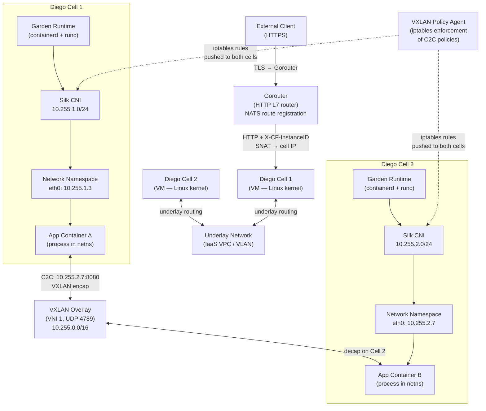

# Cloud Foundry Networking

> A 20-lesson course covering Cloud Foundry's opinionated networking stack — from Garden container primitives and Silk CNI through Gorouter, container-to-container policies, TLS certificate management, multi-tenancy isolation, and Korifi's CF-on-Kubernetes future.

---

## What Makes CF Networking Different

Kubernetes hands you a blank networking canvas: choose a CNI plugin, pick an ingress controller, design your NetworkPolicy strategy, and decide how service discovery works. Cloud Foundry makes all of those decisions for you. When you `cf push` an application, the platform provisions a VXLAN overlay address, registers an HTTP route with Gorouter, creates iptables egress rules from your Application Security Group, and wires up BOSH DNS — without a single line of YAML from the operator.

That opinionated approach is CF's core value: a developer pushes an app and it is reachable on a public route in under two minutes, with sane defaults for egress control and zero pod/node concepts to understand. The tradeoff is depth: when something breaks, or when you need to extend the platform (custom internal routes, C2C policies, TCP routing, TLS passthrough), you need to understand the layers beneath `cf push`. This book is that understanding — written for network engineers who already know Linux and TCP/IP, with explicit translations to Kubernetes equivalents throughout.

---

## CF Networking Stack

The diagram below shows how traffic flows through CF's networking layers, from an external HTTP request inbound through Gorouter down to a container on a Diego Cell, and how container-to-container (C2C) traffic travels across the Silk VXLAN overlay without ever leaving the platform.



---

## Course Tracks

| Track | Lessons | Focus |
|-------|---------|-------|
| **CF-A — Platform Foundations** | 01–04 | Platform architecture, Garden container primitives, BOSH DNS, IPAM |
| **CF-B — Overlay Networking** | 05–08 | Silk CNI and VXLAN overlay, VXLAN Policy Agent, Application Security Groups, Garden namespace deep-dive |
| **CF-C — Routing Layer** | 09–12 | Gorouter HTTP routing, TCP Router, routes and domains, service discovery |
| **CF-D — Security and Multi-Tenancy** | 13–15 | C2C network policies, TLS and certificates, Org/Space isolation |
| **CF-E — Observability** | 16–17 | Network observability and troubleshooting, logging, metrics, and performance |
| **CF-F — CF on Kubernetes** | 18–19 | Korifi architecture, CF-to-Kubernetes migration patterns |
| **CF-G — Platform Comparison** | 20 | Kubernetes vs Cloud Foundry complete network comparison |

### Full Lesson List

| # | File | Title |
|---|------|-------|
| 01 | [cf-01-platform-architecture.md](cf-01-platform-architecture.md) | CF Platform Architecture for Network Engineers |
| 02 | [cf-02-garden-container-networking.md](cf-02-garden-container-networking.md) | Garden and Container Networking Primitives |
| 03 | [cf-03-bosh-dns-service-discovery.md](cf-03-bosh-dns-service-discovery.md) | BOSH DNS and Platform Service Discovery |
| 04 | [cf-04-ipam.md](cf-04-ipam.md) | IP Address Management in Cloud Foundry |
| 05 | [cf-05-silk-cni-vxlan.md](cf-05-silk-cni-vxlan.md) | Silk CNI — CF's VXLAN Overlay |
| 06 | [cf-06-vxlan-policy-agent.md](cf-06-vxlan-policy-agent.md) | VXLAN Policy Agent — Enforcing C2C Policies |
| 07 | [cf-07-application-security-groups.md](cf-07-application-security-groups.md) | Application Security Groups — Egress Control |
| 08 | [cf-08-garden-namespaces-deep-dive.md](cf-08-garden-namespaces-deep-dive.md) | Garden Container Runtime and Network Namespaces |
| 09 | [cf-09-gorouter.md](cf-09-gorouter.md) | Gorouter — HTTP Routing Architecture |
| 10 | [cf-10-tcp-router.md](cf-10-tcp-router.md) | TCP Router — Non-HTTP Traffic Routing |
| 11 | [cf-11-routes-domains.md](cf-11-routes-domains.md) | Routes, Domains, and Route Services |
| 12 | [cf-12-service-discovery.md](cf-12-service-discovery.md) | Service Discovery Deep Dive |
| 13 | [cf-13-c2c-network-policies.md](cf-13-c2c-network-policies.md) | CF Network Policies — C2C Security Model |
| 14 | [cf-14-tls-certificates.md](cf-14-tls-certificates.md) | TLS and Certificates in CF |
| 15 | [cf-15-org-space-isolation.md](cf-15-org-space-isolation.md) | Org/Space Isolation and Multi-Tenancy Networking |
| 16 | [cf-16-observability-troubleshooting.md](cf-16-observability-troubleshooting.md) | CF Network Observability and Troubleshooting |
| 17 | [cf-17-logging-metrics-performance.md](cf-17-logging-metrics-performance.md) | CF Logging, Metrics, and Network Performance |
| 18 | [cf-18-korifi-cf-on-kubernetes.md](cf-18-korifi-cf-on-kubernetes.md) | Korifi — Cloud Foundry API on Kubernetes |
| 19 | [cf-19-cf-to-k8s-migration-patterns.md](cf-19-cf-to-k8s-migration-patterns.md) | CF-to-Kubernetes Migration Networking Patterns |
| 20 | [cf-20-cf-vs-k8s-comparison.md](cf-20-cf-vs-k8s-comparison.md) | Kubernetes vs Cloud Foundry — Complete Comparison |

---

## How to Use This Book

### Two-Terminal Practice Model

Every lesson in this course is designed for two simultaneous terminals — the same model used in the companion Kubernetes course.

```bash
# Terminal 1 — BOSH-managed VM (Diego Cell or Gorouter)
# Provides access to the Linux kernel: ip netns, iptables, brctl, tcpdump
bosh -d cf ssh diego-cell/0

# Terminal 2 — CF operator / developer machine
# Runs CF CLI, bosh CLI, and network diagnostic commands
cf apps
cf network-policies
bosh instances --details
```

Linux-layer commands (`ip netns exec`, `iptables -L`, `ss -tnp`, `tcpdump -i silk0`) run inside `bosh ssh`. CF API commands (`cf push`, `cf map-route`, `cf add-network-policy`) and BOSH commands run from your local terminal.

### Lesson Structure

Each lesson follows the same structure:

1. **Practice Setup** — exact commands to reach the right terminal and check prerequisites
2. **Concept sections** — with Mermaid diagrams and annotated packet traces where relevant
3. **K8s Engineer's Translation** callouts — explicit mappings from CF concepts to their Kubernetes equivalents
4. **Hands-on commands** — commands you run in both terminals to observe the behavior directly
5. **Troubleshooting** — common failure modes and diagnostic steps
6. **See Also** — cross-references to related CF lessons and K8s course lessons
7. **Online Resources** — curated free references for deeper study

### Navigating Between CF and Kubernetes Content

Throughout this book, callout boxes mark every major concept with its Kubernetes equivalent:

> **K8s Engineer's Translation:** CF's Silk CNI VXLAN overlay maps to Flannel's VXLAN backend or Calico's VXLAN mode. The `/24` per Diego Cell is equivalent to a per-node PodCIDR assignment. See K8s lesson 05: VXLAN and Overlay Networks.

If you are a CF engineer approaching K8s, read these callouts as a preview of what the K8s course covers. If you are a K8s engineer approaching CF, read them as anchors that let you apply what you already know.

---

## Prerequisites

This book assumes you are comfortable with Linux networking fundamentals:

- Network namespaces and veth pairs
- iptables chains and rules
- VXLAN encapsulation basics
- TCP/IP — socket states, SYN/ACK, TIME_WAIT
- DNS — resolver configuration, A/AAAA records

If any of those topics are unfamiliar, start with [K8s Lesson 01 — Linux Networking Fundamentals](../lessons/01-linux-networking-fundamentals.md) in the companion Kubernetes course. That lesson covers all prerequisites at the kernel level and takes roughly 90 minutes to complete including hands-on commands.

No prior CF knowledge is required. No Kubernetes knowledge is required to follow CF-only lessons — K8s translations are clearly marked as optional context.

---

## Quick-Start Path for Kubernetes Engineers

If you already know Kubernetes networking and want the fastest path to CF fluency, follow these five lessons in order. Each one is self-contained and explicitly maps CF primitives to K8s equivalents you already know.

| Step | Lesson | Why This One |
|------|--------|--------------|
| 1 | [Lesson 01 — CF Platform Architecture](cf-01-platform-architecture.md) | Orients you to Diego, Garden, Gorouter, and BOSH — the four components that replace K8s worker nodes, containerd, Ingress, and kubeadm |
| 2 | [Lesson 05 — Silk CNI and VXLAN Overlay](cf-05-silk-cni-vxlan.md) | Direct translation: Silk = Flannel VXLAN mode, but managed by CF; `10.255.0.0/16` = PodCIDR, `/24` per cell = per-node CIDR |
| 3 | [Lesson 09 — Gorouter HTTP Routing](cf-09-gorouter.md) | Gorouter = NGINX Ingress controller + L7 load balancer; NATS registration = Endpoints watch; Route Emitter = endpoint controller |
| 4 | [Lesson 13 — C2C Network Policies](cf-13-c2c-network-policies.md) | CF NetworkPolicy = K8s NetworkPolicy with GUID-stable selectors instead of label selectors; default-deny same as K8s when policies exist |
| 5 | [Lesson 18 — Korifi: CF API on Kubernetes](cf-18-korifi-cf-on-kubernetes.md) | The convergence point — Korifi maps `cf push` to K8s CRDs, Contour replaces Gorouter, standard NetworkPolicy replaces Silk |

After completing this path you will understand the full CF networking model and be equipped to navigate the remaining 15 lessons in any order based on your operational needs.

---

## Course Stats

| Metric | Value |
|--------|-------|
| Lessons | 20 |
| Tracks | 7 (CF-A through CF-G) |
| Mermaid diagrams | 25+ |
| K8s translation callouts | 60+ |
| Troubleshooting entries | 100+ |
| Practice commands | 200+ |

---

## See Also

- [K8s Lesson 01 — Linux Networking Fundamentals](../lessons/01-linux-networking-fundamentals.md) — prerequisites
- [K8s Lesson 05 — VXLAN and Overlay Networks](../lessons/05-vxlan-and-overlay-networks.md) — Silk CNI context
- [Migration Book — Decision Guide](../migration/mig-00-guide.md) — should you migrate your CF apps to K8s?
- [CF vs K8s Comparison](cf-20-cf-vs-k8s-comparison.md) — full side-by-side reference at the end of this book
- [Cheat Sheet: CF Routing](../cheatsheets/cs-05-cf-routing.md) — Gorouter / TCP Router / internal routes quick-reference
- [Cheat Sheet: Network Policy Comparison](../cheatsheets/cs-06-network-policy-compare.md) — K8s NetworkPolicy vs CF ASGs and C2C policies side-by-side
