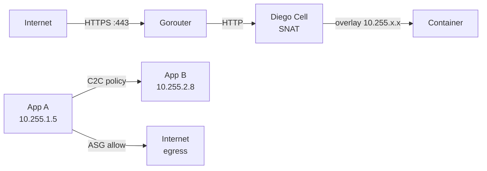
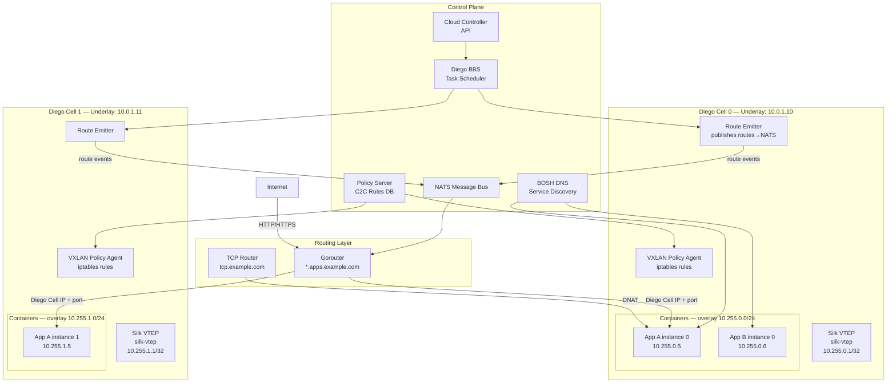
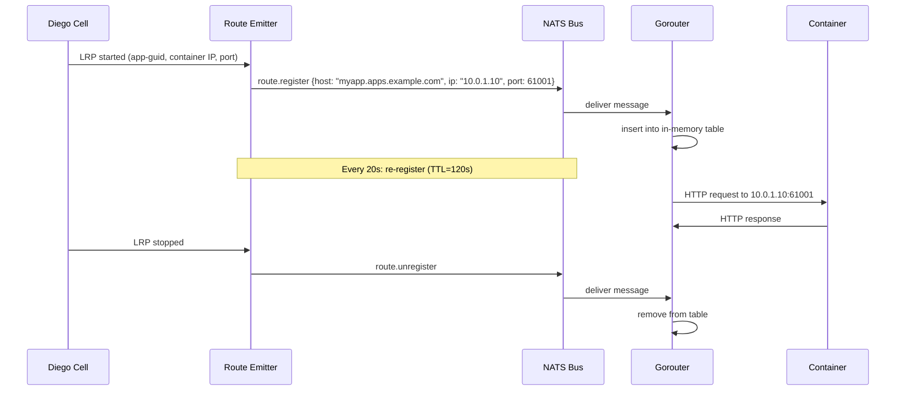

# CF-01: CF Platform Architecture for Network Engineers

**Track:** CF-A — Cloud Foundry Networking Foundations
**Level:** Intermediate
**Prerequisites:** Basic CF familiarity, Linux networking fundamentals

---

## Quick Read (10 min)

**What is CF networking, in one sentence:** Cloud Foundry is a multi-tenant PaaS where every container gets an overlay IP via Silk CNI, all inbound HTTP traffic flows through a shared Gorouter, and egress is controlled by Application Security Groups (ASGs).

**Mental model vs K8s:**

| You know (K8s) | CF equivalent |
|---|---|
| Pod | Container / App Instance |
| Node | Diego Cell |
| CNI plugin (Flannel/Calico) | Silk CNI (VXLAN overlay) |
| Ingress / Gateway | Gorouter |
| NetworkPolicy | C2C Network Policy + ASGs |
| kube-dns / CoreDNS | BOSH DNS |
| etcd | NATS (routing events only) |

**Key numbers to memorize:**

- Overlay CIDR: `10.255.0.0/16`
- Each Diego Cell: `/24` subnet (~254 containers per cell)
- Max cells in default config: 250
- Silk MTU: underlay MTU minus 50 bytes (e.g., 1500 - 50 = 1450)
- Route Emitter refresh: every 20 seconds, TTL 2 minutes
- C2C default: **deny all** (explicit policy required)

**Traffic paths:**



**What is NOT in CF that you expect from K8s:**
- No pod-to-pod DNS by IP (`10.255.x.x` is not stable across restarts)
- No NodePort/LoadBalancer — TCP Router fills that niche
- No admission webhooks — policy is enforced at iptables by VXLAN Policy Agent
- No CRDs (classic CF) — but Korifi (2026) brings CFApp, CFRoute CRDs on top of K8s

**Quick diagnostic commands:**
```bash
cf network-policies          # list all C2C policies
cf security-groups           # list ASGs
cf curl /v3/apps             # raw API
bosh ssh diego-cell/0        # get to the kernel
```

---

## Deep Dive

---

## Practice Setup

You need two terminals for every CF networking exercise. The split mirrors the K8s pattern of `kubectl` on your laptop + `minikube ssh` for kernel inspection.

**Terminal 1 — cf CLI (your laptop / Mac)**
```bash
# Install cf CLI v8
brew install cf-cli@8

# Target your foundation
cf api https://api.sys.example.com
cf login -u myuser -o my-org -s my-space

# Verify
cf target
# org:   my-org
# space: my-space

# Install CF network plugin (required for C2C policies)
cf install-plugin -r CF-Community "network-policy"
```

**Terminal 2 — BOSH SSH (Diego Cell kernel access)**
```bash
# Install BOSH CLI
brew install bosh-cli

# Set BOSH environment
export BOSH_ENVIRONMENT=https://bosh.sys.example.com
export BOSH_CA_CERT=$(cat /path/to/ca.crt)
export BOSH_CLIENT=admin
export BOSH_CLIENT_SECRET=<secret>

# List deployments
bosh deployments

# SSH into a Diego Cell
bosh -d cf ssh diego-cell/0

# Once inside the cell, switch to root
sudo su -
```

**Verify both terminals are ready:**
```bash
# Terminal 1
cf apps   # should list apps in current space

# Terminal 2 (inside diego-cell/0)
ip addr show silk-vtep   # Silk VXLAN tunnel interface
# inet 10.255.0.1/32
```

---

## 1. Diego Cell and Silk CNI Architecture

### How CF builds a container network

When `cf push` runs, the Cloud Controller schedules the app on a Diego Cell via the Diego BBS (Bulletin Board System). The Cell's Garden container runtime creates a Linux network namespace, and Silk CNI assigns it an IP from the cell's `/24` subnet.



### Silk CNI subnet allocation

Each Diego Cell is assigned a `/24` block from the `10.255.0.0/16` overlay. Cell 0 gets `10.255.0.0/24`, Cell 1 gets `10.255.1.0/24`, and so on. This gives 254 usable container IPs per cell, and supports up to 250 cells before the `/16` is exhausted (250 * 254 = 63,500 containers).

```bash
# Terminal 2 — inside diego-cell/0
# See the VTEP interface
ip addr show silk-vtep
# 2: silk-vtep: <BROADCAST,MULTICAST,UP,LOWER_UP>
#     link/ether 02:54:0a:ff:00:01 brd ff:ff:ff:ff:ff:ff
#     inet 10.255.0.1/32 scope global silk-vtep

# See the bridge connecting containers on this cell
ip addr show s-010255000000
# or
brctl show

# List running containers with their IPs
bosh -d cf ssh diego-cell/0 -- sudo /var/vcap/packages/silk/bin/silk-daemon --dump-state
```

### MTU considerations

Silk wraps packets in VXLAN: 50 bytes of overhead (outer UDP 8 + VXLAN 8 + outer IP 20 + outer Ethernet 14). If your underlay MTU is 1500, containers must use MTU 1450. If your underlay already uses jumbo frames (9000), containers can use 8950.

```bash
# Confirm MTU inside a container
cf ssh my-app -- ip link show eth0
# 7: eth0@if8: <BROADCAST,MULTICAST,UP,LOWER_UP> mtu 1450

# Confirm VTEP MTU on the cell
bosh -d cf ssh diego-cell/0 -- ip link show silk-vtep
# mtu 1450
```

> **K8s Engineer's Translation:** This is identical to Flannel's VXLAN mode. In K8s you check `ip link show flannel.1` on a node and see MTU 1450 for the same reason. The difference is that Silk assigns a whole `/24` per cell (node), whereas Flannel assigns a `/24` per node too — the topology is equivalent. Calico in VXLAN mode works identically. The key operational difference: in K8s you configure MTU in the CNI ConfigMap; in CF you set `mtu` in the `silk` BOSH job properties.

---

## 2. Gorouter: HTTP Routing Without etcd

### How route registration works

There is no etcd in CF's routing path. Instead:

1. Diego schedules an app instance on a Cell.
2. The Cell's **Route Emitter** watches the local LRP (Long-Running Process) state and publishes `route.register` NATS messages.
3. The **Gorouter** subscribes to NATS and updates its in-memory routing table.
4. Each route entry carries a TTL of **2 minutes**. Route Emitter republishes every **20 seconds** to keep entries alive.
5. When an instance is stopped, Route Emitter publishes `route.unregister`. If it crashes, routes expire after 2 minutes.



### Gorouter TLS modes

```bash
# Check current Gorouter TLS config (BOSH manifest excerpt)
bosh -d cf manifest | grep -A 20 "router:"

# Three modes:
# 1. Edge termination (default): TLS from client→Gorouter, plain HTTP inside
# 2. Passthrough (via route-service): TLS end-to-end, Gorouter does not decrypt
# 3. Full re-encrypt: Gorouter re-terminates and re-encrypts to backend

# Route integrity: Gorouter adds X-CF-RouteSignature header to verify routes
# haven't been tampered with during the NATS registration chain
```

### Sticky sessions

```bash
# Gorouter uses JSESSIONID cookie for session affinity
# If your app sets JSESSIONID, Gorouter pins subsequent requests
# to the same container

# Test: check response headers for sticky session header
curl -v https://myapp.apps.example.com/login 2>&1 | grep -i cookie
# < Set-Cookie: JSESSIONID=abc123; Path=/; Secure

# Second request with same JSESSIONID always hits same instance
curl -H "Cookie: JSESSIONID=abc123" https://myapp.apps.example.com/api
```

### WebSocket support

```bash
# Gorouter handles WebSocket upgrade natively
# No special annotation needed (unlike K8s Ingress which may need nginx.ingress.kubernetes.io/proxy-read-timeout)

# Verify WebSocket route works
wscat -c wss://myapp.apps.example.com/ws

# Check Gorouter logs for WebSocket upgrade
bosh -d cf ssh router/0 -- tail -f /var/vcap/sys/log/gorouter/access.log | grep "101 Switching"
```

> **K8s Engineer's Translation:** Gorouter = Ingress controller. NATS route registration = Kubernetes Endpoints controller watching Pod readiness and updating Ingress backends. The TTL/refresh mechanism is CF's equivalent of `readinessProbe` — if a container stops responding, its routes expire. In K8s, `kube-proxy` removes an Endpoint when the Pod fails readiness; in CF, the Route Emitter stops publishing and the TTL expires. The practical difference: K8s route removal is near-instant (probe interval); CF route removal takes up to 2 minutes if the Route Emitter crashes rather than gracefully unregisters.

---

## 3. C2C Networking and Application Security Groups

### Container-to-Container (C2C) with Silk

By default, all container-to-container traffic is **denied**. This is enforced at the iptables level on each Diego Cell by the VXLAN Policy Agent (VPA). Unlike K8s NetworkPolicy (which is enforced by the CNI plugin at the kernel level), CF's C2C policy is maintained by a userspace daemon that polls the Policy Server and translates policies into iptables rules.

```bash
# Allow App A to reach App B on port 8080 (TCP)
cf add-network-policy app-a --destination-app app-b --protocol tcp --port 8080

# Allow a port range
cf add-network-policy app-a --destination-app app-b --protocol tcp --port 8080-8090

# List all C2C policies in the current space
cf network-policies

# Output:
# Listing network policies in org my-org / space my-space as admin...
#
# source   destination   protocol   ports
# app-a    app-b         tcp        8080
# app-a    app-b         tcp        8080-8090

# Remove a policy
cf remove-network-policy app-a --destination-app app-b --protocol tcp --port 8080
```

### How the VPA enforces policy

```bash
# Terminal 2 — Diego Cell: inspect the iptables chain Silk manages
sudo iptables -L silk-firewall -n --line-numbers

# Example output showing C2C allow rule:
# Chain silk-firewall (1 references)
# num  target  prot opt source         destination
# 1    ACCEPT  tcp  --  10.255.1.0/24  10.255.0.0/24   tcp dpt:8080
# 2    DROP    all  --  0.0.0.0/0      0.0.0.0/0

# The VPA polls Policy Server every 5 seconds (configurable)
# No container restart required when policies change
```

### Application Security Groups (ASGs): Egress control

ASGs control **outbound** traffic from containers. They are allow-only rules (no deny rules — default is deny all unlisted traffic).

```bash
# View current ASGs bound to running apps in your space
cf security-groups

# View details of a specific ASG
cf security-group public-networks-egress

# Default ASGs installed by cf-deployment:
# 1. dns — allows UDP/TCP port 53 to 0.0.0.0/0
# 2. public_networks — allows all public IPs, blocks RFC1918

# Example ASG JSON (staging lifecycle)
cat > my-db-egress.json << 'EOF'
[
  {
    "protocol": "tcp",
    "destination": "10.100.50.20",
    "ports": "5432",
    "description": "Allow app to reach PostgreSQL"
  }
]
EOF

cf create-security-group my-db-egress my-db-egress.json

# Bind to a space for running apps
cf bind-security-group my-db-egress my-org my-space --lifecycle running

# Bind globally (all spaces, all orgs)
cf bind-running-security-group my-db-egress

# Since cf-deployment v20.0.0: dynamic ASG update
# No app restart required — VPA picks up changes within seconds
```

### Staging vs Running lifecycles

```bash
# Staging ASGs apply during cf push (build phase)
# Running ASGs apply to live app instances

# Example: allow package registry access only during staging
cf bind-staging-security-group npm-registry-access

# Remove staging binding
cf unbind-staging-security-group npm-registry-access

# Check effective ASGs for a running app instance
cf ssh my-app -- cat /proc/net/ip_tables_matches
# or inspect from the cell:
bosh -d cf ssh diego-cell/0 -- sudo iptables -L -n | grep -A5 "app-container-chain"
```

> **K8s Engineer's Translation:** C2C Network Policies = K8s NetworkPolicy (both are default-deny-all, both use label/GUID selectors). The key difference: K8s NetworkPolicy can restrict **both ingress and egress**; CF C2C policies restrict only **container-to-container ingress** (the destination side controls who can reach it). ASGs = K8s egress NetworkPolicy rules, but ASGs are CIDR+port based (not label-based). The polling model (VPA polls Policy Server every 5s) vs K8s (CNI watches API server via informers) means CF has slightly higher policy propagation latency — typically 5-10 seconds vs sub-second in K8s.

---

## 4. Troubleshooting CF Networking

### Common failure modes

**Failure 1: App unreachable via Gorouter (502/503)**

```bash
# Step 1: Is the route registered?
cf routes | grep my-app

# Step 2: Does the app have running instances?
cf app my-app
# check: instances column, state must be "running"

# Step 3: Check Gorouter routing table
bosh -d cf ssh router/0 -- curl -s http://localhost:8080/routes | python3 -m json.tool | grep my-app

# Step 4: Check Route Emitter logs on the cell hosting the app
bosh -d cf ssh diego-cell/0 -- tail -100 /var/vcap/sys/log/route_emitter/route_emitter.stdout.log

# Step 5: Check NATS subscription is alive
bosh -d cf ssh nats/0 -- /var/vcap/packages/gnatsd/bin/nats-sub "route.*" &
cf restart my-app   # triggers re-registration, watch NATS output
```

**Failure 2: C2C traffic blocked (app-a cannot reach app-b)**

```bash
# Step 1: Verify the policy exists
cf network-policies --source app-a

# Step 2: Confirm both apps are in the same CF deployment (C2C is intra-deployment)

# Step 3: Use cf ssh to test from inside app-a
cf ssh app-a -- curl http://app-b.apps.internal:8080/health
# If this fails: check BOSH DNS resolution first

# Step 4: Resolve app-b's overlay IP
cf ssh app-a -- nslookup app-b.apps.internal
# Should return 10.255.x.x

# Step 5: Inspect iptables on the cell running app-a
bosh -d cf ssh diego-cell/0 -- sudo iptables -L silk-firewall -nv
# Look for the ACCEPT rule matching app-b's /24

# Step 6: Packet capture on VTEP
bosh -d cf ssh diego-cell/0 -- sudo tcpdump -i silk-vtep -n host 10.255.1.5
```

**Failure 3: ASG blocking egress (app cannot reach external service)**

```bash
# Step 1: Test egress from inside the app
cf ssh my-app -- curl -v https://external-api.example.com

# Step 2: If 403/Connection refused, check ASGs
cf security-groups   # see what's bound to this space

# Step 3: Check effective iptables rules on the cell
bosh -d cf ssh diego-cell/0 -- sudo iptables -L -n | grep -A3 "netout"
# ASG rules appear in the "netout" iptables chain

# Step 4: Create a targeted ASG and bind it
cat > fix-egress.json << 'EOF'
[{"protocol": "tcp", "destination": "1.2.3.4", "ports": "443"}]
EOF
cf create-security-group fix-egress fix-egress.json
cf bind-security-group fix-egress my-org my-space --lifecycle running
# No restart needed (dynamic ASGs since cf-deployment v20.0.0)

# Step 5: Confirm dynamic update took effect (VPA re-polls in ~5s)
cf ssh my-app -- curl -v https://external-api.example.com
```

**Failure 4: MTU mismatch causing silent packet drops**

```bash
# Symptoms: large requests/responses fail, small ones succeed
# Cause: container MTU not set correctly for the underlay

# Step 1: Check container MTU
cf ssh my-app -- ip link show eth0

# Step 2: Check VTEP MTU on the cell
bosh -d cf ssh diego-cell/0 -- ip link show silk-vtep

# Step 3: Check underlay MTU
bosh -d cf ssh diego-cell/0 -- ip link show eth0

# Fix: underlay MTU - 50 = correct Silk MTU
# If underlay is 1500 → containers must use 1450
# If underlay is 9000 → containers can use 8950

# Step 4: Test with a large payload
cf ssh my-app -- curl -v --data "$(python3 -c 'print("x"*4000)')" https://echo.example.com
```

**Failure 5: BOSH DNS not resolving apps.internal**

```bash
# apps.internal is used for C2C service discovery
# Format: <app-name>.apps.internal
# Per-instance: <index>.<app-name>.apps.internal

# Step 1: Verify BOSH DNS is running on the cell
bosh -d cf ssh diego-cell/0 -- ps aux | grep bosh-dns

# Step 2: Test resolution from app
cf ssh my-app -- nslookup other-app.apps.internal
# Expected: returns overlay IP 10.255.x.x
# If NXDOMAIN: check the app is running and C2C policy exists

# Step 3: Check BOSH DNS health files
bosh -d cf ssh diego-cell/0 -- ls /var/vcap/data/bosh-dns/health/
# Health-aware DNS: unhealthy instances are removed from DNS responses

# Step 4: Specific instance addressing
cf ssh my-app -- nslookup 0.other-app.apps.internal
cf ssh my-app -- nslookup 1.other-app.apps.internal
# Useful for debugging: bypass LB and hit a specific instance
```

> **K8s Engineer's Translation:** Most CF network debugging maps directly to K8s equivalents: `cf ssh` = `kubectl exec -it`, `bosh ssh diego-cell/0` = `kubectl debug node/...` or `minikube ssh`. The iptables chain names differ (K8s uses `KUBE-*`, CF uses `silk-*`, `netout-*`) but the inspection commands are the same. BOSH DNS health awareness = K8s readiness probe integration with Endpoints — both remove unhealthy backends from DNS responses.

---

## Production Checklist

- [ ] Overlay CIDR (`10.255.0.0/16`) does not conflict with any underlay subnet or on-prem range
- [ ] Container MTU is set to underlay MTU minus 50 (verify: `ip link show silk-vtep` on each cell)
- [ ] Default ASGs (`dns`, `public_networks`) are present; custom ASGs applied per space for least-privilege egress
- [ ] C2C policies documented per application dependency map; default-deny confirmed with `cf network-policies` baseline
- [ ] Gorouter TLS mode selected intentionally (edge termination vs full re-encrypt) based on compliance requirements
- [ ] Route Emitter refresh interval (20s) and TTL (2min) accepted; if lower latency needed, tune `route_emitter.route_ttl_seconds`
- [ ] `apps.internal` DNS names used for C2C service discovery (not overlay IPs, which are not stable across restarts)
- [ ] BOSH DNS health awareness enabled (default in cf-deployment >= 15.0); apps.internal resolves to healthy instances only
- [ ] Dynamic ASG updates enabled (cf-deployment >= v20.0.0); ASG changes do not require app restarts in production
- [ ] TCP Router configured if any apps need non-HTTP TCP access; `reservable_ports` range planned and documented
- [ ] Gorouter sticky sessions (JSESSIONID) behavior documented for stateful apps; session affinity tested under instance scaling
- [ ] WebSocket apps tested through Gorouter with appropriate timeout settings
- [ ] C2C policies use app GUIDs internally (survive redeploy); verify with `cf app <name> --guid`
- [ ] Korifi migration roadmap assessed if moving to K8s-based CF (Contour replaces Gorouter; standard K8s NetworkPolicy replaces Silk+VPA)

---

## Quick Reference

### cf CLI networking commands

| Command | Purpose |
|---|---|
| `cf routes` | List all routes in org/space |
| `cf create-route SPACE apps.example.com --hostname myapp` | Create a route |
| `cf map-route APP apps.example.com --hostname myapp` | Bind route to app |
| `cf unmap-route APP apps.example.com --hostname myapp` | Unbind route from app |
| `cf network-policies` | List C2C policies |
| `cf add-network-policy SRC --destination-app DST --protocol tcp --port PORT` | Allow C2C |
| `cf remove-network-policy SRC --destination-app DST --protocol tcp --port PORT` | Revoke C2C |
| `cf security-groups` | List ASGs bound to space |
| `cf create-security-group NAME rules.json` | Create an ASG |
| `cf bind-security-group NAME ORG SPACE --lifecycle running` | Bind ASG to space |
| `cf bind-running-security-group NAME` | Bind ASG globally (all spaces) |
| `cf ssh APP` | Exec into app container |
| `cf ssh APP -- curl http://other.apps.internal:8080` | Test C2C connectivity |
| `cf curl /v3/apps` | Raw CF API call |
| `cf app APP --guid` | Get app GUID (for policy debugging) |

### BOSH commands for network inspection

| Command | Purpose |
|---|---|
| `bosh -d cf ssh diego-cell/0` | SSH to Diego Cell 0 |
| `bosh -d cf ssh router/0` | SSH to Gorouter |
| `bosh -d cf ssh nats/0` | SSH to NATS |
| `ip addr show silk-vtep` | View VTEP IP (on cell) |
| `iptables -L silk-firewall -nv` | View C2C iptables rules (on cell) |
| `iptables -L netout -nv` | View ASG egress rules (on cell) |
| `tcpdump -i silk-vtep -n` | Capture overlay traffic (on cell) |
| `curl http://localhost:8080/routes` | Dump Gorouter routing table (on router) |

### Key ports and addresses

| Component | Protocol | Port | Notes |
|---|---|---|---|
| Gorouter HTTP | TCP | 80 | Redirect to HTTPS |
| Gorouter HTTPS | TCP | 443 | Main ingress |
| Gorouter internal | TCP | 8080 | Health check, routes API |
| TCP Router | TCP | 1024-1123 | Default reservable range |
| NATS | TCP | 4222 | Route registration bus |
| Silk VXLAN | UDP | 4789 | Overlay encapsulation |
| BOSH DNS | UDP/TCP | 53 | apps.internal resolution |
| Policy Server | TCP | 4003 | C2C policy API (internal) |

### Overlay addressing quick reference

| Resource | CIDR / Value |
|---|---|
| Overlay network | `10.255.0.0/16` |
| Cell 0 subnet | `10.255.0.0/24` |
| Cell 1 subnet | `10.255.1.0/24` |
| Cell N subnet | `10.255.N.0/24` |
| Max cells | 250 (`/16` / `256` - 6 reserved) |
| Containers per cell | ~254 |
| VTEP IP on cell N | `10.255.N.1/32` |

---

## See Also

**Related K8s lessons in this course:**

- **K8s-05: CNI Deep Dive** — Flannel and Calico VXLAN mode; identical overlay mechanics to Silk CNI
- **K8s-06: NetworkPolicy** — K8s default-deny patterns that mirror CF's C2C default-deny; iptables enforcement comparison
- **K8s-07: Ingress and Gateway API** — Ingress controllers compared to Gorouter; NATS vs etcd registration; session affinity annotations
- **K8s-10: DNS and Service Discovery** — CoreDNS compared to BOSH DNS; health-aware DNS patterns; `ndots:5` chain vs CF's flat apps.internal
- **K8s-11: Troubleshooting Pod Networking** — `kubectl exec` debugging workflow maps directly to `cf ssh` patterns; iptables chain inspection

---

## Online Resources

- [CF Networking Documentation (official)](https://docs.cloudfoundry.org/concepts/understand-cf-networking.html) — C2C policies, ASGs, Silk CNI overview
- [Silk CNI GitHub repository](https://github.com/cloudfoundry/silk) — Source code, MTU configuration, VTEP implementation details
- [Gorouter Architecture](https://github.com/cloudfoundry/gorouter) — NATS registration protocol, TLS modes, routing table internals
- [cf-deployment v20.0.0 release notes](https://github.com/cloudfoundry/cf-deployment/releases/tag/v20.0.0) — Dynamic ASG update feature; no-restart policy propagation
- [Korifi documentation (CF on K8s, 2026)](https://korifi.cloudfoundry.org) — CFApp/CFRoute CRDs, Contour-based routing, K8s NetworkPolicy migration from Silk+VPA
