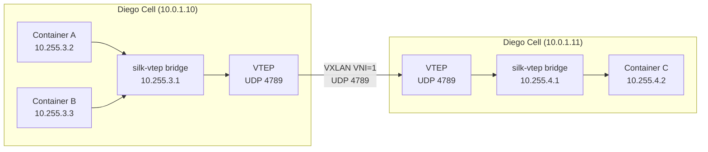
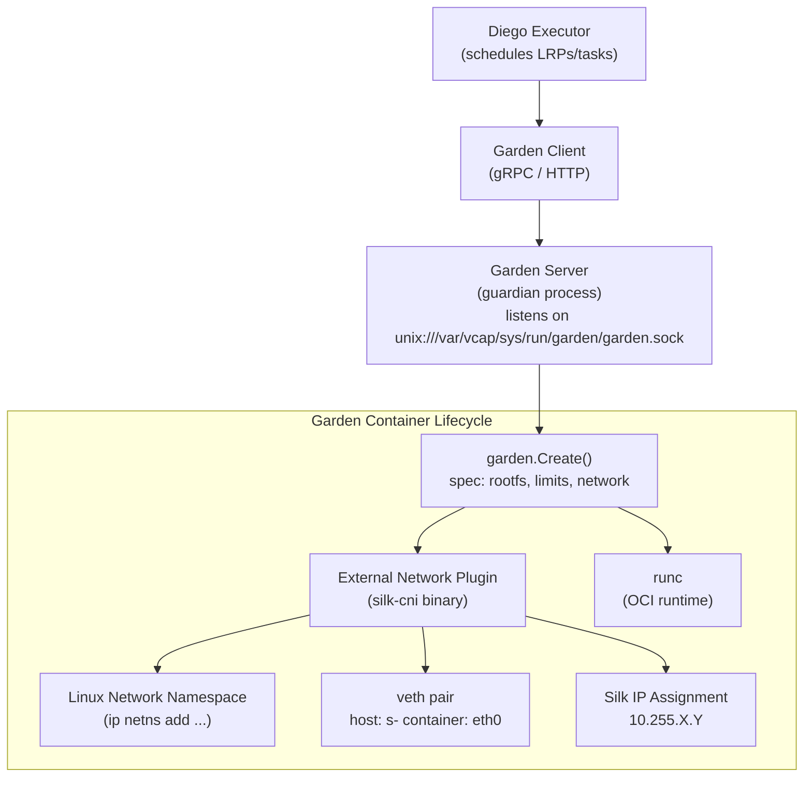
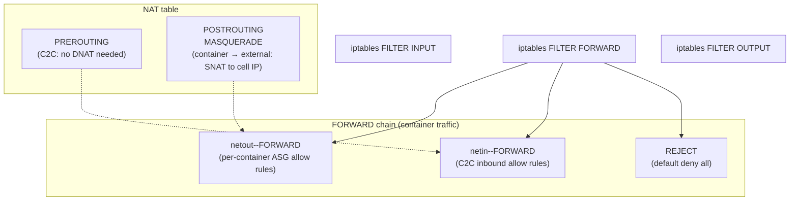

# CF-02 — Garden and Container Networking Primitives

**Track:** CF-A — Foundation  
**Prerequisite:** CF-01 (Diego Architecture) or equivalent  
**Companion K8s lessons:** Lesson 07 — CNI Deep Dive, Lesson 08 — Pod Networking Internals

**Jump to:** [Quick Read](#quick-read-10-min) · [Deep Dive](#deep-dive) · [Practice Setup](#practice-setup) · [Troubleshooting](#4-troubleshooting-garden-and-silk-networking) · [Quick Reference](#quick-reference)

---

## Quick Read (10 min)

After this lesson you will be able to: explain how Garden constructs container network namespaces using Silk CNI, and diagnose the four most common container networking failures on a Diego Cell.

**What Garden is:** CF's container runtime — a wrapper around runc + containerd that adds CF-specific lifecycle management, resource limits, and network namespace wiring. Every `cf push` creates one or more Garden containers per instance.

**Key mental model:**

- One Garden container = one Linux network namespace + veth pair + Silk IP address
- Silk CNI carves a /24 per Diego Cell from the 10.255.0.0/16 VXLAN overlay pool
- Containers talk to external traffic via SNAT (cell IP); containers talk to each other via VXLAN without SNAT
- iptables is the enforcement plane for both ASG egress rules and C2C Network Policies
- Diego Cell = the K8s Node; Garden container = the K8s Pod; Silk CNI = Calico/Flannel/Cilium

**Silk overlay at a glance:**



**Core facts — bullet form:**

- Silk VXLAN overlay: default CIDR `10.255.0.0/16`, each Diego Cell gets a `/24` (~254 containers per cell)
- Max cells in default config: 250 (limited by /24 carve-out count within /16)
- MTU: underlay MTU minus 50 bytes (VXLAN + outer IP/UDP headers); default 1454 on most IaaS
- Each container gets: network namespace, veth pair, one IP, default gateway = cell bridge IP
- SNAT: outbound external traffic is SNATed to Diego Cell IP by an iptables MASQUERADE rule
- C2C traffic: overlay end-to-end, no SNAT, identified by VXLAN tag + source/dest IP
- Garden communicates with the CNI plugin via the standard CNI binary interface (ADD/DEL/CHECK)
- `cf ssh` enters the same cgroup/namespace context as the app process

**What you will learn in the Deep Dive:** how Garden constructs network namespaces, how Silk assigns IPs and builds VXLAN FDB entries, how iptables layers interact, and how to diagnose container networking failures.

---

## Deep Dive

---

## Practice Setup

You need two terminals for every exercise in this lesson.

**Terminal 1 — cf CLI (your laptop or jumpbox)**

```bash
cf api https://api.cf.example.com --skip-ssl-validation
cf login -u admin
cf target -o myorg -s myspace
```

**Terminal 2 — BOSH SSH into a Diego Cell**

```bash
# List deployments and find Diego Cells
bosh -e my-env deployments
bosh -e my-env -d cf vms --vitals | grep diego_cell

# SSH into the first Diego Cell
bosh -e my-env -d cf ssh diego_cell/0

# Once inside the Diego Cell
sudo -i
```

> All `ip`, `iptables`, `nsenter`, and `cat /proc` commands in this lesson run inside the BOSH SSH session (Terminal 2). `cf` commands run from Terminal 1.

---

## 1. Garden Runtime Architecture

Garden is CF's container runtime layer. It sits between the Diego executor (which schedules tasks and LRPs) and the Linux kernel. Its job is to create, manage, and destroy containers with consistent resource isolation and network configuration.



> **K8s Engineer's Translation:** Garden Server is the equivalent of containerd (the container runtime daemon). The Diego Executor is analogous to the kubelet scheduling loop. The Garden "external network plugin" is wired the same way as a CNI plugin: an executable invoked with JSON on stdin, following the [CNI spec](https://github.com/containernetworking/cni/blob/main/SPEC.md). Silk-cni is literally a CNI binary.

### How Garden Creates a Container

When Diego schedules an LRP instance, it calls `garden.Create()` with a container spec. Garden orchestrates the following steps in order:

1. **Allocate a container ID** — a unique hex string used for all subsequent operations
2. **Invoke runc** to create a new PID/mount/UTS/IPC namespace using the app rootfs
3. **Call the network plugin** (`/var/vcap/packages/silk-cni/bin/silk-cni`) with `CNI_COMMAND=ADD`
4. The CNI plugin requests an IP from the Silk daemon (`/var/vcap/jobs/silk-cni/config/`) via a local HTTP API
5. CNI creates a veth pair, moves one end into the container network namespace, assigns the IP, and sets up routes
6. Garden stores the container handle → network config mapping for later use by `cf ssh`, metrics, etc.

Inspect running containers on a Diego Cell:

```bash
# Terminal 2 — Diego Cell
# List all Garden container handles
ls /var/vcap/data/garden/depot/

# Garden client CLI (garden-client binary)
/var/vcap/packages/guardian/bin/gaol -a unix:///var/vcap/sys/run/garden/garden.sock list

# Inspect a specific container's metadata
/var/vcap/packages/guardian/bin/gaol -a unix:///var/vcap/sys/run/garden/garden.sock info <container-handle>
```

Confirm the veth pairs that Garden/Silk created:

```bash
# Terminal 2 — Diego Cell
# Each s-<id> interface is one end of a veth pair attached to a container
ip link show | grep -E '^[0-9]+: s-'

# Show all veth pairs and their peers
ip link show type veth

# Map a veth to its container namespace PID
# (Garden stores PIDs in /var/vcap/data/garden/depot/<handle>/pidfile)
cat /var/vcap/data/garden/depot/<handle>/pidfile
```

---

## 2. Silk CNI and the VXLAN Overlay

Silk is CF's purpose-built CNI plugin. It implements a VXLAN overlay network where every Diego Cell is a VXLAN tunnel endpoint (VTEP). Unlike Flannel (which uses a central etcd for FDB entries), Silk uses a central **Silk Controller** that pushes subnet lease information to all cells. Each cell's Silk Daemon polls the controller and updates its local VXLAN FDB (Forwarding Database) entries.

### IP Address Allocation

```
Overlay CIDR:  10.255.0.0/16  (default, configurable)
Per-cell /24:  10.255.1.0/24, 10.255.2.0/24, ...
Container IPs: 10.255.1.2 – 10.255.1.254
Gateway (bridge): 10.255.1.1
```

The Silk Controller assigns one /24 subnet lease to each Diego Cell. The lease is stored in a database (backed by BOSH-deployed MySQL or PostgreSQL). Each container on that cell gets an IP from the cell's /24.

```bash
# Terminal 2 — Diego Cell
# Show the VTEP interface and assigned subnet
ip addr show silk-vtep

# Show the bridge that connects all containers on this cell
ip addr show s-bridge

# List all VXLAN FDB entries (one per remote Diego Cell)
bridge fdb show dev silk-vtep | grep -v permanent

# Show the routing table for the overlay
ip route show | grep 10.255

# Example output:
# 10.255.0.0/16 via 10.255.1.1 dev s-bridge
# 10.255.2.0/24 via 10.0.1.11 dev eth0 onlink   <-- remote cell reached via underlay
# 10.255.3.0/24 via 10.0.1.12 dev eth0 onlink
```

> **K8s Engineer's Translation:** Silk's per-cell /24 allocation is identical to how Flannel assigns a podCIDR per node. The VXLAN FDB management is analogous to how Calico programs routes via BGP or how Cilium uses eBPF maps to encode peer endpoints. The Silk Controller filling in FDB entries is what kube-controller-manager does when it updates node.spec.podCIDR.

### MTU Calculation

VXLAN adds an outer Ethernet (14) + IP (20) + UDP (8) + VXLAN (8) header = 50 bytes of overhead.

```
Underlay MTU (AWS default):  9001  →  Silk container MTU: 8951
Underlay MTU (standard):     1500  →  Silk container MTU: 1450
Underlay MTU (GCP default):  1460  →  Silk container MTU: 1410
```

Check the configured MTU on a running container:

```bash
# Terminal 2 — Diego Cell
# Get the PID of a container process
PID=$(cat /var/vcap/data/garden/depot/<handle>/pidfile)

# Enter the container's network namespace and check MTU
nsenter -t $PID -n -- ip link show eth0

# Or check the veth host side
ip link show s-<id> | grep mtu
```

If the MTU is misconfigured, you will see TCP retransmits and slow large-file transfers. The correct MTU is set in `cf-deployment` under `silk-cni.network.mtu` (or derived automatically if set to 0).

### Watching CNI in Action

```bash
# Terminal 2 — Diego Cell
# Tail the CNI log to watch ADD/DEL events as containers start/stop
tail -f /var/vcap/sys/log/silk-cni/cni.log

# Check the Silk daemon log for IP lease requests and FDB updates
tail -f /var/vcap/sys/log/silk-daemon/silk-daemon.stdout.log

# Show currently allocated IPs on this cell
cat /var/vcap/data/silk-daemon/store.json | python3 -m json.tool
```

---

## 3. iptables: Egress SNAT and Container Isolation

The Diego Cell iptables ruleset is where CF enforces two critical policies: **ASG egress filtering** and **container-to-container (C2C) isolation**. Understanding the chain structure is essential for troubleshooting.

### Chain Architecture



> **K8s Engineer's Translation:** CF's iptables chain structure is very similar to Calico's (CALI-INPUT, CALI-FORWARD, CALI-OUTPUT) or kube-proxy's (KUBE-FORWARD, KUBE-SERVICES). The key difference is that CF uses container GUIDs to name per-container chains at creation time, while Kubernetes uses iptables for Service load-balancing (DNAT), not primarily for pod-to-pod policy. CF's C2C policy is more analogous to Kubernetes NetworkPolicy enforced by a CNI plugin.

### Inspecting iptables Rules

```bash
# Terminal 2 — Diego Cell (must be root)

# See all FORWARD chain rules (shows per-container ASG chains)
iptables -L FORWARD -n -v --line-numbers

# List all chains (many will be named netout--<container-guid>)
iptables -L -n | grep Chain

# Inspect a specific container's egress rules
# The chain is named: netout--<first-8-chars-of-container-handle>
iptables -L netout--<container-id> -n -v

# Show NAT table POSTROUTING (SNAT/MASQUERADE rules)
iptables -t nat -L POSTROUTING -n -v

# Count packets hitting each rule (useful for traffic verification)
iptables -L FORWARD -n -v -Z   # -Z resets counters after showing
```

### Application Security Groups (ASGs)

ASGs are CF's egress firewall. Each ASG is a JSON list of allow rules (there is no explicit deny syntax — the default is deny-all outbound, and ASGs add allow rules on top).

```bash
# Terminal 1 — cf CLI

# List all ASGs
cf security-groups

# Show the rules in a specific ASG
cf security-group public_networks_egress

# Show which ASGs are bound to staging/running
cf staging-security-groups
cf running-security-groups

# Bind an ASG to a space for running apps
cf bind-security-group my-asg myorg myspace --lifecycle running

# Dynamically update an ASG (no container restart required since cf-deployment v20)
cf update-security-group my-asg updated-rules.json
```

Example ASG JSON (allow HTTPS to a specific CIDR):

```json
[
  {
    "protocol": "tcp",
    "destination": "203.0.113.0/24",
    "ports": "443",
    "description": "Allow HTTPS to example range"
  },
  {
    "protocol": "udp",
    "destination": "203.0.113.5",
    "ports": "53",
    "description": "Allow DNS to specific resolver"
  }
]
```

Default ASGs in a standard cf-deployment:

- `dns` — allows UDP/TCP port 53 to all destinations (required for apps to resolve names)
- `public_networks_egress` — allows all TCP/UDP to public IPs, **blocks** RFC1918 ranges (10.0.0.0/8, 172.16.0.0/12, 192.168.0.0/16)

> **K8s Engineer's Translation:** ASGs are CF's equivalent of Kubernetes NetworkPolicy `egress` rules — but simpler (allow-only, no label selectors, no namespace matching). They are closer to a traditional firewall ACL applied per container. The lack of deny rules means you cannot "punch a hole" to block a subset within an already-allowed range; you have to restructure the allow rules.

### C2C Policy and VXLAN Policy Agent

Container-to-container (C2C) traffic uses a different enforcement path. The **VXLAN Policy Agent** (VPA) runs on every Diego Cell and polls the **Policy Server** for active Network Policies. It then programs iptables rules that allow traffic between specific source and destination VXLAN IPs.

```bash
# Terminal 1 — cf CLI

# List all C2C policies in the current space
cf network-policies

# Allow app-frontend to reach app-backend on port 8080/tcp
cf add-network-policy app-frontend --destination-app app-backend --port 8080 --protocol tcp

# Remove a C2C policy
cf remove-network-policy app-frontend --destination-app app-backend --port 8080 --protocol tcp
```

Policies are keyed by **application GUID**, not instance IP:

```bash
# Terminal 1
# Get the GUIDs — policies survive app restarts and re-deploys
cf app app-frontend --guid
cf app app-backend --guid
```

```bash
# Terminal 2 — Diego Cell
# Check VXLAN Policy Agent logs for policy sync activity
tail -f /var/vcap/sys/log/vxlan-policy-agent/vxlan-policy-agent.stdout.log

# View the iptables chains that VPA created for C2C
# Source chains: src--<src-app-guid>
# Destination chains: dst--<dst-app-guid>
iptables -L -n | grep -E '(src--|dst--)'

# Show the actual allow rule for a C2C policy
iptables -L src--<app-guid> -n -v
```

> **K8s Engineer's Translation:** CF C2C Network Policies are identical in concept to Kubernetes NetworkPolicy: source app → destination app, protocol, port. The key operational difference is that CF uses App GUIDs (stable across deploys) where Kubernetes uses label selectors (stable only if labels are consistent). The enforcement mechanism is iptables on the same node where either the source or destination container runs — equivalent to how Calico enforces NetworkPolicy.

---

## 4. Troubleshooting Garden and Silk Networking

### Failure Mode 1 — Container Cannot Reach the Internet

**Symptoms:** App logs show connection refused or timeout on outbound calls; `cf ssh` into the app and `curl` fails.

**Diagnosis:**

```bash
# Terminal 1 — cf SSH into the failing app
cf ssh my-app

# Inside the app container
curl -v https://registry.npmjs.org/ --connect-timeout 5
ip addr show eth0           # Is there a Silk IP?
ip route show               # Is the default route set?
cat /etc/resolv.conf        # Is DNS configured?
nslookup registry.npmjs.org # Does DNS resolve?
```

```bash
# Terminal 2 — Diego Cell (check ASG rules)
# Find the container handle for the app instance
grep -r "my-app" /var/vcap/data/garden/depot/*/metadata.json 2>/dev/null | head -5

# Check its outbound iptables chain
iptables -L netout--<container-id> -n -v

# Verify SNAT rule exists
iptables -t nat -L POSTROUTING -n -v | grep MASQUERADE
```

**Common causes:**

- Missing or restrictive ASG — check `cf security-groups` and binding
- MASQUERADE rule absent — Silk daemon crash or restart; check `monit status silk-daemon`
- MTU mismatch causing TCP black hole — check `ip link show eth0` MTU inside container
- DNS blocked — check if `dns` ASG is bound: `cf running-security-groups`

### Failure Mode 2 — C2C Policy Not Working

**Symptoms:** App A cannot reach App B on internal port even after `cf add-network-policy`.

**Diagnosis:**

```bash
# Terminal 1 — verify policy exists
cf network-policies

# Get the app GUIDs
SRC_GUID=$(cf app app-frontend --guid)
DST_GUID=$(cf app app-backend --guid)
echo "Source: $SRC_GUID"
echo "Destination: $DST_GUID"
```

```bash
# Terminal 2 — Diego Cell running app-frontend
# Check if VPA has pushed rules for this policy
iptables -L src--${SRC_GUID:0:8} -n -v 2>/dev/null || echo "Chain not found — policy not synced"

# Check VPA is running and can reach Policy Server
monit status vxlan-policy-agent
tail -20 /var/vcap/sys/log/vxlan-policy-agent/vxlan-policy-agent.stdout.log | grep -i error
```

```bash
# Terminal 1 — test from app container
cf ssh app-frontend
# Inside app-frontend container — get the backend's internal IP
curl http://app-backend.apps.internal:8080/health --connect-timeout 5
```

**Common causes:**

- BOSH DNS not resolving `app-backend.apps.internal` — check `/etc/resolv.conf` in container
- VPA cannot reach Policy Server — network segmentation between Diego Cells and CF control plane
- Policy created with wrong app GUID (copied from wrong org/space)
- Destination app is in a different CF deployment — C2C is intra-deployment only

### Failure Mode 3 — New Container Has No IP

**Symptoms:** App instance starts and immediately crashes; `cf events my-app` shows "container failed to start".

**Diagnosis:**

```bash
# Terminal 2 — Diego Cell
# Check if Silk daemon is running
monit status silk-daemon
systemctl status silk.service 2>/dev/null

# Check if Silk Controller is reachable
# (replace with your Silk Controller IP from BOSH manifest)
curl http://10.0.0.5:4103/subnets

# Check CNI log for ADD errors
grep -i error /var/vcap/sys/log/silk-cni/cni.log | tail -20

# Check if the /24 subnet is exhausted (254 containers limit)
ip addr show | grep 10.255 | wc -l  # rough count of active IPs
```

```bash
# Terminal 2 — Check Silk daemon store for lease info
cat /var/vcap/data/silk-daemon/store.json | python3 -c "
import json,sys
data = json.load(sys.stdin)
print('Subnet:', data.get('subnet'))
print('MTU:', data.get('mtu'))
"
```

**Common causes:**

- Cell's /24 is exhausted (> 254 containers) — scale horizontally, add more cells
- Silk Controller database unavailable — BOSH deployment issue
- CNI binary missing or wrong permissions: `ls -la /var/vcap/packages/silk-cni/bin/`
- Silk daemon cannot write to store.json — disk full: `df -h /var/vcap/data/`

### Failure Mode 4 — VXLAN Packet Loss Between Cells

**Symptoms:** Intermittent C2C failures; large file transfers between app instances drop.

**Diagnosis:**

```bash
# Terminal 2 — Diego Cell (check VTEP and FDB)
# Verify VTEP interface is up
ip link show silk-vtep

# Check FDB entries for remote cells
bridge fdb show dev silk-vtep | grep -v permanent

# Test VXLAN reachability to a specific remote cell
# (port 4789 is VXLAN default)
nc -vzu 10.0.1.11 4789 2>&1  # or use nmap

# Check if VXLAN port is blocked by IaaS security groups
# AWS: check EC2 security groups for inbound UDP 4789
# GCP: check VPC firewall rules for udp:4789
```

```bash
# Terminal 2 — Monitor VXLAN traffic with tcpdump
# Filter for VXLAN (UDP port 4789)
tcpdump -i eth0 -n 'udp port 4789' -c 50

# Decode inner VXLAN payload
tcpdump -i eth0 -n -X 'udp port 4789' -c 10
```

**Common causes:**

- IaaS security group blocking UDP 4789 between Diego Cells
- MTU mismatch causing fragmentation (Silk MTU not accounting for encapsulation overhead). In a PCI-DSS cardholder data environment, MTU fragmentation is a recurring audit finding: a misconfigured Silk MTU can cause TCP sessions carrying card-present transaction data to silently drop, breaking the payment flow in ways that are difficult to attribute without packet-level evidence from `tcpdump` on the VTEP interface.
- Silk daemon on one cell has stale FDB entries — restart silk-daemon
- Underlay network asymmetric routing causing VXLAN packets to drop

---

## Production Checklist

- [ ] Verify Silk overlay CIDR does not overlap with any underlay subnet or external service CIDR
- [ ] Confirm MTU is set correctly: underlay MTU - 50 bytes (check at both cell and container level)
- [ ] Ensure IaaS security groups allow UDP 4789 between all Diego Cell IPs
- [ ] Validate that the `dns` ASG is bound to running apps (required for name resolution)
- [ ] Review `public_networks_egress` ASG to confirm RFC1918 blocking is intentional for your environment
- [ ] Size Diego Cells to stay below 200 containers/cell (reserve headroom below the 254 limit)
- [ ] Monitor Silk Controller database availability — lease failures cause container start failures
- [ ] Enable dynamic ASG update (requires cf-deployment v20.0.0+) to avoid container restarts for policy changes
- [ ] Use `cf network-policies` audit regularly; policies are GUID-based and survive redeploys
- [ ] Test C2C connectivity via `apps.internal` DNS after every major platform upgrade
- [ ] Confirm VXLAN Policy Agent sync interval and Policy Server health in platform monitoring
- [ ] Review per-container iptables chain count on Diego Cells — very high container churn can cause iptables contention

---

## Quick Reference

| Task | Command |
|------|---------|
| List Garden containers on a cell | `/var/vcap/packages/guardian/bin/gaol -a unix:///var/vcap/sys/run/garden/garden.sock list` |
| Show container network namespaces | `ip link show type veth` |
| Enter a container network namespace | `nsenter -t $(cat /var/vcap/data/garden/depot/<handle>/pidfile) -n -- bash` |
| Show Silk overlay routes | `ip route show \| grep 10.255` |
| Show VXLAN FDB entries | `bridge fdb show dev silk-vtep` |
| Check VTEP interface | `ip addr show silk-vtep` |
| List ASGs | `cf security-groups` |
| Show ASG rules | `cf security-group <name>` |
| Bind ASG to space | `cf bind-security-group <asg> <org> <space> --lifecycle running` |
| Update ASG without restart | `cf update-security-group <asg> rules.json` |
| List C2C policies | `cf network-policies` |
| Add C2C policy | `cf add-network-policy <src> --destination-app <dst> --port <p> --protocol tcp` |
| Remove C2C policy | `cf remove-network-policy <src> --destination-app <dst> --port <p> --protocol tcp` |
| Check container iptables chain | `iptables -L netout--<container-id> -n -v` |
| Check C2C iptables chain | `iptables -L src--<app-guid-prefix> -n -v` |
| Show SNAT rules | `iptables -t nat -L POSTROUTING -n -v` |
| Check Silk daemon status | `monit status silk-daemon` |
| Tail CNI log | `tail -f /var/vcap/sys/log/silk-cni/cni.log` |
| Tail VPA log | `tail -f /var/vcap/sys/log/vxlan-policy-agent/vxlan-policy-agent.stdout.log` |
| Check Silk store | `cat /var/vcap/data/silk-daemon/store.json \| python3 -m json.tool` |
| Capture VXLAN traffic | `tcpdump -i eth0 -n 'udp port 4789' -c 50` |
| SSH into app container | `cf ssh <app-name>` |
| SSH to specific instance | `cf ssh <app-name> -i 2` |

---

## Check Your Understanding

1. A Garden container on a Diego Cell with a /24 subnet has been assigned IP `10.255.7.45`. What is the IP of the bridge gateway for that container, and how many containers can share the same cell before the subnet is exhausted?
2. After running `cf add-network-policy app-a --destination-app app-b --port 9000 --protocol tcp`, app-a still cannot reach app-b. You confirm the policy appears in `cf network-policies`. What two components would you check on the Diego Cell, and what log file would you inspect first?
3. Silk VXLAN encapsulation adds 50 bytes of overhead. If the IaaS underlay MTU is 1500 bytes and the Silk container MTU is left at 1500, what failure symptom would you observe and which command inside a container confirms the misconfiguration?
4. A new app instance crashes immediately with "container failed to start". The Silk daemon is running and the CNI log shows no errors, but `ip addr show | grep 10.255 | wc -l` returns 255 on the Diego Cell. What is the most likely cause and what is the remediation?
5. An ASG named `allow-db` permits TCP port 5432 to `203.0.113.0/24`. An app bound to that ASG still cannot reach a PostgreSQL instance at `203.0.113.10`. Name two distinct causes unrelated to the ASG rules themselves that you would rule out first using `cf ssh`.

---

## See Also

**Kubernetes lessons in this course that map to CF concepts covered here:**

- **Lesson 07 — CNI Deep Dive:** The CNI binary interface that Silk uses is identical to the standard described here. Silk-cni follows CNI spec v0.4; the ADD/DEL/CHECK flow is the same as Calico or Cilium.
- **Lesson 08 — Pod Networking Internals:** The veth pair + bridge + network namespace construction that Garden/Silk performs is structurally identical to what kubelet + CNI do for pods. The iptables MASQUERADE SNAT for external traffic is the same pattern.
- **Lesson 09 — NetworkPolicy:** CF C2C policies are CF's implementation of the same concept. Compare iptables chain structure between Calico (CALI-\* chains) and Silk (netout--, src--, dst-- chains).
- **Lesson 11 — Overlay Networks and VXLAN:** The VXLAN FDB management and VTEP architecture described here matches the general VXLAN overlay concepts. Silk's controller-based FDB population vs. Flannel's etcd-based approach is a useful comparison point.
- **Lesson 14 — Troubleshooting Pod Networking:** The diagnostic workflow (`nsenter`, `tcpdump`, `iptables -L`, route inspection) is identical. CF adds the Garden depot path as the way to find container PIDs.

---

## Online Resources

- [CF Networking Release GitHub (cloudfoundry/cf-networking-release)](https://github.com/cloudfoundry/cf-networking-release) — Source code for Silk CNI, VXLAN Policy Agent, and Policy Server. The `docs/` directory has architecture diagrams and config references.
- [CF App Container Networking Docs](https://docs.cloudfoundry.org/concepts/understand-cf-networking.html) — Official CF documentation covering the overlay network, C2C policies, and ASGs.
- [Application Security Groups Reference](https://docs.cloudfoundry.org/concepts/asg.html) — Complete ASG JSON schema, default ASG behavior, staging vs. running lifecycle, and dynamic update instructions.
- [Garden-runC GitHub (cloudfoundry/guardian)](https://github.com/cloudfoundry/guardian) — Garden server (guardian) source; useful for understanding container lifecycle hooks and how the external network plugin interface works.
- [CNI Specification v1.0](https://github.com/containernetworking/cni/blob/main/SPEC.md) — The spec that Silk implements; reading this makes the ADD/DEL/CHECK flow and the JSON structures in Silk logs immediately legible.
