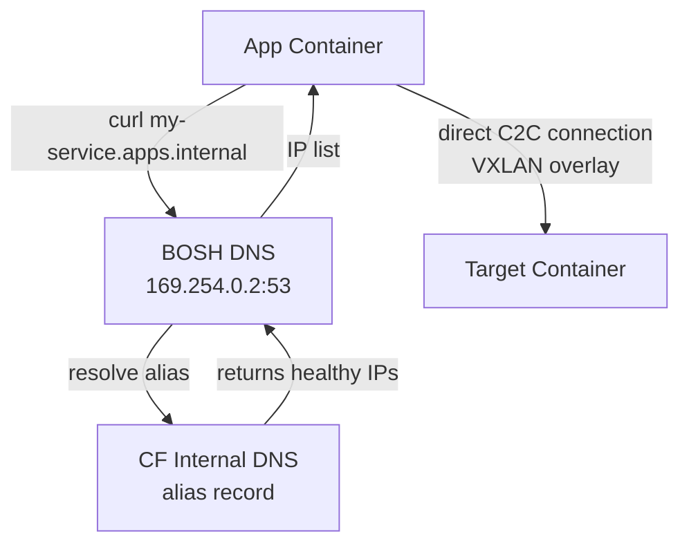
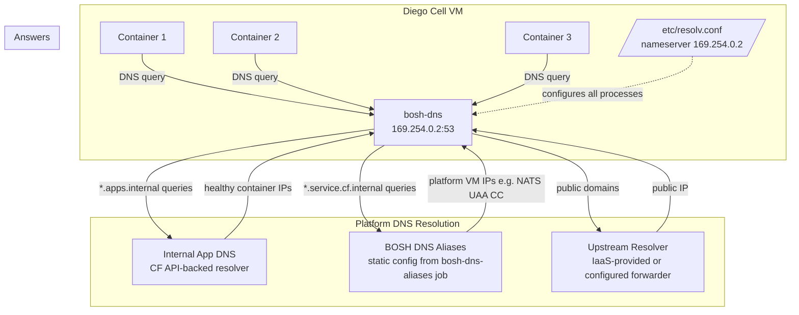
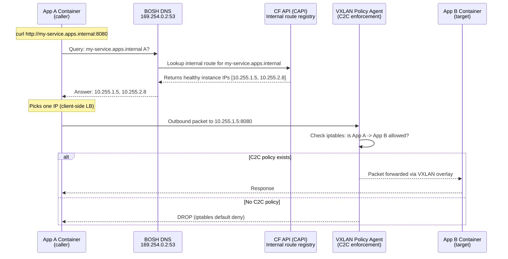

# BOSH DNS and Platform Service Discovery

**Track:** CF-A | **Lesson:** CF-03 | **Prerequisites:** CF-01 (Overlay Networking), CF-02 (Gorouter and Traffic Flow)

**Jump to:** [Theory](#1-bosh-dns-architecture) · [Practice](#practice-setup) · [Troubleshooting](#4-troubleshooting-bosh-dns-and-service-discovery) · [Quick Reference](#quick-reference)

---

## Quick Read (10 min)

After this lesson you will be able to: explain how BOSH DNS resolves both platform component addresses and app-to-app addresses, and diagnose the most common `apps.internal` failures using `dig` and CF CLI commands.

**Core mental model:** BOSH DNS is CF's internal DNS system. It is health-aware, runs on every VM, and resolves both platform component addresses and app-to-app addresses. The `apps.internal` domain is the namespace for container-to-container service discovery.

**Key facts:**

- BOSH DNS agent (`bosh-dns`) runs as a system process on every BOSH-managed VM, including Diego Cells
- Listening on `169.254.0.2:53` — a link-local address, not `127.0.0.1`
- All `/etc/resolv.conf` on BOSH VMs point to `169.254.0.2` as the nameserver
- `apps.internal` zone is served by an internal DNS alias record backed by the CF API (via BOSH DNS Aliases)
- Each app instance gets a DNS entry: `<index>.<hostname>.apps.internal` (e.g., `0.my-app.apps.internal`)
- The bare hostname `my-app.apps.internal` returns ALL healthy instance IPs — client-side load balancing
- No `ndots:5` search chain (unlike Kubernetes); queries are authoritative and direct
- BOSH DNS handles health checks natively; unhealthy instances are removed from DNS responses automatically

**When to use `apps.internal` vs Gorouter:**

| Use case | Mechanism |
|---|---|
| App calls another app (C2C) | `apps.internal` + C2C network policy |
| External clients reach app | Gorouter via `*.cfapps.io` or custom domain |
| Platform component communication | BOSH DNS alias (e.g., `nats.service.cf.internal`) |
| TCP non-HTTP traffic | TCP Router + `apps.internal` |



**Quick diagnostics:**

```bash
# From bosh ssh on a Diego Cell
dig @169.254.0.2 my-app.apps.internal
nslookup 0.my-app.apps.internal 169.254.0.2
```

---

## Deep Dive

---

## Practice Setup

You need two terminals for this lesson.

**Terminal 1 — CF CLI (Mac/local)**

```bash
# Confirm you are targeted to the right foundation
cf target
cf apps

# Map an internal route to your app (required for apps.internal DNS)
cf map-route my-app apps.internal --hostname my-app

# Verify internal route is registered
cf routes | grep apps.internal
```

**Terminal 2 — BOSH SSH (Diego Cell)**

```bash
# SSH to a Diego Cell to inspect BOSH DNS directly
bosh -e my-env -d cf ssh diego-cell/0

# Once inside the cell, check DNS config
cat /etc/resolv.conf
# Should show: nameserver 169.254.0.2

# Verify bosh-dns process is running
sudo monit summary | grep bosh-dns
ps aux | grep bosh-dns
```

> **Note:** The `bosh` CLI must be authenticated and targeted to your BOSH director. If you only have `cf` access, the `cf ssh` command gets you into an app container where you can still run `dig` and `curl` to validate DNS resolution.

---

## 1. BOSH DNS Architecture

BOSH DNS is a distributed, health-aware DNS system built into the BOSH runtime. It is not an optional component — every BOSH-managed deployment uses it, including CF itself.

### How BOSH DNS works at the platform level

BOSH DNS consists of two main components:

1. **`bosh-dns` process** — runs on every BOSH VM, listens on `169.254.0.2:53`. It handles all DNS queries originating from that VM (and containers on it).
2. **`bosh-dns-aliases`** — a BOSH release job that pushes zone/alias configuration into the local `bosh-dns` instance. This is how CF registers names like `nats.service.cf.internal`.



### The link-local address `169.254.0.2`

This address is intentional and significant. Using a link-local address (`169.254.0.0/16`) means:

- It is never routable across network boundaries — queries cannot accidentally leak to external resolvers
- It is available on every network interface without IP collision risk with app subnets
- Containers spawned by Garden on the Diego Cell inherit the host's `/etc/resolv.conf`, so they automatically use the BOSH DNS agent

**Verify on a Diego Cell:**

```bash
# Check the listening address
ss -ulnp | grep :53
# or
netstat -ulnp | grep :53
# Expected: udp  0  0  169.254.0.2:53  ...  bosh-dns

# Check /etc/resolv.conf
cat /etc/resolv.conf
# nameserver 169.254.0.2
# search ...
```

> **K8s Engineer's Translation:** In Kubernetes, CoreDNS runs as a Deployment/DaemonSet in `kube-system`, typically at `ClusterIP` `10.96.0.10` (or similar). Every pod gets `/etc/resolv.conf` with `nameserver 10.96.0.10` injected by kubelet. BOSH DNS is conceptually identical — a cluster-wide DNS agent — but it runs as a host process on the VM rather than as a pod, and uses a link-local IP instead of a ClusterIP. The health-awareness feature in BOSH DNS is equivalent to what Kubernetes achieves by removing endpoints from Service when readiness probes fail.

### BOSH DNS Aliases — platform service discovery

CF platform components (NATS, UAA, Cloud Controller, Credhub, etc.) register themselves via BOSH DNS Aliases. These are static records pushed to `bosh-dns` by the `bosh-dns-aliases` BOSH release job.

Example alias configuration (from a BOSH manifest or ops file):

```yaml
# bosh-dns-aliases job configuration
aliases:
- domain: nats.service.cf.internal
  targets:
  - query: '*'
    instance_group: nats
    deployment: cf
    network: default
    domain: bosh
- domain: uaa.service.cf.internal
  targets:
  - query: '*'
    instance_group: uaa
    deployment: cf
    network: default
    domain: bosh
```

**Check platform aliases from a Diego Cell:**

```bash
# From bosh ssh on any BOSH VM
dig @169.254.0.2 nats.service.cf.internal
dig @169.254.0.2 uaa.service.cf.internal
dig @169.254.0.2 cloud-controller.service.cf.internal

# BOSH DNS native resolution (uses .bosh suffix — resolved by BOSH director)
dig @169.254.0.2 diego-cell.cf.bosh
```

---

## 2. App Service Discovery with `apps.internal`

The `apps.internal` domain is the user-facing service discovery mechanism for CF applications. It allows one CF app to discover and connect to another CF app by name, without going through the Gorouter.

### How `apps.internal` works end-to-end



### Registering an internal route

Internal routes are created with the `apps.internal` domain. This is a special shared domain in CF that does not go through the Gorouter for external traffic — it only exists in the BOSH DNS system.

```bash
# Step 1: Create an internal route for your app
cf map-route my-service-app apps.internal --hostname my-service

# Step 2: Verify the route exists
cf routes
# Shows: my-service.apps.internal  (no port for HTTP)

# Step 3: Add C2C network policy so the calling app can reach it
cf add-network-policy my-caller-app my-service-app --protocol tcp --port 8080

# Step 4: From inside my-caller-app container, test DNS
cf ssh my-caller-app
# Inside container:
dig my-service.apps.internal
curl http://my-service.apps.internal:8080/health
```

### Per-instance DNS records

Every app instance gets an individual DNS record using the index prefix format:

```
<instance-index>.<hostname>.apps.internal
```

For example, if `my-service` has 3 instances:

| Record | IP |
|---|---|
| `my-service.apps.internal` | All 3 healthy IPs (round-robin / client chooses) |
| `0.my-service.apps.internal` | Instance 0 IP only |
| `1.my-service.apps.internal` | Instance 1 IP only |
| `2.my-service.apps.internal` | Instance 2 IP only |

This is essential for stateful apps that need to target a specific instance (databases, leader election).

```bash
# From inside any container on the same CF foundation
# (requires C2C policy for actual connections, but DNS works without policy)

# Resolve all instances
dig my-service.apps.internal
# Returns: 10.255.1.5, 10.255.2.8, 10.255.0.12

# Resolve specific instance
dig 0.my-service.apps.internal
# Returns: 10.255.1.5

dig 1.my-service.apps.internal
# Returns: 10.255.2.8

# Check how many instances are currently healthy
dig my-service.apps.internal | grep -c "IN A"
```

> **K8s Engineer's Translation:** In Kubernetes, a headless Service (`clusterIP: None`) returns all pod IPs via DNS. Individual pods are addressable as `<pod-name>.<service-name>.<namespace>.svc.cluster.local` in a StatefulSet. CF's `<index>.<hostname>.apps.internal` is exactly the headless Service + StatefulSet DNS pattern. The key difference: Kubernetes services have a stable ClusterIP option for virtual IP load balancing; CF has no virtual IP — it is always DNS-based, always client-side load balancing.

### No `ndots:5` search chain

Kubernetes pods have this in `/etc/resolv.conf`:

```
search default.svc.cluster.local svc.cluster.local cluster.local
options ndots:5
```

This means a query for `my-service` triggers 5 search domain appends before falling through to a fully qualified lookup. This causes latency on the first query to any external domain.

CF containers have a much simpler configuration:

```
nameserver 169.254.0.2
```

No `search` domains, no `ndots` option. Every query to `apps.internal` must be fully qualified (`my-service.apps.internal`) — but this also means no search chain penalty on external lookups.

```bash
# From inside a CF app container
cat /etc/resolv.conf
# nameserver 169.254.0.2
# (no search, no ndots)

# This WORKS (fully qualified)
curl http://my-service.apps.internal:8080

# This does NOT work (not fully qualified, no search chain)
curl http://my-service:8080
```

---

## 3. Health Awareness and DNS-Based Load Balancing

BOSH DNS is not a passive registry. It actively monitors instance health and removes unhealthy instances from DNS responses. This is a core differentiator from simpler DNS systems.

### Health check integration

BOSH DNS integrates with the BOSH agent's health system. Each BOSH VM reports its health status. The local `bosh-dns` instance knows which instances in the alias records are healthy and which are not.

For `apps.internal`, health awareness is provided through the Route Emitter and CAPI integration:

- The Diego Route Emitter on each Cell monitors container health checks (defined in the app manifest or push flags)
- When a container fails its health check, the Route Emitter deregisters it from internal routes
- The CF API updates the internal DNS record accordingly
- BOSH DNS stops returning that container's IP

```bash
# Simulate checking health-aware behavior

# Scale your app to 3 instances
cf scale my-service-app -i 3

# Watch DNS responses as you crash one instance
watch -n 2 'dig @169.254.0.2 my-service.apps.internal +short'

# In another terminal, crash instance 1
cf ssh my-service-app -i 1 -c "kill -9 1"

# After ~20s, DNS should return only 2 IPs
# (Route Emitter refresh interval is 20 seconds)
```

### Route Emitter refresh and TTL

The DNS health state has timing implications:

| Event | Timing |
|---|---|
| Route Emitter refresh interval | Every 20 seconds |
| Route TTL (how long Gorouter/DNS holds a registration) | 2 minutes |
| Unhealthy container removed from DNS | Within ~20s |
| Restarted container added to DNS | Within ~20s of passing health check |

For `apps.internal` DNS, the client should not cache DNS responses aggressively. The TTL returned by BOSH DNS for `apps.internal` records is typically low (60s or less) to allow rapid health changes to propagate.

```bash
# Check TTL in DNS response
dig my-service.apps.internal
# Look at the TTL field in the ANSWER SECTION
# Example: my-service.apps.internal.  60  IN  A  10.255.1.5
#                                      ^^
#                                      TTL in seconds
```

### Client-side load balancing patterns

Since `apps.internal` returns multiple IPs and there is no virtual IP, clients must implement their own load balancing. Common patterns:

**Simple round-robin via repeated DNS queries (not recommended — relies on DNS TTL cycling):**

```bash
# Not reliable — DNS caching varies by client library
for i in $(seq 1 5); do
  curl -s http://my-service.apps.internal:8080/instance-id
done
```

**Explicit instance targeting for active-passive failover:**

```bash
# Try instance 0 first, fall back to instance 1
PRIMARY_IP=$(dig +short 0.my-service.apps.internal @169.254.0.2 | head -1)
FALLBACK_IP=$(dig +short 1.my-service.apps.internal @169.254.0.2 | head -1)

curl --connect-timeout 2 "http://${PRIMARY_IP}:8080" || \
  curl "http://${FALLBACK_IP}:8080"
```

**Service mesh or sidecar proxy (Envoy, linkerd):**

For production workloads requiring true load balancing and retry logic, apps can run a sidecar proxy. The sidecar queries `apps.internal`, maintains a connection pool to all healthy instances, and load-balances across them. This is the pattern used before CF adopted native service mesh features.

> **K8s Engineer's Translation:** This is identical to how headless Services work in Kubernetes. A Deployment with 3 pods behind a headless Service returns all 3 pod IPs from DNS. If you need proper load balancing beyond DNS round-robin, you either use a standard ClusterIP Service (kube-proxy handles LB) or a service mesh (Istio/Linkerd with Envoy sidecar). In CF the equivalent path is: basic use = `apps.internal` DNS, production use = `apps.internal` DNS + sidecar proxy or CF service mesh feature.

---

## 4. Troubleshooting BOSH DNS and Service Discovery

### Common failure modes

| Symptom | Root cause | Fix |
|---|---|---|
| `dig my-service.apps.internal` returns `NXDOMAIN` | Internal route not mapped, or app is not running/healthy | Run `cf map-route my-service-app apps.internal --hostname my-service`; confirm `cf app my-service-app` shows state `running` |
| DNS resolves an IP but `curl` hangs or connection is refused | C2C network policy missing between caller and target | Run `cf add-network-policy my-caller-app my-service-app --protocol tcp --port 8080` |
| All `apps.internal` DNS queries fail from containers on a Diego Cell | `bosh-dns` process is not running on that Cell | SSH to the Cell with `bosh ssh`, run `sudo monit restart bosh-dns`, verify with `dig @169.254.0.2 nats.service.cf.internal` |
| DNS returns IPs that are no longer reachable after `cf push` | Client is caching stale IPs beyond the DNS TTL; Route Emitter has not propagated new IPs yet | Wait up to 20 seconds for Route Emitter refresh; ensure app runtimes re-resolve DNS every 60 seconds or less |
| `curl http://my-service.apps.internal:80` returns connection refused | Wrong port — CF apps listen on `$PORT` (default 8080), not port 80 | Use port 8080: `curl http://my-service.apps.internal:8080` |

> **Banking scenario:** In a retail banking platform running payment microservices on CF, a `cf push` of the account-balance service caused the transaction-history service to return errors for up to 90 seconds after deployment. The root cause was that the transaction-history service's HTTP client cached DNS responses for 5 minutes, far exceeding the 60-second `apps.internal` TTL. After the push, the client continued connecting to the old container IP, which had already been released. The fix was to configure the HTTP connection pool to re-resolve DNS every 30 seconds, bringing stale-IP errors to zero on subsequent deployments.

### Diagnostic command cheatsheet

```bash
# --- From Mac / cf CLI ---

# List all internal routes
cf routes | grep apps.internal

# Check if an app has an internal route
cf routes --orglevel | grep my-app | grep apps.internal

# List all C2C network policies
cf network-policies

# Check app health and instances
cf app my-service-app

# View recent app events (crashes, health check failures)
cf events my-service-app

# --- From inside an app container (cf ssh) ---

# Test DNS resolution
dig @169.254.0.2 my-service.apps.internal
dig @169.254.0.2 0.my-service.apps.internal

# Test DNS without specifying resolver (uses /etc/resolv.conf)
nslookup my-service.apps.internal

# Test HTTP connectivity
curl -v http://my-service.apps.internal:8080/health

# Check resolv.conf
cat /etc/resolv.conf

# --- From bosh ssh on Diego Cell ---

# Check bosh-dns health
sudo monit summary | grep bosh-dns

# Resolve platform service names
dig @169.254.0.2 nats.service.cf.internal
dig @169.254.0.2 uaa.service.cf.internal
dig @169.254.0.2 cloud-controller.service.cf.internal

# Check bosh-dns configuration files
ls /var/vcap/jobs/bosh-dns/
cat /var/vcap/jobs/bosh-dns/config/bosh-dns.json

# Check alias configuration
ls /var/vcap/jobs/bosh-dns-aliases/ 2>/dev/null || \
  ls /var/vcap/data/dns/aliases/

# View bosh-dns logs
sudo tail -f /var/vcap/sys/log/bosh-dns/bosh-dns.stdout.log
```

---

## Production Checklist

- Every app that needs to be discoverable via `apps.internal` has an explicit `cf map-route` to the `apps.internal` domain
- Callers have explicit `cf add-network-policy` for each target app, protocol, and port — no wildcard policies
- Application health checks are configured and passing before marking service as ready
- Callers do not cache `apps.internal` DNS responses longer than the DNS TTL (do not set aggressive DNS cache TTLs in app runtimes)
- Stateful apps use per-instance DNS records (`<index>.<hostname>.apps.internal`) when pinning to a specific instance is required
- Internal routes are unmapped (`cf unmap-route`) for apps that should not be reachable via C2C after decommission
- C2C policies are reviewed periodically — `cf network-policies` should not have stale policies for deleted apps
- Apps that perform DNS lookups in connection pools recycle connections or re-resolve periodically (every 60s or less) to handle IP changes after `cf push`
- For services that require true load balancing (not DNS round-robin), a sidecar proxy or CF service mesh is in use
- BOSH DNS health is monitored via BOSH CPI health metrics or `monit summary` on Diego Cells

---

## Quick Reference

| Task | Command |
|---|---|
| Map internal route | `cf map-route APP apps.internal --hostname HOSTNAME` |
| Unmap internal route | `cf unmap-route APP apps.internal --hostname HOSTNAME` |
| List all routes | `cf routes` |
| List routes in org | `cf routes --orglevel` |
| Add C2C policy | `cf add-network-policy CALLER TARGET --protocol tcp --port PORT` |
| Remove C2C policy | `cf remove-network-policy CALLER TARGET --protocol tcp --port PORT` |
| List C2C policies | `cf network-policies` |
| SSH into app container | `cf ssh APP` |
| SSH into specific instance | `cf ssh APP -i INDEX` |
| DNS query from container | `dig @169.254.0.2 HOSTNAME.apps.internal` |
| Per-instance DNS query | `dig @169.254.0.2 INDEX.HOSTNAME.apps.internal` |
| Check app instances/IPs | `cf app APP` |
| Check app health check | `cf curl /v3/apps/$(cf app APP --guid)/processes/web` |
| Check Route Emitter (Diego) | `bosh -d cf logs diego-cell/0 --job route_emitter` |
| Check bosh-dns health | `sudo monit summary \| grep bosh-dns` (from bosh ssh) |
| Resolve platform alias | `dig @169.254.0.2 nats.service.cf.internal` |

---

## Check Your Understanding

1. What IP address does BOSH DNS listen on, and why is a link-local address used instead of `127.0.0.1`?
2. You run `dig my-service.apps.internal` from inside a CF app container and receive `NXDOMAIN`. List two distinct causes you would check first and the command to verify each.
3. An app resolves `my-service.apps.internal` and receives a valid IP, but `curl` to that IP on port 8080 times out. What is the most likely cause, and how do you fix it?
4. How does CF's per-instance DNS record format (`0.my-service.apps.internal`) compare to StatefulSet pod DNS in Kubernetes, and in what scenario would you use it?
5. A client app caches DNS responses for 5 minutes. After a `cf push` of the target service, the client experiences errors for up to 5 minutes. Explain the mechanism and the recommended remediation.

---

## See Also

| CF Concept | Kubernetes Equivalent Lesson |
|---|---|
| BOSH DNS agent on each VM | CoreDNS as a cluster add-on — see **Kubernetes DNS and Service Discovery** (Track K8s-C) |
| `apps.internal` headless DNS | Headless Services and StatefulSet DNS — see **Kubernetes Services In Depth** |
| Health-aware DNS removal | Endpoint slices and readiness probe integration — see **Kubernetes Health Checks and Probes** |
| Client-side load balancing via DNS | Kubernetes DNS round-robin vs kube-proxy ClusterIP — see **Kubernetes Service Load Balancing** |
| C2C network policy required for DNS-resolved IPs | NetworkPolicy (pod-to-pod) — see **Kubernetes Network Policy** (Track K8s-E) |
| BOSH DNS aliases for platform components | Kubernetes Service ClusterDNS for in-cluster services — see **CoreDNS Configuration and Customization** |

---

## Online Resources

- [CF App Service Discovery — official documentation](https://docs.cloudfoundry.org/devguide/deploy-apps/cf-networking.html#service-discovery)
- [BOSH DNS release — GitHub source and configuration reference](https://github.com/cloudfoundry/bosh-dns-release)
- [CF Networking release — Silk CNI and service discovery internals](https://github.com/cloudfoundry/cf-networking-release)
- [Diego Route Emitter design — how routes are registered and refreshed](https://github.com/cloudfoundry/diego-release/blob/master/docs/route-emitter.md)
- [CF C2C Networking policy documentation](https://docs.cloudfoundry.org/concepts/understand-cf-networking.html)
