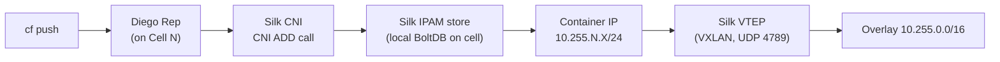
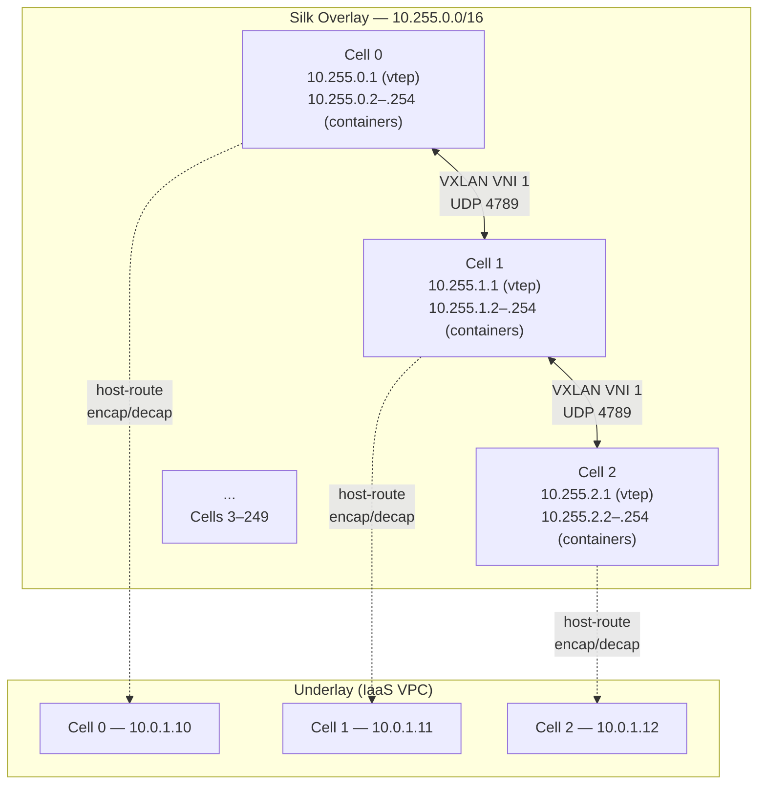

# CF-04: IP Address Management in Cloud Foundry

> **Track CF-A** | Prerequisites: CF-01 (Garden), CF-02 (Silk CNI), CF-03 (Diego Cell networking)

---

## Quick Read (10 min)

**The essential mental model in under 60 lines.**

### Key Facts

- Silk CNI owns all container IP allocation — no external IPAM daemon, no etcd.
- Default overlay CIDR: `10.255.0.0/16` (operator-configurable in `cf-networking-release`).
- Each Diego Cell claims one `/24` subnet: Cell 0 → `10.255.0.0/24`, Cell 1 → `10.255.1.0/24`, etc.
- Each `/24` holds up to **254 usable container IPs** (`.1` reserved for vtep, `.0` and `.255` unusable).
- Max cells at `/24` granularity: **250** (`.1–.250` of the outer `/16`; `.0`, `.251–.255` reserved).
- IP assignment is **deterministic**: a container always gets the next free IP in its cell's `/24`. No IP follows a container on restart — it may get a different IP.
- C2C traffic: overlay IP-to-overlay IP, VXLAN-encapped, never SNATted.
- Gorouter/external traffic: **container overlay IP is hidden**; Diego Cell underlay IP + SNAT is used at egress.
- MTU = underlay MTU − 50 bytes (VXLAN header overhead).

### Allocation Flow



### K8s Comparison at a Glance

| Concept | Cloud Foundry | Kubernetes |
|---|---|---|
| Overlay CIDR | `10.255.0.0/16` (Silk) | `--cluster-cidr` (kube-controller-manager) |
| Per-node subnet | `/24` per Diego Cell | `/24` per Node (default nodeCIDRMaskSize) |
| IP allocator | Silk IPAM (BoltDB on cell) | kube-controller-manager NodeIPAM + CNI plugin |
| IP follows container? | No — changes on restart | No (Pod) — yes (StatefulSet with stable network ID) |
| MTU overhead | 50 bytes (VXLAN) | 50 bytes (VXLAN-based CNI) |
| IP released on delete | Immediately (CNI DEL) | Immediately (CNI DEL) |

### When Things Go Wrong (Quick Hits)

- **IP exhaustion on a cell** → `cf scale` fails with placement errors; fix: `bosh ssh` → check BoltDB, drain containers to other cells.
- **Duplicate IP** → usually a stale BoltDB entry after a hard cell crash; fix: restart `silk-daemon` after draining.
- **MTU mismatch** → fragmented packets, app sees TCP resets; fix: audit underlay MTU and recalculate Silk MTU property.
- **Wrong overlay CIDR** → cells cannot see each other's containers; fix: redeploy with consistent `network.network_cidr`.

---

## Deep Dive

---

## Practice Setup

Open two terminals before working through this lesson.

**Terminal 1 — cf CLI (Mac/local)**

```bash
# Log in and target your org/space
cf login -a https://api.sys.example.com --skip-ssl-validation
cf target -o myorg -s myspace

# Push a minimal test app (used throughout this lesson)
cf push ipam-test --no-route -m 64M -k 128M \
  -p /dev/null --no-start \
  -c 'while true; do sleep 60; done'
cf start ipam-test
```

**Terminal 2 — BOSH SSH (Diego Cell)**

```bash
# List deployments and find the CF deployment name
bosh deployments

# SSH into Diego Cell 0 (adjust deployment name and index)
bosh -d cf ssh diego-cell/0

# Once inside the VM:
sudo -i
# Confirm you are on the right cell
hostname
ip addr show silk-vtep
```

---

## 1. Silk CNI IPAM Architecture

### How the Address Space Is Carved Up

Silk divides the `/16` overlay CIDR into `/24` blocks, one per Diego Cell. The cell index (0-based, assigned by BOSH) determines which `/24` it owns:

```
Overlay CIDR: 10.255.0.0/16  (65 536 addresses)

Cell 0  → 10.255.0.0/24   (253 usable: .2–.254; .1 = VTEP)
Cell 1  → 10.255.1.0/24
Cell 2  → 10.255.2.0/24
...
Cell N  → 10.255.N.0/24
Max N   = 250  (cells 0–249; cells 250–255 reserved)
```

The VTEP address for each cell is always `.1` in that cell's subnet: Cell 0 VTEP = `10.255.0.1`, Cell 3 VTEP = `10.255.3.1`.



> **K8s Engineer's Translation:** This is identical to how Flannel VXLAN or Calico VXLAN works — each node gets a `/24` from the cluster CIDR, and cross-node traffic is encapsulated in VXLAN. In K8s the mask size is controlled by `--node-cidr-mask-size` (default 24) on `kube-controller-manager`. In CF, the equivalent is the `network.subnet_prefix_length` property in `cf-networking-release` (default 24, range 24–28).

### IPAM State: BoltDB on Each Cell

Silk does **not** use a central IPAM service (no etcd, no Consul). Each Diego Cell runs its own local BoltDB file that tracks which IPs in its `/24` are allocated to which container handle (Garden container ID).

```
/var/vcap/data/silk-daemon/store.db   ← BoltDB file
```

This design means:
- IP allocation is O(1) with no network round-trip.
- If the cell crashes hard (power loss), the BoltDB may become stale — orphaned entries pointing to containers that no longer exist.
- On a clean shutdown, `silk-daemon` runs CNI DEL for every container, cleaning the store.

---

## 2. IP Allocation Lifecycle

### Step-by-Step: Container Gets an IP

1. **`cf push` / `cf scale`** → Cloud Controller schedules an `ActualLRP` on Diego BBS.
2. **Diego Auctioneer** finds a cell with capacity; Diego Rep on that cell wins the auction.
3. **Diego Rep** calls Garden to create a container (`garden.ContainerSpec`).
4. **Garden** forks a new Linux network namespace and calls the Silk CNI plugin (`CNI ADD`).
5. **Silk CNI** queries the local BoltDB for the next free IP in the cell's `/24`. It assigns the IP, writes the allocation to BoltDB, creates a veth pair, and plumbs the veth into both the container netns and the host namespace.
6. The container's `eth0` receives the overlay IP. A host-side route is added: `10.255.N.X → vethXXXXX`.
7. **Silk VTEP** (`silk-vtep` interface) handles cross-cell forwarding via VXLAN.

```bash
# On the Diego Cell: watch CNI ADD in action
# (requires running during a cf push)
sudo journalctl -u silk-daemon -f

# List all container IP allocations on this cell
sudo cat /var/vcap/data/silk-daemon/store.db | strings | grep '10\.255\.'

# More readable: use boltdbutil if installed
sudo /var/vcap/packages/silk-daemon/bin/boltdbutil \
  dump /var/vcap/data/silk-daemon/store.db
```

### Step-by-Step: Container Loses an IP

When `cf stop`, `cf delete`, or a crash recovery occurs:

1. Diego Rep calls Garden to destroy the container.
2. Garden calls Silk CNI (`CNI DEL`).
3. Silk CNI removes the veth pair, deletes the host-side route, and **removes the BoltDB entry**, freeing the IP for reuse.
4. The overlay IP is immediately available for the next container on the same cell.

> **K8s Engineer's Translation:** This is exactly how K8s CNI plugins work — CNI ADD on pod creation, CNI DEL on pod deletion. The difference is persistence: K8s control plane (via NodeIPAM controller) persists allocations in the Node's `.spec.podCIDR`, while CF Silk uses a local BoltDB with no central tracking. Neither gives you a stable IP across restarts unless you use a StatefulSet (K8s) or a dedicated internal route (CF).

### Verifying IP Assignment from the cf CLI

```bash
# Get the app GUID
APP_GUID=$(cf app ipam-test --guid)
echo "App GUID: $APP_GUID"

# List all app instances with their cell placement
cf curl "/v3/apps/${APP_GUID}/processes/web/stats" | \
  python3 -m json.tool | grep -E '"host"|"port"|"index"'

# Full stats including Diego cell host IP (underlay) and container port
cf curl "/v2/apps/${APP_GUID}/stats" | python3 -m json.tool
```

Note: The CF API exposes the **Diego Cell underlay IP** (e.g., `10.0.1.10`) and the **host-mapped port**, not the container's overlay IP. The overlay IP is an internal platform detail — you need BOSH SSH to see it directly.

```bash
# BOSH SSH: see the overlay IP of running containers
# (on the diego-cell VM)
sudo ip netns list            # list container network namespaces
sudo ip netns exec <ns> ip addr show eth0   # see container overlay IP

# Or iterate all netns
for ns in $(sudo ip netns list | awk '{print $1}'); do
  echo "=== $ns ===";
  sudo ip netns exec "$ns" ip addr show eth0 2>/dev/null | grep 'inet ';
done
```

---

## 3. MTU Calculation and Underlay Coordination

### Why MTU Matters

VXLAN encapsulation adds overhead to every packet leaving a container:

```
VXLAN overhead breakdown:
  Outer Ethernet header : 14 bytes
  Outer IP header       : 20 bytes
  Outer UDP header      :  8 bytes
  VXLAN header          :  8 bytes
  ─────────────────────────────────
  Total overhead        : 50 bytes

If underlay MTU = 1500:
  Silk MTU = 1500 - 50 = 1450 bytes

If underlay MTU = 9000 (jumbo frames):
  Silk MTU = 9000 - 50 = 8950 bytes
```

Silk sets the container `eth0` MTU to match the configured `network.mtu` property. If this value is wrong (too high), containers produce packets that exceed the underlay MTU, causing silent drops or ICMP fragmentation-needed messages that many firewalls block.

### Configuring MTU in cf-deployment

In your `cf-deployment` ops file or vars file:

```yaml
# ops/silk-mtu.yml  — override the Silk MTU
- type: replace
  path: /instance_groups/name=diego-cell/jobs/name=silk-cni/properties/cf_networking/mtu
  value: 1450
```

Or if using `cf-networking-release` directly:

```yaml
# In your BOSH manifest (jobs: silk-cni)
properties:
  cf_networking:
    mtu: 1450              # Set to underlay_MTU - 50
    network_cidr: 10.255.0.0/16
    subnet_prefix_length: 24
```

Verify on the cell after deploy:

```bash
# Check the MTU of the silk-vtep interface
ip link show silk-vtep | grep mtu

# Check a container's eth0 MTU
sudo ip netns exec <container-ns> ip link show eth0 | grep mtu
```

> **K8s Engineer's Translation:** In K8s with Calico VXLAN or Flannel, you set MTU via the CNI ConfigMap. For example, in Calico: `kubectl edit configmap calico-config -n kube-system` and set `veth_mtu`. The math is identical: underlay MTU − 50. If you use Cilium with VXLAN, it auto-detects underlay MTU and sets container MTU correctly — Silk does not auto-detect, it requires explicit configuration.

### Checking for MTU Mismatches

```bash
# From BOSH SSH on a diego-cell: probe across overlay with large packets
# Find another cell's VTEP IP first
ip route show table main | grep silk-vtep

# Ping from cell host to another cell's VTEP with DF bit set
ping -M do -s 1400 10.255.1.1    # should succeed if MTU >= 1450

# If this fails, the underlay MTU is too small or ICMP is filtered
# Check underlay interface MTU
ip link show eth0 | grep mtu

# From inside a container: test end-to-end overlay MTU
# (use bosh ssh to get a container shell via garden-runc)
sudo /var/vcap/packages/guardian/bin/dontpanic list   # list containers
sudo nsenter --net=/proc/<pid>/ns/net -- \
  ping -M do -s 1400 10.255.2.5
```

---

## 4. Troubleshooting IPAM Issues

### Failure Mode 1: IP Exhaustion on a Cell

**Symptom:** `cf push` or `cf scale` fails with:
```
Insufficient resources: memory, disk, or container count exceeded
```
or Diego placement logs show `no-cell-available`.

**Diagnosis:**
```bash
# From cf CLI: check app instance counts
cf app ipam-test

# From BOSH SSH on the saturated cell:
sudo cat /var/vcap/data/silk-daemon/store.db | strings | grep '10\.255\.' | wc -l
# If count ≈ 253, the cell's /24 is full

# Check Garden container count
sudo /var/vcap/packages/guardian/bin/gaol -a unix:///var/vcap/sys/run/garden/garden.sock list | wc -l

# Check Diego Rep capacity
curl -sk https://localhost:1801/state | python3 -m json.tool | grep -E '"Available|"Total'
```

**Resolution:**
1. Scale down low-priority apps on the saturated cell using `cf scale`.
2. Add more Diego Cells via BOSH `bosh deploy` with higher instance count.
3. Consider reducing app instance density per cell.

### Failure Mode 2: Stale BoltDB Entries After Hard Crash

**Symptom:** Cell comes back after power loss. New containers fail CNI ADD with:
```
error allocating IP: all IPs in subnet 10.255.N.0/24 are allocated
```
But `ps aux` shows far fewer containers than 253.

**Diagnosis:**
```bash
# Check how many entries BoltDB thinks are allocated
sudo /var/vcap/packages/silk-daemon/bin/boltdbutil \
  dump /var/vcap/data/silk-daemon/store.db | wc -l

# List actual running Garden containers
sudo /var/vcap/packages/guardian/bin/gaol \
  -a unix:///var/vcap/sys/run/garden/garden.sock list
```

**Resolution:**
```bash
# Drain all app instances off this cell first (from cf CLI)
cf drain-cell <cell-index>   # if cf CLI plugin available, or use bosh recreate

# Then restart silk-daemon — it will re-sync BoltDB against actual containers
sudo monit restart silk-daemon

# Alternatively, full cell recreation (safe after drain)
bosh -d cf recreate diego-cell/N
```

### Failure Mode 3: Cross-Cell Container Reachability Loss

**Symptom:** C2C traffic between containers on different cells times out. Containers on the **same** cell can reach each other.

**Diagnosis:**
```bash
# Check VXLAN FDB (forwarding database) on cell
bridge fdb show dev silk-vtep

# Should show entries like:
# 00:00:00:00:00:00 dev silk-vtep dst 10.0.1.11 self permanent
# (one entry per remote cell's underlay IP)

# If FDB is missing entries, silk-daemon hasn't learned the remote cell
sudo journalctl -u silk-daemon --since "10 min ago" | grep -i "vtep\|fdb\|error"

# Check that UDP 4789 is open between cells at the underlay level
nc -zu 10.0.1.11 4789 && echo "open" || echo "blocked"
# Note: nc -zu may not work for VXLAN; use tcpdump on the receiver instead

# On the target cell: watch for incoming VXLAN traffic
sudo tcpdump -i eth0 -n udp port 4789
```

**Resolution:**
- Ensure IaaS security groups / firewall rules allow UDP 4789 between Diego Cell underlay IPs.
- If using AWS: check the EC2 security group inbound rules.
- If using GCP: check VPC firewall rules.
- Restart silk-daemon on the affected cells: `sudo monit restart silk-daemon`.

### Failure Mode 4: Wrong overlay CIDR Causes Routing Loops

**Symptom:** After a BOSH redeploy with a changed `network_cidr`, some cells route overlay traffic to the underlay, causing black-holes or cross-tenant leakage.

**Diagnosis:**
```bash
# Check current silk configuration on a cell
cat /var/vcap/jobs/silk-cni/config/cni.json | python3 -m json.tool | grep -i cidr

# Compare against the BOSH manifest value
# (from your BOSH operator workstation)
bosh -d cf manifest | grep network_cidr
```

**Resolution:**
- Never change `network_cidr` on a live deployment without a full re-create of all Diego Cells.
- Stage the change: add new cells with the new CIDR, migrate apps, remove old cells.
- Use `bosh deploy --recreate-all-instances` only during a maintenance window.

### Quick Diagnostic Commands Summary

```bash
# From cf CLI
cf app <appname>                          # instance IPs (cell underlay) and ports
cf curl "/v3/apps/<guid>/processes/web/stats"  # full stats per instance

# From BOSH SSH on a Diego Cell
ip addr show silk-vtep                   # VTEP IP and overlay subnet
ip route show table main | grep silk     # overlay routes
bridge fdb show dev silk-vtep            # VXLAN forwarding database (remote cells)
sudo ip netns list                       # container network namespaces
sudo ip netns exec <ns> ip addr show eth0  # container overlay IP
sudo monit status silk-daemon             # silk-daemon process status
sudo journalctl -u silk-daemon -n 100     # recent silk-daemon logs

# BoltDB inspection
sudo /var/vcap/packages/silk-daemon/bin/boltdbutil \
  dump /var/vcap/data/silk-daemon/store.db

# MTU checks
ip link show silk-vtep | grep mtu
ip link show eth0 | grep mtu

# VXLAN traffic (run on target cell)
sudo tcpdump -i eth0 -n udp port 4789 -c 50
```

---

## Production Checklist

- [ ] Confirm overlay CIDR (`network.network_cidr`) does not overlap with underlay VPC CIDR, Gorouter IP range, BOSH director IP, or any external peered networks.
- [ ] Set `network.mtu` = underlay interface MTU − 50. Verify with `ping -M do -s <mtu-50> <remote-vtep-ip>` from each cell.
- [ ] Verify IaaS firewall rules permit UDP 4789 (VXLAN) between all Diego Cell underlay IPs (inbound and outbound).
- [ ] Confirm `/24` per cell gives enough IPs for peak container density. If apps routinely exceed 200 instances/cell, consider `subnet_prefix_length: 23` for `/23` subnets (510 usable IPs) — but this halves your max cell count.
- [ ] Monitor cell container count. Alert at 80% of 253 (≈202 containers/cell).
- [ ] Test cross-cell C2C reachability after every new cell addition: deploy a probe app pair with a C2C policy and confirm connectivity.
- [ ] After any hard cell crash, verify BoltDB integrity before returning the cell to service. Use `boltdbutil dump | wc -l` vs actual container count.
- [ ] Do not change `network_cidr` on a live deployment. Plan a maintenance window and full recreate if CIDR must change.
- [ ] For jumbo-frame underlay (MTU 9000+), set Silk MTU to 8950 to gain significant throughput on data-intensive apps.
- [ ] Document your overlay CIDR choice in infrastructure runbooks. CIDR conflicts are silent and hard to diagnose.

---

## Quick Reference

| Task | Command |
|---|---|
| Get app instance cell placement | `cf curl "/v3/apps/$(cf app APP --guid)/processes/web/stats"` |
| List container netns on cell | `sudo ip netns list` |
| Show container overlay IP | `sudo ip netns exec <ns> ip addr show eth0` |
| Show VTEP IP and subnet | `ip addr show silk-vtep` |
| Show overlay routes | `ip route show table main \| grep silk` |
| Show VXLAN FDB (remote cells) | `bridge fdb show dev silk-vtep` |
| Dump BoltDB allocations | `sudo boltdbutil dump /var/vcap/data/silk-daemon/store.db` |
| Count allocated IPs | `sudo boltdbutil dump <store.db> \| wc -l` |
| Check silk-daemon status | `sudo monit status silk-daemon` |
| Restart silk-daemon | `sudo monit restart silk-daemon` |
| Check MTU (vtep) | `ip link show silk-vtep \| grep mtu` |
| Test VXLAN path (from cell) | `sudo tcpdump -i eth0 -n udp port 4789 -c 50` |
| Check CNI config | `cat /var/vcap/jobs/silk-cni/config/cni.json` |
| Check silk-daemon config | `cat /var/vcap/jobs/silk-daemon/config/silk-daemon.json` |
| Test cross-cell MTU | `ping -M do -s 1400 <remote-vtep-ip>` |
| CF app GUID | `cf app APP_NAME --guid` |
| View silk-daemon logs | `sudo journalctl -u silk-daemon -n 200` |

---

## See Also

- **CF-02: Silk CNI Deep Dive** — VXLAN mechanics, VTEP setup, and cross-cell forwarding in detail.
- **CF-03: Diego Cell Networking** — Host-side iptables, veth pairs, and the host network namespace.
- **CF-05: Gorouter and Route Registration** — How the overlay IP is hidden from external clients via SNAT.
- **CF-07: Container-to-Container Policies** — How C2C policies interact with overlay IPs (GUID-based, not IP-based).
- **K8s Lesson: Pod Networking with Calico** — K8s equivalent of Silk: per-node CIDR, VXLAN/BGP, and IP allocation via host-local or Calico IPAM.
- **K8s Lesson: CNI Plugins and Node CIDR Allocation** — How kube-controller-manager assigns `/24` per Node from `--cluster-cidr`, directly analogous to Silk's per-cell `/24`.
- **K8s Lesson: Flannel VXLAN** — The simplest K8s overlay model; architecture is nearly identical to Silk VXLAN.

---

## Online Resources

- [cf-networking-release GitHub — Silk IPAM source and configuration reference](https://github.com/cloudfoundry/cf-networking-release)
- [Cloud Foundry Container Networking — official documentation](https://docs.cloudfoundry.org/concepts/understand-cf-networking.html)
- [BOSH DNS and Service Discovery in CF](https://docs.cloudfoundry.org/devguide/deploy-apps/cf-networking.html)
- [Silk CNI design document (cloudfoundry/silk)](https://github.com/cloudfoundry/silk/blob/main/docs/architecture.md)
- [RFC 7348 — VXLAN: A Framework for Overlaying Virtualized Layer 2 Networks over Layer 3 Networks](https://datatracker.ietf.org/doc/html/rfc7348)
