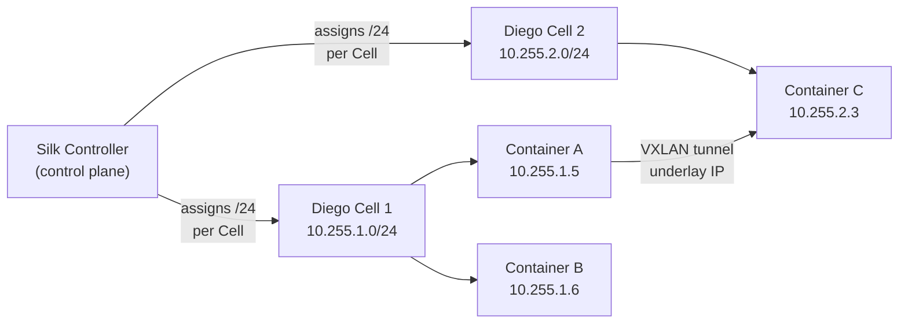
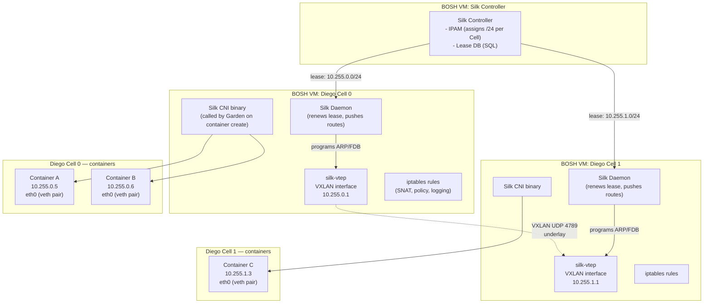

# Silk CNI — CF's VXLAN Overlay

**Track:** CF-B | **Lesson:** CF-05 | **Time:** 10 min quick read / 45 min deep dive

---

## Quick Read (10 min)

**What Silk CNI does in one sentence:** Silk is CF's built-in CNI plugin that creates a flat VXLAN overlay network so every container on every Diego Cell can talk to every other container using a stable, routable IP address — without needing the underlay network to know anything about containers.

**Mental model checklist:**

- Each Diego Cell gets one `/24` subnet from `10.255.0.0/16`
- Each container gets one IP from its Cell's `/24` — practical limit ~254 containers/cell
- Maximum deployment: 250 Cells → 250 × 254 = 63,500 containers across the overlay
- Overlay packets ride a VXLAN tunnel over the underlay (IaaS network)
- MTU = underlay MTU minus 50 bytes (VXLAN header overhead)
- Typical: underlay 1500 → containers see MTU 1450
- C2C (container-to-container) traffic stays entirely on the overlay; Gorouter traffic exits via Diego Cell IP + SNAT

**Address allocation flow:**



**Key numbers at a glance:**

| Parameter | Value |
|---|---|
| Overlay CIDR | `10.255.0.0/16` (default) |
| Subnet per Cell | `/24` |
| Max containers/Cell | ~254 |
| Max Cells | 250 |
| MTU penalty | 50 bytes |
| VXLAN port | UDP 4789 |
| Lease TTL | 24 h (renewed on boot) |

> **K8s Engineer's Translation:** Silk CNI is CF's equivalent of Flannel (VXLAN backend) or Calico with VXLAN encapsulation. The Silk Controller is the IPAM equivalent of the K8s node IPAM controller. Each Diego Cell is equivalent to a K8s Node, and the per-Cell `/24` mirrors how K8s `--node-cidr-mask-size` carves pod CIDRs per node. CF has no concept of a pod CIDR pool at the cluster level because the entire `10.255.0.0/16` is the pod CIDR.

**Five commands you will use most:**

```bash
# 1. See overlay IPs for a running app
cf ssh myapp -c "ip addr show eth0"

# 2. Check the Silk CNI config on a Diego Cell
bosh ssh diego-cell/0 -c "cat /var/vcap/jobs/silk-cni/config/cni.conf"

# 3. Verify VTEP IP of a Diego Cell
bosh ssh diego-cell/0 -c "ip addr show silk-vtep"

# 4. Dump overlay routes on a Cell
bosh ssh diego-cell/0 -c "ip route show table 1"

# 5. Check container MTU
cf ssh myapp -c "ip link show eth0 | grep mtu"
```

---

## Deep Dive

### Practice Setup

You need two terminals for all exercises in this lesson.

**Terminal 1 — CF CLI (Mac/workstation)**

```bash
# Log in and target a space
cf login -a https://api.sys.example.com --sso
cf target -o my-org -s my-space

# Confirm an app is running
cf app myapp
```

**Terminal 2 — BOSH SSH (Diego Cell)**

```bash
# List Diego Cells
bosh -d cf-deployment vms --column=Instance --column=IPs | grep diego-cell

# SSH to the first Cell
bosh -d cf-deployment ssh diego-cell/0

# Once inside the Cell, confirm Silk VTEP
ip addr show silk-vtep
```

> Keep both terminals open. Several exercises require you to compare overlay IPs from CF CLI with what you see on the Diego Cell.

---

## 1. Silk CNI Architecture — How the Overlay Is Built

### 1.1 Components

Silk CNI is composed of three co-located pieces on each Diego Cell, plus a central controller:



**Component responsibilities:**

| Component | Where it runs | What it does |
|---|---|---|
| Silk Controller | Dedicated VM | IPAM: allocates one `/24` per Cell, stores leases in SQL |
| Silk Daemon | Every Diego Cell | Renews lease, programs VTEP ARP/FDB entries, pushes routes for remote Cells |
| Silk CNI binary | Every Diego Cell | Called by Garden (CF's container runtime) on `container create`; assigns IP from local `/24`, creates veth pair, sets MTU |
| silk-vtep | Every Diego Cell | Linux VXLAN interface, VNI 1, UDP 4789 |

### 1.2 Packet Walk: Container-to-Container (Same Cell)

When Container A (`10.255.0.5`) talks to Container B (`10.255.0.6`) on the same Diego Cell:

1. Packet leaves Container A's `eth0` veth
2. Arrives at the veth peer on the Cell's bridge (`cni-flannel0` or `silk0`)
3. Linux routes it out the bridge to Container B's veth peer
4. No VXLAN encapsulation — traffic stays on the bridge
5. iptables policy rules are still evaluated (C2C policy enforcement)

```bash
# Observe the bridge on a Diego Cell
bosh ssh diego-cell/0 -c "ip link show type bridge"
bosh ssh diego-cell/0 -c "bridge link show"
```

### 1.3 Packet Walk: Container-to-Container (Different Cells)

Container A (`10.255.0.5`, Cell 0) → Container C (`10.255.1.3`, Cell 1):

1. Container A sends to `10.255.1.3`; routing table on Cell 0 says: `10.255.1.0/24 via 10.255.1.1 dev silk-vtep`
2. Silk Daemon on Cell 0 has pre-programmed a VTEP ARP entry: `10.255.1.1` → MAC of Cell 1's VTEP
3. Silk Daemon has also pre-programmed an FDB entry: `<Cell1-VTEP-MAC>` → `<Cell1-underlay-IP>`
4. Kernel encapsulates the original IP packet in a VXLAN frame (outer UDP, VNI=1, VXLAN header)
5. Outer IP src = Cell 0 underlay IP, dst = Cell 1 underlay IP, UDP dport = 4789
6. Cell 1 decapsulates, inner dst = `10.255.1.3` → routed to Container C's veth

```bash
# Watch VXLAN encapsulation from inside a container
# Terminal 1 — get overlay IPs
cf ssh myapp -c "ip addr show eth0"
cf ssh myapp -i 1 -c "ip addr show eth0"

# Terminal 2 — capture VXLAN on the Cell
bosh ssh diego-cell/0 -c "sudo tcpdump -i ens4 -n udp port 4789 -c 20"
```

> **K8s Engineer's Translation:** This is identical to a Flannel VXLAN deployment. The Silk Daemon's FDB/ARP programming is equivalent to what `flanneld` does via the K8s node API — it watches for new nodes and pre-populates VXLAN forwarding entries so the kernel can encapsulate without ARP flooding.

---

## 2. IP Address Management (IPAM) and Leases

### 2.1 Lease Lifecycle

```bash
# Check current lease on a Diego Cell
bosh ssh diego-cell/0 -c "cat /var/vcap/data/silk-daemon/state.json"

# Expected output (truncated):
# {
#   "lease": {
#     "underlay_ip": "10.0.1.15",
#     "overlay_subnet": "10.255.3.0/24",
#     "overlay_hardware_addr": "ee:ee:0a:ff:03:00",
#     "vtep_name": "silk-vtep",
#     "ttl_seconds": 86400
#   }
# }
```

The Silk Daemon renews its lease every time it starts (Diego Cell reboot) and periodically before TTL expiry. If the Silk Controller is unreachable at Cell startup, the daemon fails to get a lease and Garden refuses to place containers on that Cell.

### 2.2 Container IP Assignment

When Garden asks Silk CNI to set up a container network:

```bash
# The CNI invocation (abbreviated) — happens automatically on cf push/cf scale
# You can see it in the Garden log
bosh ssh diego-cell/0 -c "sudo grep 'silk-cni' /var/vcap/sys/log/garden/garden.stdout.log | tail -20"
```

The CNI binary:
1. Picks the next unused IP in the Cell's `/24`
2. Creates a veth pair: one end in the container netns, one end on the Cell
3. Sets the container-side MTU to `underlay_mtu - 50` (default: 1450 if underlay is 1500)
4. Adds a default route inside the container: `0.0.0.0/0 via <Cell-gateway-IP>`
5. Writes the assignment to a local state file so the IP is not reused

```bash
# View CNI state files (one per container)
bosh ssh diego-cell/0 -c "ls /var/vcap/data/silk-cni/container-netns/"
bosh ssh diego-cell/0 -c "cat /var/vcap/data/silk-cni/container-netns/<container-id>.json"
```

### 2.3 MTU Configuration and Troubleshooting

**MTU chain:**

```
IaaS VM NIC (e.g., 1500 on AWS)
  └── Diego Cell eth0: MTU 1500
        └── silk-vtep: MTU 1450  (1500 - 50)
              └── container eth0: MTU 1450
```

If the underlay uses jumbo frames (9000 on some bare-metal or on-prem IaaS):

```
Diego Cell eth0: MTU 9000
  └── silk-vtep: MTU 8950
        └── container eth0: MTU 8950
```

```bash
# Verify MTU on the VTEP
bosh ssh diego-cell/0 -c "ip link show silk-vtep"

# Verify MTU inside a container
cf ssh myapp -c "ip link show eth0"

# Test MTU with ping (send 1450-byte payload with DF set)
cf ssh myapp -c "ping -M do -s 1422 10.255.2.3 -c 3"
# 1422 data + 28 (IP+ICMP header) = 1450 — should pass
# 1423 data + 28 = 1451 — should fail with "Frag needed"
```

> **K8s Engineer's Translation:** This is the same MTU calculation you do for Calico VXLAN (`vxlanMTU = nodeMTU - 50`) or for Flannel. In K8s you set this in the CNI ConfigMap; in CF it is set in the BOSH manifest under `silk-cni.mtu` and defaults to auto-detect.

---

## 3. Overlay Routing Table and VTEP Programming

### 3.1 How Routes Are Distributed

Silk does not use BGP, OSPF, or etcd. Instead:

1. The **Silk Controller** maintains a database of all active Cell leases (`overlay_subnet` → `underlay_ip` → `vtep_mac`)
2. Each **Silk Daemon** polls the Silk Controller every 5 seconds for the full lease table
3. The Daemon reconciles the local ARP table, FDB (forwarding database), and kernel routing table to match the current lease table
4. When a new Cell joins, all existing Daemons learn about it within 5 seconds

```bash
# View the overlay routing table on a Cell
bosh ssh diego-cell/0 -c "ip route show table 1"
# Output looks like:
# 10.255.1.0/24 via 10.255.1.1 dev silk-vtep onlink
# 10.255.2.0/24 via 10.255.2.1 dev silk-vtep onlink
# ...

# View the ARP table for the VTEP
bosh ssh diego-cell/0 -c "ip neigh show dev silk-vtep"
# 10.255.1.1 lladdr ee:ee:0a:ff:01:00 PERMANENT

# View the FDB (MAC → underlay IP mapping)
bosh ssh diego-cell/0 -c "bridge fdb show dev silk-vtep"
# ee:ee:0a:ff:01:00 dst 10.0.1.16 self permanent
```

### 3.2 VTEP MAC Address Scheme

Silk assigns VTEP MAC addresses deterministically from the overlay IP:

```
Overlay gateway IP: 10.255.X.1
VTEP MAC:          ee:ee:0a:ff:X:01
                              ^^---  third and fourth octets of overlay IP in hex
```

For Cell with subnet `10.255.3.0/24`:
- Gateway IP: `10.255.3.1`
- VTEP MAC: `ee:ee:0a:ff:03:01`

This deterministic scheme means the Silk Daemon can pre-compute ARP entries without asking the Silk Controller for MAC addresses separately.

```bash
# Verify on a Cell
bosh ssh diego-cell/0 -c "cat /sys/class/net/silk-vtep/address"
```

### 3.3 Silk CNI Configuration File

```bash
# Full CNI config
bosh ssh diego-cell/0 -c "cat /var/vcap/jobs/silk-cni/config/cni.conf"
```

Key fields in the CNI config:

```json
{
  "cniVersion": "0.3.1",
  "name": "silk",
  "type": "silk",
  "dataDir": "/var/vcap/data/silk-cni",
  "subnetFile": "/var/vcap/data/silk-daemon/subnet.env",
  "mtu": 1450,
  "noMasqueradeDestinations": ["10.255.0.0/16", "10.0.0.0/8"],
  "iptablesLockFile": "/var/vcap/data/silk-cni/iptables.lock"
}
```

The `subnetFile` is written by the Silk Daemon after it gets a lease. The CNI binary reads it to determine which `/24` to allocate from.

> **K8s Engineer's Translation:** This CNI config is equivalent to a Flannel `net-conf.json` or a Calico `cni.conf`. The `subnetFile` mechanism (daemon writes a file, CNI binary reads it) is the same pattern Flannel uses with `/run/flannel/subnet.env`.

---

## 4. Troubleshooting

### 4.1 Common Failure Modes

#### Failure: Containers get no overlay IP — Garden refuses to place apps

**Symptom:**

```
cf push myapp
# Stuck in "Starting" or immediate failure:
# Diego error: insufficient resources
```

**Root cause:** Silk Daemon could not renew lease with Silk Controller.

**Diagnosis:**

```bash
# Check Silk Daemon health
bosh ssh diego-cell/0 -c "sudo monit summary | grep silk"
bosh ssh diego-cell/0 -c "sudo cat /var/vcap/sys/log/silk-daemon/silk-daemon.stdout.log | tail -50"

# Check connectivity from Cell to Silk Controller
bosh ssh diego-cell/0 -c "curl -sk https://<silk-controller-ip>:4244/leases"

# Check Silk Controller health
bosh -d cf-deployment ssh silk-controller/0 -c "sudo monit summary"
```

**Fix:** Restart the Silk Daemon. If the Silk Controller is down, bring it back up first.

```bash
bosh ssh diego-cell/0 -c "sudo monit restart silk-daemon"
```

---

#### Failure: C2C traffic dropped between containers on different Cells

**Symptom:** App on Cell 0 cannot reach app on Cell 1 at overlay IP.

**Diagnosis flow:**

```bash
# Step 1: Confirm overlay IPs
cf ssh app-a -c "ip addr show eth0"   # note IP, e.g., 10.255.0.5
cf ssh app-b -c "ip addr show eth0"   # note IP, e.g., 10.255.1.3

# Step 2: Confirm a C2C policy exists
cf network-policies
# If missing: cf add-network-policy app-a --destination-app app-b --port 8080 --protocol tcp

# Step 3: From app-a container, try to reach app-b
cf ssh app-a -c "curl -v http://10.255.1.3:8080 --connect-timeout 5"

# Step 4: On Cell 0, check that overlay route exists for 10.255.1.0/24
bosh ssh diego-cell/0 -c "ip route show table 1 | grep 10.255.1"

# Step 5: Check FDB entry for Cell 1's VTEP
bosh ssh diego-cell/0 -c "bridge fdb show dev silk-vtep | grep ee:ee:0a:ff:01"

# Step 6: Verify VXLAN traffic leaves Cell 0
bosh ssh diego-cell/0 -c "sudo tcpdump -i ens4 -n udp port 4789 -c 10"

# Step 7: Check iptables policy rules on Cell 0 (C2C egress)
bosh ssh diego-cell/0 -c "sudo iptables -L netout-<container-id> -n -v"
```

**Common fixes:**

- Missing C2C network policy → `cf add-network-policy`
- Stale VTEP routes → `sudo monit restart silk-daemon` on affected Cell
- Underlay firewall blocking UDP 4789 → open it in IaaS security groups

---

#### Failure: MTU mismatch causing silent packet loss

**Symptom:** Small requests work, large responses are silently dropped or connections hang.

```bash
# Test from inside the container
cf ssh myapp -c "ping -M do -s 1422 <dest-overlay-ip> -c 5"
# If this fails:
cf ssh myapp -c "ping -M do -s 1372 <dest-overlay-ip> -c 5"
# If 1372 works but 1422 does not, MTU is misconfigured

# Check actual MTU
cf ssh myapp -c "ip link show eth0"

# Check VTEP MTU
bosh ssh diego-cell/0 -c "ip link show silk-vtep"
```

**Fix:** Reconfigure `silk-cni.mtu` in the BOSH manifest to `underlay_mtu - 50` and redeploy.

---

#### Failure: Silk Controller reports duplicate subnet lease

**Symptom:** Silk Controller logs show:

```
"error assigning subnet: subnet 10.255.3.0/24 already leased to a different host"
```

**Cause:** A Diego Cell was rebuilt with a different underlay IP but the old lease was not released.

```bash
# On Silk Controller
bosh ssh silk-controller/0

# Check the lease DB (usually SQLite or MySQL via CF's internal DB)
# Path varies by deployment:
cat /var/vcap/jobs/silk-controller/config/silk-controller.json | grep -i database

# Manual lease cleanup (use with caution — only if old Cell is confirmed gone)
# This requires direct DB access — coordinate with platform team
```

---

### 4.2 Diagnostic Command Reference

```bash
# Silk Daemon status
bosh ssh diego-cell/0 -c "sudo monit summary | grep silk"

# Full lease state
bosh ssh diego-cell/0 -c "cat /var/vcap/data/silk-daemon/state.json"

# Overlay routes
bosh ssh diego-cell/0 -c "ip route show table 1"

# VTEP ARP cache
bosh ssh diego-cell/0 -c "ip neigh show dev silk-vtep"

# VXLAN FDB
bosh ssh diego-cell/0 -c "bridge fdb show dev silk-vtep"

# Container CNI state
bosh ssh diego-cell/0 -c "ls -la /var/vcap/data/silk-cni/container-netns/"

# Silk CNI logs
bosh ssh diego-cell/0 -c "sudo tail -100 /var/vcap/sys/log/silk-cni/silk-cni.stdout.log"

# Silk Daemon logs
bosh ssh diego-cell/0 -c "sudo tail -100 /var/vcap/sys/log/silk-daemon/silk-daemon.stdout.log"

# Silk Controller logs
bosh ssh silk-controller/0 -c "sudo tail -100 /var/vcap/sys/log/silk-controller/silk-controller.stdout.log"

# Capture VXLAN traffic on a Cell
bosh ssh diego-cell/0 -c "sudo tcpdump -i ens4 udp port 4789 -n -c 50 -w /tmp/vxlan.pcap"

# Count active overlay IPs on a Cell
bosh ssh diego-cell/0 -c "ip neigh show dev silk-vtep | wc -l"

# Check ICMP between two containers (run from app-a container)
cf ssh app-a -c "ping -c 3 <app-b-overlay-ip>"
```

---

## Production Checklist

- Overlay CIDR `10.255.0.0/16` does not conflict with existing IaaS subnets or corporate networks
- Diego Cell count is within 250-Cell limit (or custom CIDR is sized accordingly)
- IaaS security groups allow UDP 4789 between all Diego Cells
- Underlay MTU is known; `silk-cni.mtu` is set to `underlay_mtu - 50` in BOSH manifest
- Jumbo frames configured on underlay if container workloads require MTU > 1450
- Silk Controller is deployed with HA (at least 2 instances with shared SQL backend)
- Silk Controller VM is included in BOSH resurrection policies
- Silk Daemon health is monitored via BOSH HM or external Prometheus scrape
- Container MTU verified with large-payload ping after every underlay MTU change
- C2C policies are reviewed quarterly — remove stale policies for decommissioned apps
- VXLAN port 4789 is NOT blocked by any host-level firewall on Diego Cells (check `iptables -L INPUT`)
- Silk CNI state directory `/var/vcap/data/silk-cni/` is on a persistent disk or backed up before Cell recreation
- Lease renewal interval and TTL are appropriate for Cell reboot frequency in your environment

---

## Quick Reference

| Task | Command |
|---|---|
| Show overlay IP of an app container | `cf ssh myapp -c "ip addr show eth0"` |
| Show overlay IP for a specific instance | `cf ssh myapp -i 2 -c "ip addr show eth0"` |
| Show VTEP IP of a Diego Cell | `bosh ssh diego-cell/0 -c "ip addr show silk-vtep"` |
| Show all overlay routes on a Cell | `bosh ssh diego-cell/0 -c "ip route show table 1"` |
| Show VTEP ARP entries | `bosh ssh diego-cell/0 -c "ip neigh show dev silk-vtep"` |
| Show VXLAN FDB | `bosh ssh diego-cell/0 -c "bridge fdb show dev silk-vtep"` |
| Show Silk Daemon lease | `bosh ssh diego-cell/0 -c "cat /var/vcap/data/silk-daemon/state.json"` |
| Show CNI config | `bosh ssh diego-cell/0 -c "cat /var/vcap/jobs/silk-cni/config/cni.conf"` |
| Restart Silk Daemon | `bosh ssh diego-cell/0 -c "sudo monit restart silk-daemon"` |
| Capture VXLAN packets | `bosh ssh diego-cell/0 -c "sudo tcpdump -i ens4 udp port 4789 -n"` |
| Check MTU in container | `cf ssh myapp -c "ip link show eth0 \| grep mtu"` |
| Ping between containers | `cf ssh app-a -c "ping -c 3 <overlay-ip-of-app-b>"` |
| List C2C network policies | `cf network-policies` |
| Add C2C policy | `cf add-network-policy src-app --destination-app dst-app --port 8080 --protocol tcp` |
| Remove C2C policy | `cf remove-network-policy src-app --destination-app dst-app --port 8080 --protocol tcp` |
| Check Silk Controller status | `bosh -d cf-deployment vms | grep silk-controller` |

---

## See Also

**Related K8s lessons in this course:**

- **Lesson 08 — Flannel and VXLAN Overlay Networks:** Direct K8s equivalent of Silk CNI. Same VXLAN encapsulation, same FDB/ARP programming pattern, same MTU calculation.
- **Lesson 09 — Calico CNI and BGP:** Alternative to overlay — Calico with IPIP or VXLAN. Contrast with Silk's simpler controller-based approach.
- **Lesson 10 — CNI Deep Dive:** How CNI plugins are invoked, the CNI spec, veth pairs, netns — applies directly to understanding how Silk CNI sets up containers.
- **Lesson 15 — NetworkPolicy:** K8s equivalent of CF C2C network policies and ASGs. The iptables programming model is identical.
- **Lesson 22 — Ingress and Gateway API:** Equivalent of CF Gorouter and TCP Router — how traffic enters the cluster from outside.

---

## Online Resources

- [CF Networking Release — Silk CNI README](https://github.com/cloudfoundry/silk-release/blob/main/docs/silk-cni.md) — official component docs, configuration reference, and architecture notes
- [CF Networking Release GitHub](https://github.com/cloudfoundry/cf-networking-release) — source for the full networking stack including Silk, VXLAN Policy Agent, and C2C policy
- [BOSH CF Deployment Networking Ops Files](https://github.com/cloudfoundry/cf-deployment/tree/main/operations/addons) — example BOSH ops files for MTU overrides and overlay CIDR changes
- [RFC 7348 — VXLAN](https://datatracker.ietf.org/doc/html/rfc7348) — the VXLAN specification that underpins both Silk and Flannel/Calico VXLAN modes
- [Cloud Foundry Docs — Container-to-Container Networking](https://docs.cloudfoundry.org/devguide/deploy-apps/cf-networking.html) — official operator and developer guide covering Silk, C2C policies, and ASGs
