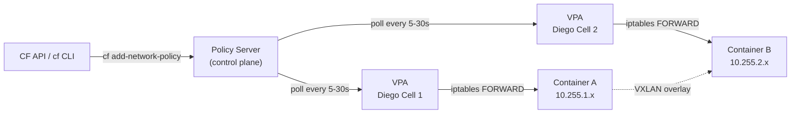
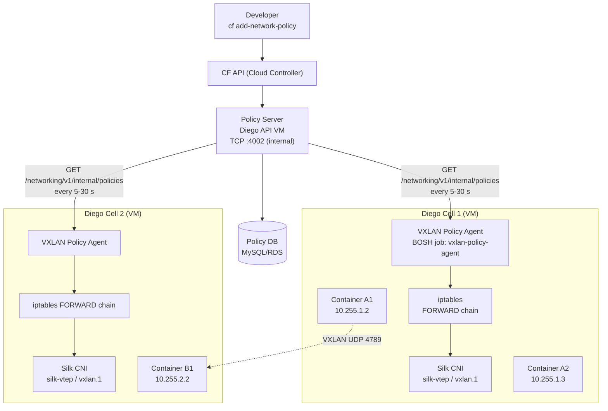
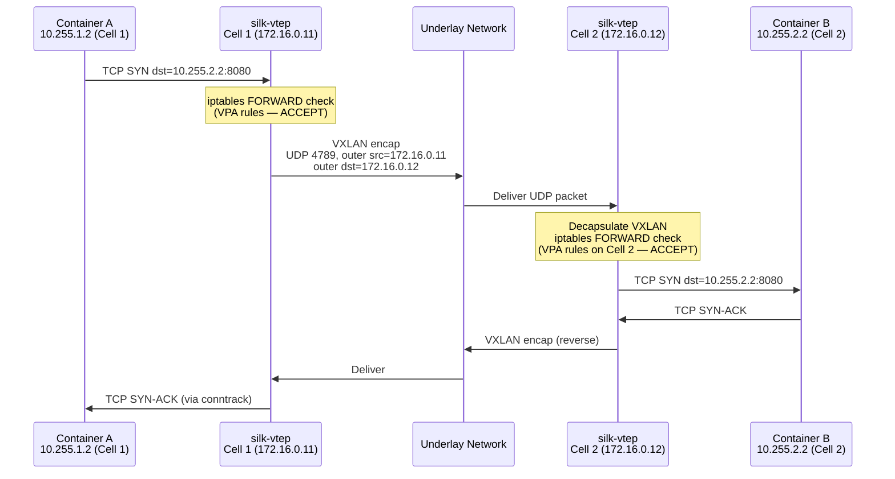

# CF-06: VXLAN Policy Agent — Enforcing C2C Policies

**Track:** CF-B — Container-to-Container Networking
**Lesson:** 6 of 9
**Time:** Quick Read 10 min | Deep Dive 45 min

**Jump to:** [Theory](#1-architecture-overview-where-the-vpa-fits) · [Practice](#practice-setup) · [Troubleshooting](#4-troubleshooting-c2c-policy-enforcement) · [Quick Reference](#quick-reference)

---

## Quick Read (10 min)

After this lesson you will be able to: trace the full path from `cf add-network-policy` through the Policy Server to iptables rules on a Diego Cell, and diagnose why a C2C policy that appears correct in the control plane is not being enforced in the dataplane.

### Key Facts

- **Default posture:** all C2C traffic is denied. No policy = no connectivity between apps.
- **Policy store:** Policy Server (control plane) holds all rules; VPA polls it every 5–30 s.
- **Enforcement mechanism:** iptables `FORWARD` chain on the overlay network interface (`silk-vtep` / `vxlan.1`).
- **GUID-based identities:** policies survive app restarts, redeploys, and IP churn because they reference app GUIDs, not IPs.
- **No container restart required:** VPA pushes new iptables rules live; running containers see the change within one poll interval.
- **Overlay addressing:** 10.255.0.0/16, each Diego Cell gets a /24 (up to 254 containers), VXLAN encapsulation, underlay MTU − 50.
- **C2C traffic path:** container → `silk-vtep` (VXLAN) → remote cell `silk-vtep` → destination container. Never touches Gorouter.



### What You Must Know

- `cf network-policies` lists active policies; `cf add-network-policy` / `cf remove-network-policy` manages them.
- Policy is **directional** (source → destination) but TCP sessions are stateful so the reply is allowed by conntrack.
- The VPA runs as a BOSH job (`vxlan-policy-agent`) on every Diego Cell.
- Policy Server runs on the Diego API VM alongside other control-plane components.
- Dynamic policy update (no restart) has been available since cf-deployment v4.x.
- In Korifi (CF on K8s, 2026): VPA is replaced by standard Kubernetes `NetworkPolicy` objects enforced by the CNI plugin.

> **K8s Engineer's Translation:** VPA is CF's equivalent of a per-node CNI enforcement daemon (like Calico's Felix or Cilium's agent) that watches a central policy store and programs the local dataplane.

---

## Deep Dive

---

## Practice Setup

You need two terminals for every exercise in this lesson.

**Terminal 1 — cf CLI (Mac/local)**

```bash
# Log in and target your org/space
cf login -a https://api.<your-cf-domain> --skip-ssl-validation
cf target -o my-org -s my-space

# Verify you can list network policies
cf network-policies
```

**Terminal 2 — BOSH SSH into a Diego Cell**

```bash
# List deployments
bosh deployments

# SSH into the first Diego Cell
bosh -d cf ssh diego-cell/0

# Become root
sudo su -

# Confirm VPA process is running
monit summary | grep vxlan
# or
ps aux | grep vxlan-policy-agent
```

> **Tip:** Keep both terminals visible. Terminal 1 shows the control-plane view (what CF knows). Terminal 2 shows the dataplane view (what iptables actually enforces on that cell).

---

## 1. Architecture Overview — Where the VPA Fits

### The C2C Policy Stack

Cloud Foundry's container-to-container networking has three distinct layers:

1. **cf CLI / CF API** — where operators and developers declare intent ("app A should talk to app B on port 8080").
2. **Policy Server** — the central store that persists policies and serves them over an internal API.
3. **VXLAN Policy Agent** — the per-cell enforcement daemon that translates stored policies into iptables rules.



### Key Design Decisions

**Why GUID-based policies?** Container IPs on the Silk overlay are ephemeral — they can change when Diego reschedules an app instance. App GUIDs, however, are permanent (they survive `cf push`, restarts, and even renaming). The VPA resolves GUIDs to current IPs at poll time.

**Why poll instead of push?** A poll-based model means cells are self-healing. If a cell reboots, its VPA re-fetches all policies independently without requiring the Policy Server to track cell state. This matches CF's philosophy of disposable, self-sufficient components.

**Why iptables?** The Silk overlay uses VXLAN encapsulation. By the time a packet exits the VXLAN tunnel on the receiving cell, it appears as a regular IP packet on the overlay bridge. iptables `FORWARD` rules on that bridge are a natural enforcement point with well-understood semantics and kernel-level performance.

> **K8s Engineer's Translation:** This is architecturally similar to Calico's model: a central policy store (Calico's etcd/Kubernetes API) + a per-node agent (Felix) that programs iptables/eBPF. The key difference is that CF identifies workloads by app GUID rather than pod labels, and enforcement is always iptables (no eBPF path yet in open-source CF).

---

## 2. The Policy Lifecycle — From `cf add-network-policy` to iptables

### Step 1: Declare a Policy

```bash
# Syntax: cf add-network-policy SOURCE_APP --destination-app DEST_APP \
#           --protocol PROTO --port PORT[-PORT_END]

# Allow app "frontend" to call app "backend" on TCP/8080
cf add-network-policy frontend --destination-app backend \
  --protocol tcp --port 8080

# Allow a port range (e.g., gRPC services on 9000-9099)
cf add-network-policy grpc-client --destination-app grpc-server \
  --protocol tcp --port 9000-9099

# Allow UDP (e.g., DNS-over-UDP between apps)
cf add-network-policy sender --destination-app receiver \
  --protocol udp --port 5353
```

```bash
# Verify the policy was stored
cf network-policies
# Output:
# Listing network policies in org my-org / space my-space as admin...
#
# source    destination   protocol   ports   destination space   destination org
# frontend  backend       tcp        8080    my-space            my-org
```

### Step 2: Policy Server Stores It

The CF API forwards the policy creation request to the Policy Server's internal API. The Policy Server stores it in its MySQL database, keyed by source and destination app GUIDs.

```bash
# From the Diego API VM (bosh ssh diego-api/0):
# Inspect the Policy Server's internal API directly (mTLS required from the cell)
curl -s http://127.0.0.1:4002/networking/v1/internal/policies \
  | python3 -m json.tool | head -40
```

Example response (truncated):

```json
{
  "policies": [
    {
      "source": {
        "id": "a1b2c3d4-e5f6-7890-abcd-ef1234567890",
        "tag": "0x0001"
      },
      "destination": {
        "id": "b2c3d4e5-f6a7-8901-bcde-f12345678901",
        "tag": "0x0002",
        "protocol": "tcp",
        "ports": {
          "start": 8080,
          "end": 8080
        }
      }
    }
  ]
}
```

Notice the `tag` field — these are VXLAN network identifier (VNI) tags. The Policy Server assigns a compact numeric tag to each app. VPA uses these tags to match traffic on the overlay.

### Step 3: VPA Polls and Programs iptables

On every Diego Cell, the VPA polls the Policy Server, resolves GUIDs to current container IPs (via the Silk daemon's local store), and writes iptables rules.

```bash
# From bosh ssh diego-cell/0 (as root):

# Watch VPA logs in real time
tail -f /var/vcap/sys/log/vxlan-policy-agent/vxlan-policy-agent.stdout.log

# View the iptables chains managed by VPA
iptables -L netout-overlay -n --line-numbers 2>/dev/null || \
  iptables -L FORWARD -n | grep -A5 "overlay"

# More specifically, look for the netout chains
iptables -S | grep -i "netout\|overlay\|silk"
```

A typical VPA-managed chain looks like:

```
Chain netout--abc123 (1 references)
target     prot opt source               destination
ACCEPT     tcp  --  10.255.1.2           10.255.2.2           tcp dpt:8080
ACCEPT     tcp  --  10.255.1.3           10.255.2.2           tcp dpt:8080
DROP       all  --  0.0.0.0/0            0.0.0.0/0
```

The chain name encodes the source container handle. The final `DROP` is the default-deny tail rule.

> **K8s Engineer's Translation:** This is equivalent to Calico programming per-pod iptables chains in `FORWARD`. Each chain corresponds to one source identity (app GUID / container), with explicit ACCEPT rules for allowed destinations and an implicit or explicit DROP at the end.

### Step 4: Traffic Flows

```bash
# From inside source container (cf ssh frontend):
cf ssh frontend

# Inside the container:
# Check the overlay IP of this instance
ip addr show eth0
# inet 10.255.1.2/24

# Probe backend (replace with actual backend overlay IP or use apps.internal)
curl http://backend.apps.internal:8080/health
# Should succeed if the network policy is in place

# Without the policy, this would timeout (default-deny)
```

---

## 3. VXLAN Encapsulation and the Overlay Dataplane

### How Silk VXLAN Works

Silk creates a VXLAN tunnel between Diego Cells. Each cell has a `silk-vtep` interface (or `vxlan.1` on older deployments) that acts as the VXLAN tunnel endpoint (VTEP).

```bash
# From bosh ssh diego-cell/0 (as root):

# Inspect the VTEP interface
ip link show silk-vtep
ip addr show silk-vtep
# The cell's overlay IP (e.g., 10.255.1.1/32)

# Check the bridge that containers attach to
ip link show type bridge
# Usually: cni-flannel0 or similar

# View the VXLAN FDB (forwarding database) — maps overlay MACs to underlay IPs
bridge fdb show dev silk-vtep | head -20

# Full overlay routing table
ip route show table 200  # Silk uses a custom routing table
```

### MTU Calculation

VXLAN adds 50 bytes of overhead (outer IP 20 + UDP 8 + VXLAN 8 + inner Ethernet 14 = 50).

```
Underlay MTU:         1500 bytes  (typical cloud VM)
VXLAN overhead:        -50 bytes
Container MTU:        1450 bytes  (default Silk MTU)
```

```bash
# Verify MTU inside a running container
cf ssh frontend -- ip link show eth0 | grep mtu
# flags=... mtu 1450

# On the cell, verify the VTEP MTU matches expectation
ip link show silk-vtep | grep mtu
# mtu 1450 (should match container MTU)
```

> **K8s Engineer's Translation:** Same math as any VXLAN-based K8s CNI (Flannel, Calico VXLAN mode). The difference is CF sets MTU via BOSH deployment manifest rather than a CNI ConfigMap. If your cloud underlay uses jumbo frames (9000 MTU), containers get 8950 MTU — no special configuration needed in Silk.

### VXLAN Packet Walk



### Policy Tags and VNI Marks

The Policy Server assigns each app a compact 16-bit "tag." The VPA encodes the source app tag into the VXLAN VNI field (or uses iptables marks, depending on CF version). The receiving cell's VPA can use this tag to enforce destination-side rules without needing to look up the source IP in a policy table.

```bash
# On the cell, check if MARK-based tagging is in use
iptables -L INPUT -n | grep MARK
iptables -t mangle -L -n | grep MARK

# In newer Silk versions, source app tag is set as an iptables mark
# Chain netout--<handle>:
#   -j MARK --set-mark 0x0001  (source app tag)
#   Then FORWARD chain checks: -m mark --mark 0x0002 -j ACCEPT (dest tag)
```

---

## 4. Troubleshooting C2C Policy Enforcement

### Failure Mode 1: Policy Exists But Traffic Drops

**Symptom:** `cf network-policies` shows the policy, but `curl` from source to destination times out.

**Diagnostic steps:**

```bash
# Step 1: Confirm both apps are running and check their overlay IPs
cf app frontend
cf app backend

# Step 2: SSH into source app and get its overlay IP
cf ssh frontend -- ip addr show eth0
# Note the 10.255.x.x address

# Step 3: SSH into destination app and check overlay IP + listening port
cf ssh backend -- ss -tlnp | grep 8080
cf ssh backend -- ip addr show eth0

# Step 4: SSH onto the DEST Diego Cell and check iptables for backend's inbound rules
# First, find which cell backend is on:
cf curl /v3/apps/$(cf app backend --guid)/processes | python3 -m json.tool | grep index

# Then bosh ssh to that cell:
bosh -d cf ssh diego-cell/1

# As root, look for backend's container handle in iptables
iptables -L -n | grep 10.255.2.2  # backend IP

# Step 5: Check VPA logs for errors
tail -100 /var/vcap/sys/log/vxlan-policy-agent/vxlan-policy-agent.stdout.log | grep -i error
```

**Common cause:** VPA failed to reach Policy Server (network partition, certificate expiry). Check:

```bash
# From the Diego Cell, test Policy Server reachability
# Policy Server listens on the Diego API VM's internal IP, port 4003
curl -v --cacert /var/vcap/jobs/vxlan-policy-agent/config/certs/ca.crt \
     --cert /var/vcap/jobs/vxlan-policy-agent/config/certs/client.crt \
     --key  /var/vcap/jobs/vxlan-policy-agent/config/certs/client.key \
     https://<diego-api-ip>:4003/networking/v1/internal/policies 2>&1 | head -20
```

### Failure Mode 2: Stale iptables Rules After Policy Removal

**Symptom:** `cf remove-network-policy` succeeds but traffic still flows for up to 30 s.

**Explanation:** VPA polls on an interval (default: varies by deployment, commonly 5–30 s). Until the next poll cycle, old ACCEPT rules remain in place. This is expected behavior.

```bash
# Force a faster update by restarting VPA (non-disruptive — no container impact):
# From bosh ssh diego-cell/0 as root:
monit restart vxlan-policy-agent

# Then watch the iptables rules update:
watch -n1 "iptables -L FORWARD -n | grep 10.255"
```

### Failure Mode 3: Cross-Space Policies Fail

**Symptom:** Policy created between apps in different spaces is not effective.

**Check:** Cross-space policies require the `network.admin` scope (admin or space developer in both spaces is not sufficient).

```bash
# Verify the policy was actually accepted by CF API (not silently dropped):
cf curl /networking/v1/external/policies | python3 -m json.tool | grep -A10 "source"

# Check GUID resolution — confirm both app GUIDs are correct:
cf app frontend --guid
cf app backend --guid

# If GUIDs don't appear in the policy store output, the policy creation failed
```

### Failure Mode 4: MTU Mismatch Causing Silent Packet Loss

**Symptom:** Small payloads succeed; large payloads (file uploads, database queries) hang or fail.

In banking or medtech environments running CF on bare-metal hosts with jumbo frames enabled on the underlay, an MTU mismatch is a common root cause of intermittent DICOM image transfer failures or large transaction payload drops that are difficult to reproduce with synthetic health checks.

**Diagnostic:**

```bash
# Test with explicit payload sizes from inside source container
cf ssh frontend

# Inside container:
# Test with small payload (should work)
curl -s http://backend.apps.internal:8080/ -o /dev/null -w "%{http_code}\n"

# Test with large payload that forces fragmentation
dd if=/dev/zero bs=5000 count=1 2>/dev/null | \
  curl -s -X POST http://backend.apps.internal:8080/upload \
  --data-binary @- -o /dev/null -w "%{http_code}\n"

# Check MTU end-to-end:
ping -c3 -M do -s 1400 10.255.2.2  # adjust size until it fails

# From the cell, verify VTEP MTU:
ip link show silk-vtep | grep mtu
```

**Fix:** Ensure the BOSH deployment manifest sets `mtu` in the `silk-cni` job properties to `underlay_MTU - 50`. If your cloud provider uses jumbo frames and the underlay MTU was recently changed, re-deploy the Diego Cells.

### Failure Mode 5: VPA Cannot Authenticate to Policy Server

**Symptom:** VPA log shows certificate errors; no policies are enforced (all C2C traffic drops).

```bash
# Check certificate expiry
openssl x509 -enddate -noout \
  -in /var/vcap/jobs/vxlan-policy-agent/config/certs/client.crt

# Check CA cert matches server
openssl verify \
  -CAfile /var/vcap/jobs/vxlan-policy-agent/config/certs/ca.crt \
  /var/vcap/jobs/vxlan-policy-agent/config/certs/client.crt

# If certs are expired, rotate via BOSH:
# bosh -d cf run-errand rotate-vxlan-policy-agent-certs  (deployment-specific)
# Or re-deploy: bosh -d cf deploy cf-deployment.yml ...
```

> **K8s Engineer's Translation:** This is equivalent to a Calico Felix agent losing its etcd or Kubernetes API credentials. The result is the same — the dataplane freezes at its last known good state (or drops everything if it was never initialized). In K8s you'd rotate the ServiceAccount token; in CF you rotate BOSH-managed mTLS certificates.

---

## Production Checklist

- [ ] Confirm default-deny behavior: a fresh app with no policies cannot reach other apps on the overlay.
- [ ] Test policy propagation latency in your environment: `cf add-network-policy` → measure time until traffic passes.
- [ ] Set VPA poll interval to match your SLA for policy activation (default is usually acceptable; consider lowering for security-sensitive deployments).
- [ ] Monitor VPA health via BOSH monit: `monit summary` on every Diego Cell should show `vxlan-policy-agent` as `running`.
- [ ] Include policy definition in your app's deployment automation (Concourse pipeline, `cf push` scripts, or CF manifests with the network-policies block).
- [ ] Audit all C2C policies regularly: `cf curl /networking/v1/external/policies` returns all policies across all spaces (admin only).
- [ ] Document cross-space policies; they require admin-level permissions and are easy to forget.
- [ ] Verify MTU is correctly set for your underlay (especially on bare-metal or on clouds with jumbo frames enabled).
- [ ] Confirm Policy Server HA: it should run on multiple Diego API VMs with a shared MySQL backend.
- [ ] Test the "no restart required" behavior: add a policy to a running app pair and confirm traffic flows without restaging.
- [ ] Validate certificate rotation procedure for VPA mTLS certs (annual rotation in most CF deployments).
- [ ] If running Korifi (CF on K8s): replace VPA-based policy workflows with `kubectl apply -f networkpolicy.yaml`; validate that the CNI plugin enforces namespace isolation.

---

## Quick Reference

| Task | Command |
|---|---|
| Add a C2C policy | `cf add-network-policy SRC --destination-app DST --protocol tcp --port 8080` |
| List all C2C policies (current space) | `cf network-policies` |
| List all C2C policies (all spaces, admin) | `cf curl /networking/v1/external/policies` |
| Remove a C2C policy | `cf remove-network-policy SRC --destination-app DST --protocol tcp --port 8080` |
| Get app GUID | `cf app APP_NAME --guid` |
| SSH into source app | `cf ssh APP_NAME` |
| Check overlay IP inside container | `ip addr show eth0` |
| Check container overlay connectivity | `ping 10.255.x.x` from `cf ssh` |
| Resolve apps.internal hostname | `nslookup backend.apps.internal` |
| Check VPA process on cell | `monit summary \| grep vxlan` |
| View VPA logs | `tail -f /var/vcap/sys/log/vxlan-policy-agent/vxlan-policy-agent.stdout.log` |
| List iptables FORWARD rules | `iptables -L FORWARD -n --line-numbers` |
| Check VTEP interface | `ip addr show silk-vtep` |
| Check VXLAN FDB | `bridge fdb show dev silk-vtep` |
| Check overlay routing table | `ip route show table 200` |
| Restart VPA (non-disruptive) | `monit restart vxlan-policy-agent` (as root on cell) |
| Check Policy Server API | `cf curl /networking/v1/external/policies` |
| Check MTU inside container | `ip link show eth0 \| grep mtu` |
| Verify cert expiry | `openssl x509 -enddate -noout -in /path/to/client.crt` |

---

## Check Your Understanding

1. What is the default C2C traffic posture in a CF deployment using Silk/VPA, and what must an operator do to allow two apps to communicate on the overlay?
2. The VPA uses app GUIDs rather than container IPs to identify policy subjects. What operational problem does this solve, and when does the GUID-to-IP resolution actually occur?
3. A developer adds a C2C policy via `cf add-network-policy` but traffic from the source app still times out 60 seconds later. List three distinct root causes you would investigate in order, and state which tool or log surfaces each one.
4. A CF deployment is running on bare-metal hosts with a 9000-byte underlay MTU. What container MTU should Silk be configured to use, and what symptom appears first when this value is set incorrectly?
5. In Korifi (CF on Kubernetes), the VXLAN Policy Agent is removed entirely. What replaces it, and what is the key architectural difference in how workload identity is expressed in policy rules?

---

## See Also

**Related K8s Network Engineering lessons in this course:**

- **Linux-04: iptables and nftables** — The iptables chain model that VPA leverages is exactly the same as covered in the Linux foundations track. `FORWARD` chain, `ACCEPT`/`DROP` targets, and conntrack state matching are all standard Linux netfilter.
- **K8s-05: Kubernetes NetworkPolicy** — The direct K8s analog to CF C2C policies. NetworkPolicy uses pod label selectors instead of app GUIDs, but the enforcement model (default-deny, explicit allow, CNI-implemented) is the same.
- **K8s-06: Calico and Felix** — Calico's Felix agent is the K8s parallel to the VXLAN Policy Agent: a per-node daemon that watches a central store and programs iptables/eBPF on the local node.
- **K8s-07: Cilium and eBPF** — Cilium represents the direction CF networking could evolve toward: identity-based policy enforcement using eBPF instead of iptables, with better performance and observability.
- **K8s-08: CNI Deep Dive** — Silk is a CF-specific CNI plugin. The CNI interface (ADD/DEL/CHECK) works identically in CF and K8s, making this lesson directly applicable to understanding how Silk sets up container networking.
- **CF-05: Silk CNI and the Overlay** — The prerequisite lesson for this one; covers how Silk allocates the 10.255.0.0/16 overlay, assigns /24 per cell, and establishes VXLAN tunnels before VPA enforces policy on them.

---

## Online Resources

- [CF Networking Policy documentation (Cloud Foundry Docs)](https://docs.cloudfoundry.org/concepts/understand-cf-networking.html) — official overview of container-to-container networking, Silk, and the Policy Server architecture.
- [cf-networking-release GitHub repository](https://github.com/cloudfoundry/cf-networking-release) — source code for the Policy Server, VXLAN Policy Agent, and Silk CNI; the `README` and `docs/` directory contain architectural details not in the official docs.
- [Silk CNI GitHub repository](https://github.com/cloudfoundry/silk) — the VXLAN overlay CNI plugin used by CF; includes MTU calculation logic and VTEP management code.
- [cf-deployment networking ops-files](https://github.com/cloudfoundry/cf-deployment/tree/main/operations/addons) — BOSH ops-files for tuning VPA poll interval, MTU, and Policy Server HA configuration in production deployments.
- [Korifi networking architecture (2026)](https://github.com/cloudfoundry/korifi) — the CF-on-Kubernetes project; shows how the VPA + Silk stack is replaced by standard Kubernetes NetworkPolicy objects when running CF workloads on a K8s substrate.
