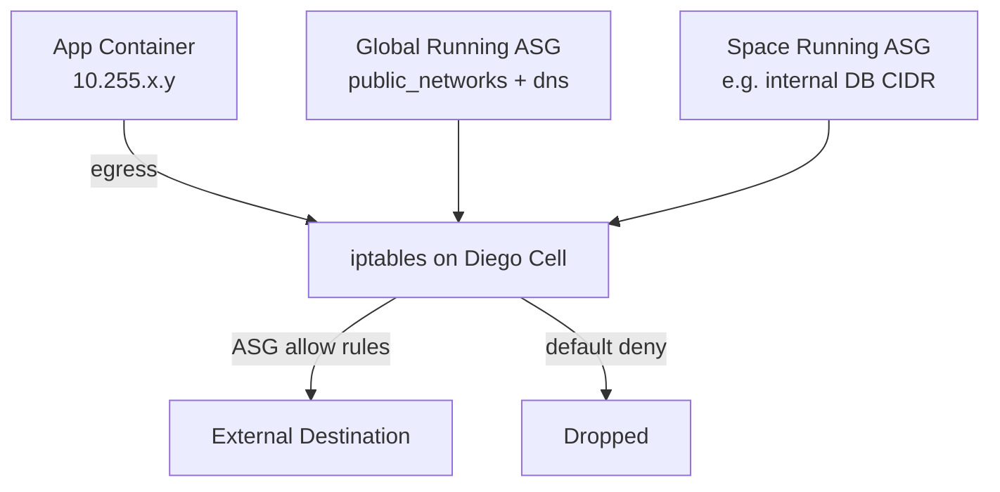
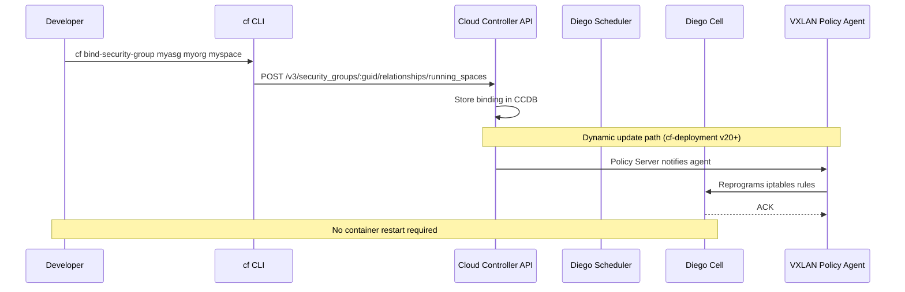
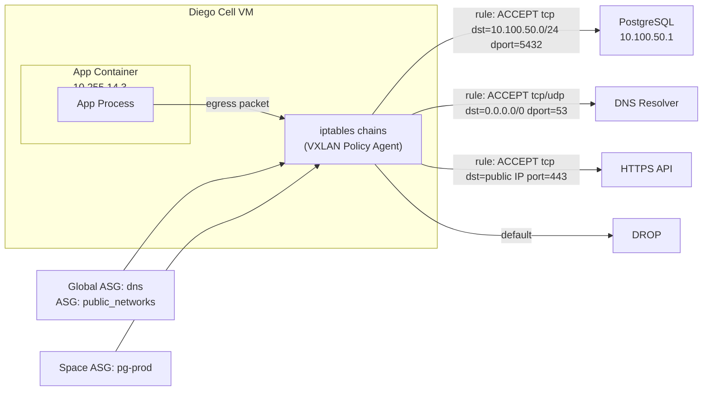

# Application Security Groups — Egress Control

**Track:** CF-B | **Lesson:** CF-07 | **Duration:** 45–60 min

---

## Quick Read (10 min)

**What ASGs are:** Stateful allow-rules that control outbound (egress) traffic from CF app containers to external destinations. They are the CF equivalent of Kubernetes egress NetworkPolicy rules — but coarser-grained and lifecycle-scoped.

**Key mental model:**
- ASGs are **allow-only**; default posture is deny-all egress
- Two lifecycle scopes: **Staging** (during `cf push` build) and **Running** (live container)
- Two binding scopes: **Global** (platform-wide default) and **Space-scoped** (per org/space)
- Rules match on: destination CIDR, protocol (tcp/udp/icmp/all), port range, optional `log` flag

**Default ASGs shipped with cf-deployment:**
- `dns` — allows UDP/TCP port 53 to all destinations
- `public_networks` — allows all ports/protocols but explicitly blocks all RFC 1918 ranges (10.0.0.0/8, 172.16.0.0/12, 192.168.0.0/16)

**Dynamic update (cf-deployment v20.0.0+):** ASG changes apply without container restart via the VXLAN Policy Agent reprogramming iptables.

**Staging vs Running matters:** A staging ASG is needed only if your buildpack or compile step fetches artifacts from the internet. Running ASGs govern your app's live traffic.



**Core commands:**
- `cf security-groups` — list all ASGs
- `cf security-group <name>` — inspect rules
- `cf create-security-group <name> rules.json` — create
- `cf bind-running-security-group <name>` — bind globally
- `cf bind-security-group <name> <org> <space>` — bind to space

**Production rules of thumb:**
- Never bind an ASG that allows all RFC 1918 ranges globally — that opens lateral movement to BOSH/CF infrastructure
- Always separate staging and running ASGs — buildpack internet access does not imply runtime internet access
- Log sensitive egress rules (`"log": true`) for audit trails
- Use space-scoped ASGs for internal service CIDRs (e.g., managed DB subnets)

> **K8s Engineer's Translation:** ASGs map most closely to Kubernetes `NetworkPolicy` with `policyTypes: [Egress]`. The global default ASG is like a cluster-wide default-deny egress policy with two allow rules (DNS + public internet). Space-scoped ASGs are like namespace-scoped egress NetworkPolicy rules added on top of the global baseline.

---

## Deep Dive

---

## Practice Setup

You need two terminals for this lesson.

**Terminal 1 — cf CLI (Mac/local)**
```bash
# Authenticate and target a space
cf login -a https://api.<your-cf-domain> --skip-ssl-validation
cf target -o myorg -s myspace

# Verify ASG tooling
cf security-groups
cf running-security-groups
cf staging-security-groups
```

**Terminal 2 — BOSH SSH into Diego Cell (operator access)**
```bash
# SSH into the Diego Cell to inspect iptables rules directly
bosh -d cf ssh diego-cell/0

# Once inside the Diego cell VM:
sudo iptables -L -n -v --line-numbers | head -60
sudo iptables -t nat -L -n -v | grep MASQUERADE
```

> You need BOSH operator access for Terminal 2. If you are a developer without BOSH access, Terminal 1 alone is sufficient for all cf CLI exercises.

---

## 1. What Application Security Groups Are

Application Security Groups (ASGs) define egress firewall rules for CF app containers. They answer one question: **which outbound connections is a container allowed to initiate?**

ASGs are implemented as `iptables` rules on the Diego Cell host, managed by the **VXLAN Policy Agent** (the same daemon that handles C2C network policies). Each rule is an allow-rule; there is no deny syntax in an ASG definition. Everything not explicitly allowed is dropped.



### The two scopes you must understand

**Lifecycle scope** determines when the ASG applies:
- **Staging ASGs** apply during `cf push` while the buildpack compiles/downloads dependencies
- **Running ASGs** apply once the container is running and serving traffic

**Binding scope** determines which apps are affected:
- **Global ASGs** (`bind-running-security-group` / `bind-staging-security-group`) apply to every app on the platform
- **Space-scoped ASGs** (`bind-security-group <name> <org> <space>`) apply only to apps in that specific org/space combination

The effective egress policy for a container is the **union** of all matching global and space-scoped ASGs. There is no precedence or override — it is strictly additive.

> **K8s Engineer's Translation:** The lifecycle scope (Staging vs Running) has no direct K8s equivalent; Kubernetes init containers and build pods use the same NetworkPolicy namespace as the main pod. The global vs space-scoped distinction maps to: global ASG = cluster-wide default NetworkPolicy; space-scoped ASG = additional namespace-scoped NetworkPolicy rules.

---

## 2. ASG Rule Structure and Default Policies

### Rule JSON format

An ASG is a JSON array of rule objects. Each object has the following fields:

| Field | Required | Description |
|-------|----------|-------------|
| `protocol` | yes | `tcp`, `udp`, `icmp`, or `all` |
| `destination` | yes | CIDR or single IP (e.g., `10.0.0.0/8`, `8.8.8.8`) |
| `ports` | if tcp/udp | Port or range: `"443"`, `"8000-9000"` |
| `type` / `code` | if icmp | ICMP type and code numbers |
| `log` | no | `true` enables kernel logging of matched packets |
| `description` | no | Human-readable note (not enforced) |

Example — a production-style outbound HTTPS + DNS ASG:

```json
[
  {
    "protocol": "tcp",
    "destination": "0.0.0.0/0",
    "ports": "443",
    "description": "Allow outbound HTTPS"
  },
  {
    "protocol": "tcp",
    "destination": "0.0.0.0/0",
    "ports": "80",
    "description": "Allow outbound HTTP (for redirects)"
  },
  {
    "protocol": "udp",
    "destination": "0.0.0.0/0",
    "ports": "53",
    "description": "Allow DNS UDP"
  },
  {
    "protocol": "tcp",
    "destination": "0.0.0.0/0",
    "ports": "53",
    "description": "Allow DNS TCP (for large responses)"
  }
]
```

### Default ASGs in cf-deployment

cf-deployment ships two global running ASGs that form the baseline posture:

**`dns` ASG:**
```json
[
  {
    "protocol": "udp",
    "destination": "0.0.0.0/0",
    "ports": "53"
  },
  {
    "protocol": "tcp",
    "destination": "0.0.0.0/0",
    "ports": "53"
  }
]
```

**`public_networks` ASG (conceptual — actual rules block RFC 1918):**
```json
[
  { "protocol": "all", "destination": "0.0.0.0-9.255.255.255" },
  { "protocol": "all", "destination": "11.0.0.0-172.15.255.255" },
  { "protocol": "all", "destination": "172.32.0.0-192.167.255.255" },
  { "protocol": "all", "destination": "192.169.0.0-255.255.255.255" }
]
```

This allows all public internet while implicitly blocking 10.0.0.0/8, 172.16.0.0/12, and 192.168.0.0/16. The Silk overlay (10.255.0.0/16) is separately unreachable from containers via other mechanisms.

```bash
# Inspect the default ASGs on your platform
cf security-group dns
cf security-group public_networks

# See which ASGs are bound globally for running apps
cf running-security-groups

# See which ASGs are bound globally for staging
cf staging-security-groups
```

> **K8s Engineer's Translation:** The `public_networks` ASG is equivalent to a cluster-wide default egress NetworkPolicy that allows `0.0.0.0/0` but has except clauses for all three RFC 1918 blocks. Kubernetes NetworkPolicy `ipBlock.except` does exactly this. The CF implementation compiles this into discrete iptables ACCEPT chains; the K8s equivalent compiles into iptables rules via kube-proxy or CNI.

---

## 3. Creating, Binding, and Managing ASGs

### Full workflow: creating a space-scoped ASG for a managed database

Your app in `myorg/production` needs to reach a PostgreSQL cluster at `10.100.50.0/24` on port 5432. This is an RFC 1918 address not covered by `public_networks`.

**Step 1: Write the rule file**

```bash
cat > /tmp/pg-asg.json <<'EOF'
[
  {
    "protocol": "tcp",
    "destination": "10.100.50.0/24",
    "ports": "5432",
    "log": true,
    "description": "Allow egress to managed PostgreSQL cluster"
  }
]
EOF
```

**Step 2: Create the ASG**

```bash
cf create-security-group pg-prod /tmp/pg-asg.json
# Creating security group pg-prod as admin...
# OK
```

**Step 3: Bind to the specific space**

```bash
cf bind-security-group pg-prod myorg production
# Assigning running security group pg-prod to space production in org myorg as admin...
# OK
# TIP: If Dynamic ASG's are disabled in Cloud Foundry, changes will require an app restart to take effect.
```

**Step 4: Verify the binding**

```bash
# Check the ASG definition
cf security-group pg-prod

# Check all security groups bound to the space
cf security-groups
# Look for pg-prod in the myorg / production row

# From the app container, test connectivity
cf ssh myapp -c "nc -zv 10.100.50.1 5432"
```

**Step 5: Verify iptables on the Diego Cell (operator)**

```bash
# In bosh ssh diego-cell/0:
sudo iptables -L -n -v | grep 10.100.50
# You should see ACCEPT rules for the destination CIDR/port
```

### Global binding (platform-wide)

```bash
# Bind an ASG globally for running apps
cf bind-running-security-group pg-prod
# This applies to ALL apps on the platform — use with caution

# Bind an ASG globally for staging
cf bind-staging-security-group my-staging-asg

# Unbind a global running ASG
cf unbind-running-security-group pg-prod

# Unbind a space-scoped ASG
cf unbind-security-group pg-prod myorg production
```

### Updating an existing ASG

```bash
# Update the rules (replaces all existing rules in the ASG)
cf update-security-group pg-prod /tmp/pg-asg-v2.json

# With dynamic ASGs (cf-deployment v20+), running containers pick up
# the update without restart. Verify:
cf ssh myapp -c "nc -zv 10.100.50.5 5432"
```

### ASG rule for ICMP (health checks, ping)

```bash
cat > /tmp/icmp-asg.json <<'EOF'
[
  {
    "protocol": "icmp",
    "destination": "0.0.0.0/0",
    "type": 8,
    "code": 0,
    "description": "Allow ICMP echo requests"
  }
]
EOF

cf create-security-group allow-icmp /tmp/icmp-asg.json
cf bind-security-group allow-icmp myorg myspace
```



> **K8s Engineer's Translation:** The VXLAN Policy Agent's iptables programming is analogous to what a CNI plugin (Calico, Cilium) does when it reconciles NetworkPolicy objects. In K8s, `kubectl apply` on a NetworkPolicy triggers the CNI to reprogram iptables or eBPF rules — no pod restart needed. CF's dynamic ASG update (v20+) achieves the same behavior: `cf update-security-group` or `cf bind-security-group` reprograms iptables on the Diego Cell without touching the container.

---

## 4. Troubleshooting

### Common failure mode 1: App cannot reach external service after deploy

**Symptom:** `cf ssh myapp -c "nc -zv api.external-service.com 443"` times out or connection refused.

**Diagnosis:**
```bash
# Step 1: Identify which ASGs are active for this app's space
cf target -o myorg -s myspace
cf security-groups | grep -E "myorg|myspace|<none>"

# Step 2: Check if the destination is RFC 1918 (blocked by public_networks)
# If the target is e.g. 10.x.x.x, public_networks will not cover it
# You need a space-scoped ASG

# Step 3: Verify no typo in the ASG rule CIDR
cf security-group my-asg

# Step 4: Test from inside the container
cf ssh myapp -c "curl -v --max-time 5 https://api.external-service.com/health"
cf ssh myapp -c "nc -zv api.external-service.com 443"
cf ssh myapp -c "nslookup api.external-service.com"

# Step 5: If DNS resolves but TCP fails, it is an ASG port/CIDR issue
# If DNS itself fails, check the dns global ASG is still bound
cf running-security-groups | grep dns
```

### Common failure mode 2: Dynamic ASG update not applying

**Symptom:** You updated an ASG but running containers still see the old behavior.

**Diagnosis:**
```bash
# Check cf-deployment version — dynamic ASGs require v20.0.0+
bosh -d cf releases | grep cf-deployment

# Check if the VXLAN Policy Agent is running on Diego Cells
bosh -d cf instances --ps | grep vxlan-policy-agent

# Check Policy Server logs for errors
bosh -d cf ssh diego-cell/0 -c "sudo monit summary | grep vxlan"
bosh -d cf ssh diego-cell/0 -c "sudo tail -50 /var/vcap/sys/log/vxlan-policy-agent/vxlan-policy-agent.stdout.log"

# Force a container restart as a workaround if dynamic update is broken
cf restart myapp
```

### Common failure mode 3: Staging fails because buildpack cannot download artifacts

**Symptom:** `cf push` fails with buildpack download errors during compile.

**Diagnosis:**
```bash
# Check if staging ASGs include the buildpack source
cf staging-security-groups

# Many teams forget to add a staging ASG and rely only on running ASGs
# Staging and running ASG sets are completely independent

# Example: allow staging access to npmjs.com and pypi.org
cat > /tmp/staging-internet.json <<'EOF'
[
  {"protocol": "tcp", "destination": "0.0.0.0/0", "ports": "443"},
  {"protocol": "tcp", "destination": "0.0.0.0/0", "ports": "80"},
  {"protocol": "udp", "destination": "0.0.0.0/0", "ports": "53"},
  {"protocol": "tcp", "destination": "0.0.0.0/0", "ports": "53"}
]
EOF

cf create-security-group staging-internet /tmp/staging-internet.json
cf bind-staging-security-group staging-internet
```

### Common failure mode 4: Unexpected lateral movement — RFC 1918 reachable from app

**Symptom:** Security audit reveals app containers can reach internal infrastructure IPs.

**Diagnosis:**
```bash
# Check if someone added a broad RFC 1918 ASG
cf security-groups
# Look for any ASG bound globally with destinations like 10.0.0.0/8

# Inspect each suspicious ASG
cf security-group suspicious-asg-name

# Check for overlapping space-scoped ASGs that together cover internal ranges
# Enumerate all space bindings
cf curl /v3/security_groups?running_space_guids=$(cf space myspace --guid)

# Remediation: unbind the overly permissive ASG and replace with scoped rules
cf unbind-running-security-group overly-broad-asg
cf unbind-security-group overly-broad-asg myorg myspace
```

### Diagnostic command summary

```bash
# List all ASGs (global and space-scoped)
cf security-groups

# Show rules for one ASG
cf security-group <name>

# Show all globally bound running ASGs
cf running-security-groups

# Show all globally bound staging ASGs
cf staging-security-groups

# Test egress from inside a container
cf ssh <app> -c "nc -zv <host> <port>"
cf ssh <app> -c "curl -sv --max-time 5 https://<host>/"

# Inspect iptables on Diego Cell (BOSH operator)
bosh -d cf ssh diego-cell/0 -c "sudo iptables -L -n -v --line-numbers | grep -A2 'Chain netout'"

# Check VXLAN Policy Agent health
bosh -d cf ssh diego-cell/0 -c "sudo monit summary | grep vxlan-policy-agent"

# Check Policy Server logs
bosh -d cf ssh diego-api/0 -c "sudo tail -100 /var/vcap/sys/log/policy-server/policy-server.stdout.log"

# Audit all security group bindings via CC API
cf curl /v3/security_groups?per_page=100
```

> **K8s Engineer's Translation:** The CF ASG troubleshooting workflow mirrors K8s NetworkPolicy debugging. The equivalent K8s steps are: `kubectl get networkpolicy -n myns`, `kubectl describe networkpolicy <name>`, then `kubectl exec -it <pod> -- nc -zv <host> <port>`. The iptables inspection on Diego Cell maps to `kubectl exec -it <node-pod> -- iptables -L -n -v` (with a privileged debug pod). The key difference: CF aggregates rules across multiple ASG objects; K8s also aggregates across multiple NetworkPolicy objects, both are additive.

---

## Production Checklist

- [ ] Default ASGs (`dns`, `public_networks`) are present and globally bound for running
- [ ] No ASG with `destination: 0.0.0.0/0` and `protocol: all` is globally bound (too permissive)
- [ ] RFC 1918 ranges required by apps are covered by space-scoped ASGs, not global ones
- [ ] Staging ASGs are configured separately from running ASGs if buildpacks need internet access
- [ ] All ASGs that allow access to sensitive internal services have `"log": true` for audit trail
- [ ] cf-deployment v20.0.0+ deployed to enable dynamic ASG updates without container restarts
- [ ] Regular audit of `cf security-groups` and `/v3/security_groups` API for drift
- [ ] Space-scoped ASGs are documented and owned by the team responsible for the space
- [ ] No single ASG allows all three RFC 1918 blocks simultaneously (use per-service CIDRs)
- [ ] ICMP is explicitly allowed only where needed (not globally via `protocol: all`)
- [ ] Egress to internal CF infrastructure IPs (Diego Cell range, BOSH director) is not in any ASG
- [ ] ASG JSON files are version-controlled alongside app manifests

---

## Quick Reference

| Task | Command |
|------|---------|
| List all ASGs | `cf security-groups` |
| Show ASG rules | `cf security-group <name>` |
| Create ASG | `cf create-security-group <name> rules.json` |
| Update ASG rules | `cf update-security-group <name> rules.json` |
| Delete ASG | `cf delete-security-group <name>` |
| Bind globally (running) | `cf bind-running-security-group <name>` |
| Bind globally (staging) | `cf bind-staging-security-group <name>` |
| Bind to space (running) | `cf bind-security-group <name> <org> <space>` |
| Bind to space (staging) | `cf bind-security-group <name> <org> <space> --lifecycle staging` |
| Unbind global (running) | `cf unbind-running-security-group <name>` |
| Unbind global (staging) | `cf unbind-staging-security-group <name>` |
| Unbind from space | `cf unbind-security-group <name> <org> <space>` |
| List global running ASGs | `cf running-security-groups` |
| List global staging ASGs | `cf staging-security-groups` |
| Test egress from container | `cf ssh <app> -c "nc -zv <host> <port>"` |
| Inspect CC API bindings | `cf curl /v3/security_groups?per_page=100` |
| Check iptables on cell | `bosh -d cf ssh diego-cell/0 -c "sudo iptables -L -n -v"` |
| Check VPA logs | `bosh -d cf ssh diego-cell/0 -c "sudo tail -50 /var/vcap/sys/log/vxlan-policy-agent/vxlan-policy-agent.stdout.log"` |

---

## See Also

**Related K8s lessons in this course:**

- **Lesson 18 — Kubernetes NetworkPolicy Fundamentals:** Direct K8s counterpart to ASGs. Both compile to iptables rules; CF ASGs are egress-only while K8s NetworkPolicy handles ingress and egress.
- **Lesson 19 — Calico NetworkPolicy and GlobalNetworkPolicy:** Calico's GlobalNetworkPolicy is the closest K8s equivalent to CF's global ASGs — platform-wide rules that apply regardless of namespace.
- **Lesson 20 — Cilium Network Policy and eBPF:** Cilium replaces iptables with eBPF programs for policy enforcement, while CF's VXLAN Policy Agent uses iptables. The policy model is structurally similar.
- **Lesson 11 — Pod Security and Container Isolation:** Covers how K8s restricts what containers can do at the OS level (seccomp, AppArmor) — complementary to network-layer controls like ASGs.
- **Lesson 22 — Istio Authorization Policy:** mTLS-based service mesh egress control in K8s is an alternative approach to what ASGs provide — policy at the application layer rather than the iptables layer.

---

## Online Resources

- [CF Docs: Application Security Groups](https://docs.cloudfoundry.org/concepts/asg.html) — official CF documentation covering ASG rule format, binding scopes, and dynamic updates
- [CF Docs: Managing ASGs](https://docs.cloudfoundry.org/adminguide/app-sec-groups.html) — operator guide with full CLI reference and best practices for production platforms
- [cf-deployment v20.0.0 Release Notes](https://github.com/cloudfoundry/cf-deployment/releases/tag/v20.0.0) — release notes documenting the dynamic ASG feature introduction
- [VXLAN Policy Agent source (silk-release)](https://github.com/cloudfoundry/silk-release) — Go source for the agent that programs iptables rules from Policy Server data, useful for understanding the enforcement mechanism
- [CF Security Groups API v3](https://v3-apidocs.cloudfoundry.org/version/release-candidate/#security-groups) — V3 API reference for programmatic ASG management and automation
