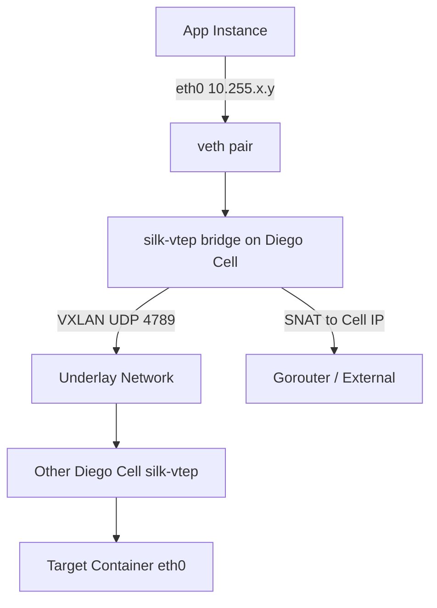
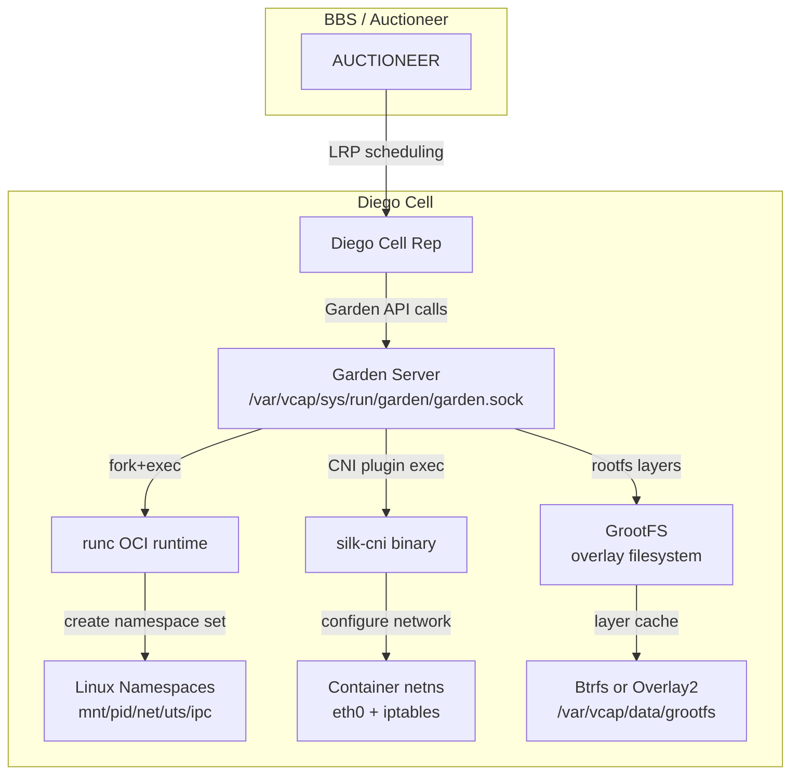

# CF-08: Garden Container Runtime and Network Namespaces

**Track:** CF-B — CF Internals and Container Networking
**Duration:** ~45 min (Deep Dive) / ~10 min (Quick Read)
**Prerequisites:** CF-01 through CF-07, Linux namespace fundamentals

---

## Quick Read (10 min)

**What Garden is:**
- Garden is the container runtime for Cloud Foundry, analogous to containerd in Kubernetes
- It runs on every Diego Cell and is managed by the `garden-runc` process
- Each CF app instance = one Garden container = one set of Linux namespaces

**Network namespace basics in CF:**
- Garden creates a dedicated network namespace per container at startup
- Silk CNI plugin wires the namespace into the VXLAN overlay (10.255.0.0/16)
- Each Diego Cell gets a /24 subnet; up to ~254 containers per Cell
- Container gets: one `eth0` (overlay), one `lo`, default route via Cell's vtep

**Key isolation layers:**
- Mount namespace: private rootfs (GrootFS layered image)
- PID namespace: container sees only its own processes
- Network namespace: private stack, routes, iptables chains
- User namespace: optional, maps container root → unprivileged host UID
- UTS namespace: independent hostname

**iptables roles in CF:**
- ASG (Application Security Group) rules → `netout-*` chains, enforced per container
- C2C policy rules → `cni-forward` chain, managed by VXLAN Policy Agent
- SNAT rule → outbound traffic masquerades as Diego Cell IP



**What you need to know fast:**
- Garden containers use `runc` under the hood — same OCI runtime as K8s pods
- Network setup is done by the CNI plugin at container create time, not at startup
- Silk CNI writes routes and iptables rules; Garden itself is CNI-agnostic
- `bosh ssh` to a Diego Cell, then `runc list` or `ip netns list` to inspect containers
- MTU = underlay MTU - 50 (VXLAN overhead); misconfigured MTU is the #1 silent networking bug

> **K8s Engineer's Translation:** Garden is to CF what containerd + kubelet are to Kubernetes. Garden creates containers; a CNI plugin (Silk) handles all networking. The "Garden container" maps directly to a K8s pod with one container. Linux namespaces are identical at the kernel level.

---

## Deep Dive

---

## Practice Setup

You need two terminals for this lesson.

**Terminal 1 — BOSH SSH (Diego Cell kernel inspection)**

```bash
# Target your BOSH environment
bosh -e my-env -d cf-deployment ssh diego-cell/0

# Once inside the Diego Cell:
sudo -i
runc list                          # list all running containers (Garden handles)
ip netns list                      # list network namespaces
ls /var/vcap/data/garden/depot/    # Garden container directories
```

**Terminal 2 — CF CLI (app-level operations)**

```bash
# Target your CF environment
cf api https://api.sys.example.com
cf login

# Push a test app for inspection
cf push nettest -o cloudfoundry/test-app --no-start
cf set-env nettest GOPACKAGENAME main
cf start nettest

# Get the app GUID — needed to correlate with Garden container ID
cf app nettest --guid
```

---

## 1. Garden Container Runtime Architecture

Garden is the Cloud Foundry container runtime daemon. It runs as a BOSH-deployed process on every Diego Cell and exposes the Garden API over a Unix socket. Diego's executor component calls Garden to create, manage, and destroy containers for every app instance and task.



**Garden server process:** `/var/vcap/jobs/garden/bin/garden_ctl`

The Garden server listens on a Unix socket (`/var/vcap/sys/run/garden/garden.sock`) and exposes a garden-api (a simple HTTP+JSON API). Diego's executor calls endpoints like `POST /containers` to create a container, `PUT /containers/:handle/run` to execute processes, and `DELETE /containers/:handle` to destroy.

**Container handles:** Garden identifies each container by a UUID handle. This handle maps one-to-one to the Diego LRP instance GUID and is also used as the container directory name under `/var/vcap/data/garden/depot/`.

```bash
# On Diego Cell: list running containers with their handles
curl --unix-socket /var/vcap/sys/run/garden/garden.sock \
     http://localhost/containers | python3 -m json.tool

# Or use the gaol CLI (Garden API Object List)
# gaol is the Garden equivalent of crictl/ctr
gaol -t unix:///var/vcap/sys/run/garden/garden.sock list
gaol -t unix:///var/vcap/sys/run/garden/garden.sock properties <handle>
```

> **K8s Engineer's Translation:** Garden is functionally equivalent to containerd's CRI endpoint. The Garden API socket (`garden.sock`) is the analog of the containerd socket (`containerd.sock`). `gaol list` is equivalent to `crictl ps`. The Diego Cell Rep is the analog of kubelet — it talks to the local container runtime to manage instance lifecycle.

**GrootFS — layered image filesystem:**

GrootFS manages the OCI image layers that form each container's rootfs. It uses either overlay2 or btrfs as the backend. When a container is created, GrootFS:

1. Downloads the application droplet (the compiled app artifact) and stack image layers
2. Stacks them using an overlay mount
3. Creates a unique read-write layer for the container

```bash
# Inspect GrootFS stores on a Diego Cell
ls /var/vcap/data/grootfs/store/unprivileged/images/
ls /var/vcap/data/grootfs/store/unprivileged/volumes/

# Get disk usage per container image
/var/vcap/packages/grootfs/bin/grootfs \
  --config /var/vcap/jobs/garden/config/grootfs_config.yml \
  stats <image-id>
```

---

## 2. Linux Namespace Creation and Network Namespace Wiring

When Garden creates a container, it invokes `runc` to set up the full namespace set. The network namespace is initially empty — it has only the loopback interface. Garden then calls the configured CNI plugin (Silk CNI in standard CF deployments) to wire in networking.

**Namespace creation sequence:**

```
1. runc create <handle>
   - new mnt namespace  (private rootfs via GrootFS overlay)
   - new pid namespace  (container PID 1 = app process)
   - new net namespace  (empty: only lo)
   - new uts namespace  (hostname = container handle)
   - new ipc namespace

2. CNI plugin exec: silk-cni ADD
   - create veth pair (eth0 in container, cni-<id> on host)
   - assign IP from /24 Cell subnet (e.g. 10.255.42.3/24)
   - set default route: 10.255.42.1 via eth0
   - create/join silk-vtep bridge on host side
   - program VXLAN FDB entries
   - install iptables rules: netout (ASG), netin, SNAT

3. runc start <handle>
   - process begins executing inside all namespaces
```

**Inspecting network namespaces from the Diego Cell:**

```bash
# List all network namespaces (each Garden container has one)
ip netns list

# Garden container net namespaces are in /proc/<pid>/ns/net
# Find the PID of a container process given a handle
HANDLE="<garden-container-handle>"
CONTAINER_PID=$(cat /var/vcap/data/garden/depot/${HANDLE}/state.json \
                | python3 -c "import sys,json; d=json.load(sys.stdin); print(d['pid'])")

# Enter the container's network namespace
nsenter --net=/proc/${CONTAINER_PID}/ns/net ip addr show
nsenter --net=/proc/${CONTAINER_PID}/ns/net ip route show
nsenter --net=/proc/${CONTAINER_PID}/ns/net iptables -L -n -v

# View the container's iptables rules (ASG enforcement chains)
nsenter --net=/proc/${CONTAINER_PID}/ns/net iptables -L netout-<handle-short> -n -v
```

**What you will see inside the container's netns:**

```
# ip addr show inside container netns
1: lo: <LOOPBACK,UP,LOWER_UP> mtu 65536 ...
    inet 127.0.0.1/8
2: eth0@if47: <BROADCAST,MULTICAST,UP,LOWER_UP> mtu 1450 ...
    inet 10.255.42.3/24

# ip route show inside container netns
default via 169.254.0.1 dev eth0
10.255.0.0/16 via 169.254.0.1 dev eth0
```

Note the gateway `169.254.0.1` — this is a link-local address assigned to the host-side veth. Silk uses this trick to avoid consuming overlay IP space for the gateway.

> **K8s Engineer's Translation:** In Kubernetes, the kubelet calls the CNI plugin to wire a pod's network namespace in exactly the same sequence: create netns, exec CNI ADD, then start containers. The veth pair + bridge model is identical to Flannel or Calico with VXLAN. The main difference is that CF uses `169.254.0.1` as a fake gateway on the host-side veth, while most K8s CNIs assign a real IP to the bridge interface.

**MTU considerations:**

The MTU inside every CF container is set to: `underlay_mtu - 50`

VXLAN encapsulation adds an outer UDP header (8 bytes), outer IP header (20 bytes), VXLAN header (8 bytes), and outer Ethernet header (14 bytes) = 50 bytes total overhead.

```bash
# Verify MTU on the container's eth0
nsenter --net=/proc/${CONTAINER_PID}/ns/net ip link show eth0
# Should show: mtu 1450 if underlay MTU is 1500

# Verify MTU on the host-side vtep
ip link show silk-vtep
# Should also show mtu 1450

# Check Garden/Silk configuration for MTU
cat /var/vcap/jobs/silk-cni/config/cni.conf | python3 -m json.tool
# Look for "mtu": 1450
```

Mismatched MTU is the most common silent performance bug: TCP sessions work but throughput is degraded because IP fragmentation occurs silently on the underlay.

---

## 3. Silk CNI Internals and VXLAN Policy Agent

**Silk CNI plugin layout:**

Silk is CF's purpose-built CNI plugin. It consists of several cooperating processes:

| Process | Role |
|---|---|
| `silk-controller` | Central IP address management (runs on control plane VMs) |
| `silk-daemon` | Per-Cell agent; leases /24 subnet from controller; programs VXLAN FDB |
| `silk-cni` | CNI plugin binary; called by Garden at container create/destroy |
| `vxlan-policy-agent` | Per-Cell agent; polls Policy Server; pushes C2C iptables rules |

```bash
# On Diego Cell: check silk-daemon health
monit summary | grep silk
curl http://127.0.0.1:23954/state | python3 -m json.tool
# Shows: overlay subnet assigned to this Cell, VTEP IP, lease expiry

# Check which subnet this Cell owns
cat /var/vcap/data/silk/client-state.json
# Example: {"subnet":"10.255.42.0/24","vtep_ip":"10.0.1.5","overlay_ip":"10.255.42.1"}

# Inspect VXLAN FDB (forwarding database) — where other Cells' VTEPs are
bridge fdb show dev silk-vtep
# Each line: <mac> dst <cell-underlay-ip> self permanent
```

**VXLAN Policy Agent and C2C rules:**

The VXLAN Policy Agent runs on each Diego Cell and is responsible for C2C (container-to-container) network policy enforcement. It polls the CF Policy Server every 5 seconds and translates network policies into iptables rules inside each container's network namespace.

```bash
# Check Policy Agent health
curl http://127.0.0.1:4007/stats | python3 -m json.tool

# View current C2C iptables rules installed by Policy Agent
# These are in the FORWARD chain on the host, keyed by overlay IP
iptables -L FORWARD -n -v | grep cni
iptables -L cni-forward -n -v

# Policy Agent log — shows policy polling and rule updates
tail -f /var/vcap/sys/log/vxlan-policy-agent/vxlan-policy-agent.stdout.log
```

**How a C2C policy becomes a packet filter:**

```
CF API: cf add-network-policy frontend --destination-app backend --port 8080 --protocol tcp

Policy Server stores:
  source_app_id:      <frontend-guid>
  destination_app_id: <backend-guid>
  protocol:           tcp
  port:               8080

VXLAN Policy Agent on each Cell polls Policy Server →
  resolves app GUID → overlay IPs of running instances →
  generates iptables rule per container netns:

iptables -A cni-forward -s 10.255.11.3 -d 10.255.42.7 -p tcp --dport 8080 -j ACCEPT
```

> **K8s Engineer's Translation:** The CF Policy Server + VXLAN Policy Agent is the analog of a Kubernetes NetworkPolicy controller (e.g., Calico Felix or Cilium agent). The policy is stored centrally, translated to kernel-level iptables/eBPF rules per node, and enforced in-kernel. The key CF difference: policies are defined by app GUID (not IP), so they survive app redeploys and IP changes automatically. K8s NetworkPolicy uses pod label selectors instead.

**Overlay vs underlay routing:**

```bash
# On Diego Cell: show the routing table
ip route show

# Key routes:
# 10.255.0.0/16 dev silk-vtep  — all overlay traffic goes to VTEP
# 10.255.42.0/24 dev silk-cni-eth0  — local Cell containers (no VXLAN needed)

# Packet path for cross-Cell C2C:
# container eth0 → veth → silk-vtep → VXLAN encap → underlay → remote silk-vtep → remote container eth0

# Packet path for same-Cell C2C:
# container eth0 → veth → bridge → remote container veth → remote eth0
# No VXLAN — hairpin bridging within the Cell
```

---

## 4. Troubleshooting Garden and Network Namespaces

### Common Failure Modes

**Failure 1: Container fails to start with network error**

Symptom: `cf logs myapp --recent` shows "Failed to create container" or timeout.

```bash
# On Diego Cell: check Garden logs
tail -100 /var/vcap/sys/log/garden/garden.stdout.log | grep -i error

# Check CNI plugin logs
tail -100 /var/vcap/sys/log/silk-cni/silk-cni.stdout.log

# Check if silk-daemon has a valid subnet lease
curl -s http://127.0.0.1:23954/state | python3 -m json.tool
# If "subnet" is empty, silk-daemon cannot reach silk-controller

# Check silk-controller reachability from the Cell
curl -s https://<silk-controller-ip>:4103/leases/renew
```

**Failure 2: Containers can reach external IPs but not each other (C2C broken)**

Symptom: `cf add-network-policy` is set, but curl between apps times out.

```bash
# Step 1: verify the policy is registered
cf network-policies

# Step 2: check Policy Agent is running and polling
monit summary | grep vxlan
curl -s http://127.0.0.1:4007/stats

# Step 3: check that rules exist in iptables for the container
# Get overlay IPs of both containers
nsenter --net=/proc/${SRC_PID}/ns/net ip addr show eth0
nsenter --net=/proc/${DST_PID}/ns/net ip addr show eth0

# Step 4: look for the specific rule
iptables -L cni-forward -n -v | grep <dst-overlay-ip>
# If missing: Policy Agent did not translate the policy to this Cell

# Step 5: check Policy Server reachability
curl -sk https://<policy-server-ip>:4003/networking/v1/internal/policies
```

**Failure 3: MTU mismatch — high packet loss or TCP stalls**

Symptom: HTTP requests succeed for small payloads, fail or stall for large responses (file downloads, large JSON).

```bash
# Verify MTU inside container matches expected value
nsenter --net=/proc/${CONTAINER_PID}/ns/net ip link show eth0
# Expected: mtu 1450 (for 1500 underlay)

# Check actual underlay MTU on the Cell's NIC
ip link show eth0  # or ens4, enp1s0 — the Cell's physical/VM NIC
# If this shows 9000 (jumbo frames), container MTU should be 8950

# Test with explicit MTU: ping with large packet from inside container
nsenter --net=/proc/${CONTAINER_PID}/ns/net \
  ping -M do -s 1422 10.255.0.1
# -M do: don't fragment; -s 1422 = 1422 bytes payload + 28 IP/ICMP header = 1450 total

# Fix: update silk-cni config and recreate containers
# /var/vcap/jobs/silk-cni/config/cni.conf: "mtu": <correct value>
# Then bosh restart diego-cell (rolling)
```

**Failure 4: Container IP address exhaustion on a Cell**

Symptom: New containers fail to start on a specific Cell with "no available IP" errors.

```bash
# Check how many containers are running on the Cell
runc list | wc -l
# Silk /24 gives 254 usable IPs; if you're near that, you need more Cells

# Check the allocated IPs
# VTEP's ARP table shows all container IPs on this Cell
arp -n | grep 10.255.<cell-subnet>

# If you are using the full /24, the Cell is at capacity
# Resolution: scale Diego Cells (bosh deploy with higher instance count)
# or investigate stuck containers that failed to be cleaned up

# Find zombie/stuck containers
runc list | grep stopped
# Destroy a stuck container
runc delete <handle>
```

**Failure 5: ASG rules not taking effect**

Symptom: App cannot reach an external endpoint that an ASG should allow.

```bash
# Step 1: verify ASG is bound correctly
cf security-groups
cf security-group <sg-name>
cf running-security-groups

# Step 2: check ASG rules are in iptables inside container
nsenter --net=/proc/${CONTAINER_PID}/ns/net \
  iptables -L netout-<handle-prefix> -n -v
# Should show ACCEPT rules matching the ASG JSON spec

# Step 3: test connectivity from inside container
# Using cf ssh
cf ssh myapp -c "curl -v https://target-host:443"

# Step 4: check if the destination is blocked by default ASG
# Default ASGs: dns (allow port 53), public_networks (block RFC1918)
# If your target is RFC1918, you need a custom Running ASG

# Step 5: check dynamic ASG update (cf-deployment v20.0.0+)
# ASG changes apply without restart — verify with:
cf update-security-group <sg-name> updated-rules.json
# Wait up to 60s, then re-test without restarting the app
```

**Diagnostic command quick reference:**

```bash
# Garden container state
gaol -t unix:///var/vcap/sys/run/garden/garden.sock list
gaol -t unix:///var/vcap/sys/run/garden/garden.sock info <handle>

# Network namespace for a specific container
runc state <handle>  # gives PID
nsenter --net=/proc/<pid>/ns/net ip addr
nsenter --net=/proc/<pid>/ns/net ip route
nsenter --net=/proc/<pid>/ns/net iptables -L -n -v

# Silk overlay state
curl -s http://127.0.0.1:23954/state | python3 -m json.tool
bridge fdb show dev silk-vtep
ip -d link show silk-vtep  # show VXLAN config (VNI, port, group)

# VXLAN Policy Agent
curl -s http://127.0.0.1:4007/stats
iptables -L cni-forward -n -v

# ASG rules inside container
nsenter --net=/proc/<pid>/ns/net iptables -L netout-<short-handle> -n -v

# Packet capture on VTEP (see all VXLAN traffic)
tcpdump -i silk-vtep -n -s0 -w /tmp/silk-vtep.pcap
# Capture on underlay to see encapsulated frames
tcpdump -i eth0 -n udp port 4789 -w /tmp/vxlan-raw.pcap
```

> **K8s Engineer's Translation:** CF troubleshooting follows exactly the same pattern as K8s CNI debugging: get the PID of the container process, enter its network namespace with `nsenter`, then use standard Linux tools (`ip`, `iptables`, `ss`, `ping`). The difference is how you find the container PID: in K8s you use `crictl inspect <container-id> | jq .info.pid`; in CF you use `runc state <garden-handle>` or read the Garden depot state file.

---

## Production Checklist

- [ ] Confirm MTU is set correctly on all Diego Cells: `container MTU = underlay MTU - 50`
- [ ] Verify silk-daemon has a valid subnet lease on every Cell: `curl http://127.0.0.1:23954/state`
- [ ] Confirm VXLAN Policy Agent is running and showing recent poll timestamps on every Cell
- [ ] Review Cell capacity: each Cell is limited to ~254 containers (/24 overlay subnet)
- [ ] Ensure default Running ASGs cover required egress (DNS on 53 at minimum)
- [ ] Confirm dynamic ASG updates are enabled (cf-deployment v20.0.0+) to avoid app restarts for policy changes
- [ ] Add custom Running ASG if apps need to reach RFC1918 addresses (blocked by default public_networks ASG)
- [ ] Verify Garden disk quota is configured appropriately to prevent one app consuming all GrootFS volume
- [ ] Test C2C connectivity end-to-end after any Diego Cell rolling restart
- [ ] Monitor `cni-forward` iptables chain size on heavily-loaded Cells — large policy sets can slow iptables traversal
- [ ] Confirm Garden ephemeral disk cleanup is not falling behind: check `/var/vcap/data/grootfs/store/` disk usage
- [ ] Validate that cross-Cell VXLAN traffic is not blocked by underlay firewall rules (UDP 4789 must be open between all Cells)
- [ ] Check Garden process file descriptor limits on cells hosting many containers: `ulimit -n` should be 65536+

---

## Quick Reference

| Task | Command |
|---|---|
| List all Garden containers on a Cell | `gaol -t unix:///var/vcap/sys/run/garden/garden.sock list` |
| Get container details (IPs, state) | `gaol -t unix:///var/vcap/sys/run/garden/garden.sock info <handle>` |
| Find container PID from handle | `runc state <handle> \| python3 -c "import sys,json; d=json.load(sys.stdin); print(d['pid'])"` |
| Enter container network namespace | `nsenter --net=/proc/<pid>/ns/net <command>` |
| Show container IP address | `nsenter --net=/proc/<pid>/ns/net ip addr show eth0` |
| Show container routes | `nsenter --net=/proc/<pid>/ns/net ip route` |
| Show container ASG iptables rules | `nsenter --net=/proc/<pid>/ns/net iptables -L netout-<handle> -n -v` |
| Show C2C policy iptables rules | `iptables -L cni-forward -n -v` |
| Check silk-daemon subnet lease | `curl -s http://127.0.0.1:23954/state \| python3 -m json.tool` |
| Show VXLAN FDB (Cell-to-Cell mapping) | `bridge fdb show dev silk-vtep` |
| Check VXLAN Policy Agent stats | `curl -s http://127.0.0.1:4007/stats` |
| Capture VXLAN overlay traffic | `tcpdump -i silk-vtep -n -s0` |
| Capture raw VXLAN encapsulated traffic | `tcpdump -i eth0 -n udp port 4789` |
| List CF network policies | `cf network-policies` |
| Add C2C network policy | `cf add-network-policy <src-app> --destination-app <dst-app> --port <port> --protocol tcp` |
| Check running security groups | `cf running-security-groups` |
| Get app GUID | `cf app <name> --guid` |
| Check Garden logs | `tail -f /var/vcap/sys/log/garden/garden.stdout.log` |
| Check Silk CNI logs | `tail -f /var/vcap/sys/log/silk-cni/silk-cni.stdout.log` |
| Check Policy Agent logs | `tail -f /var/vcap/sys/log/vxlan-policy-agent/vxlan-policy-agent.stdout.log` |
| List GrootFS images | `ls /var/vcap/data/grootfs/store/unprivileged/images/` |
| Get GrootFS disk stats for image | `/var/vcap/packages/grootfs/bin/grootfs --config /var/vcap/jobs/garden/config/grootfs_config.yml stats <id>` |

---

## See Also

**Related K8s lessons in this course:**

- **Linux-01: Linux Network Namespaces and veth Pairs** — the kernel primitives that CF and K8s both use for container networking; `ip netns`, `nsenter`, veth creation
- **Linux-02: iptables and nftables** — how iptables chains work; directly applies to understanding CF's `netout-*` and `cni-forward` chains
- **K8s-04: CNI Plugin Architecture** — the CNI specification that Silk implements; ADD/DEL/CHECK lifecycle, CNI config JSON format
- **K8s-05: Kubernetes Pod Networking with Flannel** — VXLAN-based overlay almost identical to Silk; VTEP bridge, FDB, encapsulation
- **K8s-06: Calico and NetworkPolicy** — per-node policy agent programming iptables from a central policy store; direct CF Policy Agent analog
- **K8s-08: Container Runtime Interface (CRI)** — containerd/runc and how kubelet manages container lifecycle; Garden plays the same role in CF

---

## Online Resources

- [Garden-RunC GitHub Repository](https://github.com/cloudfoundry/garden-runc-release) — source code, BOSH release, and configuration reference for the Garden container runtime
- [CF Networking Release (Silk CNI) Documentation](https://github.com/cloudfoundry/cf-networking-release/blob/develop/docs/architecture.md) — architecture overview of Silk CNI, VXLAN Policy Agent, and Policy Server
- [Cloud Foundry Container-to-Container Networking Guide](https://docs.cloudfoundry.org/devguide/deploy-apps/cf-networking.html) — official CF documentation for C2C networking and network policies
- [Application Security Groups Reference](https://docs.cloudfoundry.org/concepts/asg.html) — full ASG specification, default ASG rules, dynamic ASG updates, and troubleshooting
- [GrootFS: The CF Image Manager](https://github.com/cloudfoundry/grootfs) — GrootFS source and documentation; overlay filesystem management, disk quotas, and image layer caching
