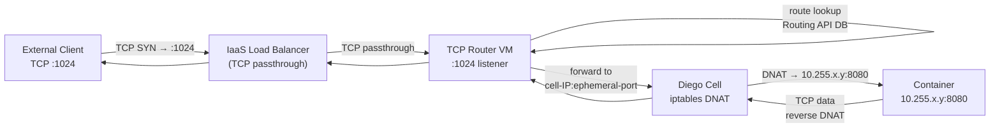
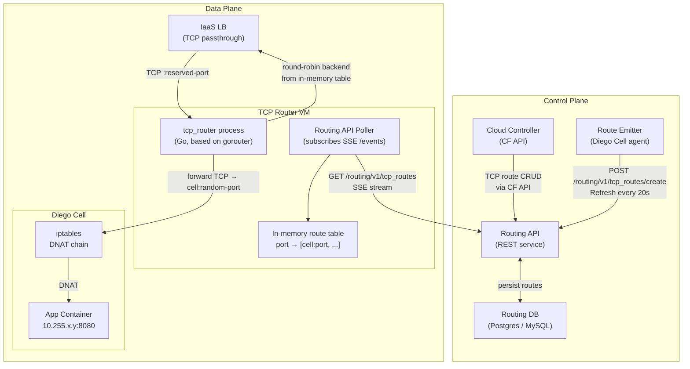

# CF-10 — TCP Router: Non-HTTP Traffic Routing

**Track:** CF-C — Advanced Routing  
**Prerequisite:** CF-09 (Gorouter TLS and Route Integrity) or equivalent  
**Companion K8s lessons:** Lesson 17 — Ingress Controllers Deep Dive, Lesson 18 — Gateway API and L4 Routing, Lesson 19 — MetalLB and LoadBalancer Services

**Jump to:** [Quick Read](#quick-read-10-min) · [Deep Dive](#deep-dive) · [Troubleshooting](#4-troubleshooting-tcp-routes) · [Quick Reference](#quick-reference)

---

## Quick Read (10 min)

After this lesson you will be able to: explain how CF TCP Router routes non-HTTP traffic at Layer 4, create and manage TCP routes with the cf CLI, and diagnose common TCP routing failures using iptables, conntrack, and the Routing API.

**What TCP Router is:** CF's dedicated Layer 4 router for non-HTTP workloads. While Gorouter handles HTTP/HTTPS at Layer 7 (with headers, sticky sessions, and route integrity), TCP Router forwards raw TCP connections by mapping an external port to a backend application instance. No HTTP parsing, no header injection, no TLS termination by default — just bytes in, bytes out.

**Key mental model:**

- TCP Router = a port-reservation system + reverse proxy for TCP, not HTTP
- Operators define `reservable_ports` (e.g., `1024-1123`) in the routing API; apps claim one port per TCP route
- Each TCP route is `<tcp-router-hostname>:<reserved-port>` → one or more app instances (round-robin per connection)
- The Diego Cell uses iptables DNAT to rewrite the destination from `cell-IP:ephemeral-port` to `container-IP:8080` (or the app's declared port)
- No Route Emitter NATS heartbeats for TCP routes — the Routing API persists TCP route mappings in a database
- TLS: app can do its own TLS; TCP Router passes bytes through unchanged unless configured for TLS termination

**Who uses TCP Router:**

- Databases (MySQL replication, Redis, Postgres)
- gRPC services (HTTP/2 binary protocol, incompatible with Gorouter HTTP/1.1 routing table)
- WebSocket-only apps that want a dedicated port instead of Gorouter WebSocket upgrade
- IoT/MQTT brokers
- Custom TCP protocols (game servers, financial FIX protocol, etc.)

**Quick architecture diagram:**



**Core facts — bullet form:**

- `reservable_ports`: operator-configured range in Cloud Controller / Routing API (e.g., `1024-1123`, max 100 ports per router group by default)
- One TCP route = one port number on the TCP Router's public hostname
- Multiple app instances behind one TCP route = round-robin, one backend chosen per new connection (not per request like HTTP)
- Backend selection is stateless — no sticky sessions for TCP routes
- TCP Router discovers backends from the Routing API (REST + Postgres), not from NATS
- If all backends are unhealthy, TCP Router drops new connections (no circuit breaker built in)
- `cf map-route` for TCP requires `--port <N>` flag; `cf create-route` requires domain with router group type `tcp`
- Diego Cell port mapping: Gorouter uses a random high port + iptables DNAT; TCP Router uses the same DNAT mechanism

> **K8s Engineer's Translation:** TCP Router is equivalent to a Kubernetes `Service` of type `LoadBalancer` with `protocol: TCP` combined with a bare-metal ingress controller for L4. The `reservable_ports` concept maps to `NodePort` ranges in K8s (`--service-node-port-range`). The routing table in Routing API DB maps to `kube-proxy` iptables rules or IPVS entries. The key difference: in K8s you create a Service per app; in CF all TCP apps share a pool of reserved ports on the same set of TCP Router VMs.

**What you will learn in the Deep Dive:** how the TCP Router component stack is wired together, how to create and manage TCP routes with the cf CLI, how the iptables DNAT chain works on a Diego Cell for TCP backends, how to configure router groups and port ranges as an operator, and how to diagnose TCP routing failures end to end.

---

## Deep Dive

---

## Practice Setup

You need two terminals for every exercise in this lesson.

**Terminal 1 — cf CLI (your laptop or jumpbox)**

```bash
cf api https://api.cf.example.com --skip-ssl-validation
cf login -u admin
cf target -o myorg -s myspace

# Verify the routing API is reachable
cf curl /routing/v1/router_groups
cf curl /routing/v1/tcp_routes
```

**Terminal 2 — BOSH SSH into a Diego Cell**

```bash
# List VMs in the CF deployment
bosh -e my-env -d cf vms | grep -E 'diego_cell|tcp_router'

# SSH into a TCP Router VM (not a Diego Cell) for router-side inspection
bosh -e my-env -d cf ssh tcp_router/0

# Or SSH into a Diego Cell for DNAT chain inspection
bosh -e my-env -d cf ssh diego_cell/0
sudo su -
```

> Both terminals are needed: Terminal 1 to push apps and manipulate routes, Terminal 2 to observe raw iptables rules, TCP Router process state, and Routing API database entries.

---

## 1. TCP Router Architecture

### Component Stack

TCP Router is a separate BOSH job (`tcp_router`) that runs alongside Gorouter but handles only Layer 4 TCP forwarding. The two routers share the Routing API as their source of truth but use different registration mechanisms.



**Key architectural points:**

- TCP Router subscribes to the Routing API via Server-Sent Events (SSE) for real-time updates — no NATS
- The in-memory route table maps `external-port → []backend{cell-IP, host-port}` entries
- Each backend `host-port` is a random ephemeral port allocated by Diego when the app instance starts
- iptables DNAT on the Diego Cell translates `cell-IP:host-port` → `container-IP:8080`
- Round-robin is per-connection (TCP SYN), not per-request — a long-lived TCP connection always stays on one backend

> **K8s Engineer's Translation:** The Routing API + SSE subscription is analogous to how `kube-proxy` watches the Kubernetes API server for `Endpoints` changes. The TCP Router's in-memory route table plays the role of `kube-proxy`'s iptables/IPVS rules, but lives in a user-space Go process rather than kernel-space. The Diego Cell iptables DNAT is the same mechanism as kube-proxy's per-node service DNAT rules.

### Router Groups and Port Ranges

TCP routes are assigned from operator-defined **router groups**. A router group defines:

- A unique name (e.g., `default-tcp`)
- Type: `tcp` (not `http`)
- `reservable_ports`: a comma-separated list of port ranges (e.g., `1024-1123,2000-2099`)

```bash
# List all router groups (requires admin or routing.router_groups.read scope)
cf curl /routing/v1/router_groups

# Example response
[
  {
    "guid": "abc12345-...",
    "name": "default-tcp",
    "type": "tcp",
    "reservable_ports": "1024-1123"
  }
]

# Check how many TCP ports are currently in use
cf curl /routing/v1/tcp_routes | python3 -c "import json,sys; r=json.load(sys.stdin); print(len(r), 'TCP routes registered')"
```

**Port reservation rules:**

- Each TCP route occupies exactly one port from the router group's `reservable_ports` range
- Ports cannot be shared between TCP routes (unlike HTTP routes sharing port 443 via SNI/Host)
- When a space requests a TCP route, Cloud Controller picks the next available port from the range
- If the range is exhausted, `cf create-route` returns HTTP 507 (Insufficient Storage)
- Maximum recommended range: 100 ports per router group per TCP Router instance (operational limit, not hard limit)

---

## 2. Creating and Managing TCP Routes

### Operator Steps (one-time setup)

Before developers can create TCP routes, an operator must:

1. Create a shared domain with the TCP router group
2. Ensure the domain's DNS resolves to the TCP Router VMs (or the IaaS LB in front of them)

```bash
# Step 1: Identify the router group GUID
cf curl /routing/v1/router_groups | python3 -m json.tool

# Step 2: Create a shared domain for TCP routing
cf create-shared-domain tcp.cf.example.com --router-group default-tcp

# Verify the domain shows router group type
cf domains
# NAME                    STATUS   TYPE   DETAILS
# apps.cf.example.com     shared
# tcp.cf.example.com      shared   tcp    router-group: default-tcp

# Step 3: Confirm TCP Router VMs are healthy
bosh -e my-env -d cf vms | grep tcp_router
# tcp_router/0   running   z1   10.0.1.20   ...
# tcp_router/1   running   z2   10.0.1.21   ...
```

### Developer Steps — Pushing a TCP App

```bash
# Push an app that listens on TCP (e.g., a Redis clone on port 6379)
# The app must listen on the PORT env var (CF injects it)
cf push myapp --no-route

# Create a TCP route — CF picks an available port from the range
cf create-route tcp.cf.example.com --random-port
# Route tcp.cf.example.com:1055 has been created

# Or request a specific port (must be in reservable_ports range)
cf create-route tcp.cf.example.com --port 1080

# Map the route to the app
cf map-route myapp tcp.cf.example.com --port 1055

# Verify
cf routes
# space    host   domain               port   path   type   apps
# myspace        tcp.cf.example.com   1055          tcp    myapp
```

### Testing a TCP Route

```bash
# Simple TCP connectivity test (using netcat)
nc -vz tcp.cf.example.com 1055

# Or use curl for a plain TCP echo service
curl tcp://tcp.cf.example.com:1055

# For a Redis app
redis-cli -h tcp.cf.example.com -p 1055 ping
# PONG

# Check which instances are mapped
cf curl "/v3/apps/$(cf app myapp --guid)/routes"

# Scale up and verify round-robin (each nc connection goes to a different instance)
cf scale myapp -i 3
# Connect three times; watch cf logs to see which instance handles each
cf logs myapp --recent &
nc -vz tcp.cf.example.com 1055
nc -vz tcp.cf.example.com 1055
nc -vz tcp.cf.example.com 1055
```

> **K8s Engineer's Translation:** `cf create-route tcp.cf.example.com --random-port` is equivalent to creating a `Service` of type `NodePort` with an auto-assigned port. `cf map-route myapp tcp.cf.example.com --port 1055` is equivalent to updating the `selector` on that Service to point to your Deployment's pods. The difference: in CF you explicitly bind routes to apps; in K8s the Service selector links to pods automatically via labels.

### Route Lifecycle — What Happens Under the Hood

```bash
# 1. cf map-route calls Cloud Controller POST /v3/routes/<guid>/destinations
# 2. Cloud Controller writes the mapping to the CCDB
# 3. Route Emitter on the Diego Cell polls CC every 20s
# 4. Route Emitter POSTs to Routing API: POST /routing/v1/tcp_routes/create
#    Body: [{"router_group_guid":"...","port":1055,"backend_ip":"10.0.1.5","backend_port":61002,"ttl":120}]
# 5. TCP Router SSE subscriber receives the event
# 6. TCP Router updates its in-memory table: 1055 → [10.0.1.5:61002, ...]
# 7. New connections to :1055 are forwarded to 10.0.1.5:61002
# 8. iptables DNAT on the Diego Cell (10.0.1.5) rewrites 10.0.1.5:61002 → 10.255.3.4:8080

# Inspect the Routing API directly for a specific port
cf curl "/routing/v1/tcp_routes?port=1055"
```

---

## 3. Diego Cell Port Mapping and iptables DNAT

### How Diego Allocates Backend Ports

When a container starts on a Diego Cell, Diego allocates a random ephemeral port on the host (the cell VM) for each application port the container declares. This host port is what the TCP Router (and Gorouter) use as the backend destination.

```bash
# On the Diego Cell VM (Terminal 2)
# List all DNAT rules in the nat table
iptables -t nat -L -n -v | grep -A2 "DNAT"

# Show the specific chain CF uses for container port mapping
# CF names this chain "netin--<container-handle>"
iptables -t nat -L -n -v | grep netin

# Example output:
# Chain netin--abc123 (1 references)
#  pkts bytes target   prot opt in  out  source      destination
#  1234  789K DNAT     tcp  --  *   *    0.0.0.0/0  10.0.1.5     tcp dpt:61002 to:10.255.3.4:8080

# Find which container handle owns a given host port
cat /var/vcap/data/garden/properties/*.json 2>/dev/null | python3 -c "
import json, sys, glob
for f in glob.glob('/var/vcap/data/garden/properties/*.json'):
    with open(f) as fh:
        props = json.load(fh)
    if 'mapped_ports' in str(props):
        print(f, props.get('mapped_ports',''))
"

# Or use the garden CLI tool (if available)
gaol list
gaol properties <container-handle> | grep port
```

### Tracing a Single TCP Connection

This is the most valuable skill for debugging TCP routing issues. Use it to verify the full path from TCP Router to container.

```bash
# From Terminal 1: start a long-lived connection
nc tcp.cf.example.com 1055 &
NC_PID=$!

# From Terminal 2 (Diego Cell): find the connection in conntrack
conntrack -L -p tcp --dport 61002 2>/dev/null
# tcp 6 86300 ESTABLISHED src=10.0.1.20 dst=10.0.1.5 sport=54321 dport=61002 \
#   src=10.255.3.4 dst=10.0.1.20 sport=8080 dport=54321 [ASSURED]

# Verify the iptables DNAT rule is hit (packet counter increments)
watch -n1 'iptables -t nat -L netin--abc123 -n -v'

# From Terminal 1: kill the nc and check the counter stopped
kill $NC_PID
```

### Port Ranges and Conflicts

```bash
# On the Diego Cell: see all currently allocated host ports
ss -tlnp | grep -E '6[0-9]{4}'

# Or via Diego BBS (if you have bbs-cli)
bbs-lrp-client actual-lrp-groups | grep -A5 "port_mapping"

# Check for port exhaustion on a cell (should be well below 60K)
ss -tlnp | wc -l

# View the host port range reserved for containers (set in Diego manifest)
cat /var/vcap/jobs/rep/config/rep.json | python3 -c "
import json, sys
c = json.load(sys.stdin)
print('Port range:', c.get('listen_addr_host_port_start'), '-', c.get('listen_addr_host_port_end'))
"
```

> **K8s Engineer's Translation:** The Diego Cell's iptables DNAT mechanism is identical to what `kube-proxy` does for `NodePort` and `ClusterIP` services. In K8s, `kube-proxy` writes `DNAT` rules to `KUBE-SVC-*` and `KUBE-SEP-*` chains. In CF, the rep agent (Diego Cell component) writes `netin--<handle>` chains. The underlying Linux netfilter kernel code is the same in both cases.

---

## 4. Troubleshooting TCP Routes

### Common Failure Modes

**Failure 1: Connection refused on TCP Router port**

```bash
# Symptom: nc -vz tcp.cf.example.com 1055 → Connection refused

# Check 1: Is the port actually in the reservable range?
cf curl /routing/v1/router_groups | python3 -c "
import json, sys
for rg in json.load(sys.stdin):
    print(rg['name'], '→', rg['reservable_ports'])
"

# Check 2: Is the route registered in the Routing API?
cf curl /routing/v1/tcp_routes | python3 -c "
import json, sys
for r in json.load(sys.stdin):
    if r.get('port') == 1055:
        print(r)
"
# If empty: Route Emitter has not registered it yet, or the app is not running

# Check 3: Is the TCP Router process listening on the port?
# On TCP Router VM (Terminal 2):
ss -tlnp | grep 1055
# If nothing: TCP Router has not received the route from Routing API

# Check 4: TCP Router logs
tail -100 /var/vcap/sys/log/tcp_router/tcp_router.stdout.log | grep -i "1055\|error\|fail"
```

**Failure 2: Connection accepted but immediately reset (TCP RST)**

```bash
# Symptom: nc connects but gets RST immediately

# Check 1: Is the app instance actually running?
cf app myapp
# Look for "running" state on all instances

# Check 2: Is the backend registered in Routing API with a valid cell IP?
cf curl "/routing/v1/tcp_routes?port=1055" | python3 -m json.tool
# Check backend_ip and backend_port fields

# Check 3: Can the TCP Router reach the Diego Cell?
# On TCP Router VM:
nc -vz <cell-ip> <backend-port>
# If refused: iptables DNAT rule is missing on the cell

# Check 4: Is the DNAT rule present on the correct Diego Cell?
bosh -e my-env -d cf ssh diego_cell/0 -c \
  "sudo iptables -t nat -L -n -v | grep ':1055\|dpt:61002'"
```

**Failure 3: Route Emitter not registering TCP routes**

```bash
# Symptom: app is running but tcp_routes API shows no entry for port 1055

# Check Route Emitter logs on the Diego Cell
tail -200 /var/vcap/sys/log/route_emitter/route_emitter.stdout.log | \
  grep -i "tcp\|error\|routing_api"

# Check Route Emitter config — is routing_api_url set?
cat /var/vcap/jobs/route_emitter/config/route_emitter.json | \
  python3 -c "import json,sys; c=json.load(sys.stdin); print(c.get('routing_api_url','NOT SET'))"

# Manually trigger a route refresh (by restarting the app)
cf restart myapp --strategy rolling
```

**Failure 4: Port range exhausted**

```bash
# Symptom: cf create-route returns HTTP 507 or "no ports available"

# Check current TCP route count vs reservable range
TOTAL_ROUTES=$(cf curl /routing/v1/tcp_routes | python3 -c "import json,sys; print(len(json.load(sys.stdin)))")
echo "TCP routes in use: $TOTAL_ROUTES"

# Check the range size
cf curl /routing/v1/router_groups | python3 -c "
import json, sys, re
for rg in json.load(sys.stdin):
    total = 0
    for part in rg['reservable_ports'].split(','):
        if '-' in part:
            lo, hi = part.split('-')
            total += int(hi) - int(lo) + 1
        else:
            total += 1
    print(rg['name'], '→', rg['reservable_ports'], '→ total ports:', total)
"

# Fix: expand the range (operator action via BOSH manifest or CF API)
# BOSH manifest path: routing_api.router_groups[name=default-tcp].reservable_ports
# Or update via API (requires routing.router_groups.write scope):
cf curl -X PUT /routing/v1/router_groups/<guid> \
  -d '{"reservable_ports":"1024-1223"}'
```

**Failure 5: Long-lived TCP connections dropping after idle timeout**

```bash
# Symptom: persistent connections (DB, Redis, MQTT) are silently dropped after ~10 minutes

# Root cause: IaaS load balancer idle timeout (commonly 10 minutes for AWS NLB)
# TCP Router itself has no idle timeout by default

# Check TCP Router config for keep-alive settings
cat /var/vcap/jobs/tcp_router/config/tcp_router.yml | grep -i "idle\|keepalive\|timeout"

# Fix options:
# 1. Configure TCP keepalive on the application (recommended for databases)
#    For Redis: set tcp-keepalive 60 in redis.conf
# 2. Set IaaS LB idle timeout higher (AWS NLB: set to 350s or 0 for no timeout)
# 3. If using HAProxy as TCP Router fronting: set timeout tunnel 1h

# Verify conntrack timeout on Diego Cell
cat /proc/sys/net/netfilter/nf_conntrack_tcp_timeout_established
# Default: 432000 (5 days) — not the culprit; look at IaaS LB

# Monitor conntrack table for dropped connections
conntrack -E -p tcp 2>&1 | grep "DESTROY.*dport=61002"
```

This failure mode is especially visible in two regulated sectors. In banking, FIX protocol engines (used for real-time order routing between trading systems) hold persistent TCP sessions for hours; a 10-minute AWS NLB idle timeout will silently tear down an active FIX session, causing missed executions and reconciliation failures — fix by setting the NLB idle timeout to 350 seconds and enabling TCP keepalive in the FIX engine configuration. In medtech, MQTT brokers connecting remote patient-monitoring devices over TCP maintain long-lived sessions to deliver telemetry; the same idle timeout drops device connections without a DISCONNECT message, causing the broker to hold stale session state and delay alarm delivery — fix by configuring MQTT keepalive to 60 seconds so devices send PINGREQ packets before the LB timeout fires.

### Diagnostic Command Summary

```bash
# Quick health check for a specific TCP port end to end
PORT=1055
echo "=== Routing API ===" && \
  cf curl "/routing/v1/tcp_routes?port=$PORT" | python3 -m json.tool

echo "=== CF Route ===" && \
  cf routes | grep "$PORT"

echo "=== CF App State ===" && \
  cf apps

echo "=== TCP Router listener ===" && \
  bosh -e my-env -d cf ssh tcp_router/0 -c "ss -tlnp | grep $PORT"

echo "=== TCP connect test ===" && \
  nc -vz tcp.cf.example.com $PORT && echo "OK" || echo "FAILED"
```

> **K8s Engineer's Translation:** These TCP routing failure modes map closely to K8s `LoadBalancer` / `NodePort` debugging. "No backend registered" = K8s pod not matching Service selector or Endpoints object empty. "Port range exhausted" = K8s NodePort range full or port conflict. "DNAT rule missing" = kube-proxy failed to write iptables rules (check kube-proxy logs, `iptables -t nat -L KUBE-SVC-*`). The same conntrack and iptables tools work in both environments.

---

## Production Checklist

- [ ] **Router group port range sized correctly:** calculate expected peak TCP route count + 20% buffer; expand `reservable_ports` before hitting 507 errors
- [ ] **IaaS LB configured for TCP passthrough:** no SSL termination, no HTTP health checks; use TCP or HTTP health check on the TCP Router health port (default: 8080)
- [ ] **IaaS LB idle timeout set appropriately:** for database workloads, set to 350 seconds (AWS NLB) or 0 (no timeout); shorter timeouts cause silent connection drops
- [ ] **TCP Router VMs behind IaaS LB:** minimum 2 TCP Router VMs across availability zones for HA; IaaS LB distributes at L4 before TCP Router does app-level round-robin
- [ ] **DNS for TCP domain:** `tcp.cf.example.com` must resolve to IaaS LB VIP or directly to TCP Router VM IPs; wildcard DNS not needed (no host-based routing for TCP)
- [ ] **App declares correct port:** app must listen on the `$PORT` env var injected by Diego, not a hardcoded port; CF's container-to-host DNAT always maps to the declared port
- [ ] **Health check configured:** use a process or TCP health check on the app (`cf set-health-check myapp tcp --endpoint :8080`); unhealthy instances are removed from the Routing API backend list
- [ ] **Monitor Routing API DB:** TCP route registrations are persisted; a Routing API DB failure means Route Emitter re-registration on restart; monitor Postgres/MySQL availability
- [ ] **Route TTL awareness:** TCP route TTL is 120 seconds (same as HTTP); if Route Emitter on a cell stops refreshing (e.g., BOSH network issue), backends expire after 2 minutes and new connections are dropped
- [ ] **TLS design decision documented:** decide upfront whether the app terminates TLS (passthrough mode — recommended for mTLS databases) or if the platform terminates TLS at the IaaS LB before TCP Router; document which ports are plaintext vs TLS

---

## Quick Reference

| Task | Command |
|------|---------|
| List TCP router groups | `cf curl /routing/v1/router_groups` |
| List all TCP routes | `cf curl /routing/v1/tcp_routes` |
| List TCP routes for a port | `cf curl "/routing/v1/tcp_routes?port=1055"` |
| List all CF domains with type | `cf domains` |
| Create TCP shared domain (admin) | `cf create-shared-domain tcp.cf.example.com --router-group default-tcp` |
| Create TCP route (random port) | `cf create-route tcp.cf.example.com --random-port` |
| Create TCP route (specific port) | `cf create-route tcp.cf.example.com --port 1080` |
| Map TCP route to app | `cf map-route myapp tcp.cf.example.com --port 1055` |
| Unmap TCP route | `cf unmap-route myapp tcp.cf.example.com --port 1055` |
| Delete TCP route | `cf delete-route tcp.cf.example.com --port 1055` |
| List app routes | `cf routes` |
| Check app health | `cf app myapp` |
| Set TCP health check | `cf set-health-check myapp tcp` |
| Test TCP connectivity | `nc -vz tcp.cf.example.com 1055` |
| View TCP Router logs (BOSH SSH) | `tail -f /var/vcap/sys/log/tcp_router/tcp_router.stdout.log` |
| View Route Emitter logs (BOSH SSH) | `tail -f /var/vcap/sys/log/route_emitter/route_emitter.stdout.log` |
| List DNAT rules on Diego Cell | `iptables -t nat -L -n -v \| grep netin` |
| Show conntrack TCP entries | `conntrack -L -p tcp` |
| Update router group port range (admin) | `cf curl -X PUT /routing/v1/router_groups/<guid> -d '{"reservable_ports":"1024-1223"}'` |
| Get router group GUID | `cf curl /routing/v1/router_groups \| python3 -c "import json,sys; [print(r['guid'],r['name']) for r in json.load(sys.stdin)]"` |

---

## Check Your Understanding

1. What is the fundamental difference between how TCP Router and Gorouter select a backend for an incoming connection — and why does this matter for long-lived database connections?
2. A developer runs `cf create-route tcp.cf.example.com --random-port` and receives an HTTP 507 error. What is the root cause and what operator action resolves it?
3. Trace the full path of a TCP SYN packet from an external client to an application container: name each component it traverses and the transformation (if any) applied at each hop.
4. Why do MQTT brokers and FIX protocol engines fail silently when the IaaS load balancer idle timeout is shorter than the application's session duration, and what is the recommended fix at both the platform and application layers?
5. The Routing API shows a backend registered for port 1055, but `nc -vz tcp.cf.example.com 1055` receives a TCP RST immediately after connecting. What two checks on the Diego Cell would you run first, and what are you looking for in each?

---

## See Also

**Within this CF course:**

- CF-09 — Gorouter TLS and Route Integrity (HTTP routing, TLS termination modes, sticky sessions)
- CF-11 — Application Security Groups (egress rules that apply to all traffic leaving a container, including TCP app traffic)
- CF-07 — Route Services (service broker pattern for modifying traffic before it reaches an app — HTTP only, not applicable to TCP routes)
- CF-15 — BOSH DNS and Service Discovery (how app-to-app TCP can use apps.internal instead of TCP Router for internal traffic)

**Companion Kubernetes lessons:**

- Lesson 17 — Ingress Controllers Deep Dive: how NGINX and Envoy handle TCP passthrough vs HTTP routing; similar split to Gorouter vs TCP Router
- Lesson 18 — Gateway API and L4 Routing: `TCPRoute` and `TLSRoute` resources in K8s Gateway API are the direct K8s equivalent of CF TCP routes
- Lesson 19 — MetalLB and LoadBalancer Services: how K8s assigns external IPs and ports to `LoadBalancer` services; analogous to TCP Router's IaaS LB integration
- Lesson 14 — kube-proxy and iptables: the iptables DNAT chains that kube-proxy writes are identical in mechanism to what Diego writes for container port mapping

---

## Online Resources

- [Cloud Foundry TCP Routing Documentation](https://docs.cloudfoundry.org/adminguide/enabling-tcp-routing.html) — Official operator guide for enabling TCP routing, router group configuration, and DNS setup
- [CF Routing Release on GitHub](https://github.com/cloudfoundry/routing-release) — Source for TCP Router, Gorouter, and Route Emitter; see `jobs/tcp_router/spec` for all configurable properties
- [Routing API Documentation](https://github.com/cloudfoundry/routing-api) — REST API spec for `/routing/v1/tcp_routes` and `/routing/v1/router_groups` endpoints used by Route Emitter and TCP Router
- [CF Dev Guide: Configuring TCP Routing](https://docs.cloudfoundry.org/devguide/deploy-apps/routes-domains.html#tcp-routes) — Developer-facing guide for creating TCP routes with the cf CLI, random vs explicit port selection
- [Kubernetes Gateway API TCPRoute](https://gateway-api.sigs.k8s.io/reference/spec/#gateway.networking.k8s.io/v1alpha2.TCPRoute) — K8s equivalent: how `TCPRoute` resources map a port on a Gateway to a backend Service, directly comparable to CF TCP route mapping
