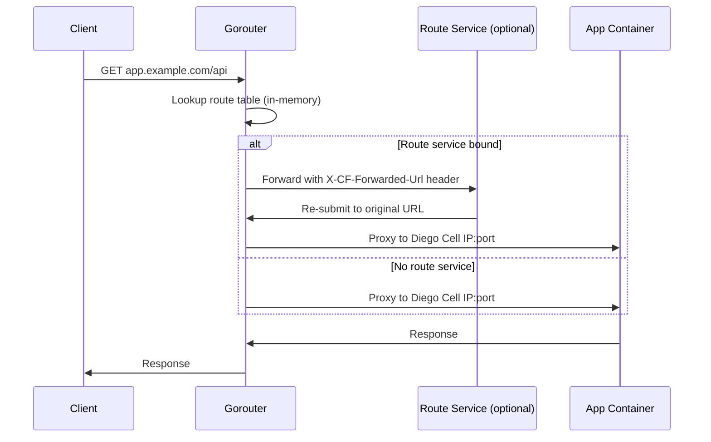
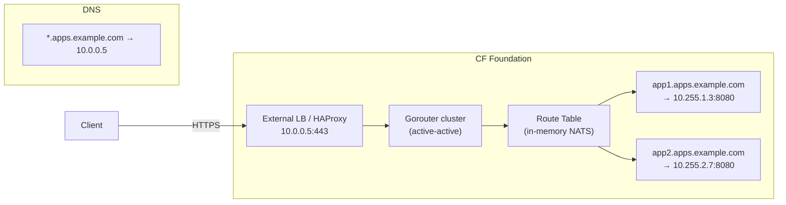
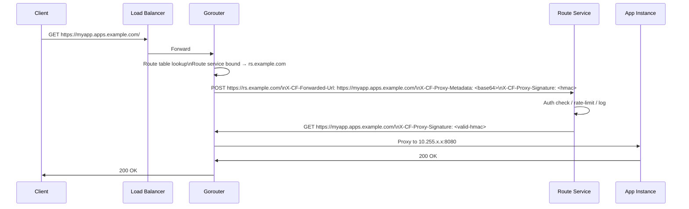

# CF-11: Routes, Domains, and Route Services

**Track:** CF-C — Cloud Foundry Application Networking
**Prerequisites:** CF-09 (Gorouter Internals), CF-10 (TCP Routing)

---

## Quick Read (10 min)

**Core mental model:** In CF, a route is a DNS name + optional path that maps to one or more app instances. Domains are the namespace from which routes are carved. Route services intercept traffic before it reaches the app.

**Essential facts:**

- A **shared domain** is org-agnostic; a **private domain** belongs to a single org.
- Routes are `<hostname>.<domain>[/<path>]` — path-based routing is first-match, longest-prefix wins.
- One route can map to multiple apps (blue/green, canary); one app can have multiple routes.
- **Gorouter** holds routes in an in-memory table, populated via NATS. Route Emitter refreshes every 20 seconds; TTL is 2 minutes.
- **Route services** are CF-managed request proxies — user-provided or broker-provisioned — that sit in front of your app to handle auth, rate-limiting, or logging.
- **Route drain:** unmap a route before `cf stop` to drain in-flight requests gracefully.

**What breaks most often:**

1. `404` — route unmapped or Gorouter table stale (wait up to 2 min or push again).
2. `502` — backend app crashed; route still registered for 2 min after crash.
3. Route conflict — another org/space owns the same hostname on a shared domain.

**Mermaid — Route Resolution Path:**



> **K8s Engineer's Translation:** Routes + domains = Ingress rules + IngressClass. Route services = admission webhooks or external auth proxies (OAuth2-proxy) inserted before the backend Service.

---

## Deep Dive

---

## Practice Setup

Open two terminals before working through this lesson.

**Terminal 1 — cf CLI (Mac/local):**

```bash
cf api https://api.sys.example.com
cf login -u admin
cf target -o my-org -s my-space
```

**Terminal 2 — Gorouter BOSH SSH:**

```bash
# From BOSH director
bosh -e my-env -d cf ssh router/0

# Inside the Gorouter VM
cd /var/vcap/jobs/gorouter/config
cat gorouter.yml | grep -A5 "routing_api"

# Live route table (requires gorouter debug port)
curl -s http://localhost:8082/routes | python3 -m json.tool | head -60
```

---

## 1. Domains and the Route Namespace

A **domain** in CF is the DNS suffix from which routes are created. CF has two domain types:

- **Shared domains** — available to all orgs in the foundation. Typically `apps.example.com` or `cfapps.io`. Created by platform admins.
- **Private domains** — scoped to one org (and optionally shared with specific sub-orgs). Useful for vanity domains owned by a team.

```bash
# List all domains visible to your org
cf domains

# Admin: create a shared domain
cf create-shared-domain apps.example.com

# Admin: create a shared domain backed by the TCP router
cf create-shared-domain tcp.example.com --router-group default-tcp

# Org manager: create a private domain for the org
cf create-private-domain my-org internal.my-org.com

# Share a private domain with another org
cf share-private-domain other-org internal.my-org.com

# Delete (must unmap all routes first)
cf delete-shared-domain apps.example.com
cf delete-private-domain internal.my-org.com
```

> **K8s Engineer's Translation:** Shared domains resemble a cluster-wide IngressClass with a wildcard DNS entry (`*.apps.example.com`). Private domains are namespace-scoped Ingress controllers or dedicated IngressClasses tied to a team's namespace group.

**DNS wildcard requirement:**

The platform operator must create a wildcard DNS record pointing to the Gorouter VIP (or load balancer in front of Gorouter):

```
*.apps.example.com  →  10.0.0.5  (Gorouter HA-proxy or external LB)
*.sys.example.com   →  10.0.0.5
*.tcp.example.com   →  10.0.0.6  (TCP Router)
```

Without the wildcard, every new route requires a manual DNS entry — not how CF is meant to work.



---

## 2. Routes — Creation, Mapping, and Lifecycle

A **route** is a fully qualified hostname (and optional path) bound to zero or more app instances. Routes exist independently of apps — you can create a route, reserve the name, then map it later.

### Route anatomy

```
<hostname>.<domain>[/<path>]
```

Examples:
- `myapp.apps.example.com` — simple hostname route
- `myapp.apps.example.com/v2` — path route (Gorouter does longest-prefix match)
- `*.apps.example.com` — wildcard route (matches any unregistered subdomain)

### CRUD commands

```bash
# Create a route (does not map it yet)
cf create-route my-space apps.example.com --hostname myapp

# Create a path route
cf create-route my-space apps.example.com --hostname myapp --path /v2

# Map to an app (the app starts receiving traffic)
cf map-route myapp apps.example.com --hostname myapp

# Map with path
cf map-route myapp apps.example.com --hostname myapp --path /v2

# Map multiple apps to same route (blue/green, canary)
cf map-route myapp-green apps.example.com --hostname myapp
cf map-route myapp-blue  apps.example.com --hostname myapp

# Unmap (removes from Gorouter table within ~2 min)
cf unmap-route myapp-blue apps.example.com --hostname myapp

# Delete the route object entirely
cf delete-route apps.example.com --hostname myapp

# Clean up unmapped routes in a space
cf delete-orphaned-routes
```

### Push with custom route

```bash
cf push myapp -f manifest.yml

# manifest.yml excerpt:
# routes:
#   - route: myapp.apps.example.com
#   - route: myapp.apps.example.com/api
```

### Gorouter route table inspection

```bash
# On Gorouter VM — full table as JSON
curl -s http://localhost:8082/routes | python3 -m json.tool

# Filter for a specific hostname
curl -s http://localhost:8082/routes | \
  python3 -c "import sys,json; d=json.load(sys.stdin); \
  [print(k,v) for k,v in d.items() if 'myapp' in k]"

# Check NATS subscriptions
curl -s http://localhost:8082/varz | python3 -m json.tool | grep -A3 "nats"
```

> **K8s Engineer's Translation:** `cf map-route` is equivalent to adding an Ingress rule (`spec.rules[].host` or `spec.rules[].http.paths[]`). Orphaned routes are equivalent to Ingress objects with no backend Service — they consume the hostname reservation but send nothing anywhere useful.

### Sticky sessions

Gorouter supports sticky sessions via the `JSESSIONID` cookie (or any `VCAP_ID` cookie). When a client's first request hits a backend instance, Gorouter sets `__VCAP_ID__` on the response. Subsequent requests with that cookie are pinned to the same instance.

```bash
# Verify sticky session header is present
curl -v https://myapp.apps.example.com/ 2>&1 | grep -i vcap_id
```

### WebSocket support

Gorouter upgrades HTTP/1.1 connections to WebSocket automatically. No special configuration needed on the route. The app must handle the `Upgrade: websocket` header.

```bash
# Test WebSocket upgrade
wscat -c wss://myapp.apps.example.com/ws
```

---

## 3. Route Services

A **route service** is a network component that intercepts all requests bound to a route before they reach the app. Use cases: authentication, rate limiting, WAF, audit logging.

CF supports two kinds of route services:

| Type | Description |
|---|---|
| **Fully-brokered** | Provisioned via a service broker; broker manages the route service instance lifecycle |
| **User-provided** | Operator supplies the route service URL directly |

### How the interception works

When a route has a route service bound, Gorouter adds an `X-CF-Forwarded-Url` header containing the original destination URL, then forwards the request to the route service endpoint. The route service processes the request and re-submits it to the URL in `X-CF-Forwarded-Url`. Gorouter validates that re-submitted requests carry a valid `X-CF-Proxy-Signature` header (HMAC-signed, 1-hour TTL) to prevent bypass.



### User-provided route service

```bash
# Create a user-provided route service pointing to your proxy
cf create-user-provided-service my-rate-limiter \
  -r https://rate-limiter.internal.example.com

# Bind the route service to a route
cf bind-route-service apps.example.com my-rate-limiter --hostname myapp

# Verify binding
cf service my-rate-limiter

# Unbind
cf unbind-route-service apps.example.com my-rate-limiter --hostname myapp
```

### Brokered route service

```bash
# Marketplace must expose a route-service-capable plan
cf marketplace -s my-waf-service

# Provision an instance
cf create-service my-waf-service standard waf-instance

# Bind to route (broker provisions interception endpoint)
cf bind-route-service apps.example.com waf-instance --hostname myapp

# Inspect binding parameters if needed
cf service waf-instance --guid
```

### Route service log inspection on Gorouter

```bash
# On Gorouter VM
tail -f /var/vcap/sys/log/gorouter/gorouter.stdout.log | \
  grep -i "route-service"

# Look for 403 Forbidden — means proxy signature validation failed
grep "signature" /var/vcap/sys/log/gorouter/gorouter.stdout.log | tail -20
```

> **K8s Engineer's Translation:** CF route services are analogous to Kubernetes admission webhooks or service mesh policies (Istio `EnvoyFilter` / `AuthorizationPolicy`) that intercept traffic before it reaches the backend pod. The `X-CF-Proxy-Signature` HMAC is CF's equivalent of a Kubernetes webhook `caBundle` — it prevents policy bypass.

### Route service configuration in BOSH manifest

```yaml
# cloud_controller.yml property relevant to route services
cc:
  route_services_enabled: true
  route_services_timeout: 60      # seconds before Gorouter gives up waiting for RS
  route_services_secret: <secret> # used to sign X-CF-Proxy-Signature
  route_services_secret_decrypt_only: <old-secret>  # for rotation
```

```bash
# On Gorouter VM — verify route service secret is set
grep -i route_service /var/vcap/jobs/gorouter/config/gorouter.yml
```

---

## 4. Troubleshooting Routes and Domains

### Failure mode matrix

| Symptom | Likely Cause | Diagnostic |
|---|---|---|
| `404 Not Found` from Gorouter | Route not mapped, or Gorouter table stale | `cf routes`, check Gorouter `/routes` endpoint |
| `502 Bad Gateway` | App crashed; route still alive (up to 2 min TTL) | `cf app myapp`, `cf logs myapp --recent` |
| `503 Service Unavailable` | No healthy backends; all instances down | `cf app myapp`, check Diego Cell health |
| Route already exists | Another space/org holds the route on a shared domain | `cf routes --orgs` (admin), contact platform team |
| Route service `403` | HMAC signature expired or mismatched secret | Check `route_services_secret` in manifest |
| Route service `504` | Route service taking > `route_services_timeout` | Tune timeout or investigate RS latency |
| WebSocket drops | Gorouter idle timeout (default 900s) shorter than WS keepalive | Adjust `request_timeout_in_seconds` in gorouter.yml |
| Wildcard route hijacking all traffic | Wildcard route bound before specific routes resolve | List routes, ensure specific routes are registered |

### Route table stale — step-by-step

```bash
# Step 1: check the route is mapped
cf routes | grep myapp

# Step 2: check the app is running and has instances
cf app myapp

# Step 3: check Gorouter table on the VM
# (requires BOSH SSH access)
curl -s http://localhost:8082/routes | \
  python3 -m json.tool | grep -A5 "myapp"

# Step 4: if route missing from table, check Route Emitter logs on Diego Cell
bosh -e my-env -d cf ssh diego-cell/0
grep "route_emitter" /var/vcap/sys/log/route_emitter/route_emitter.stdout.log | \
  grep -i "myapp" | tail -20

# Step 5: force route refresh by restarting the app
cf restart myapp
```

### 502 after crash — verify TTL drain

```bash
# Crash the app deliberately for testing
cf stop myapp

# Immediately poll — expect 502 for up to 2 minutes
for i in $(seq 1 15); do
  STATUS=$(curl -s -o /dev/null -w "%{http_code}" https://myapp.apps.example.com/)
  echo "$(date +%T)  HTTP $STATUS"
  sleep 10
done
```

### Route conflict debugging

```bash
# As admin — find which org/space owns a route
cf curl /v3/routes?hosts=myapp | python3 -m json.tool

# Output includes space_guid and organization relationship
# Cross-reference:
cf curl /v3/spaces/<space-guid> | python3 -m json.tool
```

### Route service bypass attempt detection

```bash
# On Gorouter VM — look for requests with forged/missing signatures
grep "signature_validation" \
  /var/vcap/sys/log/gorouter/gorouter.stdout.log | \
  grep -i "failed" | tail -30

# Check route service binding is active
cf curl /v3/service_route_bindings | python3 -m json.tool
```

### Path routing order debugging

```bash
# CF uses longest-prefix match — verify which route wins
cf curl "/v3/routes?hosts=myapp&paths=/v2" | python3 -m json.tool
cf curl "/v3/routes?hosts=myapp&paths=/" | python3 -m json.tool

# On Gorouter — routes with paths appear as "myapp.apps.example.com/v2"
curl -s http://localhost:8082/routes | \
  python3 -c "import sys,json; d=json.load(sys.stdin); \
  [print(k) for k in d.keys() if 'myapp' in k]"
```

> **K8s Engineer's Translation:** CF route TTL and stale-route behavior maps to Kubernetes Endpoint propagation delay. When a pod crashes, the Endpoint is removed, but in-flight connections and DNS caches may keep routing to the dead pod for seconds to tens of seconds. CF's 2-minute TTL is longer — plan for it in health checks and load balancer drain settings.

---

## Production Checklist

- [ ] Wildcard DNS entry exists for all shared domains pointing to the Gorouter VIP or external LB.
- [ ] Private domains for each production org are created and owned by the correct org manager.
- [ ] All app routes are defined in `manifest.yml` under `routes:` — no manual `cf map-route` in production pipelines (prevents drift).
- [ ] Blue/green or canary routes are unmapped from the old version before the old app is stopped, to avoid 502 during TTL drain.
- [ ] `cf delete-orphaned-routes` runs as part of cleanup pipelines to avoid hostname reservation leaks.
- [ ] Route services have their `route_services_timeout` tuned to match the actual SLA of the upstream proxy.
- [ ] Route service secrets (`route_services_secret`) are rotated via `route_services_secret_decrypt_only` without downtime.
- [ ] WebSocket apps have Gorouter `request_timeout_in_seconds` set higher than the WebSocket keepalive interval.
- [ ] Sticky session behavior is explicitly tested and documented per app — do not rely on it for stateless apps.
- [ ] Path-routed apps are tested with longest-prefix ordering validated against the Gorouter route table.
- [ ] Platform team has documented the shared domain ownership and DNS TTL for planned maintenance windows.
- [ ] Gorouter `/routes` debug endpoint is firewalled — only accessible from BOSH management network.

---

## Quick Reference

| Task | Command |
|---|---|
| List all domains | `cf domains` |
| Create shared domain | `cf create-shared-domain example.com` |
| Create TCP shared domain | `cf create-shared-domain tcp.example.com --router-group default-tcp` |
| Create private domain | `cf create-private-domain my-org example.com` |
| Share private domain | `cf share-private-domain other-org example.com` |
| List routes in space | `cf routes` |
| Create a route | `cf create-route my-space apps.example.com --hostname myapp` |
| Create path route | `cf create-route my-space apps.example.com --hostname myapp --path /v2` |
| Map route to app | `cf map-route myapp apps.example.com --hostname myapp` |
| Unmap route from app | `cf unmap-route myapp apps.example.com --hostname myapp` |
| Delete route | `cf delete-route apps.example.com --hostname myapp` |
| Delete orphaned routes | `cf delete-orphaned-routes` |
| Create user-provided RS | `cf create-user-provided-service my-rs -r https://rs.example.com` |
| Bind route service | `cf bind-route-service apps.example.com my-rs --hostname myapp` |
| Unbind route service | `cf unbind-route-service apps.example.com my-rs --hostname myapp` |
| Inspect Gorouter table | `curl http://localhost:8082/routes` (on Gorouter VM) |
| Find route owner (admin) | `cf curl /v3/routes?hosts=myapp` |
| Check route service bindings | `cf curl /v3/service_route_bindings` |
| View Gorouter logs | `tail -f /var/vcap/sys/log/gorouter/gorouter.stdout.log` |

---

## See Also

**Related CF lessons:**

- CF-09: Gorouter Internals — route table population via NATS, Route Emitter, TTL behavior
- CF-10: TCP Routing — `reservable_ports`, TCP Router, non-HTTP route domains
- CF-12: TLS in CF — edge termination, passthrough, full re-encrypt, route integrity
- CF-07: App Security Groups — egress rules that apply alongside inbound route policies

**Kubernetes equivalent lessons:**

- **Lesson 18 — Ingress Controllers and IngressClass:** Direct equivalent of Gorouter + shared domains. Covers wildcard DNS, path-based routing, and backend Service selection — the same mental model as `cf map-route` with paths.
- **Lesson 19 — Gateway API:** The successor to Ingress, analogous to CF V3 route model and Korifi's use of Contour as the Gorouter replacement. HTTPRoute resources map closely to CF route objects.
- **Lesson 22 — Service Mesh (Istio):** Covers VirtualService and DestinationRule — the K8s equivalent of route services for traffic shaping, auth policy, and canary rollout.
- **Lesson 15 — Network Policies:** Default-deny and allow rules; compare to CF C2C policies which also use a default-deny model but are enforced at the Silk/VXLAN layer rather than iptables directly.

---

## Online Resources

- [CF Docs — Managing Routes and Domains](https://docs.cloudfoundry.org/devguide/deploy-apps/routes-domains.html) — official reference for all route and domain CLI commands, including path routing and wildcard routes.
- [CF Docs — Route Services](https://docs.cloudfoundry.org/services/route-services.html) — covers fully-brokered and user-provided route services, the proxy signature protocol, and binding lifecycle.
- [Gorouter GitHub Repository](https://github.com/cloudfoundry/gorouter) — source code, configuration reference (`gorouter.yml` schema), and issue tracker for Gorouter bugs including TTL and sticky session behavior.
- [CF V3 API — Routes Resource](https://v3-apidocs.cloudfoundry.org/index.html#routes) — machine-readable route management via `cf curl /v3/routes`; useful for scripting and pipeline automation.
- [Korifi Routing Design (2026)](https://github.com/cloudfoundry/korifi/blob/main/docs/architecture.md) — documents how Korifi replaces Gorouter with Contour and maps CF route concepts to HTTPRoute CRDs; relevant for foundations evaluating the K8s-native CF runtime.

---

## Appendix: Route Weights and Canary Rollout

CF V3 API supports **route weights** — a numeric weight (1–128) assigned per route binding that controls the fraction of traffic sent to each app. This is the native CF mechanism for canary and blue/green deployments without external load balancers.

```bash
# Map both old and new app versions to the same route with weights
# 90% to stable, 10% to canary
cf map-route myapp-stable apps.example.com --hostname myapp
cf map-route myapp-canary apps.example.com --hostname myapp

# Set weights via V3 API (cf CLI does not expose weights directly)
# Step 1: get route destination GUIDs
cf curl "/v3/routes?hosts=myapp" | python3 -m json.tool

# Step 2: patch weights on route destinations
# (replace <route-guid> and <dest-guid-stable>, <dest-guid-canary>)
cf curl -X PATCH /v3/routes/<route-guid>/destinations \
  -d '{
    "destinations": [
      { "guid": "<dest-guid-stable>", "weight": 90 },
      { "guid": "<dest-guid-canary>", "weight": 10 }
    ]
  }'

# Gradually shift: 50/50
cf curl -X PATCH /v3/routes/<route-guid>/destinations \
  -d '{
    "destinations": [
      { "guid": "<dest-guid-stable>", "weight": 50 },
      { "guid": "<dest-guid-canary>", "weight": 50 }
    ]
  }'

# Full cutover: 0/100 — then unmap stable
cf curl -X PATCH /v3/routes/<route-guid>/destinations \
  -d '{
    "destinations": [
      { "guid": "<dest-guid-stable>", "weight": 0 },
      { "guid": "<dest-guid-canary>", "weight": 100 }
    ]
  }'
cf unmap-route myapp-stable apps.example.com --hostname myapp
```

> **K8s Engineer's Translation:** Route weights are the CF equivalent of Argo Rollouts `canarySteps` with `setWeight`, or Istio `VirtualService` with traffic split across two Kubernetes Services. The difference: in CF the split lives in the Gorouter route table; in K8s it lives either in the mesh control plane or the rollout controller.

**Gorouter weight distribution:** Gorouter uses a weighted random algorithm. With weights 90/10, approximately 1 in 10 requests (randomly selected) will go to the canary. This is not round-robin with skipping — traffic distribution converges toward the weight ratio over many requests, not every 10th request exactly.
