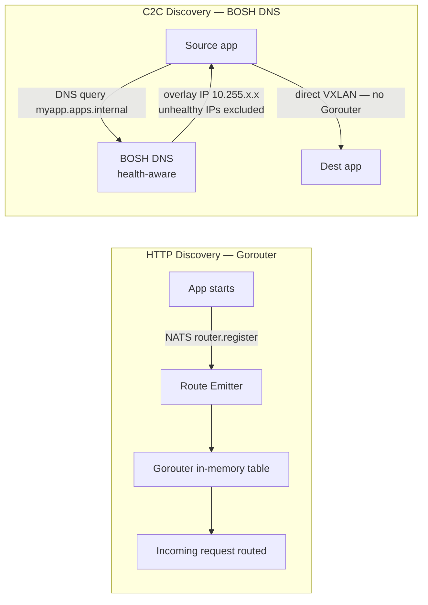
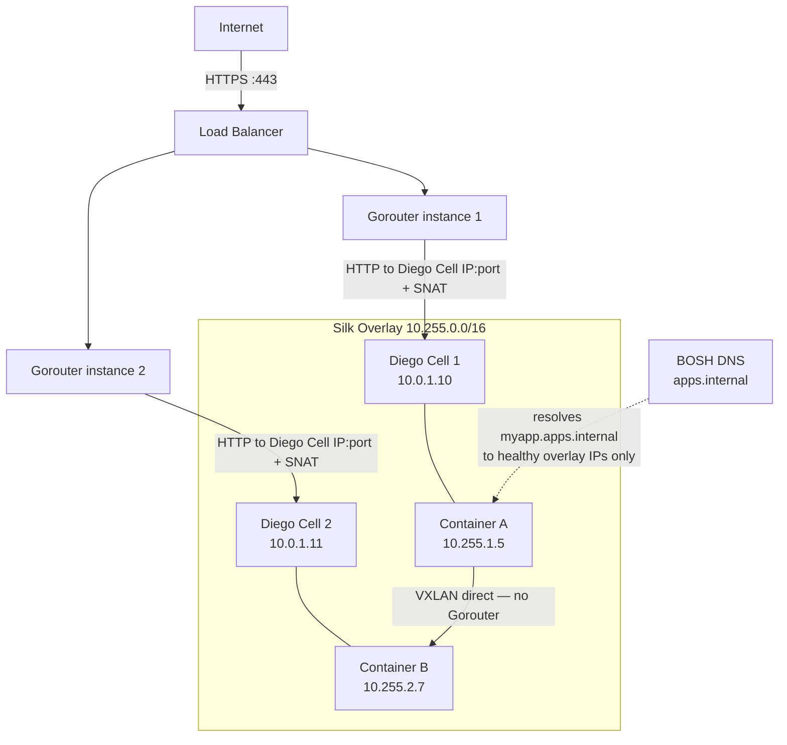
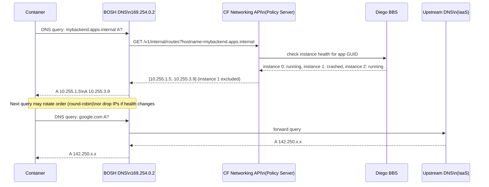
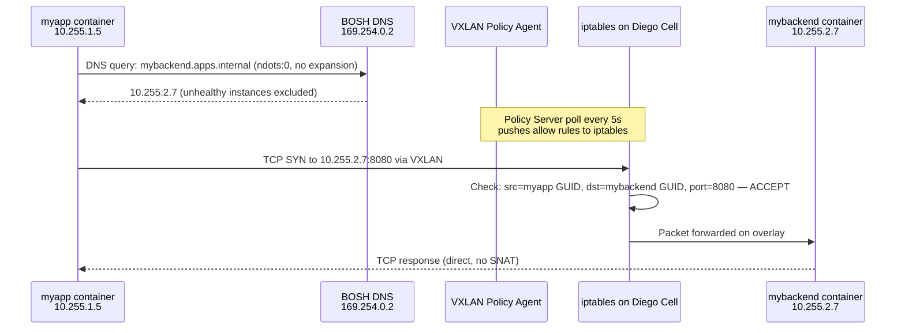

# CF-12: Service Discovery Deep Dive

**Track:** CF-C — Application Networking
**Prerequisites:** CF-09 (Gorouter Internals), CF-10 (C2C Policies), CF-11 (BOSH DNS)

**Jump to:** [Quick Read](#quick-read-10-min) · [Deep Dive](#deep-dive) · [Troubleshooting](#4-troubleshooting-service-discovery) · [Quick Reference](#quick-reference)

---

## Quick Read (10 min)

After this lesson you will be able to: explain how CF routes HTTP requests through Gorouter using NATS-based registration and how container-to-container discovery works via BOSH DNS and the `apps.internal` domain, and diagnose failures in both discovery planes using CLI and BOSH SSH commands.

**The essential mental model for CF service discovery:**

- CF has **two discovery planes**: HTTP (Gorouter) and C2C (Silk overlay)
- **Gorouter** builds its routing table from NATS `router.register` messages — no etcd, no Kubernetes Service objects
- **Route Emitter** (on each Diego Cell) publishes registrations every 20 s; TTL is 2 min — a silent app still stays routable
- **BOSH DNS** (`apps.internal`) handles C2C discovery by app name + instance index; it is **health-aware at the DNS layer** — unhealthy instances are removed from DNS before the app restarts
- C2C discovery requires both a **Network Policy** and an `apps.internal` route — policy alone is not enough to reach the app by name
- There is no kube-proxy, no ClusterIP, no Endpoints object — CF discovery is fully NATS + DNS + iptables
- CF containers get `ndots:0` (no search chain); K8s pods get `ndots:5` (5-step search chain) — CF DNS queries are always absolute

**Key addresses:**
- App reachable externally: `https://myapp.cfapps.example.com` via Gorouter → Diego Cell SNAT
- App reachable internally: `myapp.apps.internal` → BOSH DNS → overlay IP directly (no SNAT, no Gorouter)
- Specific instance: `0.myapp.apps.internal` → instance 0 overlay IP only



**Critical differences from Kubernetes:**

| K8s concept | CF equivalent |
|---|---|
| kube-dns / CoreDNS + ndots:5 | BOSH DNS + ndots:0 (no search chain) |
| Service (ClusterIP) | Gorouter route OR `apps.internal` DNS name |
| Headless Service (all pod IPs in DNS) | `apps.internal` returns only healthy instance IPs |
| Endpoints / EndpointSlices | Route table in Gorouter memory (NATS-updated) |
| kube-proxy iptables rules | VXLAN Policy Agent iptables + Diego Cell NAT |
| StatefulSet pod DNS (`pod-0.svc.ns.svc.cluster.local`) | Per-instance: `0.myapp.apps.internal` |
| Service mesh sidecar | No sidecar — Gorouter does TLS/LB at edge |

---

## Deep Dive

The sections below examine each discovery plane in detail: how Gorouter assembles its in-memory routing table from NATS messages, how BOSH DNS performs health-aware resolution for `apps.internal` names, and how the VXLAN Policy Agent enforces C2C access control at the iptables layer. Work through sections 1–3 in order before moving to the troubleshooting and production checklist sections.

---

## Practice Setup

You need two terminals for every exercise in this lesson.

**Terminal 1 — cf CLI (local Mac)**

```bash
cf login -a https://api.sys.example.com --skip-ssl-validation
cf target -o myorg -s myspace
cf apps   # confirm apps are running
```

**Terminal 2 — BOSH SSH into a Diego Cell**

```bash
# list deployments
bosh deployments

# ssh into Diego Cell 0 of cf deployment
bosh -d cf ssh diego-cell/0

# once inside the VM
sudo -i
# confirm Silk network interface
ip addr show silk-vtep
# confirm BOSH DNS is listening on link-local
dig @169.254.0.2 myapp.apps.internal
# confirm iptables NAT rules exist
iptables -t nat -L -n --line-numbers | head -40
```

> **K8s Engineer's Translation:** Terminal 1 is equivalent to your `kubectl` terminal against the API server. Terminal 2 is equivalent to `kubectl debug node/<nodename>` or directly SSH-ing into a worker node — something you rarely do in K8s but do regularly in CF/BOSH to inspect the data plane.

---

## 1. The Two Discovery Planes

CF service discovery splits cleanly into two planes that never overlap:

- **North-South (external) discovery**: HTTP/HTTPS traffic entering through Gorouter. Apps are discovered by DNS name resolving to a load balancer VIP that fronts multiple Gorouter instances.
- **East-West (C2C) discovery**: Container-to-container traffic on the Silk VXLAN overlay. Apps are discovered via BOSH DNS name `<app-name>.apps.internal` resolving directly to overlay IPs.

Understanding which plane you are on determines every diagnostic step.



**Underlay vs overlay addressing:**

```bash
# On Diego Cell: underlay IP (what Gorouter connects to)
ip addr show eth0
# inet 10.0.1.10/24

# Silk VTEP: overlay gateway for this cell's /24
ip addr show silk-vtep
# inet 10.255.1.1/16

# A running container's overlay IP
cat /var/vcap/data/silk/state.json | python3 -m json.tool | grep -A3 overlay
```

> **K8s Engineer's Translation:** This is identical to the K8s node IP (eth0) vs pod IP (veth pair into the pod network CIDR). In K8s, kube-proxy handles east-west load balancing via ClusterIP. In CF, there is no ClusterIP — BOSH DNS returns individual overlay IPs, and clients connect directly.

---

## 2. Gorouter Registration: NATS-Based Discovery

Gorouter does not poll an API, watch a database, or use etcd. It listens on NATS for two message types:

- `router.register` — add or refresh a route entry
- `router.unregister` — remove a route entry

The Route Emitter component on each Diego Cell is responsible for publishing these messages on behalf of every app instance running on that cell.

### Registration lifecycle

```bash
# Watch NATS registration messages in real time (from NATS VM)
bosh -d cf ssh nats/0
/var/vcap/packages/nats/bin/nats-sub "router.*" \
  -s nats://nats:$(cat /var/vcap/jobs/nats/config/nats.conf \
    | grep password | awk '{print $2}' | tr -d '"')@127.0.0.1:4222
```

A `router.register` message payload looks like:

```json
{
  "host": "10.0.1.10",
  "port": 61234,
  "uris": ["myapp.cfapps.example.com", "myapp-blue.cfapps.example.com"],
  "app": "a1b2c3d4-e5f6-...",
  "private_instance_id": "uuid-of-this-instance",
  "tags": {"component": "route-emitter", "source_id": "a1b2c3d4-..."},
  "server_cert_domain_san": "a1b2c3d4-e5f6-...",
  "stale_threshold_in_seconds": 120
}
```

Key fields:
- `host` + `port`: Diego Cell underlay IP + mapped port (not container overlay IP)
- `uris`: one entry per CF route bound to this app
- `stale_threshold_in_seconds`: 120 — Gorouter marks an entry stale if no refresh within 2 minutes
- `server_cert_domain_san`: used for route integrity verification (mTLS Diego Cell to app)

### Route Emitter refresh cycle

```bash
# Inspect Route Emitter config on a Diego Cell
cat /var/vcap/jobs/route_emitter/config/route_emitter.json \
  | python3 -m json.tool | grep -i sync

# Key fields:
# "sync_interval": "20s"   -- full table re-emit every 20 seconds
# "heartbeat_interval": "20s"
```

```bash
# Check Route Emitter logs for registration activity
tail -f /var/vcap/sys/log/route_emitter/route_emitter.stdout.log \
  | grep -E "register|unregister|sync"
```

### Gorouter in-memory routing table

```bash
# Query Gorouter routing table via its debug endpoint (from Gorouter VM)
bosh -d cf ssh router/0
curl -s http://localhost:8080/routes | python3 -m json.tool | head -60

# Count routes
curl -s http://localhost:8080/routes | python3 -m json.tool | grep '"host"' | wc -l

# Filter for a specific app route
curl -s http://localhost:8080/routes \
  | python3 -m json.tool \
  | grep -A5 "myapp.cfapps.example.com"
```

### Sticky sessions

Gorouter supports session affinity via the `JSESSIONID` cookie. When a request arrives with a known `JSESSIONID`, Gorouter routes to the same backend that served the original request.

```bash
# Inspect sticky session header in a response
curl -v https://myapp.cfapps.example.com/ 2>&1 | grep -i set-cookie
# Set-Cookie: JSESSIONID=abc123...; Path=/; HttpOnly

# Second request with same JSESSIONID goes to same instance
curl -v -b "JSESSIONID=abc123..." https://myapp.cfapps.example.com/
```

> **K8s Engineer's Translation:** Gorouter is a combination of an Ingress controller and a software load balancer (comparable to NGINX Ingress or Envoy). The NATS-based registration is conceptually similar to how Endpoints/EndpointSlices are populated in K8s — except there is no central API server write; Route Emitters publish directly to the NATS bus. There is no equivalent of a ClusterIP in this path — every route maps to one or more `{Diego Cell IP, port}` pairs.

---

## 3. BOSH DNS Internals and C2C Service Discovery

For container-to-container communication, CF uses BOSH DNS with the `apps.internal` domain. This path bypasses Gorouter entirely — traffic flows directly on the Silk VXLAN overlay.

### BOSH DNS architecture

BOSH DNS runs as an agent on every Diego Cell VM at the link-local address `169.254.0.2`. Every container's `/etc/resolv.conf` points to this address. BOSH DNS does three things:

1. **Answers `*.apps.internal` queries** by consulting the CF Networking API (CAPI) for the current set of healthy overlay IPs for an app.
2. **Performs health-aware client-side load balancing** — it only returns IPs for instances that Diego reports as running and healthy.
3. **Forwards all other queries** to the upstream resolvers configured in the BOSH manifest (typically the IaaS DNS).



### ndots:0 — no search chain

CF containers are configured with `ndots:0` in `/etc/resolv.conf`. This means every DNS query is treated as a fully qualified domain name immediately, with no search path expansion.

```bash
# From inside a running container (via cf ssh)
cf ssh myapp -t -c 'cat /etc/resolv.conf'
# nameserver 169.254.0.2
# options ndots:0
```

Compare this directly to Kubernetes:

```bash
# From inside a K8s pod
kubectl exec -it mypod -- cat /etc/resolv.conf
# nameserver 10.96.0.10
# search myns.svc.cluster.local svc.cluster.local cluster.local
# options ndots:5
```

The K8s `ndots:5` rule means that any name with fewer than 5 dots triggers up to 4 search-path expansions before the absolute query. For example, resolving `mybackend` from a pod in `myns`:

```
1. mybackend.myns.svc.cluster.local   -> NXDOMAIN
2. mybackend.svc.cluster.local        -> NXDOMAIN
3. mybackend.cluster.local            -> NXDOMAIN
4. mybackend.                         -> NXDOMAIN or answer
```

In CF, `mybackend.apps.internal` has 2 dots (fewer than 5) but `ndots:0` means no expansion occurs — the query is sent as-is immediately. This eliminates the latency overhead of multiple failed DNS lookups that K8s pods experience for every short service name resolution.

> **K8s Engineer's Translation:** The CF `ndots:0` approach is equivalent to always using the fully qualified `mybackend.myns.svc.cluster.local` form in K8s. CF enforces this globally; K8s engineers must opt into it per pod with `dnsConfig.options: [{name: ndots, value: "1"}]`.

### BOSH DNS health awareness vs K8s headless Services

This is a critical architectural difference. In K8s, a headless Service (ClusterIP: None) returns all pod IPs regardless of pod readiness:

```bash
# K8s headless Service — returns ALL pod IPs, even unready ones
kubectl run -it --rm debug --image=busybox -- nslookup my-headless-svc.myns.svc.cluster.local
# Server:    10.96.0.10
# Address 1: 10.96.0.10
# Name: my-headless-svc.myns.svc.cluster.local
# Address 1: 10.0.0.5  (pod-0, Terminating but still returned)
# Address 2: 10.0.0.6  (pod-1, Running)
# Address 3: 10.0.0.7  (pod-2, Running)
```

Readiness filtering in K8s happens at the kube-proxy / Service / Endpoints level, not at the DNS level. A headless Service does not filter unready pods from DNS.

BOSH DNS works differently — health filtering happens **inside the DNS response**:

```bash
# CF: BOSH DNS only returns healthy instance IPs
cf ssh myapp -t -c 'dig +short mybackend.apps.internal'
# 10.255.2.7
# 10.255.3.4
# Instance 1 (10.255.1.9) is crashed — absent from DNS response

# Kill one instance and watch DNS change within seconds
cf ssh myapp -t -c 'for i in 1 2 3 4 5; do \
  echo "Query $i:"; dig +short mybackend.apps.internal; sleep 2; done'
```

The result: a client using BOSH DNS for C2C discovery will naturally avoid connecting to crashed instances without any client-side retry logic, circuit breaker, or Endpoints watch. In a banking or medtech environment where a backend microservice handles sensitive transactions, this DNS-layer health filtering means a crashing instance is removed from the discovery pool within seconds — before client applications have a chance to accumulate connection errors that require manual intervention.

### Per-instance addressing

BOSH DNS supports per-instance addressing with the syntax `<index>.<hostname>.apps.internal`:

```bash
# Always reach instance 0 specifically
cf ssh myapp -t -c 'curl http://0.mybackend.apps.internal:8080/'

# Always reach instance 2 specifically
cf ssh myapp -t -c 'curl http://2.mybackend.apps.internal:8080/'

# Useful for leader/follower topology or shard-based routing
# Instance 0 is the write primary; instances 1+ are read replicas
cf ssh myapp -t -c 'curl -X POST http://0.mydb.apps.internal:5432/ ...'
cf ssh myapp -t -c 'curl -X GET  http://1.mydb.apps.internal:5432/ ...'
```

The index corresponds to the CF instance index (`CF_INSTANCE_INDEX` environment variable inside the container). It is stable across restarts as long as the app is not scaled down below that index.

> **K8s Engineer's Translation:** Per-instance addressing is equivalent to StatefulSet pod DNS (`pod-0.my-service.namespace.svc.cluster.local`). K8s only provides this stable per-instance DNS for StatefulSets, not Deployments. CF provides it for all apps regardless of how they are deployed — every app gets indexed instance DNS names automatically.

### Internal route registration

```bash
# Create an internal domain (operator, once per foundation)
cf create-shared-domain apps.internal --internal

# Map an internal route to an app
cf map-route mybackend apps.internal --hostname mybackend

# Verify
cf routes | grep apps.internal
# mybackend   apps.internal   mybackend
```

### Network Policy requirement

An internal route alone is not enough for C2C traffic to succeed. You must also create a network policy allowing the source app to reach the destination app on the specific port.

```bash
# Allow myapp to reach mybackend on port 8080 over TCP
cf add-network-policy myapp --destination-app mybackend \
  --protocol tcp --port 8080

# Verify policy exists
cf network-policies
# source      destination   protocol  ports
# myapp       mybackend     tcp       8080

# Test from inside myapp
cf ssh myapp -t -c 'curl -s http://mybackend.apps.internal:8080/health'
```



---

## 4. Troubleshooting Service Discovery

### Failure mode matrix

| Symptom | Likely cause | First command |
|---|---|---|
| App returns 404 from Gorouter | Route not bound or emitter down | `cf routes`, check Route Emitter logs |
| App returns 502 Bad Gateway | Backend unhealthy or port mismatch | `cf app myapp`, check Cell iptables DNAT |
| `mybackend.apps.internal` NXDOMAIN | No internal route mapped | `cf routes \| grep apps.internal` |
| C2C connection refused | Missing network policy or app not listening | `cf network-policies` |
| C2C connection timeout | iptables DROP — policy missing or wrong port | iptables on Diego Cell, VXLAN Policy Agent logs |
| Intermittent C2C errors | BOSH DNS health drop + slow recovery | BOSH DNS logs on Diego Cell |
| DNS returns wrong number of IPs | Instances crashing/recovering | `dig` loop to watch health changes |
| Sticky session broken | Multiple Gorouter instances, table diverged | Check NATS connectivity between Gorouters |

### Diagnostic commands — Route Emitter and Gorouter

```bash
# Step 1: confirm app has routes
cf routes | grep myapp

# Step 2: check app is running and cell is healthy
cf app myapp
cf events myapp

# Step 3: on Diego Cell — check Route Emitter is publishing
bosh -d cf ssh diego-cell/0
grep -i "router.register" \
  /var/vcap/sys/log/route_emitter/route_emitter.stdout.log | tail -20

# Step 4: on Gorouter — confirm route is in table
bosh -d cf ssh router/0
curl -s http://localhost:8080/routes | python3 -m json.tool \
  | grep -B2 -A10 "myapp.cfapps.example.com"

# Step 5: check Gorouter can reach backend — look for 5xx error log entries
grep -E "HTTP [45][0-9][0-9]" /var/vcap/sys/log/gorouter/access.log | tail -20

# Step 6: check Gorouter access log for backend IP
grep "myapp.cfapps.example.com" /var/vcap/sys/log/gorouter/access.log \
  | tail -5
# Format: host backend_ip:port response_time status
```

### Diagnostic commands — BOSH DNS and C2C

```bash
# Step 1: verify internal route exists
cf routes | grep apps.internal

# Step 2: verify network policy exists
cf network-policies --source-app myapp

# Step 3: DNS resolution from source app
cf ssh myapp -t -c 'dig +short mybackend.apps.internal'
# Should return one or more 10.255.x.x IPs
# No IPs returned = internal route missing OR all instances unhealthy

# Step 4: test TCP reachability
cf ssh myapp -t -c 'nc -zv mybackend.apps.internal 8080'
# If timeout: policy iptables rules not applied yet
# If refused: app not listening on 8080

# Step 5: on Diego Cell — inspect iptables for C2C policy
bosh -d cf ssh diego-cell/0
# Find the source container's overlay IP
cat /var/vcap/data/silk/state.json | python3 -m json.tool

# Check iptables FORWARD chain for overlay traffic
iptables -L FORWARD -n | grep -E "10\.255\."

# Check the netout chain for the specific container
iptables -L netout--<container-handle> -n 2>/dev/null | head -20
```

### BOSH DNS diagnostic

```bash
# From inside any container on the foundation
cf ssh myapp -t -c 'cat /etc/resolv.conf'
# Should show 169.254.0.2 as nameserver and options ndots:0

# Check BOSH DNS is healthy on the Diego Cell
bosh -d cf ssh diego-cell/0
dig @169.254.0.2 mybackend.apps.internal
# If SERVFAIL: BOSH DNS agent unhealthy or CAPI unreachable
# If NXDOMAIN: no internal route mapped for this hostname

# Check BOSH DNS health server
curl -s http://169.254.0.2:8080/health | python3 -m json.tool

# View BOSH DNS logs
tail -f /var/vcap/sys/log/bosh-dns/bosh_dns.stdout.log \
  | grep -i "apps.internal"

# Verify ndots:0 is in effect — confirm no search expansion
# This query should NOT expand to mybackend.svc.cluster.local etc.
cf ssh myapp -t -c 'dig mybackend.apps.internal +noall +answer +stats 2>&1 \
  | grep -E "ANSWER|Query"'
```

### VXLAN Policy Agent sync

```bash
# Policy Agent polls Policy Server every 5 seconds
# Check last successful sync time
bosh -d cf ssh diego-cell/0
grep -i "poll\|sync\|update" \
  /var/vcap/sys/log/vxlan-policy-agent/vxlan-policy-agent.stdout.log | tail -20

# Force immediate iptables rule dump
iptables-save | grep -E "ACCEPT|DROP" | grep "10\.255\." | head -30
```

> **K8s Engineer's Translation:** CF's C2C troubleshooting path closely mirrors NetworkPolicy debugging in K8s:
> 1. Does the DNS name resolve? (`dig` for CF; `nslookup` in a debug pod for K8s)
> 2. Does the policy exist? (`cf network-policies` vs `kubectl get networkpolicy`)
> 3. Are the iptables rules actually in place? (same `iptables -L` command on the node)
>
> Key difference: in K8s, NetworkPolicy is enforced by the CNI plugin (Calico, Cilium) and DNS health filtering does not happen — CoreDNS returns all Endpoints regardless of pod readiness for headless Services. In CF, enforcement is VXLAN Policy Agent + iptables and DNS health filtering is built into BOSH DNS. This means CF C2C is more self-healing by default.

---

## Production Checklist

- [ ] Internal routes are mapped with `cf map-route <app> apps.internal --hostname <name>` for all apps that need C2C reachability
- [ ] Network policies are created with least privilege: exact app GUID pairs, specific port, specific protocol
- [ ] Route Emitter sync interval is validated (`sync_interval: 20s`) — increase only if NATS bus is under heavy load
- [ ] Gorouter route table size is monitored: greater than 10,000 routes can cause memory pressure
- [ ] BOSH DNS health check endpoint (port 8080 on 169.254.0.2) is included in Diego Cell health monitoring
- [ ] `ndots:0` in container `resolv.conf` is confirmed — prevents unnecessary DNS search chain queries; verify after platform upgrades
- [ ] Per-instance addressing (`0.myapp.apps.internal`) is used for stateful leader/follower apps rather than relying on client-side logic
- [ ] Sticky sessions (JSESSIONID) are only enabled when the application actually requires session affinity — stateless apps should disable it to get true round-robin
- [ ] WebSocket apps have `cf set-env <app> CF_DIAL_TIMEOUT <n>` tuned for long-lived connections through Gorouter
- [ ] TCP Router port ranges are pre-allocated and documented per space/app if non-HTTP TCP services are deployed
- [ ] VXLAN Policy Agent poll interval is verified against Policy Server capacity — default 5 s is safe up to ~500 apps; consider 10 s for larger foundations
- [ ] After `cf delete-network-policy`, confirm iptables rules are flushed on all relevant Diego Cells within one poll cycle
- [ ] C2C policies use app GUIDs internally — confirm that `cf network-policies` output is audited after app renames or redeployments (GUIDs do not change on `cf push`)
- [ ] BOSH DNS health awareness is tested during maintenance: scale down app instances and confirm DNS response drops corresponding IPs within 30 s

---

## Quick Reference

### Route management

| Command | Description |
|---|---|
| `cf routes` | List all routes in current space |
| `cf map-route <app> <domain> --hostname <host>` | Bind a route to an app |
| `cf unmap-route <app> <domain> --hostname <host>` | Remove route binding |
| `cf create-route <domain> --hostname <host>` | Create route without binding |
| `cf delete-route <domain> --hostname <host>` | Delete route |
| `cf map-route <app> apps.internal --hostname <name>` | Create internal (C2C) route |

### C2C policy management

| Command | Description |
|---|---|
| `cf add-network-policy <src> --destination-app <dst> --protocol tcp --port <p>` | Allow C2C traffic |
| `cf remove-network-policy <src> --destination-app <dst> --protocol tcp --port <p>` | Remove C2C policy |
| `cf network-policies` | List all policies in current space |
| `cf network-policies --source-app <app>` | Policies from a specific source app |

### DNS and connectivity testing (from inside cf ssh)

| Command | Description |
|---|---|
| `dig +short myapp.apps.internal` | Resolve internal app DNS (all healthy instances) |
| `dig +short 0.myapp.apps.internal` | Resolve specific instance index 0 |
| `cat /etc/resolv.conf` | Confirm BOSH DNS nameserver + ndots:0 |
| `nc -zv myapp.apps.internal 8080` | Test TCP reachability C2C |
| `curl -v http://myapp.apps.internal:8080/` | HTTP test over C2C |
| `dig @169.254.0.2 myapp.apps.internal` | Direct BOSH DNS query from Diego Cell |

### Gorouter and Route Emitter (on BOSH VMs)

| Command | Description |
|---|---|
| `curl -s http://localhost:8080/routes` | Dump Gorouter route table (from router VM) |
| `grep router.register /var/vcap/sys/log/route_emitter/*.log` | Route registration activity |
| `grep HTTP /var/vcap/sys/log/gorouter/access.log` | Gorouter access log |
| `iptables -t nat -L -n` | DNAT rules on Diego Cell |
| `cat /var/vcap/data/silk/state.json` | Silk overlay state for this cell |

---

## Check Your Understanding

1. CF has two discovery planes. What determines which plane handles a given request, and what is the key difference in how each plane locates a destination app?

2. A Route Emitter publishes `router.register` messages every 20 seconds and the Gorouter TTL is 2 minutes. What happens to routing if a Diego Cell loses NATS connectivity for 90 seconds? For 150 seconds?

3. You run `cf ssh myapp -t -c 'dig +short mybackend.apps.internal'` and get no output (no IPs returned). Walk through the two distinct root causes that could produce this result and the first command you would run to distinguish between them.

4. Explain why CF containers use `ndots:0` while K8s pods use `ndots:5`, and describe one operational scenario where the K8s `ndots:5` default causes measurable latency overhead that CF avoids.

5. A source app can resolve `mybackend.apps.internal` to a valid overlay IP but `nc -zv mybackend.apps.internal 8080` times out. What is the most likely cause, and which two commands — one using `cf` CLI and one on the Diego Cell — would you run to confirm and fix it?

---

## See Also

**Related K8s lessons in this course:**

- **K8s-07: DNS and Service Discovery** — CoreDNS architecture, `ndots:5`, headless Services, ExternalName; directly comparable to BOSH DNS and `apps.internal`
- **K8s-08: Services and kube-proxy** — ClusterIP, NodePort, LoadBalancer; the K8s equivalent of Gorouter routes and TCP Router
- **K8s-13: NetworkPolicy** — CNI-enforced pod-to-pod policy; directly maps to CF Network Policies enforced by VXLAN Policy Agent
- **K8s-15: Ingress and Ingress Controllers** — NGINX/Envoy Ingress; the K8s counterpart of Gorouter for north-south HTTP traffic
- **K8s-21: Service Mesh (Istio/Linkerd)** — sidecar-based discovery and mTLS; CF has no direct equivalent but Korifi (2026) moves in this direction
- **K8s-29: CNI Deep Dive** — VXLAN overlays, MTU, encapsulation overhead; Silk CNI uses identical VXLAN mechanics

---

## Online Resources

- [CF Networking Release — Route Emitter](https://github.com/cloudfoundry/route-emitter) — Source code and configuration reference for NATS-based route registration
- [BOSH DNS Release](https://github.com/cloudfoundry/bosh-dns-release) — Health-aware DNS with `apps.internal` support; configuration and troubleshooting guide
- [CF Networking Policies Documentation](https://docs.cloudfoundry.org/devguide/deploy-apps/cf-networking.html) — Official CF docs: internal routes, network policies, C2C setup walkthrough
- [Gorouter Architecture](https://github.com/cloudfoundry/gorouter) — Source and architecture notes; covers NATS registration, sticky sessions, WebSocket, route integrity
- [Korifi Networking Design (2026)](https://github.com/cloudfoundry/korifi/blob/main/docs/networking.md) — How CF V3 API maps to Kubernetes CRDs (CFRoute to Contour HTTPProxy); the future of CF service discovery on K8s
