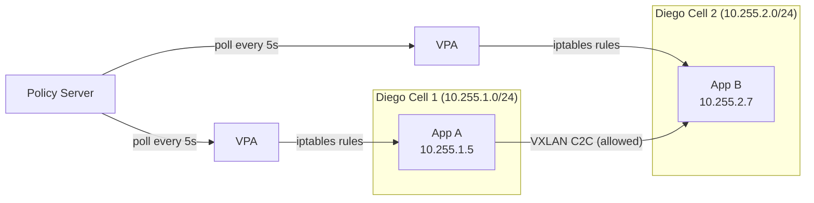
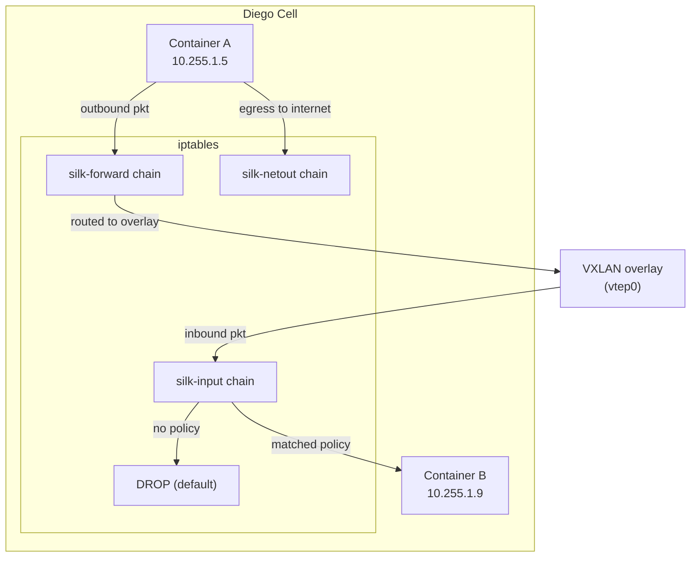
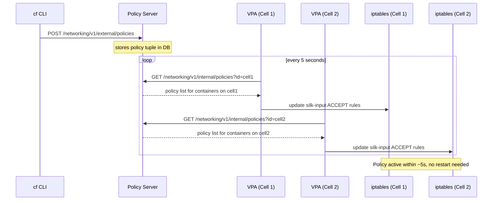

# CF Network Policies — C2C Security Model

**Track:** CF-D | **Lesson:** 13 | **Duration:** 45 min (Deep Dive) / 10 min (Quick Read)

**Jump to:** [Quick Read](#quick-read-10-min) · [Deep Dive](#deep-dive) · [Troubleshooting](#4-troubleshooting) · [Quick Reference](#quick-reference)

---

## Quick Read (10 min)

After this lesson you will be able to: explain how CF enforces container-to-container isolation with default-deny iptables rules, and create, inspect, and remove network policies using the cf CLI and BOSH SSH tools.

**What this lesson covers:** How Cloud Foundry implements container-to-container (C2C) networking with a default-deny security model enforced by iptables and the VXLAN Policy Agent.

### Core Mental Model

- **Default deny all C2C.** No two app containers can reach each other unless a network policy explicitly allows it. This is true even if apps share a space or org.
- **Policy = source app GUID + dest app GUID + protocol + port.** GUIDs survive redeploys; policy does not break when you push a new version.
- **Enforcement is local.** The VXLAN Policy Agent (VPA) on each Diego Cell polls the central Policy Server every 5 seconds, then programs iptables directly on the host. No kube-proxy, no etcd fanout.
- **Overlay only.** C2C traffic never leaves the VXLAN overlay (10.255.0.0/16). It never touches the Gorouter, never gets SNAT'd, and never exits to the external network.
- **Dynamic update.** Adding or removing a policy takes effect within ~5 seconds. No container restart required.

### Key Numbers

| Parameter | Value |
|---|---|
| Overlay CIDR | 10.255.0.0/16 |
| Per-cell subnet | /24 (~254 containers) |
| Max cells (default) | 250 |
| VPA poll interval | 5 seconds |
| Policy Server endpoint | internal BOSH DNS |

### Quick Diagram



### Essential Commands

```bash
# Allow app-a to reach app-b on port 8080/tcp
cf add-network-policy app-a --destination-app app-b --port 8080 --protocol tcp

# List all policies in space
cf network-policies

# Remove a policy
cf remove-network-policy app-a --destination-app app-b --port 8080 --protocol tcp

# Verify connectivity from app-a container
cf ssh app-a -c "curl -s http://app-b.apps.internal:8080/health"
```

> **K8s Engineer's Translation:** C2C network policy is CF's equivalent of a Kubernetes `NetworkPolicy` with a default-deny `podSelector: {}` applied to every namespace. The Policy Server is roughly analogous to a network policy controller, and the VXLAN Policy Agent is analogous to the CNI plugin (e.g., Calico) that programs iptables/eBPF rules on each node.

---

## Deep Dive

---

## Practice Setup

You need two terminals for every exercise in this lesson.

**Terminal 1 — cf CLI (Mac/local)**

```bash
# Log in and target your space
cf login -a https://api.your-cf.example.com
cf target -o my-org -s my-space

# Confirm apps are running
cf apps

# Check existing network policies
cf network-policies
```

**Terminal 2 — BOSH SSH into Diego Cell**

```bash
# List deployments to find cf deployment name
bosh deployments

# SSH into a Diego Cell (adjust index as needed)
bosh -d cf ssh diego-cell/0

# Once inside, switch to root to inspect iptables
sudo -i
iptables -L -n -v | grep -i silk
```

> **Tip:** Keep Terminal 2 open throughout the lesson. You will watch iptables rules appear and disappear in real time as you create and remove network policies from Terminal 1.

---

## 1. The C2C Security Model

### Why Default-Deny Matters

In a multi-tenant PaaS, the default networking posture must be deny-all between workloads. Without this, any compromised app container could freely reach all other containers on the overlay — including apps belonging to other orgs and spaces.

Cloud Foundry's C2C model enforces this at the iptables level on every Diego Cell. When an app container is created, Silk CNI assigns it an IP from the cell's /24 subnet (carved out of 10.255.0.0/16). The VXLAN Policy Agent then programs three iptables chains:

- **silk-input** — governs inbound traffic to containers on this cell
- **silk-forward** — governs traffic transiting this cell
- **silk-netout** — governs egress from containers (enforces ASGs)

By default, the silk-input chain has a final DROP rule. Only explicitly allowed C2C policies generate ACCEPT rules above that DROP.



> **K8s Engineer's Translation:** The `silk-input` chain enforces ingress policy, like a Kubernetes `NetworkPolicy` with `policyTypes: [Ingress]`. The `silk-netout` chain enforces egress policy, like `policyTypes: [Egress]`. Unlike K8s NetworkPolicy (which is namespace-scoped), CF network policies are org-scoped and reference apps by GUID.

### The Policy Tuple

A CF network policy is a 4-tuple:

| Field | Description | Example |
|---|---|---|
| source_app | GUID of the calling app | `abc-123-def...` |
| destination_app | GUID of the target app | `xyz-456-ghi...` |
| protocol | tcp or udp | `tcp` |
| port (or range) | destination port(s) | `8080` or `8080-8090` |

**Why GUIDs instead of app names?**

App names can be reused or changed. GUIDs are immutable per app instance and persist across `cf push` redeploys. This means: if you deploy version 2 of `app-b`, the network policy allowing `app-a` to reach `app-b` continues to work without any policy update.

```bash
# Find the GUID for an app
cf app app-b --guid

# Policy Server stores the policy using these GUIDs
# The VPA resolves GUIDs -> overlay IPs at enforcement time
```

---

## 2. Creating and Managing Network Policies

### Basic Policy Operations

```bash
# Allow tcp from app-a to app-b on port 8080
cf add-network-policy app-a \
  --destination-app app-b \
  --port 8080 \
  --protocol tcp

# Allow a port range
cf add-network-policy app-a \
  --destination-app app-b \
  --port 8080-8090 \
  --protocol tcp

# Allow UDP (e.g., for game servers, telemetry)
cf add-network-policy sensor-app \
  --destination-app collector-app \
  --port 9125 \
  --protocol udp

# List all policies in current space
cf network-policies

# List policies with source app filter
cf network-policies --source app-a

# Remove a specific policy
cf remove-network-policy app-a \
  --destination-app app-b \
  --port 8080 \
  --protocol tcp
```

### Cross-Space Policies

Apps in different spaces can communicate via C2C if a policy is created. The policy must reference apps in the same org; cross-org C2C is not supported.

```bash
# Target source space and get source app GUID
cf target -s space-frontend
SOURCE_GUID=$(cf app frontend-app --guid)

# Target destination space and get dest app GUID
cf target -s space-backend
DEST_GUID=$(cf app backend-api --guid)

# Create cross-space policy (must have SpaceDeveloper in both spaces)
# Note: cf CLI v7+ supports --source-space and --destination-space flags
cf add-network-policy frontend-app \
  --destination-app backend-api \
  --destination-space space-backend \
  --port 9090 \
  --protocol tcp
```

### BOSH DNS for C2C Service Discovery

Apps on the overlay communicate using BOSH DNS `.apps.internal` hostnames, not IP addresses. This decouples application code from the underlying IP allocation.

```bash
# From inside app-a container:
# Reach app-b (any instance, load-balanced)
curl http://app-b.apps.internal:8080/api/status

# Reach a specific instance of app-b (index 0)
curl http://0.app-b.apps.internal:8080/api/status
curl http://1.app-b.apps.internal:8080/api/status

# Verify DNS resolution from container
cf ssh app-a -c "nslookup app-b.apps.internal"
cf ssh app-a -c "dig app-b.apps.internal"
```

> **K8s Engineer's Translation:** `.apps.internal` is CF's equivalent of a Kubernetes Service ClusterDNS entry (`app-b.namespace.svc.cluster.local`). BOSH DNS on Diego Cells provides health-aware client-side load balancing — similar to CoreDNS + kube-proxy readiness gate, but resolved on the client side rather than in a virtual IP.

### How the VPA Programs iptables

After you run `cf add-network-policy`, here is the propagation sequence:



### Inspecting iptables Rules on a Diego Cell

```bash
# SSH into Diego Cell
bosh -d cf ssh diego-cell/0
sudo -i

# View the silk-input chain (inbound C2C rules)
iptables -L silk-input -n -v --line-numbers

# View with numeric ports (faster)
iptables -nL silk-input

# View the silk-forward chain
iptables -nL silk-forward

# Count packets hitting each rule (useful for verification)
iptables -L silk-input -n -v -x

# Watch rules update in real time (run from Terminal 2 while adding policies in Terminal 1)
watch -n 2 "iptables -nL silk-input | wc -l"
```

Expected iptables output after a policy allowing 10.255.2.7:8080 to receive from 10.255.1.5:

```
Chain silk-input (1 references)
target     prot opt source               destination
ACCEPT     tcp  --  10.255.1.5           10.255.2.7           tcp dpt:8080
...
DROP       all  --  0.0.0.0/0            10.255.0.0/16
```

---

## 3. Advanced C2C Patterns

### Microservice Mesh Without a Service Mesh

In a PCI-DSS-compliant banking deployment, strict tier isolation is a hard requirement: the card-data environment (CDE) must be segmented from the web tier, and the web tier must have no direct path to the database. CF network policies enforce this topology explicitly — a misconfigured or missing policy generates a DROP at the iptables level, providing an auditable control boundary that satisfies PCI-DSS Requirement 1 (network segmentation).

```bash
# Frontend (web tier) can reach the payment API (CDE boundary)
cf add-network-policy frontend --destination-app api-service --port 8080 --protocol tcp

# Payment API can reach the database proxy (CDE internal)
cf add-network-policy api-service --destination-app postgres-proxy --port 5432 --protocol tcp

# Database cannot reach anything (no policies from db)
# Frontend cannot directly reach database (no policy)
```

This creates a topology equivalent to K8s NetworkPolicy with strict per-tier allow rules.

### Bulk Policy Management with cf CLI and jq

```bash
# Export all current policies to JSON
cf curl /networking/v1/external/policies | jq '.' > policies-backup.json

# Count total policies
cf curl /networking/v1/external/policies | jq '.total_policies'

# List policies for a specific destination app GUID
DEST_GUID=$(cf app backend --guid)
cf curl "/networking/v1/external/policies?id=${DEST_GUID}" | jq '.policies[]'

# Apply policies from a JSON file (using cf curl)
# policies.json format:
# {"policies": [{"source":{"id":"<src-guid>"},"destination":{"id":"<dst-guid>","protocol":"tcp","ports":{"start":8080,"end":8080}}}]}
cf curl -X POST /networking/v1/external/policies -d @policies.json
```

### Policy Quotas

Operators can cap the number of network policies per space to prevent misconfiguration sprawl:

```bash
# Check current quota (operator command)
cf space-quota my-space-quota

# Example quota manifest (operator sets via CF API or BOSH manifest)
# network_policies: 50  (default is unlimited)
```

### UDP C2C: Metrics and Telemetry

UDP policies are useful for high-frequency telemetry where dropped packets are acceptable:

```bash
# Allow Prometheus scraping over UDP (unusual but valid)
cf add-network-policy prometheus --destination-app app-metrics --port 9090 --protocol tcp

# Allow StatsD metrics (UDP is correct here)
cf add-network-policy app-a --destination-app statsd-sink --port 8125 --protocol udp

# Verify UDP connectivity from container
cf ssh app-a -c "echo 'test' | nc -u app-b.apps.internal 8125"
```

> **K8s Engineer's Translation:** CF network policies support port ranges and both TCP/UDP — matching K8s NetworkPolicy `ports:` field. CF does not yet support ICMP policies at the C2C layer; CF does not support `namespaceSelector` or `ipBlock` within C2C policies (those functions are served by ASGs for egress and there is no equivalent ingress ipBlock concept).

### Korifi (2026) — C2C Policy Migration Note

In Korifi deployments (CF V3 on Kubernetes), the Silk CNI + VXLAN Policy Agent stack is replaced by standard Kubernetes NetworkPolicy objects. CF network policies created via `cf add-network-policy` are translated into K8s NetworkPolicy resources by the Korifi controller:

```yaml
# Korifi-generated K8s NetworkPolicy equivalent of:
# cf add-network-policy app-a --destination-app app-b --port 8080 --protocol tcp
apiVersion: networking.k8s.io/v1
kind: NetworkPolicy
metadata:
  name: cf-policy-app-a-to-app-b-8080-tcp
  namespace: cf-space-guid
spec:
  podSelector:
    matchLabels:
      korifi.cloudfoundry.org/app-guid: <app-b-guid>
  policyTypes:
    - Ingress
  ingress:
    - from:
        - namespaceSelector:
            matchLabels:
              korifi.cloudfoundry.org/space-guid: <source-space-guid>
          podSelector:
            matchLabels:
              korifi.cloudfoundry.org/app-guid: <app-a-guid>
      ports:
        - protocol: TCP
          port: 8080
```

This means existing `cf network-policies` workflows remain unchanged in Korifi — the abstraction is preserved at the CF API layer.

---

## 4. Troubleshooting

### Failure Mode 1: Policy Created But Traffic Still Blocked

**Symptoms:** `cf add-network-policy` succeeds but `curl` from app-a to app-b times out.

**Diagnostic steps:**

```bash
# Step 1: Confirm policy exists in Policy Server
cf network-policies --source app-a

# Step 2: Confirm apps are running and get container IPs
cf ssh app-a -c "ip addr show eth0"
cf ssh app-b -c "ip addr show eth0"

# Step 3: Check VPA health on Diego Cell
bosh -d cf ssh diego-cell/0
sudo monit summary | grep vxlan-policy-agent
sudo tail -100 /var/vcap/sys/log/vxlan-policy-agent/vxlan-policy-agent.stdout.log | grep -i error

# Step 4: Verify iptables rule was programmed
# Replace IPs with actual container IPs from Step 2
sudo iptables -nL silk-input | grep 10.255.1.5

# Step 5: If rule is missing, force VPA to repoll
sudo monit restart vxlan-policy-agent
```

### Failure Mode 2: DNS Resolution Fails for .apps.internal

**Symptoms:** `cf ssh app-a -c "curl http://app-b.apps.internal:8080"` returns `Could not resolve host`.

```bash
# Check BOSH DNS is running on the Diego Cell
bosh -d cf ssh diego-cell/0
sudo monit summary | grep bosh-dns

# Check /etc/resolv.conf inside container
cf ssh app-a -c "cat /etc/resolv.conf"
# Expected: nameserver pointing to 169.254.0.2 (BOSH DNS)

# Test raw DNS resolution
cf ssh app-a -c "dig @169.254.0.2 app-b.apps.internal"

# If NXDOMAIN: app-b may not be registered with BOSH DNS
# Confirm app-b is running and has a process ID
cf app app-b
```

### Failure Mode 3: Cross-Space Policy Not Working

**Symptoms:** Cross-space `cf add-network-policy` fails with "insufficient scope" or policy is not enforced.

```bash
# Confirm you have SpaceDeveloper role in BOTH spaces
cf space-users my-org space-frontend
cf space-users my-org space-backend

# Confirm apps exist in their respective spaces
cf target -s space-frontend && cf app frontend-app --guid
cf target -s space-backend  && cf app backend-api --guid

# Re-run with explicit space flags
cf add-network-policy frontend-app \
  --destination-app backend-api \
  --destination-space space-backend \
  --destination-org my-org \
  --port 9090 \
  --protocol tcp
```

### Failure Mode 4: Policy Quota Exceeded

**Symptoms:** `cf add-network-policy` returns HTTP 422 with "policy quota exceeded".

```bash
# Check current policy count
cf network-policies | wc -l

# Check space quota
cf space my-space | grep -i quota

# Remove stale policies (apps that no longer exist)
cf network-policies | grep "app-not-found"

# Operator: raise quota
# bosh manifest edit or cf API PATCH /v3/spaces/<guid>
```

### Failure Mode 5: VPA Cannot Reach Policy Server

**Symptoms:** iptables rules not updating; VPA logs show connection refused or timeout to Policy Server.

```bash
# Check Policy Server health
bosh -d cf ssh policy-server/0
sudo monit summary

# Check Policy Server logs
sudo tail -50 /var/vcap/sys/log/policy-server/policy-server.stdout.log

# Check network connectivity from Diego Cell to Policy Server
bosh -d cf ssh diego-cell/0
curl -v https://policy-server.service.cf.internal:4003/networking/v1/internal/policies \
  --cacert /var/vcap/jobs/vxlan-policy-agent/config/certs/ca.crt \
  --cert   /var/vcap/jobs/vxlan-policy-agent/config/certs/client.crt \
  --key    /var/vcap/jobs/vxlan-policy-agent/config/certs/client.key

# Check mTLS cert expiry
openssl x509 -in /var/vcap/jobs/vxlan-policy-agent/config/certs/client.crt \
  -noout -enddate
```

### Packet-Level Debugging with tcpdump

```bash
# On Diego Cell: capture VXLAN traffic on underlay interface
bosh -d cf ssh diego-cell/0
sudo tcpdump -i eth0 -n udp port 4789 -w /tmp/vxlan.pcap

# On Diego Cell: capture decapsulated traffic on overlay interface
sudo tcpdump -i silk0 -n host 10.255.2.7 and port 8080

# Transfer pcap to local machine for Wireshark analysis
bosh -d cf scp diego-cell/0:/tmp/vxlan.pcap ./vxlan.pcap
```

---

## Production Checklist

- [ ] Confirm all C2C policies are documented in a policy manifest file under version control.
- [ ] Validate that no wildcard policies exist (avoid policy from app-X to app-X on port range 1-65535).
- [ ] Confirm policy quotas are set per space to prevent unbounded growth.
- [ ] Verify BOSH DNS `.apps.internal` resolution works from every app that uses C2C.
- [ ] Test that removing a policy (simulated incident) blocks traffic within 10 seconds.
- [ ] Confirm VPA logs are shipped to your log aggregation system (Splunk, ELK, etc.).
- [ ] Audit cross-space and cross-org policies quarterly; remove stale ones.
- [ ] Confirm Policy Server mTLS certificates are rotated per your cert lifecycle policy (CredHub rotate).
- [ ] For Korifi deployments: verify that CF network policies are reflected as K8s NetworkPolicy objects in the correct namespaces.
- [ ] Run `iptables -nL silk-input | wc -l` baseline before and after any large policy batch to detect rule table bloat.
- [ ] Confirm apps use `.apps.internal` hostnames (not hardcoded overlay IPs) so policies survive container restarts.
- [ ] Test UDP policies separately from TCP — VPA programs separate iptables rules for each protocol.

---

## Quick Reference

| Task | Command |
|---|---|
| Add TCP policy | `cf add-network-policy src --destination-app dst --port 8080 --protocol tcp` |
| Add UDP policy | `cf add-network-policy src --destination-app dst --port 9125 --protocol udp` |
| Add port range policy | `cf add-network-policy src --destination-app dst --port 8080-8090 --protocol tcp` |
| List all policies | `cf network-policies` |
| List by source app | `cf network-policies --source app-name` |
| Remove a policy | `cf remove-network-policy src --destination-app dst --port 8080 --protocol tcp` |
| Get app GUID | `cf app app-name --guid` |
| Curl via C2C | `cf ssh app-a -c "curl http://app-b.apps.internal:8080/path"` |
| Specific instance DNS | `cf ssh app-a -c "curl http://0.app-b.apps.internal:8080/"` |
| Inspect iptables rules | `sudo iptables -nL silk-input` (on Diego Cell via bosh ssh) |
| Count active rules | `sudo iptables -nL silk-input \| wc -l` |
| Watch rules live | `watch -n 2 "iptables -nL silk-input \| wc -l"` |
| Restart VPA | `sudo monit restart vxlan-policy-agent` |
| View VPA logs | `sudo tail -f /var/vcap/sys/log/vxlan-policy-agent/vxlan-policy-agent.stdout.log` |
| Export all policies | `cf curl /networking/v1/external/policies \| jq '.'` |
| Import policies from file | `cf curl -X POST /networking/v1/external/policies -d @policies.json` |
| DNS resolution test | `cf ssh app-a -c "dig app-b.apps.internal"` |
| Check resolv.conf | `cf ssh app-a -c "cat /etc/resolv.conf"` |

---

## Check Your Understanding

1. By default, can two apps in the same CF space communicate over C2C without any network policy? Explain which iptables chain enforces this restriction and on which component it runs.

2. A network policy is created with `cf add-network-policy`. After what maximum delay will the policy be active on all Diego Cells, and which component is responsible for translating the policy into iptables rules?

3. You push a new version of `app-b` with `cf push`. Does the existing network policy from `app-a` to `app-b` break? Explain why or why not, referencing how CF identifies the destination app in a policy.

4. A developer reports that `curl http://app-b.apps.internal:8080` from inside `app-a` returns "Could not resolve host", but `curl http://10.255.2.7:8080` works. What component is likely failing, and what is the first diagnostic command you would run?

5. In a Korifi deployment, what Kubernetes resource type replaces a CF network policy, and in which namespace does that resource appear?

---

## See Also

These Kubernetes lessons cover the same concepts at the K8s layer:

- **Kubernetes NetworkPolicy** — `lessons/14-network-policies.md` — Default-deny `podSelector`, ingress/egress rules, namespaceSelector; direct equivalent of CF C2C policies.
- **Calico Network Policy** — `lessons/15-calico-network-policy.md` — Extended K8s network policy with GlobalNetworkPolicy and HostEndpoint; comparable to CF ASGs + C2C combined.
- **Cilium and eBPF** — `lessons/16-cilium-ebpf.md` — eBPF-based enforcement replacing iptables; Cilium NetworkPolicy; contrast with CF's iptables-based Silk enforcement.
- **DNS and Service Discovery** — `lessons/08-dns-service-discovery.md` — CoreDNS, SRV records, headless Services; compare with BOSH DNS `.apps.internal` and per-instance addressing.
- **Pod Networking and CNI** — `lessons/06-pod-networking-cni.md` — VXLAN overlay mechanics, CNI plugin interface; directly comparable to Silk CNI overlay architecture.

---

## Online Resources

- [CF Networking Documentation — Container-to-Container Networking](https://docs.cloudfoundry.org/concepts/understand-cf-networking.html) — Official CF docs: Silk CNI architecture, policy enforcement, BOSH DNS.
- [CF CLI Network Policies Reference](https://cli.cloudfoundry.org/en-US/v8/add-network-policy.html) — Full flag reference for `cf add-network-policy`, `cf network-policies`, `cf remove-network-policy`.
- [CF Networking Release on GitHub](https://github.com/cloudfoundry/cf-networking-release) — Source for Silk CNI, VXLAN Policy Agent, and Policy Server; issues and release notes.
- [BOSH DNS Documentation](https://bosh.io/docs/dns/) — Health-aware DNS, `.apps.internal` zone, per-instance addressing, link-based DNS.
- [Korifi Networking Architecture](https://github.com/cloudfoundry/korifi/blob/main/docs/architecture.md) — How Korifi translates CF network policies to Kubernetes NetworkPolicy objects; Contour replaces Gorouter.
