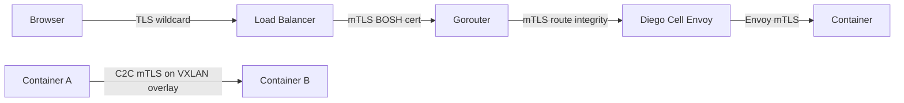
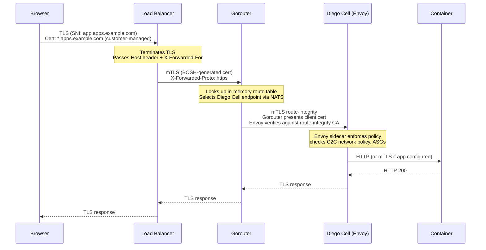

# CF-14: TLS and Certificates in CF

**Track:** CF-D — Security and Encrypted Traffic
**Prerequisites:** CF-09 (Gorouter), CF-10 (TCP Router), CF-13 (C2C Policies)
**Duration:** 10 min (Quick Read) / 60 min (Deep Dive)

**Jump to:** [Quick Read](#quick-read-10-min) · [Deep Dive](#deep-dive) · [Practice](#practice-setup) · [Troubleshooting](#4-troubleshooting) · [Quick Reference](#quick-reference)

---

## Quick Read (10 min)

After this lesson you will be able to: describe CF's layered TLS architecture from browser to container, distinguish the three Gorouter TLS termination modes, and execute a non-disruptive certificate rotation using CredHub and BOSH.

**Core mental model:** CF runs a layered TLS stack. Every hop from the browser to your app can be encrypted, and the platform manages most certificates automatically via CredHub and BOSH. You own the edge wildcard; CF owns everything inside.

**Key layers (outer to inner):**

- **Browser → Load Balancer:** Customer-managed wildcard cert (`*.apps.example.com`)
- **Load Balancer → Gorouter:** Platform-managed cert (CredHub-generated, BOSH-rotated)
- **Gorouter → Diego Cell (route integrity):** mTLS using BOSH instance identity certs, on by default since routing-release 0.195
- **Diego Cell Envoy → Container:** mTLS via Envoy sidecar injected by `silk-release` / `envoy-nginx-release`
- **Container to Container (C2C):** mTLS enforced by VXLAN Policy Agent + Envoy per container
- **Internal BOSH components:** All jobs use CredHub-generated certs with automatic rotation

**Three Gorouter TLS modes:**

- `edge` — TLS terminates at Gorouter; plain HTTP forwarded to container
- `passthrough` — Gorouter passes raw TLS bytes; app handles termination (SNI routing)
- `route-integrity` (re-encrypt) — Gorouter re-encrypts outbound to container Envoy via mTLS

**Certificate management:**

- **CredHub** stores all platform certs as typed `certificate` credentials (`ca`, `certificate`, `private_key`)
- **BOSH** generates and rotates CA + leaf certs at deploy time via `((variable))` interpolation
- **Instance identity certs** are short-lived certs (24 h TTL) issued per app instance by Diego, stored in `CF_INSTANCE_CERT` / `CF_INSTANCE_KEY`
- Rotation does NOT require app restarts for route integrity or instance identity certs

**Who manages what:**

| Cert | Owner | Rotation |
|------|-------|----------|
| Wildcard `*.apps.*` / `*.sys.*` | Platform team | Manual, ops-driven |
| Gorouter backend TLS cert | BOSH / CredHub | Auto on deploy |
| Diego Cell route-integrity cert | BOSH / CredHub | Auto on deploy |
| Instance identity cert (per app) | Diego Cell (Consul-free PKI) | Auto every 24 h |
| App custom domain cert | Developer / platform team | Manual |
| C2C Envoy sidecar cert | silk-release / BOSH | Auto on deploy |



> **K8s Engineer's Translation:** CF's Gorouter = K8s Ingress/Gateway API. Route integrity = cert-manager issuing certs for pod-level TLS with backend verification enabled. CredHub = cert-manager + Vault. Instance identity certs = SPIFFE/SPIRE workload identity. The key difference: CF automates all internal hops by default; K8s leaves most of them to you.

---

## Deep Dive

---

## Practice Setup

You need two terminals for this lesson.

**Terminal 1 — cf CLI (Mac / local):**

```bash
cf login -a https://api.sys.example.com --skip-ssl-validation
cf target -o my-org -s my-space

# Verify you can reach a deployed app
cf app myapp
cf env myapp | grep -E "CF_INSTANCE_CERT|CF_INSTANCE_KEY|CF_INSTANCE_GUID"
```

**Terminal 2 — BOSH SSH (ops / platform team access required):**

```bash
# Target BOSH director
bosh alias-env my-cf -e 10.0.0.5 \
  --ca-cert <(bosh int ./creds.yml --path /director_ssl/ca)

export BOSH_CLIENT=admin
export BOSH_CLIENT_SECRET=$(bosh int ./creds.yml --path /admin_password)
export BOSH_ENVIRONMENT=my-cf
export BOSH_DEPLOYMENT=cf

# List all VMs — note instance counts
bosh instances --ps | head -40

# SSH into Gorouter for TLS inspection
bosh ssh router/0

# Or SSH into a Diego Cell for Envoy / instance identity inspection
bosh ssh diego-cell/0
```

---

## 1. TLS Architecture Overview

CF implements defense-in-depth: every network hop between the browser and the application container carries independent TLS sessions. The platform manages the internal hops automatically; the edge certificate (the wildcard) is the only one that requires human rotation.



**Route integrity** is the critical internal hop. Without it, any process on a Diego Cell could impersonate a healthy container endpoint. With route integrity enabled, the Gorouter presents a client certificate when connecting to the Diego Cell's Envoy sidecar, and the Envoy validates that cert against the route-integrity CA before forwarding traffic.

**Certificate Authority hierarchy in a standard `cf-deployment` foundation:**

```
BOSH Root CA (CredHub: /bosh-director/bosh/default_ca)
└── CF Deployment CAs (all stored in CredHub under /cf/)
    ├── /cf/router_ca
    │   ├── /cf/router_ssl              (Gorouter server cert)
    │   └── /cf/gorouter_client_cert    (Gorouter → Diego Cell client cert)
    ├── /cf/diego_bbs_ca
    │   ├── /cf/diego_bbs_server_tls    (BBS API server cert)
    │   └── /cf/route_emitter_bbs_client_tls  (Route Emitter client cert)
    ├── /cf/silk_ca
    │   ├── /cf/silk_daemon_cert        (Silk overlay VTEP auth)
    │   └── /cf/silk_controller_cert    (Policy Server TLS)
    ├── /cf/instance_identity_ca        (Diego-issued per-instance certs)
    └── /cf/loggregator_ca
        ├── /cf/loggregator_tls_*       (Metron, Doppler, etc.)
        └── /cf/statsd_injector_tls
```

All CredHub path names vary by foundation — always verify with `credhub find -n /cf`.

> **K8s Engineer's Translation:** This CA hierarchy maps to: cert-manager `ClusterIssuer` (root CA) issuing `Issuer` per namespace (component CA), which signs `Certificate` resources per workload. CF automates this entire hierarchy; in K8s you configure each `Certificate` resource manually or via Helm.

---

## 2. Gorouter TLS Modes

The Gorouter supports three distinct TLS termination strategies. The choice is per-foundation (global config in `cf-deployment`), not per-app or per-route.

### 2.1 Edge Termination

```
Browser --TLS--> LB --TLS--> Gorouter --HTTP--> Container
```

The Gorouter holds the wildcard certificate and terminates TLS. Traffic from the Gorouter to the container is plain HTTP. This is the original CF model, still found in older foundations.

**Check if running in edge mode (from BOSH SSH on router/0):**

```bash
grep -A10 "backends:" /var/vcap/jobs/gorouter/config/gorouter.yml
```

Edge mode shows:
```yaml
backends:
  enable_tls: false
  max_conns: 500
```

**Verify what cert the Gorouter is currently presenting:**

```bash
# From outside the platform
echo | openssl s_client \
  -connect myapp.apps.example.com:443 \
  -servername myapp.apps.example.com \
  2>/dev/null | openssl x509 -noout -text | grep -E "Subject:|Issuer:|DNS:|Not After"
```

### 2.2 Route Integrity (mTLS to Diego Cell, recommended default)

Since `cf-deployment` v9.x and routing-release 0.195+, route integrity is the default for new deployments. The Gorouter presents a client certificate (signed by `/cf/router_ca`) when connecting to each Diego Cell's Envoy sidecar. The Envoy validates that certificate before forwarding traffic to the container.

```
Browser --TLS--> LB --mTLS--> Gorouter --mTLS route-integrity--> Diego Cell Envoy --HTTP--> Container
```

**Check route integrity status on the Gorouter:**

```bash
bosh ssh router/0

grep -A20 "backends:" /var/vcap/jobs/gorouter/config/gorouter.yml
```

Route integrity enabled shows:
```yaml
backends:
  enable_tls: true
  max_conns: 500
  client_cert_file: /var/vcap/jobs/gorouter/config/client.crt
  client_key_file: /var/vcap/jobs/gorouter/config/client.key
  ca_certs:
  - /var/vcap/jobs/gorouter/config/ca.crt
```

**Verify the Gorouter's client cert (what it presents to Diego Cells):**

```bash
openssl x509 -in /var/vcap/jobs/gorouter/config/client.crt \
  -noout -subject -issuer -enddate
```

**On the Diego Cell, verify Envoy is enforcing client certificate validation:**

```bash
bosh ssh diego-cell/0

# Check Envoy admin API — listener TLS config
curl -s http://127.0.0.1:9901/config_dump \
  | jq '.configs[] | select(.["@type"] | contains("ListenersConfigDump"))
        | .dynamic_listeners[].active_state.listener.filter_chains[]
        | .transport_socket.typed_config
        | {require_client_cert: .require_client_certificate,
           ca_cert: (.combined_validation_context.validation_context_sds_secret_configs // "inline")}'
```

### 2.3 TLS Passthrough (SNI routing)

When an app handles its own TLS (gRPC servers, apps using mutual TLS, apps with their own cert requirements), the Gorouter can pass the raw TLS session through without decrypting it, using SNI to route.

```
Browser --TLS--> LB --TLS (passthrough)--> Gorouter --TLS (unmodified)--> Container
```

Passthrough is configured at the route level and requires the platform to have `router.enable_ssl_client_certs: false` and appropriate backend port mapping.

```bash
# Check if a route is configured for passthrough
cf curl "/v3/routes?hosts=myapp" | jq '.resources[].metadata.annotations'

# Inspect Gorouter's routing table for passthrough routes
curl -s http://GOROUTER_IP:8080/routes \
  | jq 'to_entries[] | select(.value[].protocol == "tls") | .key'
```

> **K8s Engineer's Translation:**
> - Edge = Ingress terminates TLS, forwards HTTP to pod (`ssl-redirect: "true"` annotation)
> - Route integrity = Ingress uses upstream TLS with cert verification (NGINX: `proxy_ssl_verify on`, `proxy_ssl_certificate`)
> - Passthrough = Ingress passthrough mode (`nginx.ingress.kubernetes.io/ssl-passthrough: "true"` or Gateway API `TLSRoute`)

---

## 3. CredHub, BOSH, and Certificate Lifecycle

### 3.1 How CredHub Stores CF Certificates

CredHub is CF's credential store, deployed alongside the BOSH director. All platform certificates are stored as CredHub `certificate` type credentials. Each credential contains three fields:

- `ca`: the signing CA certificate (PEM)
- `certificate`: the leaf certificate (PEM)
- `private_key`: the leaf private key (PEM)

```bash
# List all CF TLS credentials
credhub find -n /cf --output-json \
  | jq -r '.credentials[] | select(.type == "certificate") | .name'

# Inspect a specific cert — full detail
credhub get -n /cf/router_ssl --output-json \
  | jq -r '.value.certificate' \
  | openssl x509 -noout -text

# Check expiry of a specific cert
credhub get -n /cf/router_ssl --output-json \
  | jq -r '.value.certificate' \
  | openssl x509 -noout -enddate

# Check expiry across ALL CF certs (useful for audits)
credhub find -n /cf --output-json \
  | jq -r '.credentials[] | select(.type == "certificate") | .name' \
  | while read name; do
      expiry=$(credhub get -n "$name" --output-json 2>/dev/null \
        | jq -r '.value.certificate // empty' \
        | openssl x509 -noout -enddate 2>/dev/null \
        | cut -d= -f2)
      [ -n "$expiry" ] && printf "%-60s %s\n" "$name" "$expiry"
    done | sort -k2
```

### 3.2 Instance Identity Certificates

Instance identity is one of CF's most underappreciated security features. Every app instance running on a Diego Cell is issued a short-lived X.509 certificate by the Diego Cell's Rep process. This certificate:

- Has a **24-hour TTL** and is automatically renewed before expiry
- Is signed by the **instance identity CA** (`/cf/instance_identity_ca` in CredHub)
- Encodes the **app GUID, space GUID, and org GUID** in the Subject Alternative Names
- Is exposed to the app container via environment variables and mounted files:
  - `CF_INSTANCE_CERT` — path to the PEM certificate file inside the container
  - `CF_INSTANCE_KEY` — path to the PEM private key file inside the container

```bash
# From the developer terminal — push a debug app to inspect
cf push cert-inspector --no-route -c "cat \$CF_INSTANCE_CERT | openssl x509 -noout -text" --health-check-type none

# Or SSH into a running app instance
cf ssh myapp

# Inside the container:
echo $CF_INSTANCE_CERT        # e.g. /etc/cf-instance-credentials/instance.crt
echo $CF_INSTANCE_KEY         # e.g. /etc/cf-instance-credentials/instance.key

openssl x509 -in $CF_INSTANCE_CERT -noout -text | grep -A10 "Subject Alternative"
# Shows: URI:x509-svid://cf/apps/<APP_GUID>/spaces/<SPACE_GUID>/orgs/<ORG_GUID>

# Verify cert is signed by instance identity CA
openssl verify \
  -CAfile /etc/cf-system-certs/ca.crt \
  $CF_INSTANCE_CERT
```

**Using instance identity for app-to-app mTLS:**

Apps can use `CF_INSTANCE_CERT` and `CF_INSTANCE_KEY` to present their identity to other services. This is how CF implements SPIFFE-compatible workload identity without Istio:

```bash
# From inside app container — present instance cert to a backend service
curl --cert $CF_INSTANCE_CERT \
     --key $CF_INSTANCE_KEY \
     --cacert /etc/cf-system-certs/ca.crt \
     https://backend-service.apps.internal:8443/api
```

The receiving service can parse the Subject Alternative Names to verify the caller's app GUID, enforcing identity-based access control without passwords or API keys.

> **K8s Engineer's Translation:** Instance identity certificates in CF are equivalent to SPIFFE/SPIRE workload identity in K8s. The `CF_INSTANCE_CERT` SAN format (`x509-svid://cf/apps/<guid>/...`) is structurally similar to a SPIFFE SVID URI (`spiffe://trust-domain/ns/default/sa/myapp`). In K8s you deploy SPIRE or use Istio's cert injection; in CF it is built into Diego automatically.

### 3.3 Certificate Rotation (Non-Disruptive Double-Deploy)

CF uses a **double-deploy** (also called "transitional CA") rotation strategy. This prevents downtime by temporarily trusting both the old and new CA during the transition window.

```mermaid
sequenceDiagram
    participant OPS as Ops Engineer
    participant CH as CredHub
    participant BOSH as BOSH Director
    participant VMs as CF VMs

    Note over OPS,VMs: Phase 1 — Add new CA to trust stores
    OPS->>CH: credhub regenerate -n /cf/router_ca (transitional=true)
    OPS->>BOSH: bosh deploy cf.yml
    BOSH->>VMs: All VMs now trust BOTH old CA and new CA

    Note over OPS,VMs: Phase 2 — Regenerate leaf certs with new CA
    OPS->>CH: credhub bulk-regenerate --signed-by /cf/router_ca
    OPS->>BOSH: bosh deploy cf.yml
    BOSH->>VMs: Leaf certs now signed by new CA; old CA still trusted

    Note over OPS,VMs: Phase 3 — Remove old CA from trust stores
    OPS->>CH: credhub set (remove transitional flag)
    OPS->>BOSH: bosh deploy cf.yml
    BOSH->>VMs: Only new CA trusted; old CA removed
```

**Executing the rotation (requires CredHub and BOSH admin access):**

```bash
# Phase 1: Mark new CA as transitional (both CAs trusted during this deploy)
credhub regenerate -n /cf/router_ca
credhub update-transitional-version --version latest -n /cf/router_ca

bosh deploy cf.yml \
  -o operations/use-compiled-releases.yml \
  --recreate-persistent-disks=false

# Phase 2: Regenerate all leaf certs signed by the old CA
credhub bulk-regenerate --signed-by /cf/router_ca --output-json

bosh deploy cf.yml \
  -o operations/use-compiled-releases.yml

# Phase 3: Remove old transitional CA
credhub update-transitional-version --remove -n /cf/router_ca

bosh deploy cf.yml \
  -o operations/use-compiled-releases.yml

# Verify no old-CA certs remain
credhub get -n /cf/router_ssl --output-json \
  | jq -r '.value.certificate' \
  | openssl x509 -noout -issuer
```

> This three-phase process is documented in the BOSH documentation as "CA rotation" and is required for zero-downtime cert rotation on a live foundation.

### 3.4 Custom Domain TLS (Developer Perspective)

Developers and platform teams can attach custom TLS certificates to CF domains. This covers shared domains (platform-managed) and private domains (org-managed).

```bash
# Create a private domain for your org
cf create-private-domain my-org custom.example.com

# Create a route under that domain
cf create-route my-space custom.example.com --hostname myapp

# Map route to app
cf map-route myapp custom.example.com --hostname myapp

# Check the route is registered
cf routes | grep custom.example.com

# Upload a custom TLS cert for the domain (CF v3 API)
# Note: exact command depends on your CF distribution (Ops Manager, Tanzu, etc.)
cf create-domain-cert custom.example.com \
  --certificate-file ./fullchain.pem \
  --private-key-file ./key.pem

# Verify the cert is active
echo | openssl s_client \
  -connect myapp.custom.example.com:443 \
  -servername myapp.custom.example.com \
  2>/dev/null | openssl x509 -noout -subject -issuer -enddate
```

**Important:** Always upload the **full chain** (leaf + intermediate + root), not just the leaf certificate. Missing intermediates cause `UNABLE_TO_VERIFY_LEAF_SIGNATURE` errors for clients that do not cache intermediate CAs.

### 3.5 Inspecting Live TLS Connections

```bash
# Check the wildcard cert the platform presents (from outside)
echo | openssl s_client \
  -connect myapp.apps.example.com:443 \
  -servername myapp.apps.example.com \
  2>/dev/null | openssl x509 -noout -text \
  | grep -E "Subject:|Issuer:|DNS:|Not After"

# Full certificate chain (verify all intermediates present)
openssl s_client \
  -connect myapp.apps.example.com:443 \
  -showcerts 2>/dev/null \
  | grep -E "^(subject|issuer)=|BEGIN CERT"

# Check the backend cert the Gorouter presents to Diego Cells (from BOSH SSH router/0)
openssl x509 -in /var/vcap/jobs/gorouter/config/client.crt \
  -noout -subject -issuer -enddate

# From BOSH SSH diego-cell/0 — check route emitter client cert
openssl x509 -in /var/vcap/jobs/route_emitter/config/client.crt \
  -noout -subject -issuer -enddate

# Verify BOSH DNS TLS cert (health-aware DNS resolver)
bosh ssh router/0
openssl s_client -connect 169.254.0.2:853 2>/dev/null \
  | openssl x509 -noout -subject -enddate
```

> **K8s Engineer's Translation:** CredHub = Vault + cert-manager's `CertificateRequest` controller. BOSH certificate rotation = cert-manager's automated `renewBefore` + Kubernetes rolling restart. The key difference: in K8s you configure cert-manager once per cert resource; in CF, BOSH handles all internal certs automatically and you only manage the edge wildcard and custom domain certs.

---

## 4. Troubleshooting

### Common Failure Modes

**Failure: `x509: certificate signed by unknown authority` in Gorouter logs**

The Diego Cell's Envoy sidecar is presenting a certificate the Gorouter does not trust. Usually caused by cert rotation completing on cells but not on Gorouter, or a partial BOSH deploy that left some VMs behind. In banking environments running PCI-DSS-scoped CF foundations, this failure has caused audit findings when route integrity breakage left internal traffic temporarily unencrypted during an incomplete rolling deploy.

```bash
# Check Gorouter error logs (from BOSH SSH router/0)
tail -100 /var/vcap/sys/log/gorouter/gorouter.stdout.log \
  | grep -i "x509\|certificate\|tls\|handshake"

# Verify Gorouter's trusted CA matches Diego Cell's cert CA
openssl verify \
  -CAfile /var/vcap/jobs/gorouter/config/ca.crt \
  /var/vcap/jobs/gorouter/config/client.crt

# Check if any Diego Cells are on a different cert version
bosh instances --ps | grep -v "running"

# Resolution: complete the BOSH deploy on all VMs
bosh deploy cf.yml --fix
```

---

**Failure: `SSL_ERROR_RX_RECORD_TOO_LONG` or apps unreachable via HTTPS**

Often caused by a port mismatch — the LB is sending plain HTTP to a port the Gorouter expects to receive TLS on, or vice versa.

```bash
# Check what ports the Gorouter listens on (from BOSH SSH router/0)
grep -E "port:|tls_port:" /var/vcap/jobs/gorouter/config/gorouter.yml
# Default: port: 80 (HTTP), tls_port: 443 (TLS)

# From outside, check raw connection
curl -v --insecure https://myapp.apps.example.com 2>&1 | head -40

# Check HAProxy / LB backend pool port config
# (depends on your IaaS — usually in Ops Manager networking config)
```

---

**Failure: `certificate has expired` — app traffic broken**

```bash
# Find all expired or soon-to-expire certs across the foundation
credhub find -n /cf --output-json \
  | jq -r '.credentials[] | select(.type == "certificate") | .name' \
  | while read name; do
      cert=$(credhub get -n "$name" --output-json 2>/dev/null \
        | jq -r '.value.certificate // empty')
      if [ -n "$cert" ]; then
        expiry=$(echo "$cert" | openssl x509 -noout -enddate 2>/dev/null | cut -d= -f2)
        days=$(( ($(date -d "$expiry" +%s 2>/dev/null || date -j -f "%b %d %T %Y %Z" "$expiry" +%s) - $(date +%s)) / 86400 ))
        [ "$days" -lt 90 ] && printf "DAYS_LEFT=%-4s  %s\n" "$days" "$name"
      fi
    done | sort -n

# Force regenerate an expired cert
credhub regenerate -n /cf/router_ssl

# Re-deploy to pick up the new cert
bosh deploy cf.yml
```

---

**Failure: mTLS handshake fails for C2C (container-to-container traffic)**

```bash
# From BOSH SSH on the diego-cell where the source app runs:

# Check Envoy admin API for active clusters and connection failures
curl -s http://127.0.0.1:9901/clusters \
  | grep -E "cx_active|cx_connect_fail|cx_total"

# Check VXLAN Policy Agent pushed correct cert paths
cat /var/vcap/jobs/vxlan-policy-agent/config/policy-agent.json \
  | jq '{ca: .ServerCAFile, cert: .ClientCertFile, key: .ClientKeyFile}'

# View Envoy listener TLS context
curl -s http://127.0.0.1:9901/config_dump \
  | jq '.configs[] | select(.["@type"] | contains("ListenersConfigDump"))
        | .dynamic_listeners[].active_state.listener.filter_chains[]
        | .transport_socket.typed_config
        | {require_client_cert: .require_client_certificate}'

# Check instance identity cert for the container (not just Envoy certs)
# SSH into the app container:
cf ssh myapp
openssl x509 -in $CF_INSTANCE_CERT -noout -enddate -subject
```

---

**Failure: `UNABLE_TO_VERIFY_LEAF_SIGNATURE` for custom domain**

```bash
# Check if intermediate CA is missing from the certificate chain
echo | openssl s_client \
  -connect myapp.custom.example.com:443 \
  -showcerts 2>/dev/null \
  | grep -c "BEGIN CERTIFICATE"
# Should be >= 2 (leaf + at least one intermediate)

# Full chain check — verify each cert's issuer
openssl s_client -connect myapp.custom.example.com:443 -showcerts 2>/dev/null \
  | awk '/BEGIN/,/END/' \
  | while IFS= read -r line; do
      printf "%s\n" "$line"
    done | openssl crl2pkcs7 -nocrl -certfile /dev/stdin \
  | openssl pkcs7 -print_certs -noout

# Resolution: re-upload cert with full chain
# cat leaf.pem intermediate.pem root.pem > fullchain.pem
# cf create-domain-cert custom.example.com --certificate-file fullchain.pem --private-key-file key.pem
```

---

**Failure: `tls: no supported versions satisfy MinVersion` from legacy clients**

The Gorouter defaults to TLS 1.2 minimum. Java 7, legacy curl, and old .NET Framework clients fail.

```bash
# Check configured TLS versions on Gorouter (from BOSH SSH router/0)
grep -E "min_tls_version|tls_pem|cipher_suites" \
  /var/vcap/jobs/gorouter/config/gorouter.yml

# Test specific TLS versions from outside
openssl s_client -connect myapp.apps.example.com:443 -tls1_2 2>&1 | grep "Protocol"
openssl s_client -connect myapp.apps.example.com:443 -tls1_3 2>&1 | grep "Protocol"

# Enabling TLS 1.0/1.1 is a security regression — instead, upgrade the client.
# If you must allow it temporarily, set in cf-deployment ops file:
# min_tls_version: TLSv1.0  (NOT recommended for production)
```

---

**Failure: instance identity cert not rotated — `CF_INSTANCE_CERT` expired**

Diego automatically rotates instance identity certs before the 24-hour expiry. If rotation fails (e.g., Diego Cell can't reach CredHub), the app continues running but with an expired cert.

```bash
# From inside app container (cf ssh myapp):
openssl x509 -in $CF_INSTANCE_CERT -noout -enddate -checkend 0
# If exits non-zero, cert is already expired

# From BOSH SSH diego-cell/0 — check Diego Rep logs for cert issuance errors
tail -200 /var/vcap/sys/log/rep/rep.stdout.log \
  | grep -i "instance identity\|cert\|credential"

# Check CredHub connectivity from Diego Cell
curl -v --cacert /var/vcap/jobs/rep/config/certs/credhub-ca.crt \
  https://credhub.service.cf.internal:8844/health
```

---

### Diagnostic Command Summary

```bash
# --- Developer terminal (cf CLI) ---

# Check if route is registered and what TLS mode
cf curl "/v3/routes?hosts=myapp" | jq '.resources[].metadata'

# View app environment for TLS-related vars
cf env myapp | grep -E "CF_INSTANCE_CERT|CF_INSTANCE_KEY|TLS"

# Inspect instance identity cert
cf ssh myapp -c "openssl x509 -in \$CF_INSTANCE_CERT -noout -text | grep -A5 'Subject Alternative'"

# --- BOSH SSH: router/0 ---

# Live TLS handshake stats
curl -s http://localhost:8080/varz \
  | jq '{total_requests, responses_5xx, responses_2xx, avg_latency_rp_msec}'

# Gorouter cert expiry
openssl x509 -in /var/vcap/jobs/gorouter/config/server.crt -noout -enddate

# TLS config summary
grep -E "enable_ssl|ssl_cert|ssl_key|ca_certs|min_tls|mutual_tls|route_integrity" \
  /var/vcap/jobs/gorouter/config/gorouter.yml

# --- BOSH SSH: diego-cell/0 ---

# Envoy admin — listener TLS status
curl -s http://localhost:9901/listeners
curl -s http://localhost:9901/server_info | jq '.version'

# Cert files used by Envoy sidecar
ls -la /var/vcap/data/envoy-nginx/certs/ 2>/dev/null \
  || ls -la /var/vcap/jobs/silk-cni/config/certs/ 2>/dev/null

# Route emitter client cert
openssl x509 \
  -in /var/vcap/jobs/route_emitter/config/client.crt \
  -noout -subject -enddate

# --- CredHub (from ops workstation with credhub CLI) ---

# Find all certs expiring within 30 days
credhub find -n /cf --output-json \
  | jq -r '.credentials[] | select(.type == "certificate") | .name' \
  | xargs -I{} sh -c \
    'credhub get -n {} --output-json 2>/dev/null \
     | jq -r ".value.certificate // empty" \
     | openssl x509 -noout -checkend 2592000 2>/dev/null \
     || echo "EXPIRES WITHIN 30 DAYS: {}"'
```

---

## Production Checklist

- [ ] Wildcard cert `*.apps.<domain>` and `*.sys.<domain>` are uploaded with full chain (leaf + intermediates + root)
- [ ] Wildcard cert expiry is tracked in monitoring with a 60-day warning alert
- [ ] Route integrity (mTLS Gorouter to Diego Cell) is enabled — verify `backends.enable_tls: true` in `gorouter.yml`
- [ ] BOSH-generated CredHub certs are reviewed for expiry quarterly and rotated after major `cf-deployment` upgrades
- [ ] `credhub bulk-regenerate` three-phase CA rotation is documented in your ops runbook and tested in non-prod annually
- [ ] TLS 1.0 and 1.1 are disabled — verify `min_tls_version: TLSv1.2` in Gorouter config
- [ ] Certificate CN/SAN fields are audited — wildcard `*.apps.*` does NOT cover `*.sys.*`; both must be configured
- [ ] Custom domain cert uploads always include full chain, not leaf-only
- [ ] C2C Envoy mTLS is not disabled — verify instance identity cert issuer is healthy in Diego Rep logs
- [ ] CredHub backups include private keys — test restore procedure annually
- [ ] BOSH DNS TLS health checks are passing — `bosh instances --ps` shows all healthy
- [ ] Gorouter `/health` and `/varz` endpoints are scraped by your monitoring stack
- [ ] Alert on `responses_5xx` spike — often indicates cert mismatch breaking backend connections
- [ ] Instance identity cert rotation is verified — Diego Rep logs show successful periodic renewal
- [ ] Developer-facing docs explain how to use `CF_INSTANCE_CERT` for app-level mTLS
- [ ] Ops team has verified CredHub HA (3-node cluster) and that leader election works post-director restart
- [ ] Gorouter cipher suite is reviewed — disable RC4, 3DES, and all export-grade ciphers

---

## Quick Reference

| Task | Command |
|------|---------|
| Check wildcard cert expiry | `echo \| openssl s_client -connect app.apps.example.com:443 2>/dev/null \| openssl x509 -noout -enddate` |
| Find all CredHub certs | `credhub find -n /cf --output-json \| jq '.credentials[].name'` |
| Inspect CredHub cert detail | `credhub get -n /cf/router_ssl --output-json \| jq -r '.value.certificate' \| openssl x509 -noout -text` |
| Regenerate one CredHub cert | `credhub regenerate -n /cf/router_ssl` |
| Bulk-regenerate by CA | `credhub bulk-regenerate --signed-by /cf/router_ca` |
| Check Gorouter TLS config | `grep -E "tls\|ssl\|cert\|route_integrity" /var/vcap/jobs/gorouter/config/gorouter.yml` |
| Gorouter cert expiry | `openssl x509 -in /var/vcap/jobs/gorouter/config/server.crt -noout -enddate` |
| Envoy admin — listeners | `curl -s http://localhost:9901/listeners` (from diego-cell) |
| Envoy cluster stats | `curl -s http://localhost:9901/clusters` (from diego-cell) |
| Inspect instance identity cert | `cf ssh myapp -c "openssl x509 -in \$CF_INSTANCE_CERT -noout -text"` |
| Verify instance cert against CA | `openssl verify -CAfile /etc/cf-system-certs/ca.crt $CF_INSTANCE_CERT` |
| Upload custom domain cert | `cf create-domain-cert DOMAIN --certificate-file fullchain.pem --private-key-file key.pem` |
| Check Gorouter health | `curl -s http://GOROUTER_IP:8080/health` |
| Gorouter routes with TLS info | `curl -s http://GOROUTER_IP:8080/routes \| jq 'to_entries[].value[].tlsPort'` |
| Test TLS version support | `openssl s_client -connect app.apps.example.com:443 -tls1_2` |
| View full cert chain from outside | `openssl s_client -connect app.apps.example.com:443 -showcerts` |
| Check route emitter client cert | `openssl x509 -in /var/vcap/jobs/route_emitter/config/client.crt -noout -subject -enddate` |
| Find certs expiring in 30 days | `credhub find -n /cf --output-json \| jq -r '.credentials[].name' \| xargs -I{} sh -c '... openssl x509 -noout -checkend 2592000 ...'` |

---

## Check Your Understanding

1. CF's TLS stack has multiple independent hops from browser to container. Which hop is controlled entirely by the platform team (not developers), requires manual rotation, and is the only certificate the customer must supply?
2. What is the functional difference between Gorouter `edge` mode and `route-integrity` mode, and what security risk does `edge` mode leave unaddressed on a Diego Cell?
3. Instance identity certificates have a 24-hour TTL and encode app/space/org GUIDs in their SANs. Name the two environment variables that expose the cert and key to the running container, and describe one practical use case for them in app code.
4. The CredHub double-deploy ("transitional CA") rotation strategy requires three sequential BOSH deploys. Why is a single deploy insufficient, and what failure would occur if you removed the old CA trust store in the same deploy that regenerated leaf certs?
5. A custom domain cert upload succeeds but browsers report `UNABLE_TO_VERIFY_LEAF_SIGNATURE`. What is the most likely cause, and what is the corrective action?

---

## See Also

**Related K8s lessons in this course:**

- **K8s-TLS / cert-manager** — `Certificate` CRD, `ClusterIssuer`, automatic renewal — the K8s equivalent of CredHub + BOSH cert rotation
- **K8s Ingress TLS** — NGINX/Contour TLS modes map directly to CF edge/route-integrity/passthrough; `tls:` block in Ingress spec vs. CredHub-managed Gorouter certs
- **K8s mTLS with Istio** — Istio's `PeerAuthentication` and `DestinationRule` are the K8s equivalent of CF's C2C Envoy mTLS enforced by silk-release
- **K8s Secrets Management** — Vault, Sealed Secrets, External Secrets Operator as alternatives to CredHub for app-level credential storage
- **K8s SPIFFE/SPIRE** — workload identity equivalent to CF instance identity certs (`CF_INSTANCE_CERT`)
- **CF-09: Gorouter Deep Dive** — covers Gorouter internals, NATS-based route registration, and sticky sessions referenced in this lesson
- **CF-13: Container-to-Container Networking** — covers the C2C Envoy mTLS path, iptables enforcement, and VXLAN Policy Agent

---

## Online Resources

- [CF Routing Release — Route Integrity documentation](https://github.com/cloudfoundry/routing-release/blob/develop/docs/route-integrity.md)
- [BOSH CredHub CA Certificate Rotation runbook](https://docs.cloudfoundry.org/security/pcf-infrastructure/rotate-non-configurable-certs.html)
- [Cloud Foundry Security Overview — Gorouter TLS and instance identity](https://docs.cloudfoundry.org/concepts/security.html)
- [CredHub CLI reference — certificate credential type](https://github.com/cloudfoundry/credhub-cli/blob/main/doc/credhub_commands.md)
- [Envoy Admin API reference — config_dump and cluster stats](https://www.envoyproxy.io/docs/envoy/latest/operations/admin)
