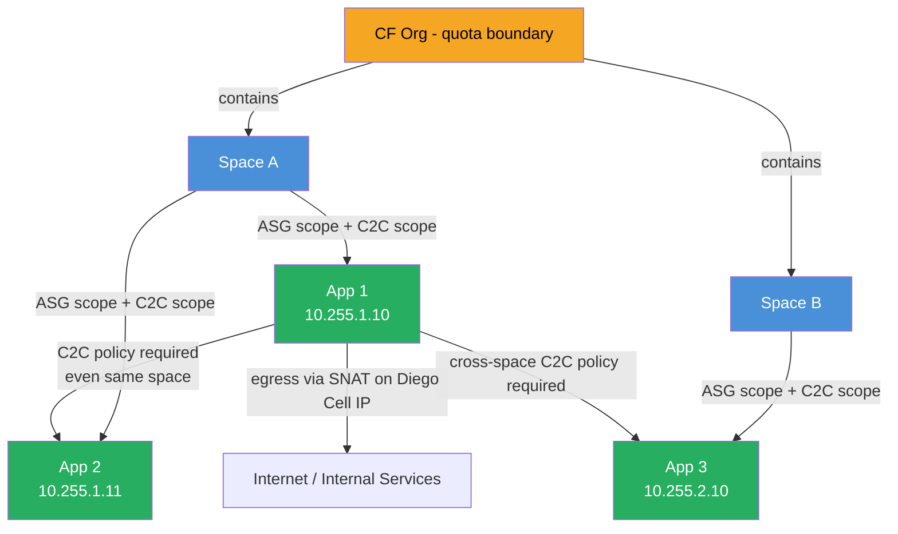
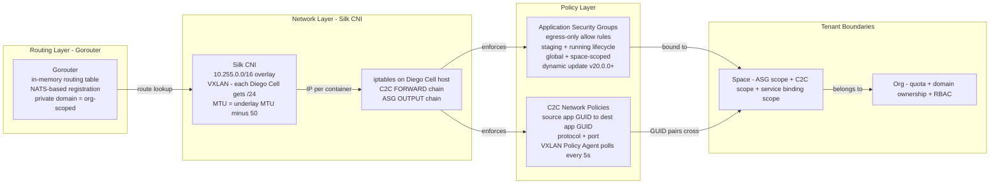
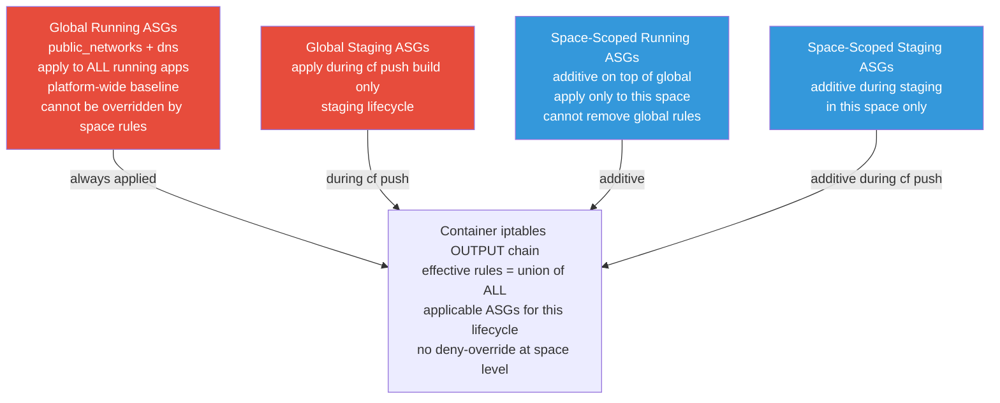

# CF-15: Org/Space Isolation and Multi-Tenancy Networking

**Track:** CF-D — Multi-Tenancy and Isolation
**Prerequisites:** CF-01 (Architecture Overview), CF-07 (ASGs), CF-13 (C2C Network Policies)

**Jump to:** [Quick Read](#quick-read-10-min) · [Deep Dive](#deep-dive) · [Troubleshooting](#6-troubleshooting) · [Quick Reference](#quick-reference)

---

## Quick Read (10 min)

After this lesson you will be able to: explain how CF enforces multi-tenant isolation across the routing, network, and policy layers simultaneously, and diagnose isolation failures using cf CLI and Diego Cell iptables commands.

**Core mental model:** CF multi-tenancy is enforced at three layers simultaneously — routing (Gorouter), network (Silk/iptables), and policy (ASGs + C2C). Orgs own quota. Spaces own network policy scope. Apps live in spaces and get isolated container networks by default.

**Key facts:**

- An **Org** is a billing/quota boundary, not a network boundary
- A **Space** is the unit of ASG and C2C policy scope
- Silk CNI gives every container a unique IP from `10.255.0.0/16`; each Diego Cell gets a `/24`
- **Default posture:** all C2C traffic denied; egress allowed only by ASGs (`dns` + `public_networks` by default)
- Route isolation: Gorouter does not enforce org/space boundaries — any app can claim any route in a shared domain unless a private domain is scoped to an org
- Space-scoped ASGs are additive — they stack on top of global running ASGs; there is no deny-override at the space level
- BOSH DNS `.apps.internal` names are resolvable across spaces; C2C policy is what blocks or allows the traffic
- Korifi (2026): isolation model migrates to standard K8s `Namespace` per space + `NetworkPolicy`; Contour replaces Gorouter

**Isolation layers at a glance:**



**What blocks what:**

| Traffic type | Blocked by default | Opened by |
|---|---|---|
| C2C (app to app, same space) | Yes — Silk iptables DROP | C2C network policy |
| C2C (app to app, cross-space) | Yes — Silk iptables DROP | C2C network policy |
| Egress to RFC1918 | Yes — `public_networks` ASG blocks private ranges | Custom space-scoped ASG |
| Egress to internet | No — `public_networks` ASG allows | (already open) |
| Egress DNS port 53 | No — `dns` ASG allows | (already open) |
| Inbound from Gorouter | No — Gorouter accesses Diego Cell IP directly | Route mapping |

> **K8s Engineer's Translation:** Think of a CF Org as a cluster-level resource quota group and a CF Space as an individual Namespace. C2C default-deny maps to `NetworkPolicy` default-deny. ASGs map to egress `NetworkPolicy` rules. The critical difference: CF's isolation is enforced by iptables on the Diego Cell host, not inside the container network namespace. There is no CNI admission webhook or kube-proxy — the VXLAN Policy Agent programs the host iptables directly.

---

## Deep Dive

---

## Practice Setup

You need two terminals for this lesson.

**Terminal 1 — cf CLI (Mac/local)**
```bash
cf login -a https://api.sys.example.com --skip-ssl-validation
cf target -o my-org -s my-space

# Verify tools
cf version                                   # >= 8.x recommended
cf plugins                                   # check for network-policy plugin
cf install-plugin -r CF-Community "network-policy"
```

**Terminal 2 — BOSH SSH into Diego Cell**
```bash
bosh -e my-env -d cf ssh diego-cell/0
# Once inside:
sudo su -
ip addr show silk-vtep                       # Silk VXLAN interface and overlay IP
ip route show table 100                      # container routing table on this cell
iptables -L FORWARD -n -v | head -60         # C2C policy rules
```

---

## 1. The Three-Layer Isolation Model

CF multi-tenancy is not a single control-plane feature. It is the intersection of three independently operating systems: the routing tier, the network overlay, and the policy enforcement layer. Understanding where each layer operates — and what it cannot do — is essential for diagnosing isolation failures.



> **K8s Engineer's Translation:** In K8s, isolation is CNI + `NetworkPolicy` objects in etcd reconciled by a CNI plugin (Calico, Cilium, etc.). In CF, isolation is Silk VXLAN + iptables rules injected by the VXLAN Policy Agent, which polls the Policy Server every 5 seconds and programs the host iptables directly. There is no CRD, no watch loop, no kube-proxy. The Policy Agent is a BOSH job running on every Diego Cell.

### What the Org boundary controls

- **Quota:** memory, service instances, routes, reserved TCP ports
- **Domain ownership:** private domains are scoped to an org; shared domains are platform-wide
- **Role-based access:** OrgManager, OrgAuditor, BillingManager

What the Org boundary does NOT control:
- IP routing between containers in different orgs on the same Diego Cell
- Route accessibility on shared domains
- C2C traffic between apps in different orgs (that is controlled by C2C policy, not org membership)

```bash
# View org quota usage
cf org my-org

# List quota limits
cf org-quota default

# List all orgs (admin)
cf orgs

# Check private domains scoped to an org
cf domains | grep private
```

### What the Space boundary controls

- **ASG scope:** space-scoped ASGs apply to running apps in that space only
- **C2C policy scope:** policies reference source-app GUID and dest-app GUID; both apps can be in different spaces
- **Service binding scope:** services bound in Space A cannot be directly used by apps in Space B
- **Role-based access:** SpaceDeveloper, SpaceAuditor, SpaceManager

```bash
# List spaces in an org
cf spaces

# Target a specific space
cf target -o my-org -s production

# Check space-level security groups
cf space-security-groups my-space

# Check space quota (spaces can have sub-quotas below the org quota)
cf space my-space
```

---

## 2. Silk CNI and Container IP Assignment Per Space

Every container running on CF receives a dedicated IP address from the Silk overlay network. This is not NAT at the overlay level — each container has a real routable IP within `10.255.0.0/16`. Containers in Space A and Space B on the same Diego Cell are reachable at the IP layer, but iptables rules enforce policy on top.

### Overlay addressing

| Component | Value |
|---|---|
| Overlay CIDR | `10.255.0.0/16` (operator-configurable) |
| Subnet per Diego Cell | `/24` — Cell 0: `10.255.0.0/24`, Cell 1: `10.255.1.0/24`, etc. |
| Containers per cell | ~254 usable addresses |
| Maximum cells | 250 (bounded by /24 subnets in a /16) |
| VTEP interface name | `silk-vtep` on each Diego Cell |
| MTU | Underlay MTU minus 50 bytes (VXLAN header overhead) |
| C2C traffic path | Stays on VXLAN overlay, never touches Gorouter, no SNAT |
| Gorouter traffic path | Diego Cell IP + SNAT; exits overlay to underlay |

```bash
# Terminal 2 (Diego Cell)

# See the VTEP interface and the cell's own overlay IP
ip addr show silk-vtep
# 10.255.1.1/32  — this cell owns the 10.255.1.0/24 block

# See individual container routes on this cell
ip route show table 100
# 10.255.1.2 dev s-010255010002 scope link
# 10.255.1.3 dev s-010255010003 scope link

# Verify MTU (should be underlay MTU - 50)
ip link show silk-vtep | grep mtu
# mtu 1450  (on a standard 1500-MTU underlay)

# See veth pairs (host side of container interfaces)
ip link show | grep "^[0-9]" | grep "s-"
# s-010255010002@if3: ...  (hex of 10.255.1.2)
```

### IP assignment lifecycle

1. Garden container runtime requests a network namespace from Silk CNI
2. Silk CNI calls the Silk Controller (a BOSH job) for a free IP from the cell's /24
3. The Silk Controller reserves the IP and records it
4. A `veth` pair is created: one end in the container namespace (`eth0`), one end on the host as `s-<ip-hex>`
5. The host-side interface enters the iptables chain for C2C and ASG policy enforcement
6. On container stop, the IP is released back to the pool

```bash
# Check Silk CNI assignment logs
tail -20 /var/vcap/sys/log/silk-cni/silk-cni.stdout.log

# Check Silk Controller state
/var/vcap/packages/silk-controller/bin/silk-controller --version
curl -sk https://localhost:4244/state | python3 -m json.tool
```

> **K8s Engineer's Translation:** Silk CNI is functionally equivalent to Flannel VXLAN mode or Calico VXLAN mode. Each node (Diego Cell) gets a subnet. VXLAN encapsulates cross-node traffic. The key difference: Silk's IP management is centralized in the Silk Controller rather than distributed via etcd watch. There is no IPAM CRD or IP address object in CF — the controller owns a simple in-memory + on-disk pool.

---

## 3. ASG Scoping: Global vs Space-Level Isolation

Application Security Groups enforce egress policies at the Space level. The iptables rules are injected into each container's network namespace by the Cloud Controller when the app starts. Since cf-deployment v20.0.0, ASG changes apply dynamically without app restarts — the VXLAN Policy Agent reprograms iptables on the running container within seconds.

### ASG hierarchy



### Default global ASGs

The platform ships with two default global running ASGs.

**`dns`** — allows egress to any IP on port 53 UDP and TCP:
```json
[
  {
    "protocol": "udp",
    "destination": "0.0.0.0/0",
    "ports": "53",
    "description": "Allow DNS lookups"
  },
  {
    "protocol": "tcp",
    "destination": "0.0.0.0/0",
    "ports": "53",
    "description": "Allow DNS lookups over TCP"
  }
]
```

**`public_networks`** — allows egress to public internet ranges, explicitly blocks RFC1918:
```json
[
  { "protocol": "all", "destination": "0.0.0.0-9.255.255.255" },
  { "protocol": "all", "destination": "11.0.0.0-169.253.255.255" },
  { "protocol": "all", "destination": "169.255.0.0-172.15.255.255" },
  { "protocol": "all", "destination": "172.32.0.0-192.167.255.255" },
  { "protocol": "all", "destination": "192.169.0.0-255.255.255.255" }
]
```

This means: by default, apps can reach the public internet but NOT private IP ranges (10.0.0.0/8, 172.16.0.0/12, 192.168.0.0/16). To reach an internal service such as a database at `10.0.0.5`, you must add a space-scoped ASG.

### Creating a space-scoped ASG for internal access

```bash
# Terminal 1 (cf CLI)

# Create the ASG definition file
cat > internal-db.json << 'EOF'
[
  {
    "protocol": "tcp",
    "destination": "10.0.0.0/8",
    "ports": "5432,3306,6379,27017",
    "description": "Allow access to internal databases in private range"
  }
]
EOF

# Create the security group object
cf create-security-group internal-db internal-db.json

# Bind it to a specific space (running lifecycle only)
cf bind-security-group internal-db my-org space-a --lifecycle running

# Bind a separate staging ASG if the buildpack needs to reach private artifact repos
cf bind-security-group internal-db my-org space-a --lifecycle staging

# Verify the binding
cf space-security-groups space-a

# Dynamic update applies within ~5 seconds — no app restart needed
# Verify on Diego Cell:
# nsenter --net=/var/vcap/data/guardian/depot/<handle>/ns/net iptables -L OUTPUT -n -v
# Look for ACCEPT rules matching 10.0.0.0/8 on those ports
```

### Verifying space isolation between spaces

An app in Space A should not reach an internal service if only Space B has the ASG:

```bash
# App in Space A — no internal-db ASG bound to space-a
cf ssh my-app-space-a
# Inside container:
curl -v --max-time 5 http://10.0.0.5:5432
# Expected: timeout — blocked by missing ASG, iptables DROP

# After binding internal-db ASG to space-a:
# (from Terminal 1, no restart needed)
cf bind-security-group internal-db my-org space-a --lifecycle running

# Wait 5-10 seconds for VXLAN Policy Agent propagation
cf ssh my-app-space-a
curl -v --max-time 5 http://10.0.0.5:5432
# Expected: TCP handshake succeeds (or port-specific response)
```

> **K8s Engineer's Translation:** Space-scoped ASGs are the CF equivalent of per-Namespace egress `NetworkPolicy`. Global running ASGs are equivalent to cluster-wide `NetworkPolicy` enforced via a mutating admission webhook or Calico `GlobalNetworkPolicy`. The CF difference: ASG rules are always additive (union). There is no `namespaceSelector` deny override. A global ASG that opens port 443 cannot be blocked at the space level. This is a weaker isolation model than K8s `NetworkPolicy` on platforms that need hard per-tenant egress blocking.

---

## 4. C2C Policies and Cross-Space Traffic

C2C (container-to-container) networking uses app GUIDs as policy identifiers. A GUID is stable across `cf push` cycles, so a policy added today survives tomorrow's deployment without manual update.

### How C2C traverses the VXLAN overlay

Consider a fintech platform where the `payment-api` app (Space: `pci-cde`, `10.255.1.10`) must call the `fraud-scoring` service (Space: `fraud-detection`, `10.255.2.10`) without exposing either service to the public internet. By default Silk drops all C2C traffic, so the connection is blocked even though both apps are in the same CF org. A single cross-space C2C policy is the only control that opens the conduit — no load balancer, no Gorouter hop, and no SNAT in the path.

1. `payment-api` (Space: `pci-cde`, `10.255.1.10`) sends a packet destined for `fraud-scoring` (Space: `fraud-detection`, `10.255.2.10`)
2. The packet hits the iptables FORWARD chain on Diego Cell 1
3. The VXLAN Policy Agent has pre-populated iptables rules derived from stored policies; if `10.255.1.10 → 10.255.2.10 tcp:8080` is allowed, the packet proceeds
4. The packet is VXLAN-encapsulated and sent to Diego Cell 2's underlay IP on UDP 4789
5. Diego Cell 2 decapsulates and delivers to `fraud-scoring`'s container network namespace
6. If no policy exists, iptables silently DROPs the packet — no ICMP unreachable is generated

```bash
# Terminal 1 — create a C2C policy between apps in different spaces

# Get app GUIDs (stable across redeploy)
cf app frontend --guid    # e.g., aaa-111-...
cf app backend --guid     # e.g., bbb-222-...

# Same-space C2C policy
cf add-network-policy frontend --destination-app backend \
  --protocol tcp --port 8080

# Cross-space C2C policy (must have SpaceDeveloper in BOTH spaces, or be admin)
cf target -o my-org -s space-a
cf add-network-policy frontend \
  --destination-app backend \
  --destination-space space-b \
  --destination-org my-org \
  --protocol tcp --port 8080

# List policies from a specific source app
cf network-policies --source frontend

# List all C2C policies in current space
cf network-policies

# Remove a policy
cf remove-network-policy frontend --destination-app backend \
  --protocol tcp --port 8080
```

### BOSH DNS for C2C service discovery

BOSH DNS provides health-aware client-side service discovery using `.apps.internal` names. The name resolves to the overlay IP of a running container. C2C policy is what gates whether the connection succeeds after DNS resolution.

```bash
# Inside a container (cf ssh my-app)

# Resolve another app by its internal DNS name
dig backend.apps.internal
# Returns: 10.255.2.10

# Per-instance resolution (useful for stateful apps)
dig 0.backend.apps.internal    # instance index 0
dig 1.backend.apps.internal    # instance index 1

# Test C2C connectivity (requires a C2C policy to exist)
curl http://backend.apps.internal:8080/health

# BOSH DNS resolver listens on 169.254.0.2 (link-local)
cat /etc/resolv.conf
# nameserver 169.254.0.2
# search apps.internal
```

```bash
# Terminal 2 (Diego Cell) — verify C2C iptables rules after policy creation
# The VXLAN Policy Agent polls the Policy Server every 5 seconds
iptables -L FORWARD -n -v | grep "10.255"
# ACCEPT  tcp  10.255.1.10  10.255.2.10  dpt:8080

# Check Policy Agent sync logs
tail -30 /var/vcap/sys/log/vxlan-policy-agent/vxlan-policy-agent.stdout.log
# Look for "poll" and "iptables update" entries
```

> **K8s Engineer's Translation:** C2C + BOSH DNS is the CF equivalent of K8s `Service` DNS + `NetworkPolicy`. In K8s you create a `Service` to get a stable DNS name, then optionally a `NetworkPolicy` to restrict which pods can reach it. In CF, BOSH DNS gives you the DNS name automatically for every app — there is no equivalent of `kubectl expose`. C2C policy is what gates access. One key difference: BOSH DNS `.apps.internal` names are resolvable across spaces by default; K8s DNS names for Services are namespace-scoped unless you use a FQDN with `.svc.cluster.local`.

---

## 5. Route Isolation and Domain Scoping

Gorouter isolation is based on domain scoping, not network-layer controls. This is an important distinction from K8s Ingress, which can enforce namespace-level route ownership via `IngressClass`.

Gorouter uses an in-memory routing table populated by NATS-based registration. The Route Emitter on each Diego Cell refreshes registrations every 20 seconds with a 2-minute TTL. There is no etcd — routes are ephemeral in-memory state.

### Shared vs private domains

```bash
# Terminal 1 — domain management

# List all domains
cf domains
# name                    status   type    details
# apps.example.com        shared
# tcp.example.com         shared   tcp
# myteam.example.com      owned    private   org: my-org

# Create a private domain scoped to an org
# Only apps in my-org can map routes under myteam.example.com
cf create-private-domain my-org myteam.example.com

# Map a route under the private domain
cf map-route my-app myteam.example.com --hostname api

# Private domain routes are not mappable by apps in other orgs
# Any org member can still map routes in shared domains — no ownership enforcement on shared

# Check which apps are mapped to a specific hostname
cf routes | grep my-hostname

# Unmap a route
cf unmap-route other-app apps.example.com --hostname my-hostname
```

### Route conflict on shared domains

If two apps in different spaces map the same route in a shared domain, both apps receive traffic — Gorouter round-robins across all registered backends for that route. There is no K8s-style `IngressClass` admission webhook preventing the second mapping.

```bash
# Check all current routes across the targeted org
cf routes

# Example output:
# space    host        domain           apps
# space-a  my-service  apps.example.com app-v1
# space-b  my-service  apps.example.com app-v2 (conflict — both get traffic)

# Unmap the unintended registration
cf target -o my-org -s space-b
cf unmap-route app-v2 apps.example.com --hostname my-service
```

> **K8s Engineer's Translation:** CF shared domains are like K8s Ingress without `IngressClassName` enforcement — any Namespace can create an Ingress for the same hostname and both coexist, splitting traffic. CF private domains are like a cluster-scoped `IngressClass` with `spec.controller` locked to a specific set of Namespaces (the org). For strong route isolation, use private domains per org.

---

## 6. Troubleshooting

### Failure: C2C traffic hangs (no response, no error)

```bash
# Step 1: Verify C2C policy exists
cf network-policies --source frontend

# Step 2: Check that app GUIDs match — policies use GUIDs, not names
cf app frontend --guid
cf app backend --guid

# Step 3: Check VXLAN Policy Agent pushed rules to iptables on the Diego Cell
# Terminal 2:
iptables -L FORWARD -n -v | grep "10.255"
# If no ACCEPT rule for the source/dest pair: Policy Agent has not synced yet, or policy is missing

# Step 4: Check Policy Agent logs for sync errors
tail -50 /var/vcap/sys/log/vxlan-policy-agent/vxlan-policy-agent.stdout.log

# Step 5: Verify BOSH DNS resolution inside the source container
cf ssh frontend
dig backend.apps.internal
# If NXDOMAIN: backend app is stopped or crashed
# If returns IP but curl hangs: C2C policy issue

# Step 6: Packet capture on the VTEP to confirm VXLAN traffic is being sent
# Terminal 2:
tcpdump -i silk-vtep -n host 10.255.2.10 -w /tmp/c2c.pcap &
# Then retry the curl from the container
# Check if outbound VXLAN packets appear — if yes, check the destination cell
```

### Failure: Egress to internal IP fails despite space ASG

```bash
# Step 1: Confirm ASG is bound to the correct space AND lifecycle
cf space-security-groups my-space
# Check both "running" and "staging" columns

# Step 2: Confirm ASG JSON covers the target IP and port
cf security-group internal-db

# Step 3: Check iptables inside the container (requires root on Diego Cell)
# Terminal 2:
# Find the container network namespace path
ls /var/vcap/data/guardian/depot/ | head -5
# nsenter into the container and check OUTPUT chain
nsenter --net=/var/vcap/data/guardian/depot/<handle>/ns/net \
  iptables -L OUTPUT -n -v
# Look for ACCEPT rule matching 10.0.0.0/8 on the target ports

# Step 4: If rules are missing, force a dynamic refresh
# Wait 10 seconds after bind — if still missing, restart the app
cf restart my-app

# Step 5: Check CC logs for ASG propagation errors
# On cloud_controller_ng BOSH VM:
tail -f /var/vcap/sys/log/cloud_controller_ng/cloud_controller_ng.log \
  | grep -i "security_group"
```

### Failure: Org quota blocking deployments

```bash
# Check org quota usage vs limits
cf org my-org
# Shows: memory used / limit, services used / limit

# Identify apps consuming the most memory
cf apps
# Sum the instances * memory column manually

# View raw quota definition
cf org-quota $(cf org my-org | grep quota | awk '{print $2}')

# As admin — increase quota
cf update-org-quota my-quota --memory 50G --num-app-instances 500

# Check space-level sub-quota if the org has headroom but space is blocked
cf space my-space
cf space-quota my-space-quota
cf update-space-quota my-space-quota --memory 20G
```

### Common failure modes

| Symptom | Likely cause | Diagnostic command |
|---|---|---|
| C2C curl hangs, no RST | C2C policy missing; iptables DROP | `cf network-policies --source app` |
| C2C curl: connection refused | Policy exists; app not listening on that port | `cf ssh dest-app -- netstat -tlnp` |
| Egress to internal IP times out | Missing space-scoped ASG | `cf space-security-groups my-space` |
| Egress to internet fails | Custom ASG accidentally replaced public_networks | `cf security-groups` check global list |
| Route receives traffic from wrong app | Shared domain conflict; both apps mapped | `cf routes` check all spaces |
| `cf push` fails: quota exceeded | Org or space quota hit | `cf org` / `cf space` |
| BOSH DNS returns NXDOMAIN | Destination app stopped or crashed | `cf app dest-app` check state |
| MTU-sized requests hang silently | silk-vtep MTU misconfigured | `ip link show silk-vtep` on Diego Cell |

---

## Production Checklist

- [ ] Audit all global running ASGs — remove any rules broader than required by the platform
- [ ] Confirm `public_networks` and `dns` global ASGs are present and unmodified
- [ ] For each space handling sensitive workloads, create dedicated space-scoped ASGs for internal service access
- [ ] Block RFC1918 egress at the space level for internet-facing apps that must not reach internal networks (note: cannot override global ASGs — restructure if needed)
- [ ] All C2C policies documented as GUID pairs in a runbook — GUIDs survive redeploy, app names do not
- [ ] Verify BOSH DNS `.apps.internal` name resolution from inside containers before go-live
- [ ] Private domains created for each org to prevent route squatting on shared domains
- [ ] Org quotas sized with at least 20% headroom above expected peak memory consumption
- [ ] Space quotas set for teams that need hard per-team billing limits
- [ ] VXLAN Policy Agent poll interval confirmed (default 5 seconds) — monitor for iptables rule count growth in large deployments
- [ ] MTU verified: `silk-vtep` MTU = underlay MTU minus 50; mismatches cause silent drops on packets larger than ~1400 bytes
- [ ] Dynamic ASG update confirmed working (cf-deployment v20.0.0+): bind an ASG and test without restart
- [ ] Cross-org C2C policies audited quarterly — remove stale GUID pairs after app decommissions
- [ ] Route conflicts in shared domains audited: `cf routes` across all spaces in each org

---

## Quick Reference

### cf CLI commands

| Command | Purpose |
|---|---|
| `cf orgs` | List all orgs |
| `cf spaces` | List spaces in targeted org |
| `cf target -o ORG -s SPACE` | Switch org/space context |
| `cf org ORG` | Show org details and quota usage |
| `cf space SPACE` | Show space details and quota |
| `cf org-quota QUOTA` | Show org quota limits |
| `cf update-org-quota QUOTA --memory 50G` | Increase org memory quota |
| `cf security-groups` | List all ASGs |
| `cf space-security-groups SPACE` | List ASGs bound to a space |
| `cf create-security-group NAME FILE` | Create ASG from JSON file |
| `cf bind-security-group NAME ORG SPACE --lifecycle running` | Bind ASG to space |
| `cf unbind-security-group NAME ORG SPACE --lifecycle running` | Remove ASG from space |
| `cf network-policies` | List C2C policies in current space |
| `cf network-policies --source APP` | List policies from specific source app |
| `cf add-network-policy SRC --destination-app DST --protocol tcp --port PORT` | Add C2C policy |
| `cf remove-network-policy SRC --destination-app DST --protocol tcp --port PORT` | Remove C2C policy |
| `cf domains` | List shared and private domains |
| `cf create-private-domain ORG DOMAIN` | Create org-scoped private domain |
| `cf routes` | List all routes in targeted org |
| `cf map-route APP DOMAIN --hostname HOST` | Map a route to an app |
| `cf unmap-route APP DOMAIN --hostname HOST` | Remove a route mapping |
| `cf app APP --guid` | Get app GUID (stable identifier, survives redeploy) |

### BOSH/Diego Cell diagnostic commands

| Command | Purpose |
|---|---|
| `ip addr show silk-vtep` | Show VTEP interface and cell's overlay IP |
| `ip route show table 100` | Show per-container routes on this Diego Cell |
| `ip link show silk-vtep` | Check VTEP MTU (must be underlay MTU minus 50) |
| `iptables -L FORWARD -n -v` | Show C2C policy enforcement rules |
| `iptables -L OUTPUT -n -v` | Show ASG egress rules (host namespace) |
| `nsenter --net=NS iptables -L OUTPUT -n -v` | Inspect ASG rules inside a container namespace |
| `tcpdump -i silk-vtep -n` | Capture VXLAN overlay traffic |
| `dig APP.apps.internal` | Resolve app DNS name from Diego Cell |
| `tail -f /var/vcap/sys/log/vxlan-policy-agent/vxlan-policy-agent.stdout.log` | Watch Policy Agent sync activity |
| `tail -f /var/vcap/sys/log/silk-cni/silk-cni.stdout.log` | Watch Silk CNI IP assignment events |

---

## Org/Space Isolation as Compliance Zones

The CF org/space hierarchy maps directly to regulated-sector security zone models. This is not coincidental — CF's multi-tenancy design satisfies the same isolation requirements that IEC 62443 zones and PCI-DSS network segmentation demand.

### IEC 62443 Zone → CF Org/Space Mapping

IEC 62443 defines **zones** (groups of assets with the same security level) and **conduits** (controlled communication paths between zones). CF orgs and spaces implement this model natively:

| IEC 62443 concept | CF equivalent | Enforcement mechanism |
|---|---|---|
| Zone (SL 1–4) | CF Org | Org-level quota + ASG scope |
| Sub-zone | CF Space | Space-scoped ASG |
| Conduit | ASG rule between spaces + C2C policy | iptables / VXLAN Policy Agent |
| Zone boundary | Diego Cell network namespace | Silk CNI overlay isolation |
| Security Level (SL) | CF org metadata annotation | Operator-defined convention |

```bash
# Annotate orgs with IEC 62443 security level (CF v3 metadata)
cf curl -X PATCH /v3/organizations/$(cf org operations-zone --guid) \
  -d '{"metadata":{"annotations":{"iec62443/zone":"operations","iec62443/sl":"2"}}}'

cf curl -X PATCH /v3/organizations/$(cf org enterprise-it --guid) \
  -d '{"metadata":{"annotations":{"iec62443/zone":"enterprise","iec62443/sl":"1"}}}'

# Verify
cf curl /v3/organizations?per_page=100 | \
  python3 -c "
import json,sys
for o in json.load(sys.stdin)['resources']:
    ann = o.get('metadata',{}).get('annotations',{})
    if 'iec62443/zone' in ann:
        print(o['name'], '→', ann)
"
```

### PCI-DSS Req 7.2 — Need-to-Know Access Control

PCI-DSS Req 7.2.1 requires access to system components and cardholder data be restricted to only those individuals whose job requires such access. In CF:

- Each CF **org** maps to a business unit or compliance boundary
- Each CF **space** maps to an environment (production, staging) within that boundary
- **SpaceDeveloper** role grants app deployment access; **SpaceAuditor** grants read-only compliance review access
- Cross-org access does not exist in CF's RBAC model — an auditor with SpaceAuditor in `cde-production` cannot see apps in `finance-reporting`

```bash
# Assign minimum-privilege roles for PCI audit access
# Auditor gets read-only view of CDE space — cannot deploy or change ASGs
cf set-space-role auditor@example.com payment-org cde-production SpaceAuditor

# Verify no SpaceDeveloper access for non-developers in regulated spaces
cf space-users payment-org cde-production
# Review: SpaceDeveloper list must match approved developer roster
```

### GDPR Art. 25 — Org/Space as Data Residency Boundary

For GDPR data residency: each CF **org** that processes EU personal data should be deployed on a CF foundation in an EU region (e.g. BTP CF eu10/eu20). The org itself is not a geographic control — the foundation's hyperscaler region is. But org/space structure should reflect data classification:

```
Global Account
├── Subaccount: EU-Production (cf.eu10.hana.ondemand.com)
│   ├── Org: personal-data-eu          ← EU personal data only
│   │   └── Space: production
│   └── Org: non-personal              ← operational data, no GDPR scope
└── Subaccount: US-Production (cf.us10.hana.ondemand.com)
    └── Org: hipaa-phi                 ← US healthcare data, separate subaccount
```

> **Full compliance mapping:** See [CF-21 — Compliance Networking](cf-21-compliance-networking.md) for the complete control matrix with CF CLI commands as auditor evidence for each framework.

---

## Check Your Understanding

1. A CF Org is described as a "quota boundary, not a network boundary." What does this mean in practice — specifically, what network-level communication is NOT blocked between containers in two different orgs on the same Diego Cell?
2. You bind a space-scoped ASG to `space-a` that opens TCP port 5432 to `10.0.0.0/8`. An app in `space-b` on the same platform tries to reach the same database and times out. What is the reason, and what is the correct fix?
3. A C2C policy between `payment-api` and `fraud-scoring` exists, `dig fraud-scoring.apps.internal` returns the correct overlay IP, but `curl` from inside `payment-api` still hangs with no RST. Walk through the two most likely causes and the diagnostic command for each.
4. Two teams in different spaces both map `my-service.apps.example.com` in the shared domain. What traffic behavior results, and what is the CF-native mechanism to prevent this conflict?
5. The VXLAN Policy Agent polls the Policy Server every 5 seconds. After you run `cf add-network-policy`, how can you confirm on the Diego Cell that the iptables FORWARD chain has actually been updated for the new policy?

---

## See Also

**Related K8s lessons in this course:**

- **Linux-02: Network Namespaces and veth pairs** — Silk CNI uses the same veth-pair mechanism as K8s CNIs; understanding host-side `s-<hex>` interfaces requires this foundation
- **Linux-05: iptables and nftables** — ASGs and C2C policies are both implemented as iptables rules; this lesson covers the chain structure Silk uses
- **K8s-08: NetworkPolicy** — Direct conceptual equivalent to CF C2C policies; K8s `NetworkPolicy` selectors vs CF GUID-based selectors; default-deny model comparison
- **K8s-09: CNI Deep Dive** — Flannel VXLAN mode is structurally identical to Silk CNI; compare VTEP setup, encapsulation, and IP assignment
- **K8s-14: Multi-Tenancy and Namespace Isolation** — K8s namespace isolation patterns (RBAC + NetworkPolicy + ResourceQuota) map directly to CF org/space patterns
- **K8s-20: Ingress and Routing** — Gorouter's NATS-based routing table vs K8s Ingress controller's etcd-backed routing; compare TTL and registration models

---

## Online Resources

- [CF Networking Documentation — Understand CF Networking](https://docs.cloudfoundry.org/concepts/understand-cf-networking.html) — official overview of Silk CNI, C2C policies, and ASGs with architecture diagrams
- [Application Security Groups Reference](https://docs.cloudfoundry.org/concepts/asg.html) — full ASG reference: JSON schema, lifecycle scoping, dynamic update behavior, and default ASG content
- [cf-networking-release on GitHub](https://github.com/cloudfoundry/cf-networking-release) — source for the VXLAN Policy Agent, Silk CNI, and Policy Server; release notes include dynamic ASG update history
- [BOSH DNS — Health-Aware Service Discovery](https://bosh.io/docs/dns/) — BOSH DNS reference covering `.apps.internal` naming, per-instance addressing with index prefix, and health check integration
- [Korifi — CF on Kubernetes (2026)](https://github.com/cloudfoundry/korifi) — Korifi project: maps CF V3 API to K8s CRDs (CFApp, CFRoute, CFSpace, CFBuild); replaces Silk + VXLAN Policy Agent with standard K8s `NetworkPolicy`; replaces Gorouter with Contour
