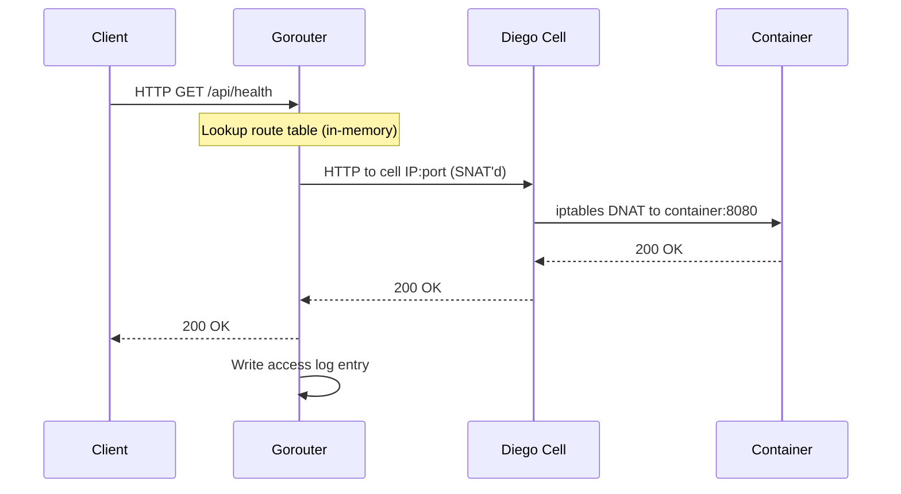
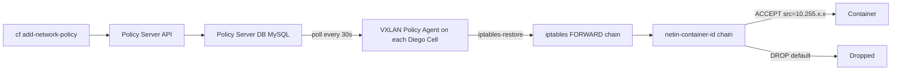
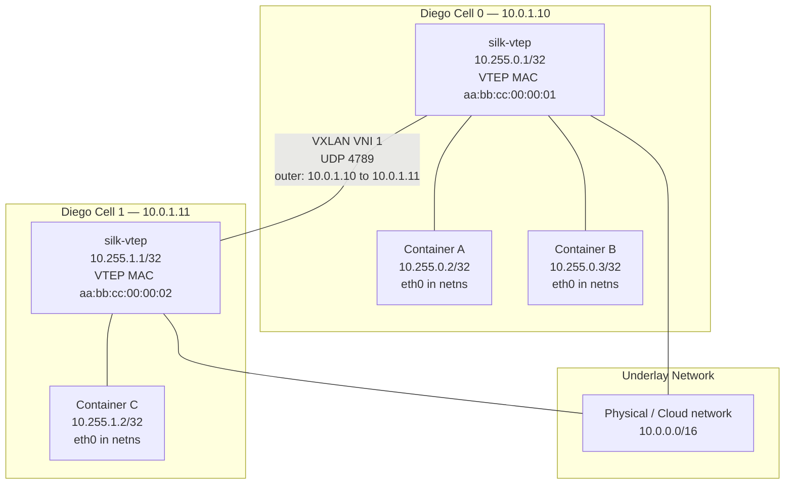
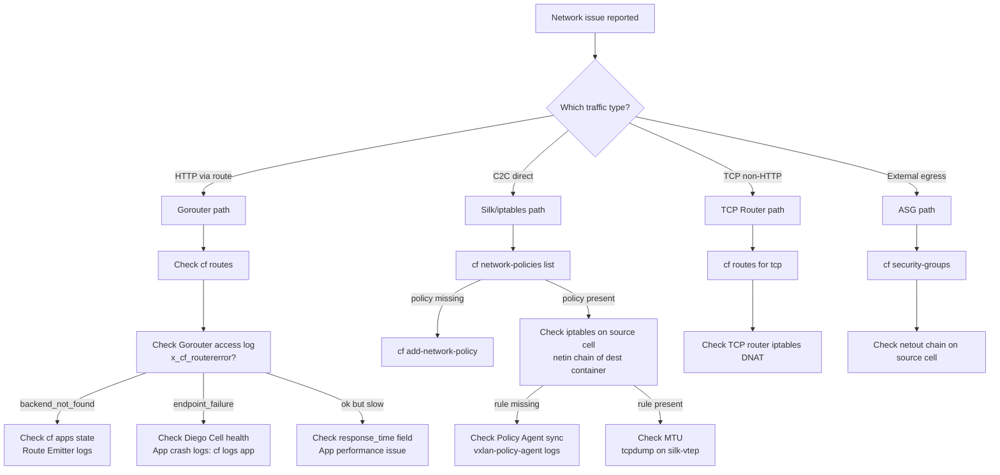

# CF Network Observability and Troubleshooting

**Track:** CF-E | **Lesson:** 16 | **Time:** Quick Read 10 min · Deep Dive 60 min

---

## Quick Read (10 min)

### The Mental Model

CF gives you two visibility planes:

- **Control plane:** `cf network-policies`, `cf apps`, `cf routes` — what *should* be reachable
- **Data plane:** BOSH SSH into Diego Cells — what *is* actually happening in iptables, VXLAN, and container netns

```mermaid
graph TD
    A[cf CLI] -->|observe policies| B[Policy Server API]
    C[Ops / BOSH] -->|ssh into Diego Cell| D[Diego Cell]
    D --> E[iptables rules]
    D --> F[VXLAN overlay silk-vtep]
    D --> G[Container netns]
    B -->|poll every 30s| E
    H[Gorouter] -->|access logs| I[/var/vcap/sys/log/gorouter/access.log]
    G -->|tcpdump on veth| J[Packet capture]
```

### Key Facts

- Gorouter logs: `/var/vcap/sys/log/gorouter/access.log` — every HTTP request with timing, backend, status
- Diego Cell iptables: `iptables -L -n -v -t filter` shows C2C + ASG rules; chains named `netout-<container-id>` and `netin-<container-id>`
- VXLAN interface: `silk-vtep` on each cell; `tcpdump -i silk-vtep` captures all overlay traffic
- Silk CNI debugging: `/var/vcap/sys/log/silk-daemon/silk-daemon.stdout.log`
- Policy Agent sync: logs at `/var/vcap/sys/log/vxlan-policy-agent/vxlan-policy-agent.stdout.log`; polls Policy Server every 30s
- Container network namespace: `ip netns exec <ns>` or enter via `/proc/<pid>/ns/net`
- C2C default deny: if two apps cannot reach each other, check `cf network-policies` first, then iptables on the *source* cell
- MTU traps: Silk MTU = underlay MTU - 50; mismatched MTU causes silent fragmentation or TCP hangs on large payloads
- BOSH SSH gate: requires `bosh ssh diego-cell/0` — Ops Manager / BOSH Director access, not cf CLI

### K8s Engineer's Translation

| CF | Kubernetes |
|---|---|
| `bosh ssh diego-cell/0` | `kubectl debug node/<node> -it --image=busybox` |
| `iptables -L` on cell | Cilium identity rules / `cilium monitor` |
| `tcpdump -i silk-vtep` | `hubble observe` / `tcpdump -i cilium_vxlan` |
| Gorouter access log | Ingress controller access log (nginx/envoy) |
| Policy Server sync lag (30s) | Cilium policy push (sub-second) |
| `cf network-policies` | `kubectl get networkpolicy` |

---

## Deep Dive

---

## Practice Setup

You need two terminals and BOSH access to a CF environment. A `cf-deployment` on BOSH with at least two deployed apps works best.

**Terminal 1 — cf CLI (Mac/local)**

```bash
# Authenticate
cf login -a https://api.sys.example.com --sso

# Target your practice org and space
cf target -o observability-org -s observability-space

# Deploy two practice apps
cf push frontend --no-start -m 128M
cf push backend --no-start -m 128M
cf start frontend
cf start backend

# Check apps are running
cf apps
# frontend   started   1/1   128M   128M   frontend.apps.example.com
# backend    started   1/1   128M   128M   (no route — internal only)
```

**Terminal 2 — BOSH SSH (ops/jumpbox terminal)**

```bash
# Target the BOSH director
bosh -e cf-prod login

# List deployments
bosh deployments

# SSH to first Diego Cell
bosh -d cf ssh diego-cell/0

# Once in: become root
sudo -i
```

> **K8s Engineer's Translation:** Terminal 1 is your `kubectl` terminal; Terminal 2 is equivalent to `kubectl debug node/<node-name> --image=ubuntu -it` or the node SSH you get via your cloud provider. BOSH SSH is more direct — you land on the actual VM, not a privileged container.

---

## 1. Gorouter Access Logs and Request Tracing

The Gorouter is CF's HTTP reverse proxy. Every request that enters through a mapped route is logged to its access log. This is the first place to look when debugging latency, 502s, or missing traffic.



### Accessing the Access Log

From Terminal 2 (BOSH SSH into the router VM — not a Diego Cell):

```bash
# SSH to Gorouter instead of Diego Cell
bosh -d cf ssh router/0

sudo -i

# Tail the access log live
tail -f /var/vcap/sys/log/gorouter/access.log
```

### Log Format Decoded

A single access log line looks like:

```
frontend.apps.example.com - [2026-11-23T14:31:02.123Z] "GET /health HTTP/1.1" 200 0 23 "-" \
  "curl/8.1.0" "10.0.0.5:48221" "10.255.12.4:60001" \
  x_forwarded_for:"1.2.3.4" x_forwarded_proto:"https" \
  vcap_request_id:"abc123-def456" response_time:0.003421 gorouter_time:0.000312 \
  app_id:"550e8400-e29b-41d4-a716-446655440000" app_index:"0" \
  x_cf_routererror:"-" x_b3_traceid:"..." x_b3_spanid:"..."
```

Field-by-field breakdown:

```bash
# Parse key fields with awk
tail -f /var/vcap/sys/log/gorouter/access.log | awk '{
  for(i=1;i<=NF;i++) {
    if ($i ~ /^response_time/) print "latency:", $i
    if ($i ~ /^app_id/)        print "app_id:", $i
    if ($i ~ /^x_cf_routererror/) print "router_err:", $i
  }
}'

# Count 502s in last 5 minutes
grep "$(date -u -v-5M +%Y-%m-%dT%H:%M)" /var/vcap/sys/log/gorouter/access.log \
  | awk '$9 == "502"' | wc -l

# Find slowest requests (response_time > 1s)
grep 'response_time' /var/vcap/sys/log/gorouter/access.log \
  | grep -oP 'response_time:\K[0-9.]+' \
  | awk '$1 > 1 {print $1}' \
  | sort -n | tail -20

# Spot x_cf_routererror values (backend unavailable, etc.)
grep -v 'x_cf_routererror:"-"' /var/vcap/sys/log/gorouter/access.log | tail -50
```

### Common x_cf_routererror Values

| Value | Meaning | Action |
|---|---|---|
| `backend_not_found` | No healthy backend registered | Check `cf apps` state; check Route Emitter logs |
| `endpoint_failure` | Backend returned connection error | Check Diego Cell health; app process crash |
| `websocket_timeout` | WebSocket idle timeout hit | Tune `router.websocket_client_inactivity_timeout` |
| `-` | No error | Normal |

### Route Emitter Lag Troubleshooting

The Route Emitter on each Diego Cell registers app routes via NATS. If routes go stale:

```bash
# On Diego Cell (Terminal 2)
# Check route emitter logs
tail -100 /var/vcap/sys/log/route_emitter/route_emitter.stdout.log \
  | grep -E 'error|warning|emit|sync'

# Route Emitter refreshes every 20s, TTL 2 min
# A cell crash leaves routes registered for up to 2 min before expiry
grep 'failed' /var/vcap/sys/log/route_emitter/route_emitter.stdout.log | tail -20
```

> **K8s Engineer's Translation:** Gorouter's access log is equivalent to your nginx-ingress or Envoy access log. The x_cf_routererror field maps to upstream connect error codes. CF uses NATS-based route registration with a 2-minute TTL rather than Kubernetes Endpoints objects — this means brief gaps during cell restarts are expected and normal.

---

## 2. CF Network Policies and C2C Debugging

Container-to-container (C2C) traffic uses the Silk VXLAN overlay. By default all C2C traffic is denied. Network policies are GUID-based and enforced via iptables on each Diego Cell.

### Viewing and Creating Network Policies

From Terminal 1 (cf CLI):

```bash
# List all network policies in the current space
cf network-policies

# Output:
# Listing network policies in org observability-org / space observability-space...
# source      destination   protocol   ports
# frontend    backend       tcp        8080

# Add a policy
cf add-network-policy frontend backend --protocol tcp --port 8080

# Remove a policy
cf remove-network-policy frontend backend --protocol tcp --port 8080

# Policies between apps in different spaces
cf add-network-policy frontend backend \
  --protocol tcp --port 8080 \
  -s observability-space \
  -o observability-org

# Get app GUIDs (policies are GUID-based internally)
cf app frontend --guid
# 550e8400-e29b-41d4-a716-446655440000

cf app backend --guid
# 6ba7b810-9dad-11d1-80b4-00c04fd430c8
```

### How Policies Become iptables Rules



### Inspecting iptables on Diego Cells

From Terminal 2 (on Diego Cell, as root):

```bash
# List all chains — look for netout-* and netin-* per container
iptables -L -n -v --line-numbers | head -100

# Map container handle to container ID via garden
curl -s --unix-socket /var/vcap/data/garden/garden.sock \
  http://localhost/containers | python3 -m json.tool | grep -i handle

# View the netin chain for a specific container handle
# Container handles look like: abc12345-1234-...
HANDLE="abc12345-1234-5678-abcd-ef0123456789"
iptables -L "netin--${HANDLE:0:10}" -n -v

# Example output showing C2C policy rule:
# Chain netin--abc12345-1 (1 references)
# target  prot  opt  source          destination
# ACCEPT  tcp   --   10.255.0.0/16   0.0.0.0/0    tcp dpt:8080
# ACCEPT  udp   --   10.255.0.0/16   0.0.0.0/0    udp dpt:8080
# DROP    all   --   0.0.0.0/0       0.0.0.0/0

# View netout chain (ASG-based egress)
iptables -L "netout--${HANDLE:0:10}" -n -v

# Count packets hitting each rule (useful for confirming traffic flows)
iptables -L -n -v -t filter | grep -A5 "netin--${HANDLE:0:10}"

# Watch hit counts update in real time (run a curl in background)
watch -n 2 "iptables -L netin--${HANDLE:0:10} -n -v"
```

### Verifying Policy Sync

```bash
# Check VXLAN Policy Agent sync status
tail -50 /var/vcap/sys/log/vxlan-policy-agent/vxlan-policy-agent.stdout.log

# Look for successful poll messages
grep 'poll' /var/vcap/sys/log/vxlan-policy-agent/vxlan-policy-agent.stdout.log | tail -20
# {"timestamp":"2026-11-23T14:35:01Z","level":"info","message":"poll-cycle-start"}
# {"timestamp":"2026-11-23T14:35:01Z","level":"info","message":"poll-cycle-end","data":{"policies":42,"tags":8}}

# If policies are not syncing — check Policy Server reachability from cell
curl -sk https://policy-server.service.cf.internal:4003/networking/v1/internal/policies \
  -H "Authorization: $(cat /var/vcap/data/vxlan-policy-agent/cf_token)" \
  | python3 -m json.tool | head -40
```

> **K8s Engineer's Translation:** CF's C2C policy model is equivalent to Kubernetes NetworkPolicy, but enforcement is always iptables-based (never eBPF). The 30-second poll cycle means policy changes take up to 30 seconds to take effect — no container restart needed. This is similar in latency to Cilium's policy sync but without the real-time push model Cilium uses. `cf network-policies` is your `kubectl get networkpolicy`.

---

## 3. VXLAN Overlay and Silk CNI Packet Captures

The Silk overlay uses VXLAN with the `silk-vtep` interface. Capturing on this interface shows all container-to-container overlay traffic in one place on a Diego Cell.

### Understanding the Silk Overlay Topology



### Packet Captures on the Overlay

From Terminal 2 (Diego Cell, as root):

```bash
# Verify silk-vtep interface exists and is up
ip link show silk-vtep
ip addr show silk-vtep
# Output: inet 10.255.0.1/32 scope global silk-vtep

# Capture ALL overlay traffic (inter-cell C2C)
tcpdump -i silk-vtep -n -s 0 -w /tmp/silk-overlay.pcap &
TCPDUMP_PID=$!

# Let it run for 30 seconds while reproducing the issue
sleep 30
kill $TCPDUMP_PID

# Analyze the capture
tcpdump -r /tmp/silk-overlay.pcap -n | head -50

# Filter for specific source container
tcpdump -r /tmp/silk-overlay.pcap -n 'src 10.255.0.2'

# Filter for traffic to backend app port
tcpdump -r /tmp/silk-overlay.pcap -n 'tcp port 8080'

# Copy off the cell for Wireshark analysis
# From your jumpbox:
bosh -d cf scp diego-cell/0:/tmp/silk-overlay.pcap ./silk-overlay.pcap
```

### Capturing Raw VXLAN on the Underlay

For cross-cell traffic analysis, capture the VXLAN-encapsulated packets on the underlay NIC:

```bash
# Find the underlay NIC name
ip route | grep default
# default via 10.0.1.1 dev eth0 ...

# Capture VXLAN (UDP 4789) between two cells
# Cell 0: 10.0.1.10, Cell 1: 10.0.1.11
tcpdump -i eth0 -n -s 0 \
  'udp port 4789 and (host 10.0.1.10 or host 10.0.1.11)' \
  -w /tmp/vxlan-underlay.pcap

# Decode VXLAN headers inline
tcpdump -i eth0 -n -v 'udp port 4789' 2>&1 | head -40
# Shows: outer IP header + VXLAN header (VNI=1) + inner Ethernet + inner IP
```

### Container Netns Capture (single container)

For the most precise capture — inside the container's own network namespace:

```bash
# Find the container's PID via runc
runc --root /var/vcap/data/guardian/depot list 2>/dev/null | head -20

# Use nsenter with the container's init PID
CONTAINER_PID=12345  # from runc list
nsenter -t $CONTAINER_PID -n -- ip addr
nsenter -t $CONTAINER_PID -n -- ss -tulnp
nsenter -t $CONTAINER_PID -n -- tcpdump -i eth0 -n -s 0 -w /tmp/container.pcap

# Check DNS resolution inside the container netns
nsenter -t $CONTAINER_PID -n -- nslookup backend.apps.internal
# Server: 169.254.0.2
# Address: 169.254.0.2#53 (BOSH DNS)
# Name: backend.apps.internal
# Address: 10.255.1.2

# Check TCP connectivity C2C
nsenter -t $CONTAINER_PID -n -- nc -zv backend.apps.internal 8080
# Connection to backend.apps.internal 8080 port [tcp/*] succeeded!
```

### MTU Verification

```bash
# Check Silk MTU (must be underlay MTU - 50)
ip link show silk-vtep | grep mtu
# 50: silk-vtep: <BROADCAST,MULTICAST,UP,LOWER_UP> mtu 1450 ...

# Check underlay NIC MTU
ip link show eth0 | grep mtu
# 2: eth0: <BROADCAST,MULTICAST,UP,LOWER_UP> mtu 1500 ...

# Verify: 1500 - 50 = 1450 ✓

# Test MTU with a large ping through the overlay
nsenter -t $CONTAINER_PID -n -- \
  ping -M do -s 1422 10.255.1.2
# If fragmentation needed: "ping: local error: Message too long"
# If correct MTU: responses come back cleanly

# Find actual path MTU
nsenter -t $CONTAINER_PID -n -- \
  tracepath -n 10.255.1.2
```

> **K8s Engineer's Translation:** `tcpdump -i silk-vtep` is exactly like `tcpdump -i cilium_vxlan` on a Cilium node. For the equivalent of `hubble observe --from-pod frontend --to-pod backend`, CF has no built-in equivalent — you must ssh to cells and capture manually. This is a significant operational gap CF ops teams work around by aggregating Gorouter logs and app-level metrics. Korifi (2026) closes this gap by switching to standard K8s NetworkPolicy and enabling Hubble/Tetragon integration.

---

## 4. Troubleshooting

### Failure Scenario Matrix



### Scenario 1: App Returns 502 Bad Gateway

```bash
# Step 1: Check route is mapped
cf routes | grep frontend

# Step 2: Check app is running
cf app frontend
# If instances show 0/1 or crashed:
cf events frontend
cf logs frontend --recent

# Step 3: Check Gorouter error type
# On router VM:
grep 'x_cf_routererror' /var/vcap/sys/log/gorouter/access.log \
  | grep -v 'x_cf_routererror:"-"' | tail -20

# Step 4: If backend_not_found, check Route Emitter
# On Diego Cell running the app:
grep 'error\|failed' /var/vcap/sys/log/route_emitter/route_emitter.stdout.log | tail -30

# Step 5: Confirm NATS registration
# On Diego Cell:
netstat -tnp | grep 4222  # NATS port — should show route emitter connection
```

### Scenario 2: C2C Traffic Blocked (frontend cannot reach backend)

```bash
# Step 1: Verify policy exists
cf network-policies
# If missing: cf add-network-policy frontend backend --protocol tcp --port 8080

# Step 2: Wait for sync and test
sleep 35  # Policy Agent polls every 30s

# Step 3: SSH to source cell and check iptables
# First find which cell is running frontend:
cf app frontend  # shows instance index and cell IP in detailed view

# Step 4: On source Diego Cell, find container handle
bosh -d cf ssh diego-cell/0
sudo -i

# Map GUID to handle via rep
curl -s http://localhost:1800/state | python3 -m json.tool \
  | python3 -c "
import json,sys
data=json.load(sys.stdin)
for c in data.get('LRPs',[]):
    print(c.get('process_guid',''), c.get('container_handle',''))
" | grep 550e8400  # frontend GUID prefix

# Step 5: Check iptables netin chain on DESTINATION cell
# (iptables rules are on the destination for C2C inbound)
HANDLE="abc12345-12"  # from above
iptables -L "netin--$HANDLE" -n -v
# Should see ACCEPT rule for 10.255.0.0/16 tcp dpt:8080

# Step 6: If rule is present but traffic blocked, capture
tcpdump -i silk-vtep -n 'tcp port 8080' -c 100

# Step 7: Check Policy Agent logs for sync errors
tail -50 /var/vcap/sys/log/vxlan-policy-agent/vxlan-policy-agent.stdout.log \
  | grep -E 'error|failed|poll-cycle-end'
```

### Scenario 3: MTU-Related TCP Hang (large payloads fail, small succeed)

```bash
# Symptom: HTTP works for small responses, hangs or errors on large file downloads

# Step 1: Verify Silk MTU on affected cell
ip link show silk-vtep | grep mtu
# Should be: underlay MTU - 50

# Step 2: Check if MSS clamping is in place
# Silk should automatically set MSS via iptables TCPMSS rule
iptables -L -n -v -t mangle | grep TCPMSS
# Chain POSTROUTING (policy ACCEPT)
# target   prot  opt  source    destination
# TCPMSS   tcp   --   anywhere  anywhere  tcp flags:SYN,RST/SYN TCPMSS clamp to path MTU

# Step 3: Probe MTU from container netns
CONTAINER_PID=12345
nsenter -t $CONTAINER_PID -n -- ping -M do -s 1400 -c 3 10.255.1.2
# Success = overlay MTU >= 1450 at minimum
nsenter -t $CONTAINER_PID -n -- ping -M do -s 1430 -c 3 10.255.1.2
# If this fails, actual effective MTU is < 1480

# Step 4: Check if underlay MTU was changed without updating Silk config
# Silk MTU is configured in CF deployment manifest:
# cf-networking.silk_daemon.mtu: 1450  (or 0 for auto-detect)
# If underlay shrunk (e.g., cloud provider change), redeploy CF networking jobs
```

### Scenario 4: BOSH DNS Resolution Failure (apps.internal not resolving)

```bash
# Step 1: Check BOSH DNS is reachable from container
nsenter -t $CONTAINER_PID -n -- cat /etc/resolv.conf
# nameserver 169.254.0.2  <-- BOSH DNS agent
# search apps.internal

# Step 2: Test resolution
nsenter -t $CONTAINER_PID -n -- nslookup backend.apps.internal
# If NXDOMAIN: app is not running or has no apps.internal route registered

# Step 3: Check if backend has an internal route
cf routes | grep apps.internal
# If missing:
cf map-route backend apps.internal --hostname backend

# Step 4: Per-instance DNS (for session affinity to specific instance)
nsenter -t $CONTAINER_PID -n -- nslookup 0.backend.apps.internal
# Returns IP of instance index 0

# Step 5: Check BOSH DNS agent on the cell
tail -20 /var/vcap/sys/log/bosh-dns/bosh_dns.stdout.log
```

### Scenario 5: ASG Blocking External Egress

```bash
# Step 1: List running ASGs
cf security-groups
# Check which are bound to running lifecycle in this space
cf security-group public_networks

# Step 2: Test from app
cf ssh frontend -c "curl -v --max-time 5 http://1.2.3.4:443"
# If connection refused: app process is reachable
# If timeout: ASG is blocking at the cell

# Step 3: On source Diego Cell, check netout chain
# (ASG rules are in the netout chain of the source container)
iptables -L "netout--${HANDLE:0:10}" -n -v
# Should see ACCEPT rules for allowed CIDRs/ports
# Default public_networks ASG blocks 10/8, 172.16/12, 192.168/16

# Step 4: Check if dynamic ASG update is pending
# Since cf-deployment v20.0.0, ASG changes don't require app restart
# Policy Agent handles dynamic netout rule updates too
grep 'asg\|security.group' \
  /var/vcap/sys/log/vxlan-policy-agent/vxlan-policy-agent.stdout.log | tail -20
```

---

## Production Checklist

Before deploying to production or handing off to on-call:

**Gorouter Observability**
- [ ] Gorouter access logs shipped to log aggregation (Elasticsearch / Splunk / CloudWatch)
- [ ] Alert on `x_cf_routererror != "-"` rate > threshold
- [ ] Alert on 5xx rate per route per minute
- [ ] `response_time` P99 latency dashboarded per hostname
- [ ] WebSocket route timeout tuned for your app workloads

**C2C Policy Hygiene**
- [ ] All C2C policies documented and reviewed (run `cf network-policies` per space)
- [ ] No wildcard policies (all are port+protocol specific)
- [ ] Policy Agent poll interval verified (default 30s, tune for your latency budget)
- [ ] Alert on Policy Agent sync failure logs (vxlan-policy-agent ERROR lines)
- [ ] GUID-based policies confirmed — do not use hostname-based workarounds

**Silk CNI Health**
- [ ] Silk MTU consistent across all Diego Cells and matches underlay MTU - 50
- [ ] TCPMSS clamping rule present in iptables mangle table on all cells
- [ ] Silk daemon logs monitored for IPAM exhaustion (each cell has /24 = 254 addresses)
- [ ] Cell count <= 250 (Silk CIDR limit: 10.255.0.0/16, /24 per cell)
- [ ] `silk-vtep` interface UP on all Diego Cells (BOSH health check)

**ASG Governance**
- [ ] Default ASGs reviewed: `dns` (port 53) and `public_networks` are active
- [ ] Space-scoped ASGs audited per space
- [ ] No overly permissive ASGs (0.0.0.0/0 all ports) in running lifecycle
- [ ] Dynamic ASG updates tested after cf-deployment v20.0.0 upgrade

**BOSH DNS**
- [ ] All apps that need C2C use `apps.internal` names, not container IPs (which change on restage)
- [ ] Per-instance DNS names (`<index>.<hostname>.apps.internal`) used where session stickiness needed
- [ ] BOSH DNS agent health monitored on all cells

**Ops Access**
- [ ] BOSH SSH access documented and tested (not just `cf ssh`)
- [ ] Packet capture runbook exists for on-call team
- [ ] tcpdump/netstat/ss available on Diego Cells (pre-installed in cf-deployment)
- [ ] Log retention policy set for Gorouter access logs (minimum 30 days recommended)

---

## Quick Reference

### Commands

| Task | Command | Location |
|---|---|---|
| List network policies | `cf network-policies` | cf CLI |
| Add C2C policy | `cf add-network-policy src dst --protocol tcp --port N` | cf CLI |
| Remove C2C policy | `cf remove-network-policy src dst --protocol tcp --port N` | cf CLI |
| Get app GUID | `cf app <name> --guid` | cf CLI |
| Map internal route | `cf map-route app apps.internal --hostname <name>` | cf CLI |
| List ASGs | `cf security-groups` | cf CLI |
| SSH to Diego Cell | `bosh -d cf ssh diego-cell/0` | BOSH CLI (ops) |
| Become root on cell | `sudo -i` | Diego Cell |
| List iptables chains | `iptables -L -n -v` | Diego Cell (root) |
| Watch a chain | `watch -n 2 "iptables -L netin--<handle> -n -v"` | Diego Cell (root) |
| Capture overlay traffic | `tcpdump -i silk-vtep -n -s 0 -w /tmp/cap.pcap` | Diego Cell (root) |
| Capture VXLAN underlay | `tcpdump -i eth0 -n 'udp port 4789'` | Diego Cell (root) |
| Enter container netns | `nsenter -t <PID> -n -- <command>` | Diego Cell (root) |
| List container PIDs | `runc --root /var/vcap/data/guardian/depot list` | Diego Cell (root) |
| Check Silk daemon log | `tail -f /var/vcap/sys/log/silk-daemon/silk-daemon.stdout.log` | Diego Cell (root) |
| Check Policy Agent log | `tail -f /var/vcap/sys/log/vxlan-policy-agent/vxlan-policy-agent.stdout.log` | Diego Cell (root) |
| Check Route Emitter log | `tail -f /var/vcap/sys/log/route_emitter/route_emitter.stdout.log` | Diego Cell (root) |
| Gorouter access log | `tail -f /var/vcap/sys/log/gorouter/access.log` | Gorouter VM (root) |
| Check BOSH DNS | `tail -f /var/vcap/sys/log/bosh-dns/bosh_dns.stdout.log` | Any VM (root) |
| Verify MTU | `ip link show silk-vtep` | Diego Cell (root) |
| Test C2C connectivity | `nsenter -t <PID> -n -- nc -zv <app>.apps.internal <port>` | Diego Cell (root) |

### Key File Paths

| File | Purpose |
|---|---|
| `/var/vcap/sys/log/gorouter/access.log` | Every HTTP request through CF routes |
| `/var/vcap/sys/log/silk-daemon/silk-daemon.stdout.log` | Silk CNI IPAM and VTEP events |
| `/var/vcap/sys/log/vxlan-policy-agent/vxlan-policy-agent.stdout.log` | Policy sync from Policy Server |
| `/var/vcap/sys/log/route_emitter/route_emitter.stdout.log` | NATS route registration events |
| `/var/vcap/sys/log/bosh-dns/bosh_dns.stdout.log` | BOSH DNS resolver events |
| `/var/vcap/data/silk/netns/` | Silk network namespace tracking |
| `/var/vcap/data/guardian/depot/` | Garden container state (runc) |

### Key IP Ranges and Ports

| Item | Value |
|---|---|
| Silk overlay CIDR | `10.255.0.0/16` |
| Per-cell subnet | `/24` (e.g., `10.255.0.0/24` for cell 0) |
| Containers per cell | ~254 max |
| Max Diego Cells (Silk) | 250 |
| Silk VXLAN VNI | 1 |
| VXLAN UDP port | 4789 |
| Silk VTEP address per cell | `10.255.<cell_index>.1` |
| BOSH DNS resolver | `169.254.0.2` |
| NATS (Route Emitter) | port 4222 |
| Policy Server internal | `policy-server.service.cf.internal:4003` |
| CF apps internal domain | `apps.internal` |
| MTU formula | underlay MTU - 50 |

---

## See Also

**Related K8s lessons in this course:**

- **Lesson 06 — NetworkPolicy:** The K8s equivalent of CF C2C network policies; `kubectl get networkpolicy` vs `cf network-policies`
- **Lesson 08 — Cilium and eBPF:** Cilium Hubble as the observability platform CF's Silk lacks; `hubble observe` vs `tcpdump -i silk-vtep`
- **Lesson 10 — Ingress Controllers:** Gorouter maps to K8s Ingress + Ingress Controller; both log every request and both support TLS termination/passthrough modes
- **Lesson 12 — DNS in Kubernetes:** CoreDNS vs BOSH DNS; both provide service discovery but K8s DNS integrates with Pod lifecycle where BOSH DNS uses health-aware polling
- **Lesson 15 — Node Networking and iptables:** Diego Cell iptables inspection is equivalent to this lesson's node-level iptables deep dive; same tools (`iptables -L`, `iptables-save`), different chain naming

**CF lessons in this track:**

- CF-10 — Gorouter TLS and Route Integrity (TLS configuration that affects what you see in access logs)
- CF-12 — Application Security Groups (ASG rules that appear as `netout-*` chains in iptables)
- CF-14 — C2C Networking and Network Policies (the policy model inspected in this lesson)
- CF-15 — Org and Space Isolation (space boundaries that scope network policies and ASGs)

---

## Online Resources

- **CF Networking docs — C2C Networking:** https://docs.cloudfoundry.org/concepts/understand-cf-networking.html
- **cf-networking-release — Silk CNI source and architecture:** https://github.com/cloudfoundry/cf-networking-release
- **Gorouter access log format reference:** https://github.com/cloudfoundry/gorouter/blob/main/docs/access_log.md
- **BOSH DNS documentation:** https://bosh.io/docs/dns/
- **Korifi networking architecture (2026):** https://github.com/cloudfoundry/korifi/blob/main/docs/networking.md
