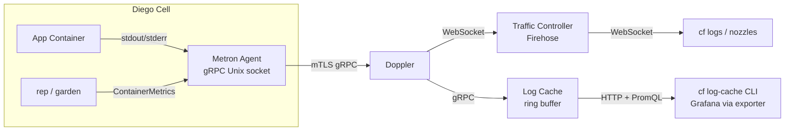
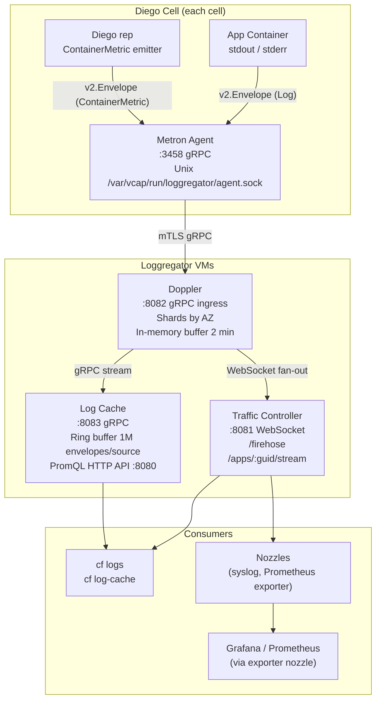

# CF Logging, Metrics, and Network Performance

**Track CF-E | Lesson 17 of 20**

**Jump to:** [Quick Read](#quick-read-10-min) · [Deep Dive](#deep-dive) · [Practice](#practice-setup) · [Troubleshooting](#4-troubleshooting) · [Quick Reference](#quick-reference)

---

## Quick Read (10 min)

After this lesson you will be able to: query container network metrics and Gorouter latency from Log Cache using the cf log-cache plugin, diagnose tx_drops caused by VXLAN MTU mismatches, and identify the correct Loggregator component to inspect when logs or metrics stop flowing.

**Core mental model:** CF uses a dedicated log and metrics pipeline called Loggregator. Every container emits logs and metrics via a local Metron agent. Metron forwards to Doppler (aggregation), which feeds Traffic Controller (streaming) and Log Cache (queryable ring buffer). Network performance data — Gorouter latency, container TX/RX bytes — flows through this same pipeline.

**Key concepts:**

- **Metron agent** runs on every Diego Cell, listens on a Unix socket, batches envelopes with gRPC, forwards to Doppler via mTLS
- **Doppler** aggregates, deduplicates, and buffers; one Doppler shard per AZ
- **Traffic Controller** exposes the legacy WebSocket Firehose (`/firehose`) and per-app log stream (`/apps/:guid/stream`)
- **Log Cache** is an in-memory ring buffer (default 1 million envelopes per source); queryable via Log Cache CLI plugin using PromQL-like syntax
- **CF CLI plugin `log-cache`** replaces the old `cf logs --recent`; supports time-range queries and metric queries
- **Gorouter emits** `gorouter.latency`, `gorouter.requests`, `gorouter.responses` as CounterEvents and ValueMetrics per route
- **Container network metrics** are emitted as `ContainerMetric` envelopes: `rx_bytes`, `tx_bytes`, `rx_drops`, `tx_drops`, `cpu_percentage`, `memory_bytes`
- **Silk CNI** VXLAN overhead: underlay MTU 1500 → container MTU 1450 (MTU - 50); oversized packets produce `tx_drops` spikes visible in Log Cache
- **No Prometheus scrape by default** — operators use the Firehose-to-Syslog nozzle or the Prometheus Firehose Exporter nozzle to bridge into Prometheus + Grafana



**vs K8s:** In K8s you scrape `/metrics` with Prometheus directly from pods. In CF, metrics are pushed to Loggregator — apps cannot be scraped because there is no stable pod IP visible outside the cell.

---

## Deep Dive

---

## Practice Setup

You need two terminals for this lesson.

**Terminal 1 — cf CLI (Mac/local)**

```bash
# Log in and target a space
cf login -a https://api.sys.example.com --skip-ssl-validation
cf target -o my-org -s my-space

# Install the log-cache CLI plugin (once)
cf install-plugin -r CF-Community "log-cache"

# Push a sample app to generate traffic
cf push netperf -m 128M -k 512M --no-route
cf map-route netperf apps.example.com --hostname netperf
```

**Terminal 2 — BOSH SSH (ops/platform team)**

```bash
# SSH into a Diego Cell to inspect Metron and network counters
bosh -d cf ssh diego-cell/0

# Once inside the cell VM
sudo su -
```

> **K8s Engineer's Translation:** Terminal 1 is equivalent to your workstation with `kubectl` + `promtool`. Terminal 2 is equivalent to `kubectl debug node/<node>` with a privileged pod — you are on the host, not inside the container.

---

## 1. Loggregator Architecture

Loggregator is the unified observability bus for CF. It carries both logs (stdout/stderr) and metrics (CPU, memory, network counters, platform components) in a single gRPC envelope format called `v2.Envelope`.



### Envelope types

| Type | What it carries | Key fields |
|---|---|---|
| `Log` | stdout/stderr lines | `source_id` (app GUID), `timestamp`, `payload` |
| `Counter` | monotonic counters | `name`, `delta`, `total` (e.g. `gorouter.requests`) |
| `Gauge` | point-in-time values | `name`, `value`, `unit` (e.g. `gorouter.latency`) |
| `ContainerMetric` (deprecated v1) | container resource stats | `cpu_percentage`, `memory_bytes`, `rx_bytes`, `tx_bytes` |
| `Timer` | request duration spans | `name`, `start`, `stop` (Gorouter emits one per request) |

> **K8s Engineer's Translation:** Envelopes are CF's equivalent of Prometheus metrics + structured log lines combined into one bus. There is no separate `/metrics` scrape endpoint on containers — everything is pushed through the gRPC socket on the cell host.

### Metron agent internals

Metron runs as a BOSH job on every Diego Cell (and also on Gorouter VMs, BOSH director, etc.). It:

1. Listens on a local gRPC Unix socket (`/var/vcap/run/loggregator/agent.sock`) and optionally UDP port 3457 (legacy v1)
2. Authenticates connecting senders via mutual TLS certificates issued by BOSH CredHub
3. Batches envelopes and forwards to Doppler over port 8082 (mTLS gRPC)
4. Implements backpressure — if Doppler is unavailable, envelopes are dropped (there is no durable queue)

```bash
# Terminal 2 — verify Metron is running and listening
ps aux | grep metron
# Expected: /var/vcap/jobs/loggregator_agent/bin/loggregator_agent ...

# Check Metron's own stats (it emits metrics about itself)
curl -s http://localhost:14824/metrics | grep dropped
# loggregator_agent_dropped_envelopes_total ...
```

---

## 2. Network Metrics: Container TX/RX and Gorouter Latency

### Container network counters

Diego rep collects container metrics from Garden/runc and emits `ContainerMetric` envelopes every 15 seconds (configurable via `rep.container_metrics_reporting_interval`). Network fields:

| Field | Meaning |
|---|---|
| `rx_bytes` | bytes received by the container since last interval |
| `tx_bytes` | bytes sent from the container since last interval |
| `rx_drops` | inbound packets dropped (NIC/buffer overflow) |
| `tx_drops` | outbound packets dropped — often MTU mismatch with VXLAN |

```bash
# Terminal 1 — query container metrics for your app via Log Cache
APP_GUID=$(cf app netperf --guid)
cf log-cache "$APP_GUID" --envelope-type gauge --follow

# Example output lines:
# 2026-11-23T10:01:00.000000000Z   gauge   cpu_percentage:0.42   memory_bytes:67108864
# 2026-11-23T10:01:00.000000000Z   gauge   rx_bytes:1048576   tx_bytes:2097152
# 2026-11-23T10:01:00.000000000Z   gauge   rx_drops:0   tx_drops:0

# Query a time range (last 5 minutes)
cf log-cache "$APP_GUID" \
  --start-time "$(date -v-5M +%s)000000000" \
  --envelope-type gauge \
  --json | jq '.envelopes.batch[] | select(.gauge.metrics["tx_drops"] != null)'
```

### MTU and tx_drops

Silk VXLAN wraps each packet with a 50-byte VXLAN/UDP/IP header. With underlay MTU 1500, the container MTU must be at most 1450. If a misconfigured app or sidecar tries to send 1500-byte frames, they are fragmented or dropped.

> **Sector note:** In medical device manufacturing environments running FDA-regulated workloads on SAP BTP, sustained `tx_drops` on containers handling HL7 or DICOM image transfer can silently corrupt message streams and trigger audit failures. MTU alignment should be verified as part of any infrastructure change control procedure, not only during incident response.

```bash
# Terminal 2 — check MTU on the silk-vtep and silk bridge interfaces
ip link show silk-vtep
# 7: silk-vtep: <BROADCAST,MULTICAST,UP,LOWER_UP> mtu 1450 ...

ip link show s-010255000  # silk bridge for cell subnet 10.255.0.0/24
# 8: s-010255000: <BROADCAST,MULTICAST,UP,LOWER_UP> mtu 1450 ...

# Check a specific container's veth pair MTU
# Find the container handle from cf curl
cf curl "/v2/apps/$APP_GUID/stats" | jq '."0".stats.host'
# returns diego cell IP

# On the matching Diego Cell:
ip link | grep veth | head -20
# All veth pairs should show mtu 1450

# Confirm VXLAN interface on the underlay
ip -d link show silk-vtep | grep vxlan
# vxlan id 1 dev eth0 srcport 0 0 dstport 4789 nolearning ageing 300 udpcsum
```

> **K8s Engineer's Translation:** This is identical to Calico/Flannel VXLAN MTU tuning. In K8s you set `mtu` in the CNI ConfigMap or the Calico `FelixConfiguration`. In CF, the silk-cni BOSH property `mtu` (default: underlay MTU - 50) is set in the CF deployment manifest. The diagnostic signal — `tx_drops` — is the same in both worlds.

### Gorouter metrics

Gorouter emits metrics via its own Metron connection (it runs on Gorouter VMs, not Diego Cells). Key metrics:

| Metric name | Type | Description |
|---|---|---|
| `gorouter.requests` | Counter | Total HTTP requests routed |
| `gorouter.responses` | Counter | Total HTTP responses by status family (2xx, 3xx, 4xx, 5xx) |
| `gorouter.latency` | Gauge (ms) | End-to-end request latency at the router |
| `gorouter.backend_exhausted_conns` | Counter | No healthy backends found (all instances down) |
| `gorouter.ms_since_last_registry_update` | Gauge | Staleness of the in-memory route table |
| `gorouter.total_routes` | Gauge | Current number of routes in the routing table |
| `gorouter.registry_message.route-emitter` | Counter | NATS route registration messages received |

```bash
# Terminal 1 — query Gorouter metrics from Log Cache
# Gorouter's source_id is "gorouter"
cf log-cache gorouter \
  --envelope-type gauge \
  --start-time "$(date -v-10M +%s)000000000" \
  --json \
  | jq '.envelopes.batch[] | .gauge.metrics | keys[]' | sort -u

# Stream live Gorouter latency
cf log-cache gorouter --envelope-type gauge --follow \
  | grep latency

# Query with PromQL via Log Cache HTTP API (requires Log Cache auth token)
TOKEN=$(cf oauth-token)
curl -s -H "Authorization: $TOKEN" \
  "https://log-cache.sys.example.com/api/v1/query?query=avg_over_time(gorouter_latency[5m])" \
  | jq '.data.result'
```

### Route registration health

Route Emitter on each Diego Cell broadcasts app instance locations to Gorouter via NATS every 20 seconds. TTL is 2 minutes. If `gorouter.ms_since_last_registry_update` exceeds 120000 (2 min), routes are expiring.

```bash
# Terminal 2 — watch NATS route registration traffic
# NATS is on the NATS VM; subscribe from any VM with NATS client
/var/vcap/packages/nats/bin/nats-sub \
  -s "nats://nats:$(bosh int /path/to/creds.yml --path /nats_password)@nats.service.cf.internal:4222" \
  "router.register" | head -20

# Example message:
# {"host":"10.0.1.47","port":61012,"uris":["netperf.apps.example.com"],
#  "app":"a1b2c3d4-...","private_instance_id":"...","tags":{"component":"route-emitter"}}
```

> **K8s Engineer's Translation:** In K8s, the equivalent is `kube-proxy` syncing iptables from the Endpoints object — driven by the kube-apiserver watch. In CF, Route Emitter polls Diego BBS for living LRPs and publishes to NATS. Gorouter subscribes. There is no etcd or watch mechanism — it is periodic push with TTL-based expiry.

---

## 3. Log Cache and the cf log-cache Plugin

Log Cache is the primary interface for querying historical metrics and logs without connecting to the Firehose. It retains roughly 15 minutes to 2 hours of data depending on envelope volume (hard cap: 1 million envelopes per source).

### Plugin installation and basic usage

```bash
# Install
cf install-plugin -r CF-Community "log-cache"

# Tail logs for an app (replaces cf logs --recent)
cf log-cache my-app

# Tail with follow (replaces cf logs)
cf log-cache my-app --follow

# Filter to stderr only
cf log-cache my-app --envelope-type log --json \
  | jq 'select(.log.payload | @base64d | test("ERROR"))'

# Show only the last 50 lines
cf log-cache my-app --lines 50

# Query a specific time window
cf log-cache my-app \
  --start-time 1732348800000000000 \
  --end-time   1732352400000000000
```

### Metric queries with PromQL

Log Cache exposes a PromQL-compatible HTTP endpoint. The `log-cache` plugin wraps it:

```bash
# Average CPU over last 5 minutes for a specific app
APP_GUID=$(cf app my-app --guid)
cf log-cache query "avg_over_time(cpu{source_id=\"$APP_GUID\"}[5m])"

# Sum of tx_bytes across all instances
cf log-cache query "sum(tx_bytes{source_id=\"$APP_GUID\"})"

# Gorouter p99 latency (requires instant query over timer envelopes)
cf log-cache query "histogram_quantile(0.99, rate(gorouter_latency_bucket[5m]))"

# Rate of 5xx errors from Gorouter
cf log-cache query "rate(gorouter_responses_5xx[2m])"
```

### Log Cache vs Firehose

| Capability | Log Cache (default) | Firehose (legacy) |
|---|---|---|
| Access control | Per-app GUID, Space Developer role | Requires `doppler.firehose` UAA scope (admin) |
| Protocol | HTTP + PromQL | WebSocket |
| Retention | Ring buffer, source-scoped | Streaming only, no retention |
| Query | PromQL-like time range queries | Real-time stream, filter client-side |
| Multi-tenant | Yes | No (all tenants visible) |
| Nozzle pattern | Log Cache exporter nozzle | Firehose nozzle |

> **K8s Engineer's Translation:** Log Cache is CF's equivalent of Prometheus TSDB — a queryable time series store. The Firehose is equivalent to `kubectl logs --all-namespaces -f` piped into a grep: powerful but requires cluster-admin and gives you everything at once.

### Prometheus exporter integration

Operators who want Prometheus + Grafana dashboards deploy the `prometheus-firehose-exporter` BOSH release or the `log-cache-forwarder` nozzle. The exporter translates Gauge/Counter envelopes into Prometheus metrics:

```yaml
# Example Prometheus scrape config after deploying the exporter
scrape_configs:
  - job_name: cf_firehose
    static_configs:
      - targets: ['firehose-exporter.sys.example.com:9186']
    metrics_path: /metrics
    bearer_token_file: /var/run/secrets/cf_token
```

```bash
# After exporter is running, query Gorouter latency in Prometheus
# metric name pattern: firehose_value_metric_gorouter_latency
curl -s http://prometheus.sys.example.com:9090/api/v1/query \
  --data-urlencode 'query=avg(firehose_value_metric_gorouter_latency)' \
  | jq '.data.result'
```

---

## 4. Troubleshooting

### Failure: cf logs shows nothing / connection refused

**Symptom:** `cf logs my-app` hangs or returns `Error opening logs: ...`

**Diagnosis:**

```bash
# Check Traffic Controller availability
cf curl /v2/info | jq '.logging_endpoint'
# Should return wss://doppler.sys.example.com:443

# Test WebSocket connectivity
wscat -c "wss://doppler.sys.example.com:443/apps/$APP_GUID/stream" \
  -H "Authorization: $(cf oauth-token)"

# Check if the app is actually running
cf app my-app
# State should be "running" with cells assigned

# Check Metron on the Diego Cell
bosh -d cf ssh diego-cell/0
journalctl -u loggregator_agent --since "5 minutes ago" | grep -i error
```

**Common causes:**
- Doppler VM unhealthy: `bosh -d cf vms` shows failing Doppler instances
- UAA token expired: `cf oauth-token` to refresh, re-run `cf log-cache`
- App crashed before emitting logs: `cf events my-app` to see crash events

### Failure: High tx_drops on containers

**Symptom:** Log Cache shows non-zero `tx_drops` metric for containers.

```bash
# Identify affected cells
cf log-cache query "sum by (source_id)(tx_drops)" | jq '.data.result[] | select(.value[1] | tonumber > 0)'

# On the Diego Cell hosting the affected app
APP_GUID="<guid>"
# Find the container's veth pair
cat /proc/net/dev | grep veth
# Check for packet drops per interface
cat /proc/net/dev
# veth1234: RX bytes  packets  errors  drop    TX bytes  packets  errors  drop

# Check effective MTU end-to-end
ip link show silk-vtep
# If MTU != underlay_mtu - 50, file a platform ticket

# Test with explicit MTU ping inside container
cf ssh my-app -c "ping -M do -s 1422 -c 3 8.8.8.8"
# 1422 bytes data + 28 bytes ICMP/IP header = 1450 bytes at IP layer
# Should succeed; if it fails, MTU misconfiguration confirmed
```

**Fix:** Update the silk BOSH property `cf_networking.mtu` to match underlay MTU - 50 and redeploy CF.

### Failure: Gorouter ms_since_last_registry_update climbing

**Symptom:** `gorouter.ms_since_last_registry_update` gauge is above 30000 ms (30 seconds).

```bash
# Query from Log Cache
cf log-cache gorouter --envelope-type gauge --follow \
  | grep ms_since_last_registry_update

# Check Route Emitter health on Diego Cells
bosh -d cf ssh diego-cell/0
monit summary | grep route_emitter
# If not running: monit start route_emitter

# Check NATS connectivity
/var/vcap/jobs/route_emitter/bin/check-nats
# Should print "NATS connection healthy"

# Inspect Route Emitter logs
tail -f /var/vcap/sys/log/route_emitter/route_emitter.stdout.log | grep -i error
```

**Root cause:** NATS VM unreachable, Route Emitter crash loop, or Diego BBS unreachable. If `ms_since_last_registry_update` exceeds 120000 (2 min), Gorouter starts returning 404 for affected routes.

### Failure: Gorouter returning 502/503 for healthy app

**Symptom:** App instances are running but clients receive 502/503.

```bash
# Check backend connection exhaustion
cf log-cache gorouter --envelope-type counter \
  | grep backend_exhausted

# Check if instances are registered
cf curl "/v2/apps/$APP_GUID/stats" | jq '.[] | {state: .stats.state, host: .stats.host, port: .stats.port}'

# Verify health check is passing
cf app my-app  # Should show "running" with uptime

# Check Gorouter's view of backends (requires Gorouter VM access)
bosh -d cf ssh router/0
curl -s http://localhost:8080/routes | jq '."netperf.apps.example.com"'
# Should list all healthy backend IPs

# If backends are listed but 502 persists, check TLS configuration
# Full re-encrypt mode requires backend certificate validation
grep -r "backend_tls" /var/vcap/jobs/gorouter/config/
```

### Failure: Log Cache returns empty results for recent metrics

**Symptom:** `cf log-cache my-app --start-time ... --end-time ...` returns empty even though app was running.

```bash
# Check Log Cache retention (1M envelope hard cap)
# High-volume apps exhaust their ring buffer quickly
# Estimate envelope rate
cf log-cache query "count_over_time({source_id=\"$APP_GUID\"}[5m])"

# If rate is very high, the 15-min window may only hold 2-3 minutes
# Solution: reduce log verbosity in the app or use a syslog drain

# Check Log Cache health
cf log-cache meta | grep "$APP_GUID"
# Shows oldest/newest timestamps and count for the source

# Verify Log Cache VM
bosh -d cf vms | grep log-cache
bosh -d cf ssh log-cache/0
monit summary | grep log-cache
```

---

## Production Checklist

- [ ] Log Cache retention is monitored: alert if `cf log-cache meta` shows oldest timestamp newer than 10 minutes ago for high-volume apps
- [ ] Prometheus Firehose Exporter nozzle deployed and scraping Gorouter, Diego, and Silk metrics
- [ ] Grafana dashboard created for `gorouter.latency` (p50/p95/p99), `gorouter.responses_5xx`, and `gorouter.total_routes`
- [ ] Alert configured on `gorouter.ms_since_last_registry_update > 30000` (route staleness)
- [ ] Alert configured on `gorouter.backend_exhausted_conns > 0` for more than 2 minutes
- [ ] Container `tx_drops` alert configured: any app instance with `tx_drops > 100/min` triggers investigation
- [ ] Silk MTU verified to equal underlay MTU - 50 on all Diego Cells after any infrastructure change
- [ ] Syslog drain configured for production apps (Log Cache ring buffer is not a durable log store)
- [ ] Log Cache PromQL queries documented for SRE runbooks: include source_id GUIDs for all production apps
- [ ] Firehose access restricted: only nozzle service accounts hold the `doppler.firehose` UAA scope
- [ ] NATS monitoring in place: NATS VM memory and subscription count alerted (Route Emitter saturation)
- [ ] `gorouter.total_routes` baselined: sudden drops indicate mass Route Emitter failure

---

## Quick Reference

### Log Cache commands

| Command | Purpose |
|---|---|
| `cf log-cache <app>` | Show recent logs (last 100 lines) |
| `cf log-cache <app> --follow` | Tail logs live |
| `cf log-cache <app> --envelope-type gauge` | Show metric envelopes only |
| `cf log-cache <app> --envelope-type log` | Show log envelopes only |
| `cf log-cache <app> --lines 200` | Show last N lines |
| `cf log-cache <app> --start-time <ns> --end-time <ns>` | Query time range (nanosecond timestamps) |
| `cf log-cache query "<promql>"` | PromQL metric query |
| `cf log-cache meta` | Show all sources and retention stats |
| `cf log-cache meta --source-id <guid>` | Show retention for one source |

### Useful PromQL queries

| Query | Meaning |
|---|---|
| `cpu{source_id="<guid>"}` | CPU % for app |
| `avg_over_time(cpu{source_id="<guid>"}[5m])` | 5-min avg CPU |
| `sum(tx_bytes{source_id="<guid>"})` | Total bytes sent |
| `rate(tx_drops{source_id="<guid>"}[1m])` | Drop rate per second |
| `avg(gorouter_latency)` | Mean Gorouter latency |
| `rate(gorouter_responses_5xx[2m])` | 5xx error rate |
| `gorouter_ms_since_last_registry_update` | Route table staleness |
| `gorouter_total_routes` | Live route count |

### BOSH / platform commands

| Command | Purpose |
|---|---|
| `bosh -d cf vms` | List all CF VMs and health |
| `bosh -d cf ssh diego-cell/0` | SSH into Diego Cell 0 |
| `monit summary` | Check job status on a VM |
| `journalctl -u loggregator_agent` | Metron agent logs |
| `ip link show silk-vtep` | Silk VXLAN interface and MTU |
| `ip link show s-010255000` | Silk bridge interface |
| `cat /proc/net/dev` | Per-interface packet drop counters |

### Key metric source IDs

| Source ID | What it represents |
|---|---|
| `<app-guid>` | App container metrics and logs |
| `gorouter` | HTTP router metrics |
| `route_emitter` | Route registration health |
| `silk-daemon` | Overlay network metrics |
| `bbs` | Diego BBS (task/LRP scheduling) |
| `rep` | Diego rep (cell-local executor) |
| `doppler` | Loggregator aggregator self-metrics |

---

## Check Your Understanding

1. What is the role of the Metron agent, and what happens to envelopes if Doppler becomes temporarily unavailable?
2. A container shows a steady rise in `tx_drops` but `rx_drops` remains zero. What is the most likely cause, and what BOSH property controls the fix?
3. `gorouter.ms_since_last_registry_update` reaches 150000 ms. What does this mean for in-flight HTTP requests, and which component should you inspect first?
4. A space developer reports that `cf log-cache my-app --start-time ... --end-time ...` returns no envelopes for a window one hour ago. The app was running. What is the most probable explanation?
5. You need to expose CF container metrics in an existing Prometheus + Grafana stack. The Firehose is not an option. What is the recommended approach, and what UAA scope does it require?

---

## See Also

**Related K8s lessons in this course:**

- [Lesson 09 — Kubernetes Observability: Prometheus and Grafana](../lessons/24-network-observability-troubleshooting.md) — The K8s counterpart: scraping pods directly, `kube-state-metrics`, `node-exporter`; contrast with CF's push model
- [Lesson 11 — CNI Deep Dive: Flannel, Calico, Cilium](../lessons/12-cilium-cni-ebpf.md) — CNI MTU configuration and VXLAN packet sizing; directly applicable to Silk MTU troubleshooting
- [Lesson 14 — Service Mesh Observability: Istio and Envoy](../lessons/21-service-mesh-istio.md) — Envoy's `envoy_cluster_upstream_rq_time` histogram vs Gorouter's `gorouter.latency` gauge
- [Lesson 20 — Kubernetes Logging: Fluentd, Loki, ELK](../lessons/24-network-observability-troubleshooting.md) — Sidecar log shipping vs CF syslog drains; structured log routing patterns

**Related CF lessons:**

- [CF-13 — C2C Network Policies](cf-13-c2c-network-policies.md) — VXLAN Policy Agent architecture, iptables enforcement, policy sync cycle
- [CF-14 — TLS Certificates in CF](cf-14-tls-certificates.md) — Gorouter TLS modes (edge/passthrough/re-encrypt), route integrity verification
- [CF-16 — CF Observability and Troubleshooting](cf-16-observability-troubleshooting.md) — BOSH-level VM health, monit, and platform diagnostics

---

## Online Resources

- [CF Loggregator architecture documentation](https://github.com/cloudfoundry/loggregator-release/blob/main/docs/architecture.md) — Official architecture overview: Metron, Doppler, Traffic Controller, Log Cache component responsibilities
- [Log Cache CLI plugin source and usage](https://github.com/cloudfoundry/log-cache-cli) — Plugin installation, all flag options, PromQL query examples, and release notes
- [Loggregator v2 envelope types spec](https://github.com/cloudfoundry/loggregator-api/blob/master/v2/envelope.proto) — Protobuf definition of all envelope types (Log, Counter, Gauge, Timer, Event) with field semantics
- [CF Prometheus Firehose Exporter](https://github.com/cloudfoundry/firehose_exporter) — Operator-facing nozzle that bridges Loggregator envelopes to Prometheus metrics; includes Grafana dashboard JSON
- [Silk CNI network performance tuning](https://github.com/cloudfoundry/silk-release/blob/main/docs/mtu.md) — MTU calculation guide for Silk VXLAN, troubleshooting `tx_drops`, and cell-to-cell throughput benchmarks
