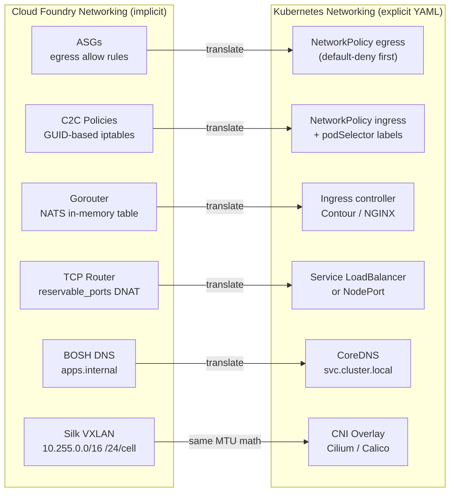
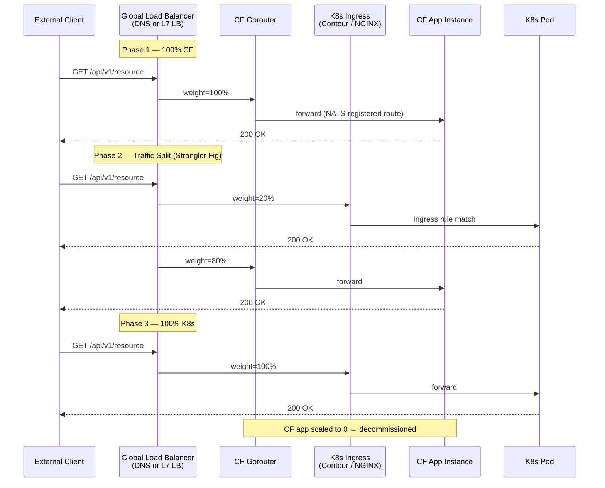
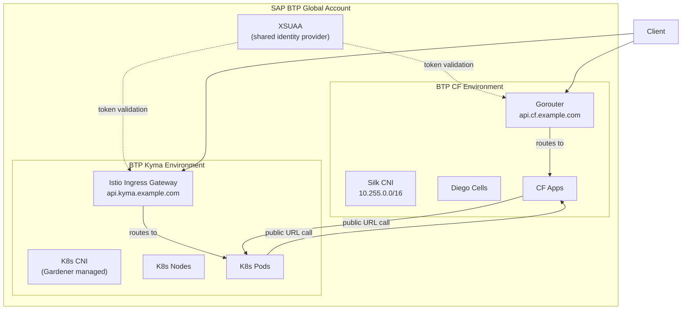

# Lesson CF-19: CF-to-Kubernetes Migration Networking Patterns

**Track:** CF-F — Migration and Interoperability
**Prerequisites:** CF-05 (Silk CNI), CF-06 (VXLAN Policy Agent), CF-07 (ASGs), CF-09 (Gorouter), CF-10 (TCP Router), CF-13 (C2C Policies), CF-18 (Korifi)
**Time:** Quick Read 10 min | Deep Dive 60-90 min

**Jump to:** [Quick Read](#quick-read-10-min) · [Deep Dive](#deep-dive) · [Troubleshooting](#4-troubleshooting-migration-issues) · [Quick Reference](#quick-reference)

---

## Quick Read (10 min)

After this lesson you will be able to: map every CF networking primitive (Gorouter, ASGs, C2C policies, BOSH DNS, Silk VXLAN) to its explicit Kubernetes equivalent, and execute an incremental CF-to-K8s migration using the Strangler Fig traffic-split pattern without breaking connectivity.

**Core idea:** Migrating from CF to Kubernetes means making every networking decision CF made *invisibly* on your behalf into *explicit* YAML. The Strangler Fig pattern lets you do this incrementally — CF and K8s run side by side, with traffic gradually shifting.

**The five CF networking primitives and their K8s equivalents:**

- Gorouter (NATS-registered, in-memory table, 20s refresh) → Ingress controller (watch-based, Contour/NGINX)
- Application Security Groups (egress allow, stateful) → NetworkPolicy egress rules (default-deny applied first)
- C2C Network Policies (GUID-based, dynamic iptables) → NetworkPolicy ingress + podSelector (label-based)
- BOSH DNS `apps.internal` (health-aware, per-instance) → CoreDNS `svc.cluster.local` + readiness probes
- Silk VXLAN overlay (10.255.0.0/16, /24 per cell, MTU = underlay - 50) → CNI overlay (podCIDR per node, same MTU math)

**SAP BTP context:**

- BTP CF environment uses Silk CNI + Gorouter; Kyma environment uses standard K8s CNI (Gardener-managed)
- XSUAA is the shared identity provider in both — but token validation moves from CF route services to K8s sidecar or API gateway
- Coexistence period: apps in both environments share the same XSUAA tenant and can call each other via public URLs

**Migration failure modes (top 5):**

1. ASG egress rules not ported → K8s app silently times out calling external services
2. C2C policies lost → microservices cannot reach each other (default-deny in CF was invisible; in K8s it's your job)
3. `apps.internal` hardcoded in app code or env vars → NXDOMAIN in K8s (CoreDNS serves `.cluster.local`)
4. JSESSIONID sticky sessions not configured → Ingress annotation required in K8s, automatic in Gorouter
5. MTU mismatch → Silk MTU = underlay - 50; CNI MTU must be calibrated to same value or fragmentation occurs



**Strangler Fig: traffic split during migration**

External DNS or GLB routes a percentage of traffic to CF Gorouter and the rest to K8s Ingress. You shift the percentage until CF traffic reaches 0%, then decommission.

**Migration inventory commands (run first):**

```bash
cf routes                              # all HTTP routes
cf routes | grep tcp                   # TCP routes
cf security-groups                     # all ASGs
cf security-group <name>               # ASG rules JSON
cf network-policies                    # all C2C policies
cf env <app> | grep apps.internal      # DNS consumers
```

---

## Deep Dive

### Practice Setup

You need two terminals for this lesson.

**Terminal 1 — CF CLI (app operations and policy inspection):**

```bash
# Verify CF target
cf target
# API endpoint:   https://api.sys.example.com
# API version:    3.147.0
# user:           mykola@example.com
# org:            migration-org
# space:          migration-space

# List running apps
cf apps
# name          requested state   processes   routes
# frontend      started           web:2/2     frontend.cfapps.example.com
# backend-api   started           web:3/3     api.cfapps.example.com
# db-proxy      started           web:1/1     tcp.example.com:5000
```

**Terminal 2 — BOSH SSH (cell-level inspection for Silk and iptables):**

```bash
# SSH into a Diego Cell
bosh -d cf ssh diego-cell/0

# Once inside:
sudo -i

# Check Silk VTEP and overlay subnet
ip link show silk-vtep
cat /var/vcap/data/silk/state.json
# {"overlay_subnet":"10.255.47.0/24","overlay_hardware_addr":"ee:ee:0a:ff:2f:01"}
```

> **K8s Engineer's Translation:** Terminal 1 is your `kubectl` equivalent — it talks to the CF API (CAPI) the way `kubectl` talks to kube-apiserver. Terminal 2 is like running `kubectl debug node/<node> -it --image=busybox` — direct access to the Linux host running containers. The difference: in K8s you can inspect any node with `kubectl`; in CF you must use BOSH SSH, which requires BOSH director access.

---

## 1. The Strangler Fig Pattern for CF Networking

The Strangler Fig pattern (Martin Fowler, 2004) migrates a system incrementally by routing traffic to a new implementation alongside the old one. For CF-to-K8s migration, the "strangler" is the external load balancer or DNS layer.

### 1.1 Why Strangler Fig Works for CF

CF and K8s run completely separate overlay networks. There is no shared underlay routing between Silk (10.255.0.0/16) and a K8s CNI overlay. Apps in both platforms communicate only via their externally-accessible URLs — which is exactly the seam the Strangler Fig exploits.



> **K8s Engineer's Translation:** The Strangler Fig is exactly what a blue/green deployment does at the DNS level, stretched over weeks instead of minutes. In K8s you use a Service with two Deployments; in CF-to-K8s migration you use an external GLB with two backends — CF Gorouter and K8s Ingress. The app URL never changes from the client's perspective.

### 1.2 Implementing the Traffic Split

The concrete mechanism depends on your infrastructure. The most common patterns:

**Option A: Weighted DNS (Route 53, Cloud DNS, Cloudflare)**

```bash
# Example: Route 53 weighted routing
# Record set 1: frontend.cfapps.example.com → CF Gorouter EIP, weight=80
# Record set 2: frontend.cfapps.example.com → K8s Ingress EIP, weight=20

# AWS CLI to create weighted records
aws route53 change-resource-record-sets \
  --hosted-zone-id Z1234567890 \
  --change-batch '{
    "Changes": [
      {
        "Action": "CREATE",
        "ResourceRecordSet": {
          "Name": "frontend.cfapps.example.com",
          "Type": "A",
          "SetIdentifier": "cf-gorouter",
          "Weight": 80,
          "TTL": 60,
          "ResourceRecords": [{"Value": "10.0.1.100"}]
        }
      },
      {
        "Action": "CREATE",
        "ResourceRecordSet": {
          "Name": "frontend.cfapps.example.com",
          "Type": "A",
          "SetIdentifier": "k8s-ingress",
          "Weight": 20,
          "TTL": 60,
          "ResourceRecords": [{"Value": "10.0.2.200"}]
        }
      }
    ]
  }'
```

**Option B: L7 load balancer upstream split (Envoy, HAProxy, F5)**

```yaml
# Envoy: weighted cluster for traffic split
static_resources:
  clusters:
  - name: cf_gorouter
    connect_timeout: 5s
    type: STRICT_DNS
    load_assignment:
      cluster_name: cf_gorouter
      endpoints:
      - lb_endpoints:
        - endpoint:
            address:
              socket_address:
                address: gorouter.sys.example.com
                port_value: 443
  - name: k8s_ingress
    connect_timeout: 5s
    type: STRICT_DNS
    load_assignment:
      cluster_name: k8s_ingress
      endpoints:
      - lb_endpoints:
        - endpoint:
            address:
              socket_address:
                address: ingress.k8s.example.com
                port_value: 443
  listeners:
  - name: https_listener
    filter_chains:
    - filters:
      - name: envoy.filters.network.http_connection_manager
        typed_config:
          route_config:
            virtual_hosts:
            - name: frontend
              domains: ["frontend.cfapps.example.com"]
              routes:
              - match:
                  prefix: "/"
                route:
                  weighted_clusters:
                    clusters:
                    - name: cf_gorouter
                      weight: 80
                    - name: k8s_ingress
                      weight: 20
```

```bash
# Verify traffic split is working — check logs on both sides
# CF side:
cf logs frontend --recent | grep "GET /"

# K8s side:
kubectl -n migration-space logs deployment/frontend --tail=50 | grep "GET /"

# Verify no errors in K8s app before increasing weight
kubectl -n migration-space get pods -l app=frontend
kubectl -n migration-space top pods -l app=frontend
```

### 1.3 Pre-Flight Inventory

Before migrating a single app, audit the full CF networking state:

```bash
# Terminal 1: complete migration inventory

# 1. All HTTP routes
cf routes
# space            host        domain               path  protocol  apps
# migration-space  frontend    cfapps.example.com         http      frontend
# migration-space  api         cfapps.example.com   /v1   http      backend-api

# 2. TCP routes (non-HTTP — need Service LoadBalancer, not Ingress)
cf routes | grep tcp
# migration-space  -    tcp.example.com  5000  tcp  db-proxy

# 3. All ASGs (global + space-scoped)
cf security-groups
cf running-security-groups   # space-bound to current space

# 4. ASG rules for each custom group
cf security-group internal-db
# [{"protocol":"tcp","destination":"10.10.20.5","ports":"5432","description":"PostgreSQL"}]

# 5. C2C policies
cf network-policies
# source      destination   protocol  ports
# frontend    backend-api   tcp       8080
# worker      cache-svc     tcp       6379

# 6. Apps using apps.internal in env vars
for app in $(cf apps | tail -n +5 | awk '{print $1}'); do
  result=$(cf env "$app" 2>/dev/null | grep apps.internal)
  if [ -n "$result" ]; then
    echo "$app: $result"
  fi
done

# 7. Service bindings (VCAP_SERVICES consumers)
cf env frontend | grep -A 50 VCAP_SERVICES
```

```bash
# Terminal 2: Silk state inventory from Diego Cell

# Check all cell overlay subnet assignments
# (run on BOSH director, not on the cell)
bosh -d cf instances --details | grep -E "diego-cell|silk"

# On diego-cell/0:
sudo cat /var/vcap/data/silk/state.json
# {"overlay_subnet":"10.255.47.0/24","overlay_hardware_addr":"ee:ee:0a:ff:2f:01"}

ip link show silk-vtep | grep mtu
# mtu 1410    ← record this; your K8s CNI MTU must match

ip link show eth0 | grep mtu
# mtu 1460    ← underlay MTU; 1460 - 50 = 1410
```

---

## 2. Mapping CF Networking Primitives to Kubernetes

### 2.1 Routes and Ingress (Gorouter → Ingress Controller)

CF Gorouter maintains an in-memory routing table populated by Route Emitter over NATS. No etcd — the table rebuilds from live registrations. Each app instance registers every 20 seconds; entries expire after 2 minutes TTL. This means a fresh Gorouter is operational within 2 minutes of startup.

K8s Ingress controllers watch the kube-apiserver for Ingress objects and program their routing tables. No NATS, no polling — purely event-driven via the Kubernetes watch API.

```bash
# CF: bind a route to an app
cf map-route frontend cfapps.example.com --hostname frontend
cf map-route backend-api cfapps.example.com --hostname api --path /v1

# Check Gorouter's routing table (from BOSH SSH into router)
bosh -d cf ssh router/0
curl -s http://localhost:8080/routes | python3 -m json.tool | head -40
# Shows in-memory table: {host+path → [ip:port, ip:port]}
```

```yaml
# K8s equivalent: Ingress for HTTP routes
# ingress-migration-space.yaml
apiVersion: networking.k8s.io/v1
kind: Ingress
metadata:
  name: migration-space-routes
  namespace: migration-space
  annotations:
    nginx.ingress.kubernetes.io/rewrite-target: /
spec:
  ingressClassName: nginx
  tls:
  - hosts:
    - frontend.cfapps.example.com
    - api.cfapps.example.com
    secretName: cfapps-example-com-tls
  rules:
  - host: frontend.cfapps.example.com
    http:
      paths:
      - path: /
        pathType: Prefix
        backend:
          service:
            name: frontend
            port:
              number: 8080
  - host: api.cfapps.example.com
    http:
      paths:
      - path: /v1
        pathType: Prefix
        backend:
          service:
            name: backend-api
            port:
              number: 8080
```

**TLS mode mapping:**

| CF Gorouter TLS mode | K8s equivalent |
|---|---|
| Edge termination (default) | TLS on Ingress, plaintext to pod |
| Passthrough (SNI routing) | `ssl-passthrough` annotation on Ingress |
| Full re-encrypt | TLS on Ingress + backend Service with TLS annotation |
| Route integrity (mTLS to Diego) | Service mesh (Istio/Linkerd) sidecar mTLS |

**JSESSIONID sticky sessions — CF automatic, K8s explicit:**

```yaml
# Sticky sessions: CF Gorouter detects JSESSIONID automatically
# K8s requires explicit annotation
apiVersion: networking.k8s.io/v1
kind: Ingress
metadata:
  name: frontend-sticky
  namespace: migration-space
  annotations:
    nginx.ingress.kubernetes.io/affinity: "cookie"
    nginx.ingress.kubernetes.io/session-cookie-name: "JSESSIONID"
    nginx.ingress.kubernetes.io/session-cookie-expires: "172800"
    nginx.ingress.kubernetes.io/session-cookie-max-age: "172800"
    nginx.ingress.kubernetes.io/session-cookie-change-on-failure: "true"
spec:
  rules:
  - host: frontend.cfapps.example.com
    http:
      paths:
      - path: /
        pathType: Prefix
        backend:
          service:
            name: frontend
            port:
              number: 8080
```

> **K8s Engineer's Translation:** CF Route Emitter polling every 20 seconds is CF's equivalent of K8s Endpoints controller — both answer the question "which instances are healthy right now?" The difference: Route Emitter is push-based (NATS publish from Diego Cell), K8s is pull-based (controller watches API for pod readiness). Both converge to: router drops unhealthy instances within seconds. NATS gives CF faster convergence on failure (~20s); K8s gives faster convergence on update (event-driven, sub-second).

### 2.2 TCP Routes (TCP Router → Service LoadBalancer)

CF TCP Router handles non-HTTP TCP traffic via reservable port ranges. Each TCP route: public port on TCP Router → random port on a Diego Cell → iptables DNAT → container port 8080. Load balancing is round-robin per new connection.

```bash
# CF: create a TCP route and bind it
cf create-route migration-space tcp.example.com --port 5000
cf map-route db-proxy tcp.example.com --port 5000

# Check TCP Router port mappings (from BOSH SSH into tcp-router)
bosh -d cf ssh tcp-router/0
cat /var/vcap/jobs/tcp_router/config/haproxy.conf | grep -A 3 "listen tcp"
```

```yaml
# K8s equivalent: Service type=LoadBalancer for TCP route
# service-db-proxy.yaml
apiVersion: v1
kind: Service
metadata:
  name: db-proxy
  namespace: migration-space
spec:
  type: LoadBalancer
  selector:
    app: db-proxy
  ports:
  - name: tcp-5000
    protocol: TCP
    port: 5000
    targetPort: 8080
---
# Or NodePort if no cloud LoadBalancer
apiVersion: v1
kind: Service
metadata:
  name: db-proxy-nodeport
  namespace: migration-space
spec:
  type: NodePort
  selector:
    app: db-proxy
  ports:
  - protocol: TCP
    port: 5000
    targetPort: 8080
    nodePort: 30500   # must be in nodePort range (30000-32767 default)
```

> **K8s Engineer's Translation:** CF TCP Router does exactly what `Service type=LoadBalancer` does — it exposes a non-HTTP TCP port at a stable external address. CF internals: iptables DNAT on the Diego Cell, port chosen from reservable_ports pool. K8s internals: kube-proxy iptables/IPVS rules on every node. The result is identical from the client's perspective.

### 2.3 Application Security Groups to NetworkPolicy Egress

ASGs in CF are egress-only stateful allow rules applied per container at runtime. The critical behavioral difference: CF default ASGs allow public internet and block RFC1918. K8s default is allow-all. When you apply any NetworkPolicy to a pod, K8s implicitly denies everything not matched.

```bash
# CF: audit all ASG rules before migration
cf security-groups
# name              organization   space
# public_networks   <all>          <all>     ← allows 0.0.0.0/0 minus RFC1918
# dns               <all>          <all>     ← allows 0.0.0.0/0 port 53
# internal-db       migration-org  migration-space

cf security-group internal-db
# [
#   {"protocol":"tcp","destination":"10.10.20.5","ports":"5432","description":"PostgreSQL primary"},
#   {"protocol":"tcp","destination":"10.10.20.6","ports":"5432","description":"PostgreSQL replica"}
# ]
```

```yaml
# Step 1: Apply default-deny egress to namespace (mirrors CF's implicit deny)
# networkpolicy-default-deny.yaml
apiVersion: networking.k8s.io/v1
kind: NetworkPolicy
metadata:
  name: default-deny-egress
  namespace: migration-space
spec:
  podSelector: {}       # applies to all pods
  policyTypes:
  - Egress
---
# Step 2: Translate CF ASG "dns" (allow port 53 everywhere)
apiVersion: networking.k8s.io/v1
kind: NetworkPolicy
metadata:
  name: allow-dns-egress
  namespace: migration-space
spec:
  podSelector: {}
  policyTypes:
  - Egress
  egress:
  - ports:
    - protocol: UDP
      port: 53
    - protocol: TCP
      port: 53
---
# Step 3: Translate CF ASG "public_networks" (allow internet, block RFC1918)
apiVersion: networking.k8s.io/v1
kind: NetworkPolicy
metadata:
  name: allow-public-egress
  namespace: migration-space
spec:
  podSelector: {}
  policyTypes:
  - Egress
  egress:
  - to:
    - ipBlock:
        cidr: 0.0.0.0/0
        except:
        - 10.0.0.0/8
        - 172.16.0.0/12
        - 192.168.0.0/16
---
# Step 4: Translate CF ASG "internal-db" (specific app → DB)
apiVersion: networking.k8s.io/v1
kind: NetworkPolicy
metadata:
  name: frontend-allow-db-egress
  namespace: migration-space
spec:
  podSelector:
    matchLabels:
      app: frontend       # apply only to frontend pods
  policyTypes:
  - Egress
  egress:
  - to:
    - ipBlock:
        cidr: 10.10.20.5/32
    ports:
    - protocol: TCP
      port: 5432
  - to:
    - ipBlock:
        cidr: 10.10.20.6/32
    ports:
    - protocol: TCP
      port: 5432
```

> **K8s Engineer's Translation:** CF ASGs are allow-only just like K8s NetworkPolicy — both model only permit rules, never explicit deny. The key difference is the default: CF ships with `public_networks` and `dns` ASGs that allow internet access out of the box. K8s has no default NetworkPolicy — allow-all until you apply one, then implicitly-deny everything not covered. Apply `default-deny-egress` to the namespace first, then add your explicit allows. This matches CF's security model.

### 2.4 C2C Network Policies to NetworkPolicy Ingress

CF C2C is GUID-based: source app GUID → destination app GUID + protocol + port. The VXLAN Policy Agent polls the Policy Server every 30 seconds and programs iptables. No container restart required. Policies survive app redeploy because the GUID stays constant.

```bash
# CF: inventory all C2C policies
cf network-policies
# source      destination   protocol  ports
# frontend    backend-api   tcp       8080
# worker      cache-svc     tcp       6379
# frontend    cache-svc     tcp       6379

# Add a policy dynamically (no restart of either app)
cf add-network-policy frontend --destination-app backend-api --protocol tcp --port 8080

# Remove a policy dynamically
cf remove-network-policy frontend --destination-app backend-api --protocol tcp --port 8080
```

```yaml
# K8s: translate each C2C policy to NetworkPolicy ingress rule
# networkpolicy-backend-api.yaml
# Equivalent to: cf add-network-policy frontend --destination-app backend-api --protocol tcp --port 8080
apiVersion: networking.k8s.io/v1
kind: NetworkPolicy
metadata:
  name: backend-api-allow-from-frontend
  namespace: migration-space
spec:
  podSelector:
    matchLabels:
      app: backend-api          # destination
  policyTypes:
  - Ingress
  ingress:
  - from:
    - podSelector:
        matchLabels:
          app: frontend         # source
    ports:
    - protocol: TCP
      port: 8080
---
# networkpolicy-cache-svc.yaml
# Equivalent to: frontend and worker can reach cache-svc on 6379
apiVersion: networking.k8s.io/v1
kind: NetworkPolicy
metadata:
  name: cache-svc-allow-from-apps
  namespace: migration-space
spec:
  podSelector:
    matchLabels:
      app: cache-svc
  policyTypes:
  - Ingress
  ingress:
  - from:
    - podSelector:
        matchLabels:
          app: frontend
    - podSelector:
        matchLabels:
          app: worker
    ports:
    - protocol: TCP
      port: 6379
```

> **K8s Engineer's Translation:** CF C2C GUID is CF's version of K8s pod labels. Both identify "this group of running instances." The critical operational difference: CF GUIDs are system-assigned and permanent. K8s labels are developer-assigned and must be maintained consistently in every Deployment spec. If a Deployment's pod template labels change between versions, NetworkPolicy stops matching — zero traffic error with no warning. Enforce a label governance policy: `app: <name>` label is mandatory and immutable.

### 2.5 BOSH DNS to CoreDNS

BOSH DNS provides health-aware client-side load balancing. `backend-api.apps.internal` resolves to all healthy app instances. `0.backend-api.apps.internal` resolves to the first instance. The health-awareness means DNS returns only instances passing health checks — no dead-instance routing.

```bash
# CF: service discovery via apps.internal (inside a CF app container)
nslookup backend-api.apps.internal
# Server:  169.254.0.2    ← BOSH DNS resolver
# Name:    backend-api.apps.internal
# Address: 10.255.47.3
# Address: 10.255.48.9    ← both healthy instances returned

# Per-instance resolution
nslookup 0.backend-api.apps.internal
# Address: 10.255.47.3

# Check if BOSH DNS is healthy on the cell
bosh -d cf ssh diego-cell/0 "sudo /var/vcap/bosh/bin/monit summary | grep bosh-dns"
```

```yaml
# K8s equivalent: ClusterIP Service (round-robin LB)
# Equivalent to backend-api.apps.internal → all instances
apiVersion: v1
kind: Service
metadata:
  name: backend-api
  namespace: migration-space
spec:
  selector:
    app: backend-api
  ports:
  - name: http
    protocol: TCP
    port: 8080
    targetPort: 8080
  type: ClusterIP
# DNS name: backend-api.migration-space.svc.cluster.local
# Short name (same namespace): backend-api
---
# K8s headless Service: per-pod DNS (equivalent to 0.app.apps.internal)
apiVersion: v1
kind: Service
metadata:
  name: backend-api-headless
  namespace: migration-space
spec:
  selector:
    app: backend-api
  clusterIP: None           # headless
  ports:
  - name: http
    protocol: TCP
    port: 8080
    targetPort: 8080
# With StatefulSet: backend-api-0.backend-api-headless.migration-space.svc.cluster.local
```

```bash
# K8s: test DNS resolution from a pod
kubectl -n migration-space exec -it deployment/frontend -- \
  nslookup backend-api
# Server:  10.96.0.10     ← CoreDNS ClusterIP
# Name:    backend-api.migration-space.svc.cluster.local
# Address: 10.96.45.12    ← Service ClusterIP

# Check CoreDNS logs if DNS fails
kubectl -n kube-system logs -l k8s-app=kube-dns --tail=50
```

### 2.6 Silk VXLAN MTU to CNI MTU

Silk assigns each Diego Cell a /24 from 10.255.0.0/16. Each cell: 254 usable container IPs. Max 250 cells → ~63,500 container IPs total. MTU = underlay MTU minus 50 bytes (VXLAN header overhead). This must be reproduced in the K8s CNI configuration.

```bash
# Terminal 2: check Silk MTU chain
ip link show eth0 | grep mtu          # underlay: mtu 1460
ip link show silk-vtep | grep mtu     # overlay: mtu 1410  (1460 - 50 = 1410)

# Verify inside a container (garden container handle)
ls /var/vcap/data/garden/depot/ | head -5
# 7a8b3c4d5e6f...  (container handle)

# Get container PID and check its network interface MTU
cat /var/vcap/data/garden/depot/7a8b3c4d5e6f/pidfile
nsenter -t <PID> -n -- ip link show | grep mtu
# eth0: mtu 1410
```

```yaml
# K8s: set CNI MTU to match (Cilium example)
# cilium-config.yaml — edit existing ConfigMap
apiVersion: v1
kind: ConfigMap
metadata:
  name: cilium-config
  namespace: kube-system
data:
  tunnel: "vxlan"
  # Must match Silk MTU: underlay MTU minus 50
  # GCP: 1460 - 50 = 1410
  # AWS: 9001 - 50 = 8951 (jumbo frames)
  # Azure: 1500 - 50 = 1450
  mtu: "1410"
```

```bash
# K8s: verify pod MTU after CNI config change
kubectl -n kube-system rollout restart daemonset/cilium
kubectl -n migration-space exec -it deployment/frontend -- ip link show eth0
# eth0: mtu 1410    ← must match Silk MTU

# Check node podCIDR (analogous to Silk /24 per cell)
kubectl get nodes -o jsonpath='{range .items[*]}{.metadata.name}{"\t"}{.spec.podCIDR}{"\n"}{end}'
# node-1    10.244.0.0/24
# node-2    10.244.1.0/24
# node-3    10.244.2.0/24
```

> **K8s Engineer's Translation:** Silk /24 per Diego Cell = K8s podCIDR per node. Both carve a larger overlay CIDR into per-host subnets for IP allocation. The operational concern: if CF's underlay is on a GCP VPC (MTU 1460) but your K8s nodes are on AWS (MTU 9001 jumbo), MTU mismatch causes silent fragmentation. Set the CNI MTU to match the underlay MTU minus VXLAN overhead — same formula as Silk.

---

## 3. SAP BTP: CF Environment to Kyma Environment

### 3.1 BTP Platform Architecture

SAP BTP runs both a CF environment (traditional Cloud Foundry, Silk CNI, Gorouter) and a Kyma environment (Kubernetes, Gardener-managed, Istio service mesh). These are separate runtimes sharing the same BTP global account and XSUAA tenant.



> **K8s Engineer's Translation:** BTP CF and Kyma are like two separate K8s clusters sharing a common IAM provider. There is no cross-cluster pod network. Cross-platform calls go through public URLs (CF Gorouter EIP and Kyma Istio Gateway EIP). The shared XSUAA tenant means OAuth tokens issued for CF apps are valid for Kyma apps and vice versa — the trust boundary is the BTP subaccount, not the runtime.

### 3.2 XSUAA Token Validation: CF vs Kyma

XSUAA is SAP's OAuth 2.0 / OIDC-based identity and access management layer. In CF, token validation is typically handled by a Route Service (middleware that intercepts requests at Gorouter) or by the app itself (spring-security-oauth2 / sap-xssec). In Kyma, it moves to an Istio authorization policy or API gateway.

**CF token validation (app-level, via cf-java-client/sap-xssec):**

```bash
# CF: app reads VCAP_SERVICES to get XSUAA credentials
cf env frontend | grep -A 20 xsuaa
# VCAP_SERVICES:
# {
#   "xsuaa": [{
#     "credentials": {
#       "clientid": "sb-frontend!t1234",
#       "clientsecret": "abc123def456",
#       "xsappname": "frontend!t1234",
#       "url": "https://my-subaccount.authentication.eu10.hana.ondemand.com",
#       "verificationkey": "-----BEGIN PUBLIC KEY-----\n..."
#     }
#   }]
# }

# Token validation happens inside the app:
# spring-security: validates JWT signature against XSUAA public key
# sap-xssec: same, plus scopes and attributes
```

**Kyma token validation (Istio AuthorizationPolicy + RequestAuthentication):**

```yaml
# Step 1: Tell Istio to validate XSUAA JWTs (RequestAuthentication)
# This is equivalent to CF app calling xssec.createSecurityContext()
apiVersion: security.istio.io/v1beta1
kind: RequestAuthentication
metadata:
  name: xsuaa-jwt
  namespace: migration-space
spec:
  selector:
    matchLabels:
      app: frontend
  jwtRules:
  - issuer: "https://my-subaccount.authentication.eu10.hana.ondemand.com/oauth/token"
    jwksUri: "https://my-subaccount.authentication.eu10.hana.ondemand.com/token_keys"
    audiences:
    - "sb-frontend!t1234"
---
# Step 2: Enforce that only valid tokens can access (AuthorizationPolicy)
# This is equivalent to CF route service rejecting unauthenticated requests
apiVersion: security.istio.io/v1beta1
kind: AuthorizationPolicy
metadata:
  name: require-xsuaa-jwt
  namespace: migration-space
spec:
  selector:
    matchLabels:
      app: frontend
  action: ALLOW
  rules:
  - from:
    - source:
        requestPrincipals:
        - "https://my-subaccount.authentication.eu10.hana.ondemand.com/oauth/token/*"
    when:
    - key: request.auth.claims[azp]
      notValues: [""]
```

```bash
# Test token validation in Kyma
# Get a token from XSUAA
TOKEN=$(curl -s -X POST \
  https://my-subaccount.authentication.eu10.hana.ondemand.com/oauth/token \
  -d "grant_type=client_credentials" \
  -u "sb-frontend!t1234:abc123def456" | jq -r .access_token)

# Call Kyma app with token
curl -H "Authorization: Bearer $TOKEN" \
  https://frontend.kyma.example.com/api/resource

# Verify token claims (decode JWT)
echo $TOKEN | cut -d. -f2 | base64 -d 2>/dev/null | python3 -m json.tool | \
  grep -E '"iss"|"azp"|"scope"'
```

**Zero-code migration with XSUAA — using the same CF binding credentials in K8s:**

```yaml
# Extract VCAP_SERVICES XSUAA credentials and create a K8s Secret
# This lets apps that read VCAP_SERVICES work in K8s without code change
# (using cf-compatibility shim like cf-local or similar)
apiVersion: v1
kind: Secret
metadata:
  name: xsuaa-binding
  namespace: migration-space
type: Opaque
stringData:
  VCAP_SERVICES: |
    {
      "xsuaa": [{
        "credentials": {
          "clientid": "sb-frontend!t1234",
          "clientsecret": "abc123def456",
          "xsappname": "frontend!t1234",
          "url": "https://my-subaccount.authentication.eu10.hana.ondemand.com",
          "verificationkey": "-----BEGIN PUBLIC KEY-----\n..."
        }
      }]
    }
```

### 3.3 Coexistence Networking: CF and Kyma Calling Each Other

During the Strangler Fig migration period, CF apps and Kyma pods must communicate. Since there is no overlay network bridge between Silk and Kyma's CNI, all cross-platform calls go via public URLs.

```bash
# CF app calling Kyma service: via Kyma Istio Gateway
# In CF app environment, set destination URL to Kyma service's external hostname
cf set-env frontend KYMA_BACKEND_URL "https://backend-api.kyma.example.com"
cf restage frontend   # reload env vars

# Kyma pod calling CF app: via CF Gorouter
# In Kyma pod environment, call CF app's route URL
kubectl -n migration-space set env deployment/frontend \
  CF_LEGACY_API_URL="https://legacy-api.cfapps.example.com"
```

```yaml
# NetworkPolicy for Kyma pod calling CF route (allow egress to public internet)
# CF Gorouter is an external IP — egress NetworkPolicy must permit it
apiVersion: networking.k8s.io/v1
kind: NetworkPolicy
metadata:
  name: allow-cf-gorouter-egress
  namespace: migration-space
spec:
  podSelector:
    matchLabels:
      app: frontend
  policyTypes:
  - Egress
  egress:
  - to:
    - ipBlock:
        cidr: <CF-GOROUTER-EIP>/32    # replace with actual Gorouter EIP
    ports:
    - protocol: TCP
      port: 443
```

```bash
# Verify cross-platform connectivity during coexistence
# From Kyma pod → CF app
kubectl -n migration-space exec -it deployment/frontend -- \
  curl -v --max-time 10 https://legacy-api.cfapps.example.com/healthz

# From CF app → Kyma service
cf ssh frontend
curl -v --max-time 10 https://backend-api.kyma.example.com/healthz
```

> **K8s Engineer's Translation:** BTP CF-to-Kyma coexistence is like two separate K8s clusters communicating via their Ingress IPs. There is no VPC peering, no pod-to-pod routing, no service mesh span. All calls are HTTPS to external FQDNs. This simplifies networking (no overlay bridge to maintain) but means every cross-platform call pays the full TLS handshake and external network hop cost — plan for latency budget accordingly.

---

## 4. Troubleshooting Migration Issues

### 4.1 Silent Egress Failures (Missing ASG → NetworkPolicy Translation)

**Symptom:** App works in CF, times out in K8s when calling databases or external APIs.

**Cause:** CF default ASGs allowed external access implicitly. Any K8s egress NetworkPolicy creates implicit-deny for unmatched traffic.

```bash
# Diagnose: test egress from pod
kubectl -n migration-space exec -it deployment/frontend -- \
  curl -v --max-time 5 http://10.10.20.5:5432

# Or use netshoot debug pod
kubectl -n migration-space debug -it \
  --image=nicolaka/netshoot deployment/frontend -- \
  nc -zv 10.10.20.5 5432
# "timed out" → NetworkPolicy blocking
# "succeeded" → NetworkPolicy allows, check app-level config

# Check which NetworkPolicies apply to the pod
kubectl -n migration-space get networkpolicy -o yaml | grep -A 10 podSelector

# Verify default-deny is in place
kubectl -n migration-space get networkpolicy default-deny-egress 2>/dev/null \
  && echo "default-deny present"

# Check if Cilium is enforcing correctly
kubectl -n kube-system exec -it ds/cilium -- \
  cilium policy get | grep -A 5 "migration-space"
```

### 4.2 C2C Policy Not Working After Migration (Label Mismatch)

**Symptom:** Service-to-service call fails. Policy existed in CF; translated NetworkPolicy exists in K8s.

**Cause:** K8s NetworkPolicy uses labels; labels in Deployment spec do not match NetworkPolicy selector.

```bash
# Check labels on source and destination pods
kubectl -n migration-space get pods --show-labels | grep -E "frontend|backend-api"
# frontend-7f9d4b...   app=frontend,version=v2    ← extra labels are OK
# backend-api-5c3...   app=backend,version=v1     ← "app=backend" ≠ "app=backend-api"!

# Fix: ensure Deployment pod template labels match NetworkPolicy selector
kubectl -n migration-space edit deployment backend-api
# spec.template.metadata.labels.app: backend-api   (must match NetworkPolicy podSelector)

# Verify policy is correctly described
kubectl -n migration-space describe networkpolicy backend-api-allow-from-frontend
# PodSelector: app=backend-api
# PolicyTypes: Ingress
# Ingress:
#   From: PodSelector: app=frontend

# Live test after label fix
kubectl -n migration-space exec -it deployment/frontend -- \
  curl -v --max-time 5 http://backend-api:8080/healthz
```

### 4.3 DNS Resolution Failures (apps.internal → cluster.local)

**Symptom:** App hardcoded to call `backend-api.apps.internal` returns NXDOMAIN in K8s.

**Cause:** CoreDNS serves `cluster.local`, not `apps.internal`.

```bash
# Diagnose
kubectl -n migration-space exec -it deployment/frontend -- \
  nslookup backend-api.apps.internal
# ** server can't find backend-api.apps.internal: NXDOMAIN

kubectl -n migration-space exec -it deployment/frontend -- \
  nslookup backend-api
# Resolves via search domain: backend-api.migration-space.svc.cluster.local → OK

# Check CoreDNS config
kubectl -n kube-system get configmap coredns -o yaml | grep -A 20 Corefile
```

**Fix option A — update app config (preferred):**

```bash
# Update env var in Deployment
kubectl -n migration-space set env deployment/frontend \
  BACKEND_URL="http://backend-api:8080"   # short name works in same namespace
```

**Fix option B — CoreDNS rewrite rule (zero-app-change migration):**

```yaml
# Edit coredns ConfigMap to rewrite apps.internal → cluster.local
# kubectl -n kube-system edit configmap coredns
apiVersion: v1
kind: ConfigMap
metadata:
  name: coredns
  namespace: kube-system
data:
  Corefile: |
    .:53 {
        rewrite name suffix .apps.internal .migration-space.svc.cluster.local
        errors
        health { lameduck 5s }
        ready
        kubernetes cluster.local in-addr.arpa ip6.arpa {
            pods insecure
            fallthrough in-addr.arpa ip6.arpa
        }
        forward . /etc/resolv.conf
        cache 30
        loop
        reload
        loadbalance
    }
```

```bash
# Restart CoreDNS to apply config
kubectl -n kube-system rollout restart deployment/coredns
kubectl -n kube-system rollout status deployment/coredns

# Verify rewrite works
kubectl -n migration-space exec -it deployment/frontend -- \
  nslookup backend-api.apps.internal
# backend-api.apps.internal → backend-api.migration-space.svc.cluster.local → 10.96.45.12
```

### 4.4 MTU-Induced Packet Loss (Large Requests Fail)

**Symptom:** Small requests succeed. Large file uploads, SQL result sets, or bulk API responses fail silently or with connection reset. No application-level error.

**Cause:** Pod MTU in K8s does not match the value Silk used. Packets above MSS are fragmented or silently dropped.

In medtech migrations running HL7 FHIR bulk-export payloads (routinely 2-10 MB per batch), an MTU miscalculation caused intermittent TCP resets that only appeared under load — patient data exports appeared to succeed but truncated silently, a silent data-integrity risk that only surfaced during end-to-end validation testing.

```bash
# Diagnose: test MTU with ping (DF = don't fragment bit)
kubectl -n migration-space exec -it deployment/frontend -- \
  ping -M do -s 1400 10.10.20.5
# 1400 bytes OK → MTU is at least 1428 (1400 + 28 IP/ICMP headers)

kubectl -n migration-space exec -it deployment/frontend -- \
  ping -M do -s 1450 10.10.20.5
# "Message too long" → MTU < 1478

# Check actual interface MTU in pod
kubectl -n migration-space exec -it deployment/frontend -- ip link show eth0
# eth0: mtu 1500   ← too high if VXLAN encap is in the path

# Check tracepath for MTU discovery
kubectl -n migration-space exec -it deployment/frontend -- \
  tracepath -n 10.10.20.5
# Resume: pmtu 1410    ← path MTU discovered as 1410
```

```bash
# Fix: update Cilium MTU to match Silk (underlay - 50)
kubectl -n kube-system edit configmap cilium-config
# Set: mtu: "1410"

kubectl -n kube-system rollout restart daemonset/cilium
kubectl -n kube-system rollout status daemonset/cilium

# Verify after restart
kubectl -n migration-space exec -it deployment/frontend -- ip link show eth0
# eth0: mtu 1410    ← correct
```

### 4.5 WebSocket Connections Dropping

**Symptom:** WebSocket handshake completes but connection drops after the Ingress timeout. Or: WebSocket upgrade rejected with 400.

**Cause:** Default Ingress proxy timeout is too short for long-lived WebSocket connections. NGINX default read timeout is 60 seconds.

```bash
# Test WebSocket upgrade
kubectl -n migration-space exec -it deployment/frontend -- \
  curl -v --no-buffer \
    -H "Connection: Upgrade" \
    -H "Upgrade: websocket" \
    -H "Sec-WebSocket-Key: dGhlIHNhbXBsZSBub25jZQ==" \
    -H "Sec-WebSocket-Version: 13" \
    http://myapp:8080/ws
# Look for: "HTTP/1.1 101 Switching Protocols" (success)
# "HTTP/1.1 400 Bad Request" = Ingress not passing Upgrade header
```

```yaml
# Fix: WebSocket proxy configuration on Ingress
apiVersion: networking.k8s.io/v1
kind: Ingress
metadata:
  name: myapp-ws
  namespace: migration-space
  annotations:
    nginx.ingress.kubernetes.io/proxy-read-timeout: "3600"
    nginx.ingress.kubernetes.io/proxy-send-timeout: "3600"
    nginx.ingress.kubernetes.io/proxy-http-version: "1.1"
    nginx.ingress.kubernetes.io/configuration-snippet: |
      proxy_set_header Upgrade $http_upgrade;
      proxy_set_header Connection "Upgrade";
spec:
  rules:
  - host: myapp.cfapps.example.com
    http:
      paths:
      - path: /ws
        pathType: Prefix
        backend:
          service:
            name: myapp
            port:
              number: 8080
```

---

## Production Checklist

Before cutting traffic from CF to K8s:

- [ ] All CF HTTP routes exported and corresponding Ingress resources created and validated
- [ ] All CF TCP routes translated to Service type=LoadBalancer (or NodePort) and tested
- [ ] All ASG rules exported (`cf security-group <name>`) and translated to NetworkPolicy egress
- [ ] `default-deny-egress` NetworkPolicy applied to each migrated namespace
- [ ] All C2C policies exported (`cf network-policies`) and translated to NetworkPolicy ingress
- [ ] Pod labels enforced consistently in all Deployment specs to match NetworkPolicy selectors
- [ ] `apps.internal` consumers identified (`cf env <app> | grep apps.internal`); app config updated or CoreDNS rewrite deployed
- [ ] CNI MTU set to underlay MTU minus 50 (match Silk MTU from `ip link show silk-vtep`)
- [ ] JSESSIONID sticky session Ingress annotations added for all stateful apps
- [ ] WebSocket proxy timeout annotations added for all WebSocket endpoints
- [ ] Service bindings translated from VCAP_SERVICES to K8s Secrets (or VCAP_SERVICES shim deployed)
- [ ] TLS certificates imported as K8s Secrets (from CF CredHub or cert-manager)
- [ ] Readiness probes configured and matching CF health check endpoint + timeout
- [ ] XSUAA token validation configured (Istio RequestAuthentication or sap-xssec in app)
- [ ] Strangler Fig traffic split configured at external LB before full cutover
- [ ] K8s app validated at ≥10% traffic for 24 hours before shifting to 100%
- [ ] Rollback plan documented (flip external DNS back to CF Gorouter VIP; execution time < 2 min)
- [ ] CF app scaled to 1 instance (not 0) during cutover — keep rollback target alive

---

## Quick Reference

| CF Concept | K8s Equivalent | Key Difference |
|---|---|---|
| `cf push` + route | Deployment + Service + Ingress | K8s requires explicit YAML for each |
| Gorouter (HTTP) | Ingress controller (Contour/NGINX) | K8s watch-based vs CF NATS-based |
| Gorouter JSESSIONID (auto) | Ingress affinity annotation (manual) | Must be explicitly configured |
| TCP Router reservable_ports | Service type=LoadBalancer or NodePort | CF: cell-side DNAT; K8s: kube-proxy |
| ASG (egress allow, default-allow-public) | NetworkPolicy egress (default-allow-all → add deny first) | Different defaults — apply default-deny first |
| C2C Network Policy (GUID-based) | NetworkPolicy ingress + podSelector (label-based) | GUID is permanent; labels must be maintained |
| `apps.internal` DNS | `svc.cluster.local` DNS | Different domain suffix — update app config or CoreDNS rewrite |
| Per-instance DNS (`0.app.apps.internal`) | Headless Service + StatefulSet DNS | K8s requires headless Service |
| BOSH DNS health-aware LB | Readiness probe + kube-proxy | CF: client-side DNS; K8s: server-side proxy |
| Silk VXLAN /24 per cell | Node podCIDR | Same IP carving, different provisioning |
| Silk MTU = underlay - 50 | CNI MTU = underlay - 50 | Must be explicitly set in K8s ConfigMap |
| Route Emitter 20s NATS poll | Endpoint controller (event-driven watch) | K8s is event-driven, converges faster |
| VCAP_SERVICES binding | K8s Secret + envFrom | App code change needed unless shim used |
| CF Route Service (middleware) | Istio EnvoyFilter or AuthorizationPolicy | K8s mesh is more flexible but more complex |
| XSUAA via VCAP_SERVICES | XSUAA via Istio RequestAuthentication | Same token; different validation location |
| BTP CF environment | BTP Kyma environment | Separate runtimes, shared XSUAA tenant |

**Key CF inventory commands:**

```bash
cf routes                              # all HTTP routes
cf routes | grep tcp                   # TCP routes only
cf security-groups                     # list all ASGs
cf security-group <name>               # ASG rules JSON
cf running-security-groups             # space-bound running ASGs
cf network-policies                    # all C2C policies
cf env <app>                           # VCAP_SERVICES + user env
cf apps                                # all apps in current space
cf app <name>                          # instances, memory, URLs, health
```

**Key K8s verification commands during migration:**

```bash
kubectl get networkpolicy -n <ns>                    # all policies in namespace
kubectl describe networkpolicy <name> -n <ns>        # policy detail + pod matches
kubectl get pods --show-labels -n <ns>               # verify label consistency
kubectl -n <ns> exec -it <pod> -- nslookup <name>   # DNS resolution test
kubectl -n <ns> exec -it <pod> -- nc -zv <ip> <port> # connectivity test
kubectl -n kube-system logs -l k8s-app=kube-dns      # CoreDNS logs
kubectl -n kube-system exec ds/cilium -- cilium policy get  # Cilium policy state
```

---

## Check Your Understanding

1. CF ships with `public_networks` and `dns` ASGs that allow internet access by default. When you migrate to Kubernetes and apply any egress NetworkPolicy to a namespace, what happens to traffic that is not explicitly covered by a rule, and what must you create first to replicate CF's security model?

2. A CF C2C policy is defined between `frontend` (source) and `backend-api` (destination) on TCP port 8080. After translation, the K8s NetworkPolicy exists but service-to-service traffic is still blocked. What is the most likely cause, and which `kubectl` command lets you verify it?

3. Your migrated app calls `backend-api.apps.internal` and receives NXDOMAIN in K8s. Describe two remediation options and explain the operational trade-off between them.

4. During the Strangler Fig traffic split, you have 20% of traffic going to K8s and 80% to CF Gorouter. A stateful Java app using JSESSIONID starts returning session errors for the K8s-routed 20%. What is missing and how do you fix it?

5. Silk VTEP on a Diego Cell reports `mtu 1410`. After migrating to Cilium on GCP nodes (underlay MTU 1460), large SQL result sets fail silently. What CNI ConfigMap value must you set, and how do you confirm the new MTU is applied inside a running pod?

---

## See Also

- **Lesson CF-05: Silk CNI and VXLAN** — Silk VXLAN internals, overlay subnet assignment, MTU chain
- **Lesson CF-06: VXLAN Policy Agent** — C2C iptables programming, Policy Server polling, dynamic updates
- **Lesson CF-07: Application Security Groups** — ASG lifecycle, staging vs running, dynamic update since v20.0.0
- **Lesson CF-09: Gorouter** — NATS-based registration, in-memory routing table, TLS modes, sticky sessions
- **Lesson CF-10: TCP Router** — reservable_ports, DNAT chain, round-robin per connection
- **Lesson CF-13: C2C Network Policies** — GUID-based identity, VXLAN Policy Agent, default-deny overlay
- **Lesson CF-18: Korifi — CF API on Kubernetes** — CFApp/CFRoute CRDs, Contour replacing Gorouter, native K8s NetworkPolicy replacing Silk+VPA
- **Lesson K8s-14: Kubernetes NetworkPolicy** — full NetworkPolicy syntax, CNI enforcement, default-deny patterns
- **Lesson K8s-15: Ingress Controllers** — Ingress resource deep dive, Contour vs NGINX, cert-manager
- **Lesson K8s-16: CoreDNS and Service Discovery** — DNS search domains, ndots:5, headless Services

---

## Online Resources

- [Korifi Documentation — CF V3 API on Kubernetes](https://github.com/cloudfoundry/korifi/blob/main/docs/index.md)
- [CF Networking Release — Silk CNI and C2C policies](https://github.com/cloudfoundry/cf-networking-release)
- [SAP BTP Kyma Environment Documentation](https://help.sap.com/docs/btp/sap-business-technology-platform/kyma-environment)
- [Kubernetes NetworkPolicy — Official Reference](https://kubernetes.io/docs/concepts/services-networking/network-policies/)
- [Service Binding Specification for Kubernetes](https://servicebinding.io/)
