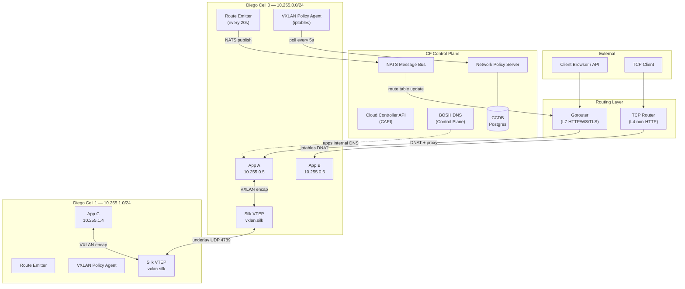
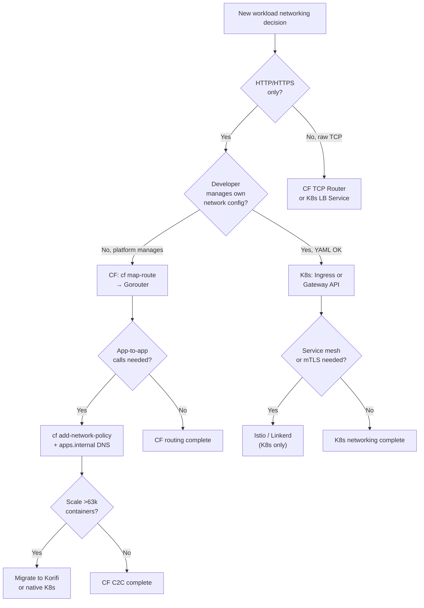
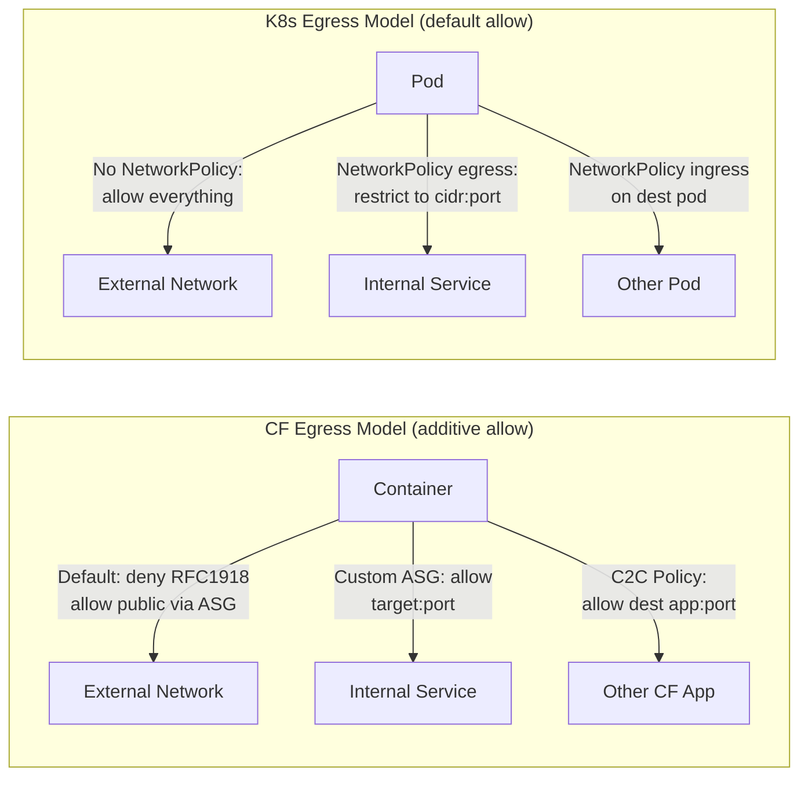

# CF-20: Kubernetes vs Cloud Foundry — Complete Comparison

**Track:** CF-G — Synthesis and Migration  
**Prerequisites:** CF-01 through CF-19, K8s lessons 01–34  
**Time:** Quick Read 10 min | Deep Dive 60 min

---

## Quick Read (10 min)

For engineers who already know K8s and need the essential mental model for CF networking.

### Core Mental Model

- CF is **opinionated K8s** — the same primitives (overlay networking, DNS, TLS termination, policy) but wired together by the platform, not by you
- Diego Cell ≈ Node; Container ≈ Pod; Gorouter ≈ Ingress+Service; ASG ≈ NetworkPolicy (egress); C2C Policy ≈ NetworkPolicy (ingress)
- The key inversion: in K8s you assemble components; in CF the platform assembles them and exposes a workflow API

### Side-by-Side at a Glance

| Concern | Kubernetes | Cloud Foundry |
|---|---|---|
| Overlay network | CNI plugin (Calico, Cilium…) | Silk CNI (VXLAN, 10.255.0.0/16) |
| IP per workload | Pod IP, stable per restart | Container IP, changes on restage |
| L7 ingress | Ingress / Gateway API | Gorouter (NATS registration) |
| TCP proxy | Service type:LoadBalancer | TCP Router (reservable_ports) |
| Egress policy | NetworkPolicy egress rules | Application Security Groups (ASGs) |
| App-to-app policy | NetworkPolicy ingress rules | C2C Network Policies |
| DNS for apps | CoreDNS + Service names | BOSH DNS, apps.internal |
| TLS | cert-manager / Istio | Gorouter edge/passthrough/re-encrypt |

### One-Diagram Summary

```mermaid
graph LR
    subgraph "Cloud Foundry"
        CF_App["CF App\n(container)"] -->|Silk VXLAN| CF_Cell["Diego Cell\n(/24 subnet)"]
        CF_Cell -->|NATS| GR["Gorouter\n(L7 TLS)"]
        GR --> Internet["Internet"]
        CF_App2["CF App B"] -->|C2C Policy\n(iptables)| CF_App
    end
    subgraph "Kubernetes"
        Pod["Pod"] -->|CNI overlay| Node["Node"]
        Node -->|Service| Ing["Ingress\n(NGINX/Envoy)"]
        Ing --> Internet2["Internet"]
        Pod2["Pod B"] -->|NetworkPolicy| Pod
    end
```

### Essential Quick Facts

- Silk CIDR: 10.255.0.0/16, each Diego Cell gets a /24 (~254 containers/cell), max 250 cells
- MTU = underlay MTU minus 50 (VXLAN overhead)
- Gorouter refreshes routes via NATS every 20s, TTL 2 minutes
- ASGs are egress-only; C2C policies are the ingress equivalent
- C2C policy is GUID-based — survives `cf push` and redeploy
- BOSH DNS `apps.internal` = K8s headless Service + CoreDNS
- Korifi (2026) translates CF V3 API to native K8s CRDs — Gorouter replaced by Contour, Silk replaced by standard NetworkPolicy

### Commands You Must Know

```bash
# Egress rules
cf security-groups
cf bind-security-group <sg> <org> <space> --lifecycle running

# App-to-app
cf add-network-policy sourceapp --destination-app destapp --port 8080 --protocol tcp

# DNS discovery
cf set-env myapp DEST_URL "http://destapp.apps.internal:8080"

# TCP routing
cf create-route <space> <tcp-domain> --random-port
```

---

## Deep Dive

---

## Practice Setup

Open two terminals before working through this lesson.

**Terminal 1 — CF CLI (local Mac)**
```bash
cf login -a https://api.sys.example.com --sso
cf target -o myorg -s myspace
cf apps
cf routes
```

**Terminal 2 — BOSH SSH into Diego Cell**
```bash
bosh -e production -d cf ssh diego-cell/0
# inside the cell
sudo su
ip addr
iptables -L -n -v | head -60
```

---

## 1. Architecture Overview

### The Fundamental Difference

Kubernetes is a **container orchestrator with a component API** — you choose, install, and wire together every networking layer: CNI plugin, Ingress controller, service mesh, DNS provider, certificate manager, network policy engine. The API surface is wide; the opinions are few.

Cloud Foundry is a **developer platform with an application API** — the networking stack is preselected, preconfigured, and managed by the platform. The CF operator configures it once; developers interact only through high-level abstractions (routes, policies, security groups).

This is not a quality difference. It is an abstraction level difference. CF trades configurability for operational simplicity and developer self-service. K8s trades simplicity for flexibility.

> **K8s Engineer's Translation:** CF is what you get when you pick one CNI (Silk), one Ingress controller (Gorouter), one network policy engine (VXLAN Policy Agent), one DNS (BOSH DNS), one certificate authority (CredHub), and hard-wire them together with a workflow API on top. The primitives are the same; the assembly is done for you.

### Full Architecture Diagram



---

## 2. Network Layer Comparisons

### 2.1 Overlay Networking: Silk vs CNI Plugins

**Cloud Foundry — Silk CNI**

Silk is CF's built-in CNI plugin. It creates a flat VXLAN overlay network across all Diego Cells.

```
Default CIDR:        10.255.0.0/16
Per-Cell subnet:     /24  (Diego Cell 0 → 10.255.0.0/24, Cell 1 → 10.255.1.0/24, …)
Max cells:           250  (limited by /24 subnets in a /16)
Containers per cell: ~254 (usable IPs in a /24)
VXLAN port:          UDP 4789
MTU:                 underlay MTU − 50 bytes
```

```bash
# On Diego Cell: inspect Silk VTEP
ip link show vxlan.silk
ip addr show vxlan.silk
# Example output:
# 7: vxlan.silk: <BROADCAST,MULTICAST,UP,LOWER_UP> mtu 1450 ...
#     inet 10.255.0.1/32 scope global vxlan.silk

# Silk writes container routes into the kernel
ip route | grep 10.255
# 10.255.0.0/24 dev silk0 proto kernel scope link
# 10.255.1.0/24 via 10.255.1.1 dev vxlan.silk
```

Each container gets a /32 address assigned from its cell's /24. The Silk daemon writes host routes for every container on the same cell and uses VXLAN FDB entries to reach containers on remote cells.

**Kubernetes — CNI Plugins**

K8s delegates to whatever CNI plugin the operator installs.

```bash
# Calico: BGP-routed overlay or underlay
calicoctl get ippool -o yaml

# Cilium: eBPF dataplane, VXLAN or native routing
cilium status
cilium config view | grep tunnel

# Flannel: simple VXLAN similar to Silk
kubectl get cm kube-flannel-cfg -n kube-flannel -o yaml
```

> **K8s Engineer's Translation:** Silk = Flannel in concept (simple VXLAN, /24 per node) but is not pluggable. CF chose a simple, supportable CNI rather than the richest one. If you want eBPF or BGP in CF, you upgrade to Korifi which inherits whatever CNI the underlying K8s cluster uses.

### 2.2 Ingress: Gorouter vs Ingress Controller

**Cloud Foundry — Gorouter**

Gorouter is CF's built-in L7 reverse proxy. It is not a sidecar or a DaemonSet — it is a dedicated VM tier, typically HA with a load balancer in front.

Route registration happens via NATS, not etcd or the K8s API server.

```
Registration flow:
  1. Developer: cf push myapp (or cf map-route)
  2. Cloud Controller writes route to CCDB
  3. Route Emitter on Diego Cell reads CCDB, publishes to NATS
  4. Gorouter subscribes to NATS, updates in-memory routing table
  5. Refresh interval: every 20 seconds
  6. Route TTL: 2 minutes (Gorouter prunes stale routes)
```

```bash
# List routes from CF CLI
cf routes

# Map a route manually
cf map-route myapp apps.example.com --hostname myapp

# Unmap
cf unmap-route myapp apps.example.com --hostname myapp

# Check Gorouter's view (on Gorouter VM via BOSH SSH)
bosh -e prod -d cf ssh router/0
curl localhost:8080/routes | python3 -m json.tool | grep myapp
```

TLS modes on Gorouter:

| Mode | Description | Use Case |
|---|---|---|
| Edge termination | TLS ends at Gorouter, plain HTTP to container | Default; simplest |
| Passthrough | SNI routing, TLS all the way to container | Apps managing own certs |
| Full re-encrypt | TLS to Gorouter, new TLS to container | Compliance requiring backend TLS |

```bash
# Route integrity: Gorouter adds X-CF-RouteSignature header
# Containers can verify they were reached through Gorouter

# WebSocket: automatic Upgrade header handling
# Sticky sessions: JSESSIONID cookie → consistent backend routing
cf set-env myapp SESSION_STICKY true
```

**Kubernetes — Ingress / Gateway API**

```yaml
# K8s Ingress (nginx example)
apiVersion: networking.k8s.io/v1
kind: Ingress
metadata:
  name: myapp
  annotations:
    nginx.ingress.kubernetes.io/ssl-redirect: "true"
spec:
  tls:
    - hosts: ["myapp.example.com"]
      secretName: myapp-tls
  rules:
    - host: myapp.example.com
      http:
        paths:
          - path: /
            pathType: Prefix
            backend:
              service:
                name: myapp
                port:
                  number: 8080
```

> **K8s Engineer's Translation:** Gorouter = NGINX Ingress Controller, but the route table is populated via NATS (not Kubernetes Endpoints/EndpointSlices). The developer-facing experience is `cf map-route` instead of editing an Ingress YAML. Gorouter does not use iptables DNAT for routing — it proxies at the application layer.

### 2.3 TCP Routing: TCP Router vs Service type:LoadBalancer

**Cloud Foundry — TCP Router**

For non-HTTP TCP workloads (databases, raw sockets, custom protocols):

```bash
# List TCP domains
cf domains | grep tcp

# Create a TCP route with a specific port
cf create-route myspace tcp.example.com --port 1024

# Or request a random port
cf create-route myspace tcp.example.com --random-port
# → Route tcp.example.com:63412 created

# Map the TCP route
cf map-route myapp tcp.example.com --port 63412

# Configure reservable port range (operator task, in cf-deployment)
# tcp_router.reservable_ports: "1024-65535"
```

Internal TCP routing flow:

```
Client:63412 → TCP Router VM:63412
TCP Router VM → iptables DNAT → random Diego Cell:ephemeral_port
Diego Cell iptables → container:8080
Round-robin selection: per connection (not per packet)
```

**Kubernetes — Service type:LoadBalancer / NodePort**

```yaml
apiVersion: v1
kind: Service
metadata:
  name: myapp-tcp
spec:
  type: LoadBalancer
  ports:
    - port: 1024
      targetPort: 8080
      protocol: TCP
  selector:
    app: myapp
```

> **K8s Engineer's Translation:** CF TCP Router = K8s Service type:LoadBalancer. Both accept TCP on a fixed external port and forward to a backend pool. The difference: K8s Services can use any port (operator assigns ExternalIP or cloud LB); CF TCP Router uses a shared pool of reservable_ports from a configured range, allocated on-demand by developers.

### 2.4 Egress Policy: ASGs vs NetworkPolicy

**Cloud Foundry — Application Security Groups**

ASGs define what CF containers are allowed to reach on the network. They are egress-only. Default-deny for public networks is not quite right — CF ships two default ASGs that together allow DNS (port 53) and all public IP space while blocking RFC1918.

```bash
# List all security groups
cf security-groups

# View rules in a security group
cf security-group public_networks

# Create a custom ASG
cat > allow-internal-postgres.json << 'EOF'
[
  {
    "protocol": "tcp",
    "destination": "10.100.0.0/16",
    "ports": "5432",
    "description": "Allow access to internal Postgres"
  }
]
EOF
cf create-security-group allow-postgres allow-internal-postgres.json

# Bind to a space for running apps
cf bind-security-group allow-postgres myorg myspace --lifecycle running

# Bind for staging (build time)
cf bind-security-group allow-postgres myorg myspace --lifecycle staging

# Global default ASGs (apply to all spaces)
cf bind-running-security-group allow-postgres
```

Default ASGs shipped with CF:

```bash
# dns: allows UDP+TCP port 53 to 0.0.0.0/0
# public_networks: allows all traffic EXCEPT:
#   10.0.0.0/8, 172.16.0.0/12, 192.168.0.0/16 (RFC1918)
#   169.254.0.0/16 (link-local)
#   100.64.0.0/10 (carrier-grade NAT)

# Check which ASGs are bound globally
cf running-security-groups
cf staging-security-groups
```

Dynamic ASG updates (cf-deployment v20.0.0+):

```bash
# Before v20: required app restart to pick up new ASG rules
# After v20: rules propagate without restart
# Verify dynamic update is enabled:
bosh -e prod -d cf manifest | grep -A5 enforce_experimental_dynamic_egress_policies
```

**Kubernetes — NetworkPolicy**

```yaml
# K8s egress restriction (equivalent to CF ASG denying RFC1918)
apiVersion: networking.k8s.io/v1
kind: NetworkPolicy
metadata:
  name: restrict-egress
  namespace: myspace
spec:
  podSelector: {}
  policyTypes:
    - Egress
  egress:
    - ports:
        - port: 53
          protocol: UDP
    - to:
        - ipBlock:
            cidr: 0.0.0.0/0
            except:
              - 10.0.0.0/8
              - 172.16.0.0/12
              - 192.168.0.0/16
```

> **K8s Engineer's Translation:** CF ASGs = K8s NetworkPolicy with policyTypes: [Egress]. The mental model inversion: K8s NetworkPolicy defaults to allow-all and you add deny rules; CF ASGs are additive allow rules against a default-deny baseline for new spaces. Also note CF ASGs apply to all pods in a Space, not to individual labeled pods — they are namespace-level, not pod-level.

### 2.5 App-to-App Policy: C2C vs NetworkPolicy Ingress

**Cloud Foundry — Container-to-Container (C2C) Network Policies**

By default, CF containers cannot reach each other directly even on the same overlay. C2C policies explicitly allow app-to-app traffic.

```bash
# Allow App A to call App B on port 8080 TCP
cf add-network-policy appA --destination-app appB --port 8080 --protocol tcp

# List current policies
cf network-policies

# Remove a policy
cf remove-network-policy appA --destination-app appB --port 8080 --protocol tcp

# Policies are GUID-based: survives cf push of either app
cf app appA --guid
cf app appB --guid
```

C2C traffic path:

```
Container A (10.255.0.5) → Silk VXLAN overlay → Container B (10.255.1.4)
Allowed by: iptables rules pushed by VXLAN Policy Agent (polls Policy Server every 5s)
No SNAT: source IP is preserved (10.255.0.5 visible to App B)
No Gorouter involvement: purely overlay, no external routing
```

Contrast with Gorouter-routed traffic:

```
Container A → iptables MASQUERADE (SNAT to Diego Cell IP) → Gorouter → Container B
Source IP: Diego Cell IP, not container IP
Used when: app calls cf route hostname, not apps.internal
```

**Kubernetes — NetworkPolicy Ingress**

```yaml
# K8s equivalent: allow Pod A's namespace to reach Pod B port 8080
apiVersion: networking.k8s.io/v1
kind: NetworkPolicy
metadata:
  name: allow-from-appa
  namespace: myspace
spec:
  podSelector:
    matchLabels:
      app: appB
  policyTypes:
    - Ingress
  ingress:
    - from:
        - podSelector:
            matchLabels:
              app: appA
      ports:
        - port: 8080
          protocol: TCP
```

> **K8s Engineer's Translation:** CF C2C policy = K8s NetworkPolicy ingress rule, but identity is based on CF App GUID (resolved by VXLAN Policy Agent into overlay IPs) rather than pod labels. The critical difference: C2C policy identity survives a full redeploy because it tracks the GUID, not the IP. In K8s, NetworkPolicy uses label selectors — the equivalent of GUIDs in terms of stability, as long as labels are consistent.

### 2.6 DNS: BOSH DNS vs CoreDNS

**Cloud Foundry — BOSH DNS**

```bash
# App-to-app DNS discovery (requires C2C policy on target port)
# Apps can reach other apps using apps.internal domain

# Example: App A calls App B
cf set-env appA DEST_URL "http://appB.apps.internal:8080"
cf restage appA  # picks up env var; not required for DNS resolution itself

# Per-instance addressing (like StatefulSet headless DNS)
# Pattern: <index>.<app-guid>.apps.internal
# Or use friendly name: <index>.<hostname>.apps.internal
# 0.appB.apps.internal → instance 0
# 1.appB.apps.internal → instance 1

# BOSH DNS is health-aware: unhealthy instances removed from DNS
# No ndots:5 search chain (unlike CoreDNS in K8s)
# TTL is short; client-side load balancing across instances

# Check DNS from inside a container
cf ssh appA
dig appB.apps.internal
# Returns all healthy container IPs (round-robin client-side LB)
```

Internal DNS record types:

| Record | Resolves To |
|---|---|
| `appB.apps.internal` | All healthy container IPs for appB |
| `0.appB.apps.internal` | IP of instance index 0 |
| `1.appB.apps.internal` | IP of instance index 1 |

**Kubernetes — CoreDNS**

```bash
# K8s service DNS
curl http://myservice.mynamespace.svc.cluster.local:8080

# Headless service (StatefulSet per-pod DNS)
# pod-0.myservice.mynamespace.svc.cluster.local

# CoreDNS ndots:5 means short names get expanded:
# "myservice" → tries "myservice.mynamespace.svc.cluster.local" first
```

> **K8s Engineer's Translation:** `appB.apps.internal` = K8s headless Service DNS (`myservice.mynamespace.svc.cluster.local`). Per-instance addressing (`0.appB.apps.internal`) = StatefulSet pod DNS (`pod-0.myservice.ns.svc.cluster.local`). CF BOSH DNS does client-side health-aware LB; K8s CoreDNS returns all Endpoints and relies on client or kube-proxy for LB.

---

## 3. Operational Model Comparison

### 3.1 Deployment and Configuration

**Cloud Foundry**

```bash
# BOSH manages VMs (Diego Cells, Gorouter VMs, NATS VMs, etc.)
bosh -e prod -d cf vms
# Outputs: diego-cell/0, diego-cell/1, router/0, router/1, nats/0, ...

# Update CF configuration (operator)
bosh -e prod -d cf manifest > current-manifest.yml
# Edit manifest, then:
bosh -e prod -d cf deploy current-manifest.yml

# Scaling (operator adds Diego Cells via BOSH)
# Developer cannot control scheduling placement

# Network configuration is in cf-deployment BOSH ops files
# Example: change Silk MTU
cat > silk-mtu.yml << 'EOF'
- type: replace
  path: /instance_groups/name=diego-cell/jobs/name=silk-cni/properties/mtu
  value: 1400
EOF
bosh -e prod -d cf deploy cf-deployment.yml -o silk-mtu.yml
```

**Kubernetes**

```bash
# Nodes managed by cloud provider or bare-metal automation
kubectl get nodes -o wide

# CNI configured via DaemonSet or operator
kubectl get ds -n kube-system | grep -E 'calico|cilium|flannel'

# Network policy via API
kubectl apply -f networkpolicy.yaml

# Developer has Namespace-level control; admin has cluster-level control
```

### 3.2 Observability and Troubleshooting Patterns

**Cloud Foundry**

```bash
# App logs (streaming)
cf logs myapp
cf logs myapp --recent

# App events
cf events myapp

# App health
cf app myapp

# Network connectivity test from app container
cf ssh myapp
# Inside container:
curl -v http://appB.apps.internal:8080
dig appB.apps.internal
netstat -tnp
```

**Kubernetes**

```bash
# Pod logs
kubectl logs -f pod/myapp-6d4f8b-xxx -c myapp

# Events
kubectl describe pod myapp-6d4f8b-xxx

# Network debugging
kubectl exec -it pod/myapp-6d4f8b-xxx -- curl -v http://myservice:8080
kubectl exec -it pod/myapp-6d4f8b-xxx -- nslookup myservice
```

---

## 4. Decision Guide: CF vs K8s for Networking Use Cases

Use this guide when evaluating whether to run workloads on CF or K8s, or when migrating between them. Each row is a real decision point a platform team or developer faces.

> **K8s Engineer's Translation:** This section answers "when should I care that it is CF and not K8s?" for every networking dimension.

### Platform Selection by Use Case

| Use Case | Recommend CF | Recommend K8s | Reason |
|---|---|---|---|
| Stateless 12-factor web app | Yes | Either | CF route registration is zero-config; K8s requires Ingress YAML |
| Stateful TCP service (database, broker) | Conditional | Yes | CF TCP Router works but port range is limited; K8s LB Services scale better |
| Service mesh / mTLS between services | No | Yes | CF has Gorouter route integrity but no sidecar mTLS; Istio/Linkerd are K8s-native |
| eBPF-based network observability | No | Yes | Silk uses iptables; Cilium/Hubble require K8s |
| Developer self-service (no YAML) | Yes | No | `cf push` + `cf add-network-policy` requires no manifest; K8s demands YAML literacy |
| Strict multi-tenant egress isolation | Either | Either | CF ASGs and K8s NetworkPolicy both achieve namespace-level egress control |
| App-to-app service discovery (no service registry) | Yes | Either | apps.internal DNS is built-in; K8s needs Service + CoreDNS (also built-in but more explicit) |
| GPU / AI workloads | No | Yes | CF has no GPU scheduling; K8s has device plugins and GPU operator |
| Canary / blue-green routing | Yes (simple) | Yes (advanced) | CF weighted routes work for basic split; K8s Gateway API / Argo Rollouts enable advanced strategies |
| Compliance requiring mutual TLS to container | Partial | Yes | CF re-encrypt mode adds Gorouter→container TLS; for container-to-container mTLS use K8s service mesh |
| Container count >250 cells × 254/cell | No | Yes | Silk /16 caps at ~63,500 containers; K8s scales much larger |
| Korifi (CF API on K8s) | Yes | Yes | Best of both: CF developer experience on K8s infrastructure; use when migrating CF orgs to K8s |

### Networking Dimension Decision Matrix



### Egress Policy Model Comparison



### Key Differences That Affect Architecture Decisions

**IP stability:**
- K8s: Pod IP is stable within Pod lifetime; predictable for readiness/liveness checks
- CF: Container IP changes on every restage/restart — never hardcode CF container IPs; always use DNS

**Identity model:**
- K8s: NetworkPolicy identity = pod labels (mutable, developer-controlled)
- CF: C2C identity = App GUID (immutable, platform-assigned) — survives all redeployments

**Egress default:**
- K8s: allow-all unless NetworkPolicy present (additive deny)
- CF: Running apps in new spaces inherit global default ASGs (dns + public_networks); RFC1918 blocked by default

**Route registration latency:**
- K8s: Endpoints update within seconds of pod readiness probe passing
- CF: Route Emitter re-registers every 20s; Gorouter route TTL 2 minutes — up to 2 minutes of stale route traffic possible

**Scaling ceiling:**
- K8s: Thousands of nodes; millions of pods (with large clusters)
- CF (Silk): 250 Diego Cells max; ~63,500 containers max per CF deployment

---

## 5. Troubleshooting

### 5.1 Gorouter: 502 Bad Gateway

**Symptom:** Client gets 502; `cf app myapp` shows all instances running.

**Diagnosis:**

```bash
# Check route mapping
cf routes | grep myapp

# Verify route emitter health (BOSH SSH to Diego Cell)
bosh -e prod -d cf ssh diego-cell/0
monit summary | grep route_emitter

# Check NATS subscription on Gorouter
bosh -e prod -d cf ssh router/0
curl localhost:8080/routes | python3 -m json.tool | grep myapp

# Test direct container connectivity from Diego Cell
# (bypasses Gorouter)
curl -v http://10.255.0.5:8080/health

# Common causes:
# 1. App crashed but route still in NATS (TTL 2min lag)
# 2. App listening on wrong port (must be $PORT)
# 3. TLS mismatch (re-encrypt mode but app serves plain HTTP)
```

**Fix:**

```bash
# Force re-registration
cf restage myapp

# Check app port binding
cf env myapp | grep PORT
# App must bind to 0.0.0.0:$PORT, not 127.0.0.1:8080
```

> **K8s Engineer's Translation:** CF 502 = K8s Ingress 502 when backend Pod is unhealthy. In K8s, the Endpoints controller removes the Pod IP within seconds of a failed readiness probe. In CF, the Route Emitter re-publishes healthy containers every 20s and routes with TTL 2 minutes — so a crashed container may still receive traffic for up to 2 minutes.

### 5.2 C2C Policy Not Working

**Symptom:** App A cannot reach App B on apps.internal even with network policy added.

**Diagnosis:**

```bash
# Step 1: Verify policy exists
cf network-policies
# Source      Destination  Protocol  Ports
# appA        appB         tcp       8080

# Step 2: Verify DNS resolves inside App A
cf ssh appA
dig appB.apps.internal
# If NXDOMAIN: app B has no apps.internal route registered

# Step 3: Register apps.internal route for App B
cf map-route appB apps.internal --hostname appB

# Step 4: Re-check DNS
dig appB.apps.internal
# Should return container IPs

# Step 5: Test connectivity
curl -v http://appB.apps.internal:8080

# Step 6: Check VXLAN Policy Agent on Diego Cell
bosh -e prod -d cf ssh diego-cell/0
iptables -L FORWARD -n -v | grep 10.255
# Look for ACCEPT rules matching source/dest container IPs

# Step 7: Check Policy Server logs
bosh -e prod -d cf logs policy-server/0 --recent
```

**Common causes:**

```
1. No apps.internal route mapped to destination app
2. Policy Agent not synced yet (wait up to 5s or restart agent)
3. ASG blocking egress from App A's Diego Cell to overlay
4. Port mismatch: policy on 8080 but app listens on 9090
5. Protocol mismatch: UDP policy but app uses TCP
```

> **K8s Engineer's Translation:** CF C2C not working = K8s NetworkPolicy not enforced. Check the same layers: DNS resolution, CNI plugin iptables rules, and whether the policy selector matches the actual pod labels. In CF, the extra layer is the NATS/apps.internal route registration — a step that has no K8s equivalent.

### 5.3 ASG Blocking Egress

**Symptom:** App cannot reach external service; works on other orgs/spaces.

```bash
# Check effective ASGs for the space
cf security-groups
cf space-security-groups myorg myspace

# Test from app container
cf ssh myapp
curl -v https://external-service.example.com:443
# If "Connection refused" or timeout: ASG is blocking

# Check which ASG would need to allow this
# external-service.example.com:443 TCP

# Create targeted ASG
cat > allow-external.json << 'EOF'
[
  {
    "protocol": "tcp",
    "destination": "external-service.example.com",
    "ports": "443",
    "description": "Allow HTTPS to external-service"
  }
]
EOF
cf create-security-group allow-external allow-external.json
cf bind-security-group allow-external myorg myspace --lifecycle running

# With dynamic ASG updates (cf-deployment v20+): no restart needed
# Without dynamic updates: must restage app
cf restage myapp
```

### 5.4 TCP Router Port Exhaustion

**Symptom:** `cf create-route` fails with "no ports available" error.

```bash
# Check configured port range
bosh -e prod -d cf manifest | grep reservable_ports

# Check currently allocated ports
cf routes | grep tcp

# Count allocated vs configured range
# If range is 1024-1123 (100 ports) and 100 routes exist: exhausted

# Resolution options:
# 1. Increase reservable_ports range in cf-deployment manifest
# 2. Remove unused TCP routes
cf delete-route tcp.example.com --port 63412
```

### 5.5 Korifi-specific: CRD Translation Failures

**Symptom (Korifi environments):** `cf push` succeeds but app is unreachable.

```bash
# In Korifi, CF objects map to K8s CRDs
kubectl get cfapps -n cf-space-<space-guid>
kubectl get cfroutes -n cf-space-<space-guid>

# Check Korifi controller logs
kubectl logs -n korifi-controllers deploy/korifi-controllers-controller-manager

# Contour HTTPProxy (replaces Gorouter routes in Korifi)
kubectl get httpproxy -n projectcontour

# NetworkPolicy (replaces Silk+C2C in Korifi)
kubectl get networkpolicy -n cf-space-<space-guid>

# If route exists but app unreachable:
kubectl describe cfroute <route-name> -n cf-space-<space-guid>
kubectl describe httpproxy <route-name> -n projectcontour
```

---

## Production Checklist

Before promoting an application or CF networking configuration to production, verify:

**Routing**
- [ ] Route mapped and visible in `cf routes`
- [ ] Route Emitter on all Diego Cells is healthy (`monit summary | grep route_emitter`)
- [ ] Gorouter reports route in `/routes` endpoint
- [ ] TLS mode configured correctly (edge/passthrough/re-encrypt) for compliance requirements
- [ ] WebSocket route flag set if app uses WebSockets (`cf map-route ... --no-hostname` for TCP WebSocket)
- [ ] Sticky sessions confirmed working if app requires session affinity

**Network Policy (C2C)**
- [ ] `cf network-policies` shows all required app-to-app policies
- [ ] `apps.internal` route registered for all destination apps
- [ ] DNS resolution confirmed from source app container (`cf ssh appA; dig destapp.apps.internal`)
- [ ] Direct TCP connectivity confirmed (`curl http://destapp.apps.internal:<port>`)

**Egress (ASGs)**
- [ ] `cf security-groups` shows all required ASGs bound to space
- [ ] Running lifecycle ASGs tested from app container
- [ ] Staging lifecycle ASGs verified (build-time dependencies can be fetched)
- [ ] Default ASGs (`dns`, `public_networks`) not accidentally unbound
- [ ] RFC1918 egress blocked unless explicitly required (verify `public_networks` ASG in place)

**DNS**
- [ ] All apps.internal FQDNs resolve correctly from consumer apps
- [ ] Per-instance addressing tested if app requires it
- [ ] BOSH DNS health filtering verified (unhealthy instances not returned)

**Silk/Overlay**
- [ ] MTU configured to underlay MTU minus 50 (check for fragmentation)
- [ ] Diego Cell count under 250 (Silk /16 limit)
- [ ] Container-per-cell count under 254

**TCP Routing (if used)**
- [ ] TCP domain exists: `cf domains | grep tcp`
- [ ] Port allocated: `cf routes | grep tcp`
- [ ] reservable_ports range has headroom for growth

**Korifi (if on Korifi platform)**
- [ ] All CFApp, CFRoute, CFBuild CRDs created successfully
- [ ] Contour HTTPProxy created and healthy
- [ ] Standard K8s NetworkPolicy created for C2C equivalents
- [ ] Underlying K8s cluster CNI supports NetworkPolicy enforcement

---

## Quick Reference

### CF CLI Network Commands

| Command | Purpose | K8s Equivalent |
|---|---|---|
| `cf routes` | List all routes | `kubectl get ingress -A` |
| `cf map-route APP DOMAIN --hostname H` | Bind route to app | `kubectl apply -f ingress.yaml` |
| `cf unmap-route APP DOMAIN --hostname H` | Remove route binding | `kubectl delete ingress myapp` |
| `cf create-route SPACE DOMAIN --hostname H` | Create route | N/A (implicit with Ingress) |
| `cf delete-route DOMAIN --hostname H` | Delete route | `kubectl delete ingress myapp` |
| `cf network-policies` | List C2C policies | `kubectl get networkpolicy -A` |
| `cf add-network-policy SRC --destination-app DST --port P --protocol PROTO` | Allow C2C | `kubectl apply -f netpol.yaml` |
| `cf remove-network-policy SRC --destination-app DST --port P --protocol PROTO` | Remove C2C | `kubectl delete networkpolicy` |
| `cf security-groups` | List ASGs | `kubectl get networkpolicy -A` (egress) |
| `cf create-security-group NAME FILE` | Create ASG | `kubectl apply -f netpol.yaml` |
| `cf bind-security-group NAME ORG SPACE --lifecycle running` | Apply ASG to space | `kubectl label namespace` |
| `cf running-security-groups` | Global running ASGs | Cluster-wide NetworkPolicy |
| `cf domains` | List routing domains | `kubectl get ingressclass` |
| `cf create-domain ORG DOMAIN` | Create private domain | `kubectl create -f ingressclass.yaml` |
| `cf create-shared-domain DOMAIN --router-group tcp` | Create TCP domain | Service type:LoadBalancer pool |

### BOSH SSH Diagnostic Commands (Diego Cell)

| Command | Purpose |
|---|---|
| `ip addr show vxlan.silk` | Silk VTEP address |
| `ip route show table all \| grep 10.255` | Container routes |
| `iptables -L FORWARD -n -v` | C2C forwarding rules |
| `iptables -L -t nat -n -v \| grep MASQUERADE` | SNAT for external traffic |
| `monit summary` | BOSH job health |
| `ps aux \| grep silk` | Silk CNI processes |
| `ps aux \| grep policy-agent` | VXLAN Policy Agent |
| `ps aux \| grep route-emitter` | Route Emitter |
| `curl -s localhost:14726/state` | VXLAN Policy Agent state |

### Networking Defaults

| Parameter | Default Value |
|---|---|
| Silk overlay CIDR | 10.255.0.0/16 |
| Per-Diego-Cell subnet | /24 |
| Max Diego Cells (Silk) | 250 |
| Max containers per cell | ~254 |
| VXLAN overlay MTU offset | underlay − 50 bytes |
| Route Emitter refresh | every 20 seconds |
| Gorouter route TTL | 2 minutes |
| Policy Agent poll interval | every 5 seconds |
| apps.internal DNS domain | BOSH DNS, all spaces |
| Default ASGs | dns, public_networks |
| C2C default | deny-all |

---

## See Also

**K8s Lessons — Direct Counterparts**

- **Lesson 07: CNI Deep Dive** — Covers VXLAN overlay mechanics; Silk uses the same VTEP/FDB model as Flannel
- **Lesson 09: NetworkPolicy** — K8s equivalents for both CF ASGs (egress) and C2C policies (ingress)
- **Lesson 10: DNS and Service Discovery** — CoreDNS vs BOSH DNS; headless Services vs apps.internal
- **Lesson 12: Ingress Controllers** — NGINX/Envoy Ingress vs Gorouter; TLS termination modes
- **Lesson 13: Gateway API** — Next-generation K8s routing; Korifi uses Contour (Gateway API compatible)
- **Lesson 14: Service Mesh** — Istio mTLS vs CF route integrity; sidecar vs platform-managed TLS
- **Lesson 15: eBPF Networking (Cilium)** — Korifi clusters may use Cilium; eBPF replaces iptables used by Silk Policy Agent
- **Lesson 20: Multi-Tenancy Network Isolation** — Namespace isolation in K8s vs CF Org/Space isolation model

**CF Lessons — Within This Track**

- **CF-01: CF Architecture Overview** — Diego Cell, BOSH, NATS topology
- **CF-05: Gorouter Deep Dive** — TLS modes, sticky sessions, WebSocket details
- **CF-10: C2C Networking** — VXLAN Policy Agent internals, policy propagation timing
- **CF-15: Application Security Groups** — ASG lifecycle, dynamic updates, troubleshooting
- **CF-18: BOSH DNS** — apps.internal, health-aware LB, per-instance addressing
- **CF-19: Korifi** — CF V3 API on K8s, CRD mappings, Contour integration

---

## Online Resources

- **Cloud Foundry Networking Documentation** — Architecture guides for Silk CNI, Gorouter, C2C policies, ASGs:  
  https://docs.cloudfoundry.org/concepts/understand-cf-networking.html

- **Korifi Project (GitHub)** — CF V3 API on Kubernetes; CRD definitions and architecture docs:  
  https://github.com/cloudfoundry/korifi

- **Silk CNI Source and Design** — VXLAN overlay design, subnet allocation, MTU handling:  
  https://github.com/cloudfoundry/silk

- **CF Networking Release (GitHub)** — VXLAN Policy Agent, C2C policy enforcement, Policy Server source:  
  https://github.com/cloudfoundry/cf-networking-release

- **Cloud Foundry Foundation — CF Summit 2026 AI Working Group** — Korifi roadmap, AI GPU workload networking on CF:  
  https://www.cloudfoundry.org/blog/
