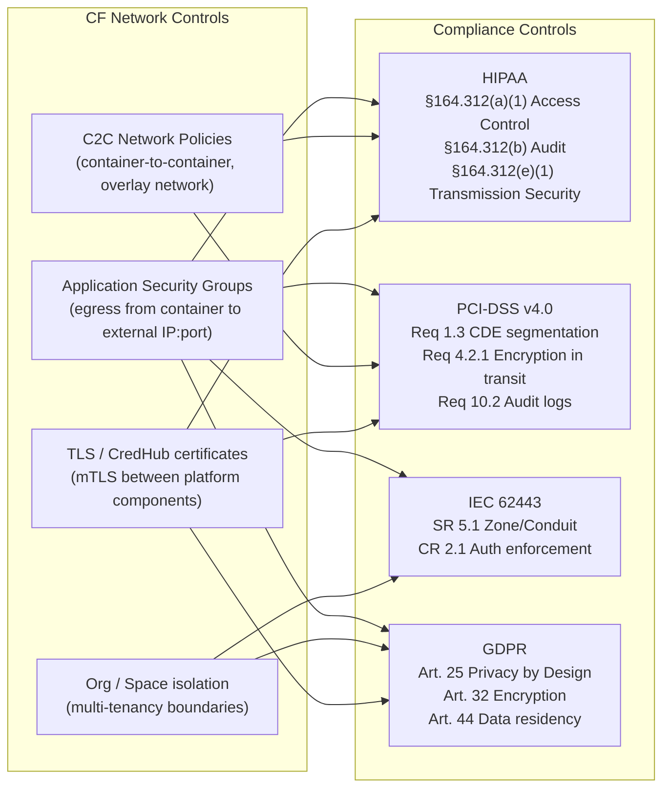
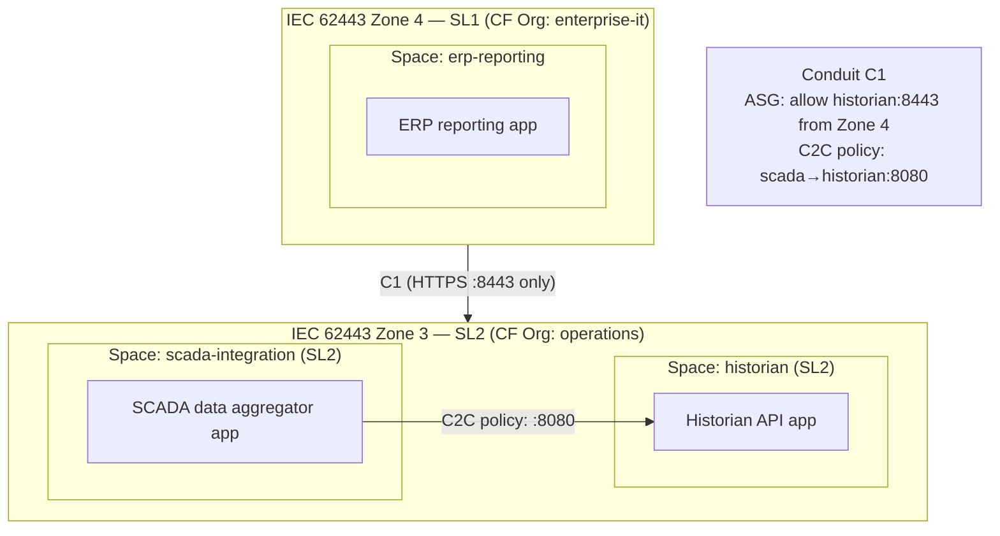

# CF-21: Compliance Networking in Cloud Foundry

**Track:** CF-H — Security & Compliance
**Prerequisites:** [CF-07 — Application Security Groups](cf-07-application-security-groups.md), [CF-13 — C2C Network Policies](cf-13-c2c-network-policies.md), [CF-14 — TLS Certificates](cf-14-tls-certificates.md), [CF-15 — Org/Space Isolation](cf-15-org-space-isolation.md)
**Time:** ~2.5 hours

> **Goal:** Map Cloud Foundry's native network controls — ASGs, C2C policies, TLS, org/space isolation — to specific audit requirements in HIPAA, PCI-DSS, IEC 62443, and GDPR. Produce the exact CF CLI commands and evidence artifacts that satisfy each control.

**Jump to:** [Theory](#theory) · [Practice](#practice) · [HIPAA](#hipaa) · [PCI-DSS](#pci-dss) · [IEC-62443](#iec-62443) · [GDPR](#gdpr) · [Audit Evidence Runbook](#audit-evidence-runbook) · [Troubleshooting](#troubleshooting) · [Production Checklist](#production-checklist) · [Quick Reference](#quick-reference)

---

> **K8s parallel:** This lesson is the CF equivalent of [K8s Lesson 37 — Compliance Networking](../lessons/37-compliance-networking.md). The controls differ (ASGs vs NetworkPolicy, Gorouter TLS vs Cilium WireGuard) but the regulatory requirements are identical.

---

## Theory

After this lesson you will be able to: map each CF network primitive (ASG, C2C policy, TLS, org/space isolation) to its specific clause in HIPAA, PCI-DSS, IEC 62443, and GDPR; and produce the CLI commands and evidence artifacts required by an auditor for each control.

## 1. CF Network Controls vs Compliance Requirements

Cloud Foundry provides four network control primitives. Each maps to one or more compliance controls:



## 2. The Default-Open Problem in CF

CF's default posture, like Kubernetes, is **open**. The default running ASG (`public_networks`) allows all outbound internet traffic from every container. Without operator intervention:

- Any app can reach any IP on the internet (HIPAA/PCI violation)
- Containers in different spaces can communicate freely via overlay if C2C policies are added without policy (less of an issue — C2C is default-deny)
- No audit log of which container reached which IP

**Before any compliance claim, verify the default ASG posture:**

```bash
# Check what global running ASGs exist
cf running-security-groups
# If you see "public_networks" or "all_open" → audit-fail for PCI-DSS Req 1.3

# Show what public_networks allows
cf security-group public_networks
# Typically: destination 0.0.0.0/0, protocol all → allows EVERYTHING

# For regulated environments: unbind or replace with explicit allow-list ASGs
cf unbind-running-security-group public_networks
```

---

## Practice

### Lab Setup

These labs require CF admin access and a CF foundation with at least two orgs and spaces. Use `cf target` to switch between orgs and spaces as directed. All commands assume CF CLI v7+.

```bash
# Confirm CF CLI version and login
cf version
cf target

# Create lab orgs and spaces if they do not exist
cf create-org phi-org
cf create-space phi-production -o phi-org
cf create-org payment-org
cf create-space cde-production -o payment-org
cf create-org personal-data-org
cf create-space production -o personal-data-org
cf create-org operations-zone
cf create-org enterprise-it
```

### Lab 1 — Harden the Default ASG Posture

**Goal:** Remove the default open ASG and verify regulated spaces cannot reach arbitrary internet IPs.

```bash
# Step 1: Check current global ASGs
cf running-security-groups

# Step 2: Unbind the open default (do NOT delete — just unbind globally)
cf unbind-running-security-group public_networks

# Step 3: Verify a container in phi-production is now blocked from arbitrary egress
cf target -o phi-org -s phi-production
# (Requires a running app; substitute your app name)
cf ssh my-test-app -c "nc -zv 8.8.8.8 443 || echo BLOCKED"
# Expected: BLOCKED

# Step 4: Create and bind a minimal allow-list ASG for DNS and CF internals
cat > asg-minimal-dns.json <<'EOF'
[{"protocol":"udp","destination":"10.0.0.2","ports":"53","description":"Internal DNS only","log":false}]
EOF
cf create-security-group minimal-dns asg-minimal-dns.json
cf bind-running-security-group minimal-dns
```

### Lab 2 — HIPAA ePHI Access Control

**Goal:** Restrict a space to reach only the ePHI database, verify isolation, and confirm audit log rules exist.

```bash
# Step 1: Create the ePHI-scoped ASG
cat > asg-phi-db-access.json <<'EOF'
[{"protocol":"tcp","destination":"10.0.5.20","ports":"5432","description":"HIPAA 164.312(a)(1): EHR app to ePHI PostgreSQL","log":true}]
EOF
cf create-security-group hipaa-phi-db-access asg-phi-db-access.json

# Step 2: Bind to phi-production space only
cf bind-security-group hipaa-phi-db-access phi-org phi-production --lifecycle running

# Step 3: Confirm the ASG is NOT globally bound
cf running-security-groups
# hipaa-phi-db-access must NOT appear here

# Step 4: Confirm a container in another space cannot reach 10.0.5.20:5432
cf target -o payment-org -s cde-production
cf ssh payment-processor -c "nc -zv 10.0.5.20 5432 || echo BLOCKED"
# Expected: BLOCKED
```

### Lab 3 — PCI-DSS CDE Segmentation Verification

**Goal:** Demonstrate that the CDE space has no wildcard ASG and cannot reach arbitrary internet destinations.

```bash
# Step 1: Create CDE-specific ASG
cat > asg-cde-egress.json <<'EOF'
[
  {"protocol":"tcp","destination":"192.168.10.5","ports":"8443","description":"PCI Req 1.3.2: CDE to payment gateway","log":true},
  {"protocol":"tcp","destination":"10.0.1.53","ports":"53","description":"PCI Req 1.3.2: CDE to internal DNS","log":false}
]
EOF
cf create-security-group pci-cde-egress asg-cde-egress.json
cf bind-security-group pci-cde-egress payment-org cde-production --lifecycle running

# Step 2: Confirm no wildcard rule in CDE space
cf space-security-groups cde-production
# Must NOT show public_networks or any 0.0.0.0/0 rule

# Step 3: Test segmentation from CDE container
cf target -o payment-org -s cde-production
cf ssh payment-processor -c "nc -zv 8.8.8.8 443 || echo BLOCKED"
# Expected: BLOCKED — arbitrary internet is not reachable from CDE
```

### Lab 4 — Run the Compliance Audit Runbook

**Goal:** Collect the full set of audit evidence files.

```bash
# Run the audit script from the Audit Evidence Runbook section below
# and verify each output file is non-empty
bash cf-compliance-audit.sh
ls -lh cf-audit-*/
# Review 01-global-running-asgs.txt: should not contain public_networks
# Review 03-all-security-groups.json: check all rules have log:true for regulated destinations
```

---

## HIPAA

### §164.312(a)(1) — Access Control

**Requirement:** Only authorized persons or software may access ePHI.

**CF control:** Space-scoped ASGs limiting which containers can reach the ePHI datastore, combined with C2C policy limiting which apps can call the ePHI service internally.

```json
// asg-phi-db-access.json
// Allow only the EHR application containers to reach the ePHI PostgreSQL database
[
  {
    "protocol": "tcp",
    "destination": "10.0.5.20",
    "ports": "5432",
    "description": "HIPAA 164.312(a)(1): EHR app → ePHI PostgreSQL. Reviewed 2026-11-25.",
    "log": true
  }
]
```

```bash
# Create the ASG
cf create-security-group hipaa-phi-db-access asg-phi-db-access.json

# Bind only to the ePHI-handling space (NOT globally)
cf bind-security-group hipaa-phi-db-access phi-org phi-production --lifecycle running

# Verify no other space has access to this CIDR
cf curl /v3/security_groups?per_page=100 | \
  python3 -c "
import json,sys
data=json.load(sys.stdin)
for sg in data['resources']:
    for rule in sg.get('rules',[]):
        if '10.0.5.20' in rule.get('destination',''):
            print(sg['name'], rule)
"
```

**Auditor evidence:** Show `cf security-group hipaa-phi-db-access` output + demonstrate a container in a different space cannot reach `10.0.5.20:5432`.

---

### §164.312(b) — Audit Controls

**Requirement:** Record and examine activity in systems containing ePHI.

**CF control:** `"log": true` on all ASG rules touching ePHI resources. This writes kernel-level connection logs to Diego Cell syslog, which forwards to your SIEM.

```json
// asg-phi-audit.json — all rules touching ePHI resources have log:true
[
  {
    "protocol": "tcp",
    "destination": "10.0.5.0/24",
    "ports": "5432,8080,8443",
    "description": "ePHI data tier — audit all access",
    "log": true
  }
]
```

```bash
# Verify logging is enabled on all ePHI-scoped ASGs
cf curl /v3/security_groups?per_page=100 | \
  python3 -c "
import json,sys
data=json.load(sys.stdin)
for sg in data['resources']:
    for rule in sg.get('rules',[]):
        if not rule.get('log') and '10.0.5' in rule.get('destination',''):
            print('AUDIT-FAIL: log:false on ePHI rule:', sg['name'], rule['destination'])
"

# On Diego Cell: verify iptables LOG rules are present (run via BOSH SSH)
# bosh -d cf ssh diego-cell/0 -c "sudo iptables -L OUTPUT -n -v | grep LOG"

# Check syslog forwarding is configured for Diego Cells to your SIEM
# cf-deployment: ops/use-external-syslog.yml or syslog-releases
```

**Auditor evidence:** `iptables -L OUTPUT -n | grep LOG` on a Diego Cell showing ASG log rules, plus a sample syslog entry showing connection timestamp, source container IP, destination IP:port.

---

### §164.312(e)(1) — Transmission Security

**Requirement:** Guard against unauthorized access to ePHI transmitted over electronic communications networks.

**CF control:** Gorouter enforces TLS termination (mTLS between Gorouter and apps via route integrity). CredHub-managed certificates rotate automatically.

```bash
# Verify route integrity (mTLS between Gorouter and Diego Cells) is enabled
cf curl /v2/info | python3 -c "import json,sys; d=json.load(sys.stdin); print(d.get('app_ssh_endpoint',''))"

# Check TLS certificate expiry on the CF API endpoint
echo | openssl s_client -connect api.cf.example.com:443 -servername api.cf.example.com 2>/dev/null \
  | openssl x509 -noout -dates

# Verify CredHub has certificates for the deployment
# bosh -d cf ssh cloud_controller/0 -c "sudo /var/vcap/packages/cf-cli/bin/cf curl /v2/info"

# Check that apps are mapped to HTTPS routes only (no plain HTTP in regulated spaces)
cf routes | grep -v "https\|HTTPS" | grep -v "^Getting\|^org\|^space\|^url"
# Any plain HTTP routes in regulated spaces = audit finding
```

**Auditor evidence:** TLS certificate chain for the CF API domain + confirmation of route integrity enabled in cf-deployment manifest.

---

## PCI-DSS

### Req 1.3 — CDE Network Segmentation

**Requirement:** Restrict inbound and outbound traffic to that which is necessary for the cardholder data environment.

**CF mapping:** The CDE = one dedicated CF Org + Space. ASGs for that space allow only traffic required by payment processing. All other spaces are isolated by default (C2C is deny-by-default across spaces).

```json
// asg-cde-egress.json
// PCI-DSS Req 1.3.2: Restrict CDE outbound to payment network endpoints only
[
  {
    "protocol": "tcp",
    "destination": "192.168.10.5",
    "ports": "8443",
    "description": "PCI Req 1.3.2: CDE → internal payment gateway only",
    "log": true
  },
  {
    "protocol": "tcp",
    "destination": "10.0.1.53",
    "ports": "53",
    "description": "PCI Req 1.3.2: CDE → internal DNS only",
    "log": false
  }
]
```

```bash
# Create CDE-specific ASG (no global bind — space-scoped only)
cf create-security-group pci-cde-egress asg-cde-egress.json
cf bind-security-group pci-cde-egress payment-org cde-production --lifecycle running

# CRITICAL: Ensure public_networks is NOT bound to the CDE space
cf space-security-groups cde-production
# Must NOT show: public_networks, all_open, or any 0.0.0.0/0 rule

# Demonstrate segmentation: app in CDE space cannot reach arbitrary internet IP
cf target -o payment-org -s cde-production
cf ssh payment-processor -c "nc -zv 8.8.8.8 443"
# nc: connect to 8.8.8.8 port 443 (tcp) failed: Connection timed out  ← PASS
```

**Auditor evidence:** `cf space-security-groups cde-production` output (no wildcard rules) + failed `nc` to arbitrary IP from CDE container.

---

### Req 4.2.1 — Encryption of PAN in Transit

**Requirement:** Strong cryptography for PAN transmitted over open, public networks.

**CF controls:**
1. Gorouter TLS termination (all external traffic encrypted)
2. Route integrity / mTLS between Gorouter and application containers
3. CredHub-managed certificates with automatic rotation

```bash
# 1. Verify Gorouter TLS config (all HTTPS routes)
cf routes --orgs payment-org | grep "^payment"
# All routes should show port 443 / HTTPS

# 2. Verify route integrity is enabled in the deployment manifest
# grep -A5 "route_integrity" ~/cf-deployment/cf-deployment.yml
# Should show: mode: mtls-required

# 3. Check certificate expiry (must be valid, rotation < 1 year)
bosh -d cf ssh router/0 -c \
  "sudo cat /var/vcap/jobs/gorouter/config/gorouter.yml | grep -A3 'tls_pem'"

# 4. Verify no plain-HTTP routes exist for payment apps
cf curl "/v3/routes?organization_guids=$(cf org payment-org --guid)" | \
  python3 -c "
import json,sys
data=json.load(sys.stdin)
for r in data['resources']:
    if r['protocol'] == 'http':
        print('PLAIN HTTP ROUTE:', r['url'])
"
```

---

### Req 10.2 — Audit Log Access to CDE

```bash
# Enable ASG logging for all CDE-touching rules (verify log:true in ASG JSON)
cf security-group pci-cde-egress | grep -i log

# Configure Diego Cell syslog to forward to SIEM (12-month retention per PCI Req 10.5.1)
# In cf-deployment, use: cf-deployment/operations/experimental/enable-oci-phase-1.yml
# and syslog-release to configure forwarding

# Generate audit report: all CDE security group changes via CC audit events
cf curl "/v3/audit_events?types=audit.security_group.create,audit.security_group.update,audit.security_group.delete,audit.security_group.bind_space,audit.security_group.unbind_space&per_page=100" | \
  python3 -c "
import json,sys
data=json.load(sys.stdin)
for e in data['resources']:
    print(e['created_at'], e['type'], e.get('target',{}).get('name',''))
"
```

**Auditor evidence:** CC audit event log showing all changes to CDE security groups, with timestamps and actor (who made the change).

---

## IEC 62443

### SR 5.1 — Network Segmentation (Zone / Conduit Model)

**CF mapping:** CF Org = IEC 62443 Zone, CF Space = sub-zone, ASG = Conduit rules.



```json
// asg-iec62443-conduit-c1.json
// IEC 62443 SR 5.1: Conduit C1 — Zone 4 (ERP) → Zone 3 (Historian)
// Only the historian app's external IP, only HTTPS
[
  {
    "protocol": "tcp",
    "destination": "10.1.2.100",
    "ports": "8443",
    "description": "IEC62443 SR5.1 Conduit C1: ERP → Historian API. Zone 4→Zone 3.",
    "log": true
  }
]
```

```bash
# Map org/space → security level in CF annotations (CF v3 metadata)
cf curl -X PATCH /v3/organizations/$(cf org operations-zone --guid) \
  -d '{"metadata":{"annotations":{"iec62443/zone":"operations","iec62443/sl":"2"}}}'

cf curl -X PATCH /v3/organizations/$(cf org enterprise-it --guid) \
  -d '{"metadata":{"annotations":{"iec62443/zone":"enterprise","iec62443/sl":"1"}}}'

# Verify zone annotations
cf curl /v3/organizations?per_page=100 | \
  python3 -c "
import json,sys
data=json.load(sys.stdin)
for o in data['resources']:
    ann = o.get('metadata',{}).get('annotations',{})
    if 'iec62443/zone' in ann:
        print(o['name'], ann)
"
```

---

### CR 2.1 — Authorization Enforcement Between Zones

```bash
# Verify only authorized C2C policies exist between zone-mapped spaces
# C2C policies are the conduits between containers in the same overlay network

# List all C2C policies and audit against conduit register
cf curl /networking/v1/external/policies | \
  python3 -c "
import json,sys
data=json.load(sys.stdin)
for p in data['policies']:
    print(f\"SRC: {p['source']['id']}  →  DST: {p['destination']['id']} :{p['destination']['port']}/{p['destination']['protocol']}\")
" 

# Cross-reference with app GUIDs to identify which apps have cross-space access
# (C2C policies that cross space boundaries are cross-zone conduits per IEC 62443)
```

---

## GDPR

### Art. 25 — Privacy by Design (Default Deny)

```bash
# Verify no wildcard ASGs are globally bound (default-open violates Art. 25)
cf running-security-groups
# MUST NOT contain: public_networks (0.0.0.0/0), all_open, or similar

# Every space processing personal data must have explicit ASG instead of global open
# Check spaces in personal-data org have no wildcard bindings:
ORG_GUID=$(cf org personal-data-org --guid)
cf curl "/v3/security_groups?running_space_guids=$(cf space production --guid)" | \
  python3 -c "
import json,sys
data=json.load(sys.stdin)
for sg in data['resources']:
    for rule in sg.get('rules',[]):
        if rule.get('destination','') in ['0.0.0.0/0','0.0.0.0-255.255.255.255']:
            print('GDPR Art.25 VIOLATION: wildcard ASG:', sg['name'])
"
```

### Art. 44 — Cross-Border Data Transfer Restriction

**CF control:** ASGs can restrict egress to only EU-hosted IP ranges. Combined with CF's deployment geography (EU-only CF foundations), this ensures personal data doesn't leave the EU.

```json
// asg-gdpr-eu-only.json
// GDPR Art. 44: Restrict personal data containers to EU datacenter IPs only
[
  {
    "protocol": "tcp",
    "destination": "10.0.0.0/8",
    "ports": "443,5432,6379",
    "description": "GDPR Art.44: internal EU datacenter services only",
    "log": true
  },
  {
    "protocol": "tcp",
    "destination": "52.28.0.0/14",
    "ports": "443",
    "description": "GDPR Art.44: AWS eu-central-1 (Frankfurt) HTTPS only",
    "log": true
  }
]
```

```bash
cf create-security-group gdpr-eu-only asg-gdpr-eu-only.json
cf bind-security-group gdpr-eu-only personal-data-org production --lifecycle running

# Test: container cannot reach US-only endpoint
cf target -o personal-data-org -s production
cf ssh user-service -c "nc -zv --max-time 5 54.239.28.85 443 || echo BLOCKED"
# BLOCKED ← PASS
```

### Art. 32 — Encryption of Personal Data in Transit

```bash
# Verify CF foundation is configured with TLS everywhere:
# 1. External: Gorouter TLS termination (all external routes HTTPS)
cf routes | awk '{print $4}' | sort -u
# Should only show 443, no 80

# 2. Internal: route integrity (mTLS Gorouter ↔ app containers)
# Check cf-deployment manifest or platform team confirmation

# 3. Personal data apps use internal C2C (overlay VXLAN) not external routes
#    to communicate — VXLAN traffic stays within Diego Cell network
cf network-policies --source user-service
# Should show internal service communication via C2C, not external ASG egress
```

---

## Audit Evidence Runbook

Run this sequence before any compliance audit. Save all output.

```bash
#!/usr/bin/env bash
# cf-compliance-audit.sh
# Run as CF admin. Saves evidence to ./cf-audit-$(date +%Y%m%d)/

AUDIT_DIR="cf-audit-$(date +%Y%m%d)"
mkdir -p "$AUDIT_DIR"

# 1. All global ASGs (look for wildcard rules = compliance fail)
cf running-security-groups > "$AUDIT_DIR/01-global-running-asgs.txt"
cf staging-security-groups > "$AUDIT_DIR/02-global-staging-asgs.txt"

# 2. All ASG definitions (full rule JSON)
cf curl /v3/security_groups?per_page=100 \
  > "$AUDIT_DIR/03-all-security-groups.json"

# 3. All space-ASG bindings
cf curl "/v3/security_groups?per_page=100&running_space_guids=*" \
  > "$AUDIT_DIR/04-space-asg-bindings.json"

# 4. All C2C network policies (cross-space = cross-zone conduits)
cf curl /networking/v1/external/policies \
  > "$AUDIT_DIR/05-c2c-policies.json"

# 5. All routes (check for plain HTTP)
cf curl /v3/routes?per_page=200 \
  > "$AUDIT_DIR/06-routes.json"

# 6. CC audit events: ASG changes in last 90 days
cf curl "/v3/audit_events?types=audit.security_group.create,audit.security_group.update,audit.security_group.bind_space&per_page=200" \
  > "$AUDIT_DIR/07-asg-audit-events.json"

# 7. TLS certificate expiry check
echo | openssl s_client -connect "$(cf api | awk '{print $3}' | sed 's|https://||')" 2>/dev/null \
  | openssl x509 -noout -subject -dates \
  > "$AUDIT_DIR/08-tls-cert-expiry.txt"

# 8. Org metadata (IEC 62443 zone annotations)
cf curl /v3/organizations?per_page=100 \
  > "$AUDIT_DIR/09-org-metadata.json"

echo "Audit evidence saved to $AUDIT_DIR/"
ls -la "$AUDIT_DIR/"
```

---

## Troubleshooting

| Symptom | Likely Cause | Diagnosis | Fix |
|---|---|---|---|
| `cf ssh myapp -c "nc -zv 10.0.5.20 5432"` times out even though the ASG allows it | ASG was created but not bound to the running lifecycle, or bound to staging only | `cf space-security-groups <space>` — check the `running` column; `cf security-group <name>` to confirm rule destination | `cf bind-security-group <name> <org> <space> --lifecycle running` |
| Auditor finds `public_networks` still appears in `cf running-security-groups` after unbind | A subsequent CF upgrade or Diego deploy re-bound the default ASG | `cf curl /v3/security_groups?per_page=100` — look for `globally_enabled.running: true` on the `public_networks` entry | `cf unbind-running-security-group public_networks`; pin the removal in your BOSH ops-file or Concourse pipeline so it survives re-deploys |
| `iptables -L OUTPUT -n \| grep LOG` on Diego Cell shows no LOG rules despite `"log": true` in ASG JSON | Diego Cell was not restarted after the ASG update, or the CF Networking plugin version pre-dates ASG logging support | Check Diego Cell `rep` logs: `bosh -d cf logs diego-cell/0`; confirm cf-deployment >= v20 (Networking release >= 3.0) | Rolling-restart Diego Cells: `bosh -d cf recreate diego-cell`; upgrade cf-deployment if below minimum version |
| `cf curl /networking/v1/external/policies` returns an empty list but apps claim C2C is working | C2C policy API query is paginated and default page size is 100; more than 100 policies exist | Add `?per_page=5000` to the curl and compare total count | `cf curl "/networking/v1/external/policies?per_page=5000"` — iterate pages if needed; audit each policy against conduit register |
| Plain HTTP routes appear in `cf routes` for a regulated space even after operator instruction | Developer pushed app with `cf push --no-route` then mapped a plain route manually, or CF marketplace service created it | `cf curl "/v3/routes?organization_guids=<org-guid>"` and filter `protocol == "http"` | Delete the HTTP route: `cf delete-route <domain> --hostname <host>` and remap to HTTPS domain; enforce with CF quota or rego policy |
| `cf curl /v3/audit_events` returns no events for ASG changes | CC audit event log was purged or `max_events` is too low, or the query time window was not set | Add `&created_ats[after]=<ISO-timestamp>` and check CC log retention settings | Increase `cc.audit_events.max_records_per_request` in Cloud Controller config; forward CC audit events to SIEM before local purge |
| GDPR Art. 44 ASG blocks all egress including internal services after binding | The EU-only ASG was bound globally (running) instead of space-scoped, overriding DNS and internal service routes | `cf running-security-groups` — if `gdpr-eu-only` appears here it is global | `cf unbind-running-security-group gdpr-eu-only`; rebind space-scoped only: `cf bind-security-group gdpr-eu-only <org> <space> --lifecycle running` |

---

## Production Checklist

- [ ] Default `public_networks` and `all_open` ASGs unbound from all regulated spaces
- [ ] Every space processing regulated data has explicit allow-list ASGs (no 0.0.0.0/0)
- [ ] All ASG rules touching regulated data destinations have `"log": true`
- [ ] Diego Cell syslog forwarding configured to SIEM with 12-month retention (PCI Req 10.5.1)
- [ ] All external routes use HTTPS (no plain HTTP routes for regulated apps)
- [ ] Route integrity (mTLS) enabled in cf-deployment
- [ ] CredHub certificate rotation configured (auto-rotate before expiry)
- [ ] CC audit events retained and queryable (ASG create/update/bind events)
- [ ] IEC 62443 zone/conduit model documented and CF org metadata annotated
- [ ] C2C policies cross-referenced against conduit register (no undocumented cross-org flows)
- [ ] GDPR: no wildcard ASG in spaces processing personal data
- [ ] GDPR: egress-to-EU-only ASG applied to all personal data spaces
- [ ] Quarterly audit: run `cf-compliance-audit.sh` and compare against baseline

---

## Quick Reference — CF Control → Compliance Framework

| CF Control | HIPAA | PCI-DSS | IEC 62443 | GDPR |
|---|---|---|---|---|
| Space-scoped ASG (allow-list) | §164.312(a)(1) | Req 1.3.1 | SR 5.1 conduit | Art. 25 |
| ASG `log: true` | §164.312(b) | Req 10.2.1 | — | Art. 32 |
| Remove wildcard ASG | §164.312(a)(1) | Req 1.3.1 | SR 5.1 | Art. 25 |
| Gorouter TLS | §164.312(e)(1) | Req 4.2.1 | CR 2.1 | Art. 32 |
| Route integrity / mTLS | §164.312(e)(1) | Req 4.2.1 | — | Art. 32 |
| C2C policy (inter-app) | §164.312(a)(1) | Req 1.3.1 | SR 5.1 conduit | Art. 25 |
| Org/Space isolation | §164.312(a)(1) | Req 7.2.1 | Zone model | Art. 25 |
| EU-only egress ASG | — | — | — | Art. 44 |
| CC audit events | §164.312(b) | Req 10.2.1 | — | Art. 5(2) |

---

## Check Your Understanding

1. CF's default running ASG `public_networks` allows all outbound traffic from every container. Which specific clause in PCI-DSS v4.0 does this violate, and what is the exact CF CLI command to remove it globally?

2. You have created an ASG with `"log": true` on all ePHI-destination rules, but `iptables -L OUTPUT -n | grep LOG` on the Diego Cell shows no LOG rules. Name two likely causes and the command to verify which applies.

3. Explain how a CF Org and CF Space map to the IEC 62443 Zone/Conduit model. What CF object represents a Conduit, and what CF CLI command lists all active conduits between containers?

4. A developer reports that their app in `cde-production` cannot reach the internal payment gateway at `192.168.10.5:8443`, even though the `pci-cde-egress` ASG allows it. Walk through three `cf` commands you would run to diagnose whether the ASG is correctly bound to the running lifecycle.

5. Your GDPR Art. 44 ASG restricts egress to EU IP ranges. After binding it to `personal-data-org/production`, the app loses connectivity to the internal DNS resolver at `10.0.0.2`. What went wrong and how do you fix it without weakening the GDPR control?

---

## See Also

- [CF-07 — Application Security Groups](cf-07-application-security-groups.md) — ASG mechanics and iptables enforcement
- [CF-13 — C2C Network Policies](cf-13-c2c-network-policies.md) — container-to-container policy model
- [CF-14 — TLS and Certificates](cf-14-tls-certificates.md) — CredHub, route integrity, certificate rotation
- [CF-15 — Org/Space Isolation](cf-15-org-space-isolation.md) — multi-tenancy boundaries and quota isolation
- [CF-22 — SAP BTP Networking](cf-22-sap-btp-networking.md) — Private Link, Cloud Connector, and Kyma network boundary on SAP BTP
- [K8s Lesson 37 — Compliance Networking](../lessons/37-compliance-networking.md) — the K8s equivalent of this lesson (NetworkPolicy, Cilium, Tetragon)
- [Compliance Paths by Sector](../compliance-paths.md) — sector-specific guidance for medtech, banking, manufacturing, and big tech across CH/DE/USA jurisdictions
