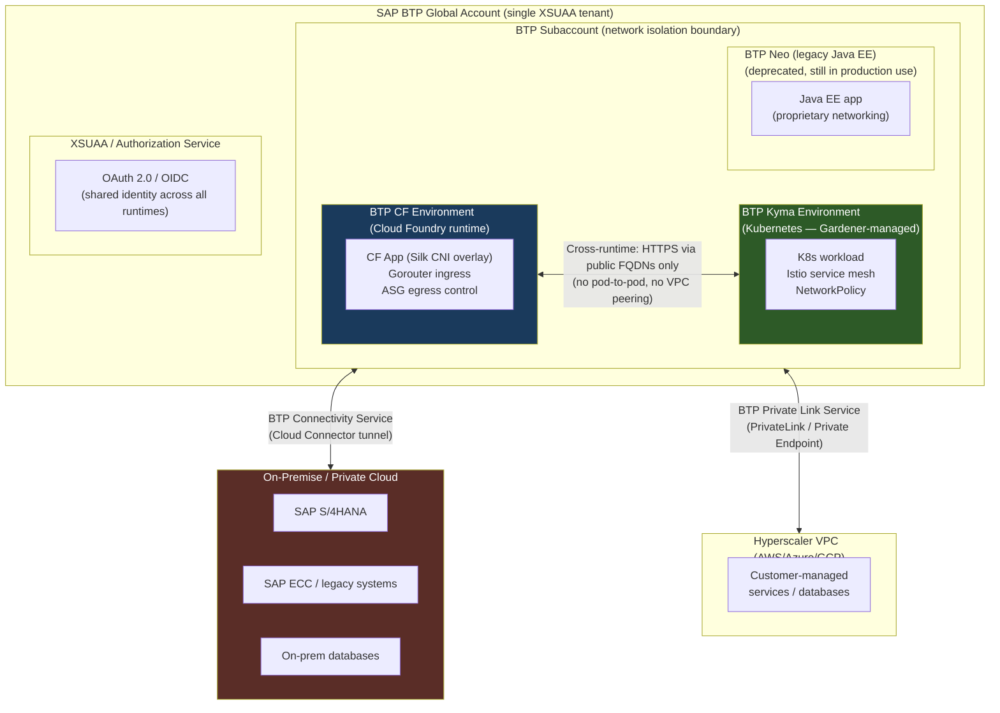
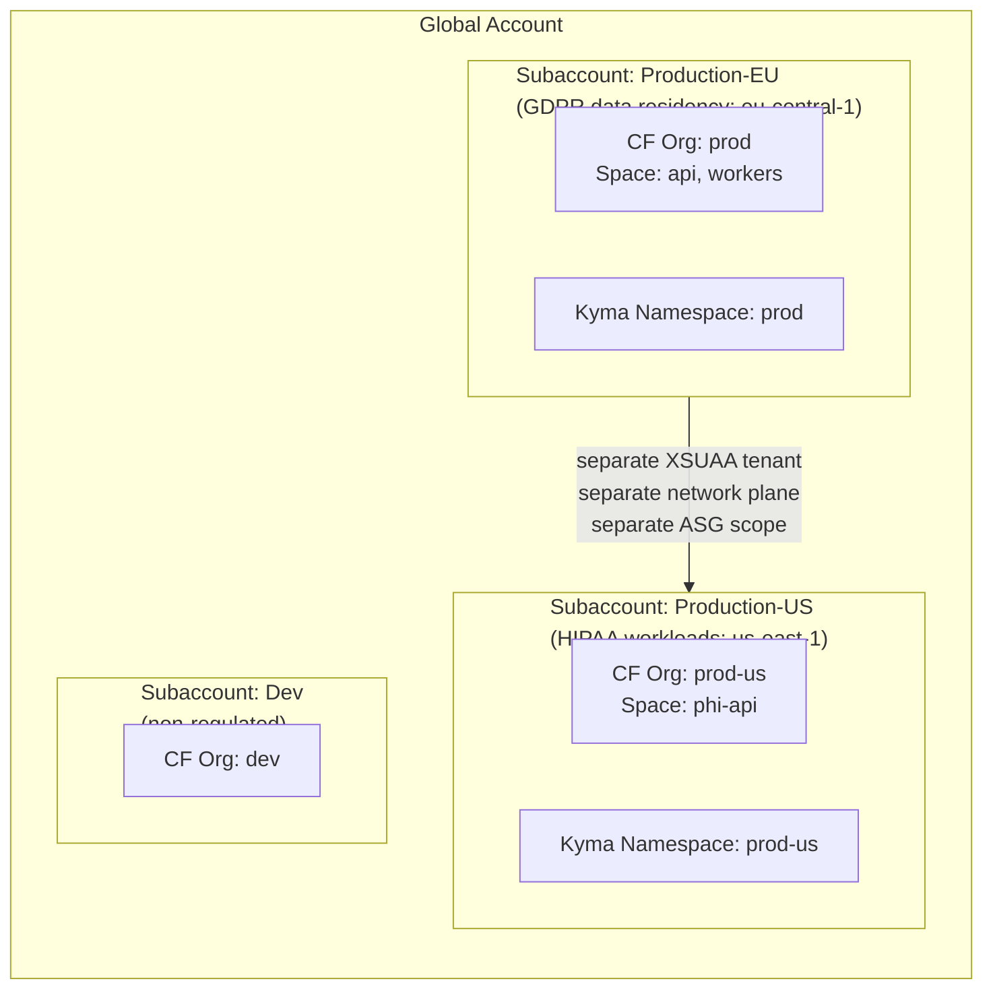
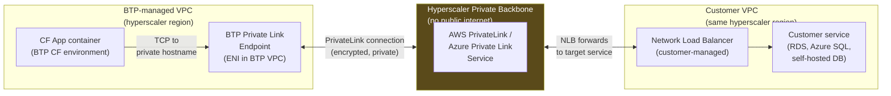
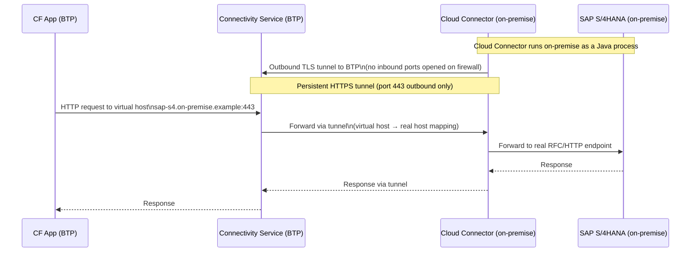
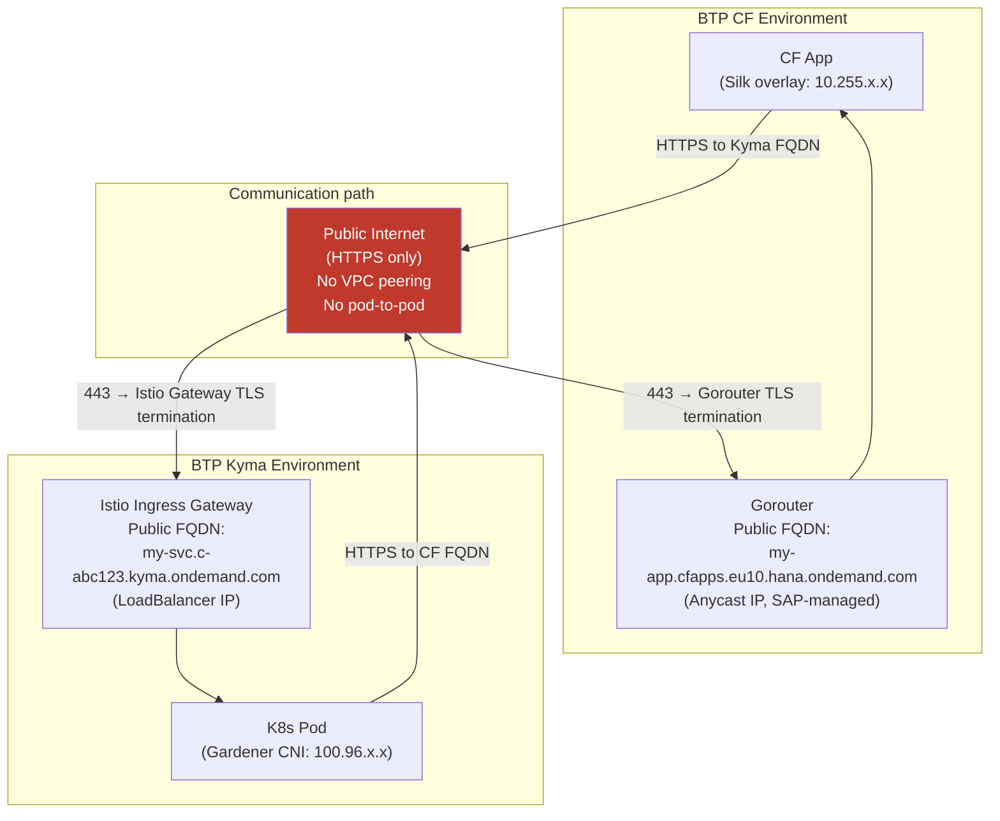

# CF-22: SAP BTP Networking Deep Dive

**Track:** CF-H — Security & Compliance
**Prerequisites:** [CF-01 — Platform Architecture](cf-01-platform-architecture.md), [CF-19 — CF-to-K8s Migration](cf-19-cf-to-k8s-migration-patterns.md)
**Time:** ~2.5 hours

> **Goal:** Understand how SAP Business Technology Platform (BTP) handles network isolation, private connectivity to on-premise systems, and the boundary between the BTP CF environment and BTP Kyma (Kubernetes). This lesson is specifically for engineers working in SAP BTP — the most widely deployed CF platform in enterprise CH/DE/USA markets.

**Jump to:** [Theory](#theory) · [Practice](#practice) · [Troubleshooting](#troubleshooting) · [Production Checklist](#production-checklist) · [Quick Reference](#quick-reference)

---

## Theory

## 1. BTP Platform Overview for Network Engineers

SAP BTP is a multi-runtime platform-as-a-service. From a networking perspective it has three distinct environments with separate network planes:



**Critical networking insight:** The BTP CF environment and Kyma environment are **completely separate network planes**. There is no VPC peering, no shared overlay, no pod-to-pod routing between them. All cross-runtime communication goes through public HTTPS endpoints (Gorouter FQDN → Kyma Istio Gateway FQDN). This simplifies firewall rules but means every cross-runtime call pays a full TLS handshake and external network round-trip.

---

## 2. BTP Subaccount as Network Isolation Boundary

The BTP **subaccount** is the primary isolation unit — not the org or space (CF) or namespace (Kyma):



Each subaccount:
- Has its own XSUAA service instance (OAuth tokens are scoped per subaccount)
- Has its own CF environment with separate Gorouter, Diego Cells, and Silk CNI overlay
- Has independent connectivity service entitlement (separate Cloud Connector)
- Maps to a specific hyperscaler region for data residency compliance

**For GDPR compliance:** one subaccount per data residency region (eu-central-1 for EU personal data, never co-mingled with US).

---

## 3. BTP Private Link Service

Private Link Service enables CF apps and Kyma workloads to reach hyperscaler-managed services (AWS RDS, Azure SQL, etc.) **without traffic traversing the public internet**. Traffic stays within the hyperscaler backbone.



### Enabling Private Link in BTP CF

```bash
# 1. Create a Private Link service instance in BTP CF
# (requires Private Link entitlement in the subaccount)
cf create-service privatelink standard my-private-link \
  -c '{"resourceId": "/subscriptions/.../resourceGroups/.../providers/Microsoft.Sql/servers/my-sql-server"}'
  # For Azure: resourceId is the ARM resource ID of the target service
  # For AWS: serviceId is the VPC Endpoint Service name (com.amazonaws.vpce.us-east-1.xxx)

# 2. Check provisioning status
cf service my-private-link
# Status: create succeeded
# Shows: hostname: my-private-link.privatelink.prod.eu20.hana.ondemand.com

# 3. Bind to your CF app
cf bind-service my-cf-app my-private-link

# 4. The VCAP_SERVICES env var now contains the private hostname
cf env my-cf-app | grep -A10 "privatelink"
# "credentials": {
#   "hostname": "fd12:3456::1",    ← IPv6 address in BTP overlay
#   "port": 1433
# }

# 5. Add ASG to allow egress to the private link endpoint
# Private Link endpoints use IPv6 addresses in BTP's internal range
cat > asg-private-link.json << 'EOF'
[
  {
    "protocol": "tcp",
    "destination": "fd12:3456::/32",
    "ports": "1433",
    "description": "BTP Private Link: Azure SQL via PrivateLink (no public internet)",
    "log": true
  }
]
EOF
cf create-security-group private-link-db asg-private-link.json
cf bind-security-group private-link-db my-org my-space --lifecycle running
```

**Compliance note:** Private Link satisfies PCI-DSS Req 4.2.1 (encryption in transit) and HIPAA §164.312(e)(1) for traffic to customer-managed databases, because traffic never traverses the public internet and uses hyperscaler-level encryption.

---

## 4. BTP Connectivity Service and Cloud Connector

For on-premise systems (SAP S/4HANA, legacy databases, OT systems), BTP uses the **Connectivity Service** paired with the **Cloud Connector** — a reverse proxy that creates an outbound-only TLS tunnel from on-premise to BTP.



**Key networking properties:**
- **Outbound-only tunnel** — the on-premise firewall needs only port 443 outbound to BTP. No inbound rules.
- **Virtual host mapping** — CF apps reference virtual hostnames (`sap-s4.on-premise`), never the real on-premise IPs. This prevents IP leakage into app config.
- **TLS mutual authentication** — the Cloud Connector authenticates to BTP using a certificate issued from the BTP subaccount.

### Configuring Connectivity Service in CF

```bash
# 1. Create Connectivity Service instance
cf create-service connectivity lite my-connectivity

# 2. Bind to app
cf bind-service my-cf-app my-connectivity

# 3. VCAP_SERVICES provides the proxy endpoint
cf env my-cf-app | grep -A5 "connectivity"
# "onpremise_proxy_host": "connectivityproxy.internal.cf.eu10.hana.ondemand.com"
# "onpremise_proxy_port": "20003"
# "onpremise_proxy_ldap_port": "20001"

# 4. Add ASG to allow egress to the connectivity proxy
cat > asg-connectivity.json << 'EOF'
[
  {
    "protocol": "tcp",
    "destination": "10.0.3.0/24",
    "ports": "20003,20004",
    "description": "BTP Connectivity Service proxy for on-premise access",
    "log": true
  }
]
EOF
cf create-security-group btp-connectivity asg-connectivity.json
cf bind-security-group btp-connectivity my-org my-space --lifecycle running
```

```python
# In your CF app: use the connectivity proxy to reach on-premise S/4HANA via RFC
import os, json

vcap = json.loads(os.environ['VCAP_SERVICES'])
conn = vcap['connectivity'][0]['credentials']

proxy_host = conn['onpremise_proxy_host']
proxy_port = conn['onpremise_proxy_port']

# Set JVM proxy (for Java-based SAP apps)
# -Dhttp.proxyHost=$proxy_host -Dhttp.proxyPort=$proxy_port
# Or for Python requests:
proxies = {
    'http': f'http://{proxy_host}:{proxy_port}',
    'https': f'http://{proxy_host}:{proxy_port}'
}
# The virtual hostname is configured in Cloud Connector's mapping
response = requests.get('http://sap-s4.on-premise/sap/bc/rest/api', proxies=proxies)
```

---

## 5. BTP CF vs Kyma Network Boundary

Understanding the network boundary between CF and Kyma is critical for architects designing cross-runtime solutions.



### Cross-runtime call from CF app to Kyma service

```bash
# In CF app: call a Kyma-hosted service
# No special networking needed — just HTTPS to the Kyma gateway FQDN
# The Kyma FQDN is available in BTP service binding credentials

# Example: CF app calling a Kyma API
curl -H "Authorization: Bearer $TOKEN" \
  https://my-svc.c-abc123.kyma.ondemand.com/api/v1/resource

# ASG needed: allow egress to *.kyma.ondemand.com on port 443
cat > asg-kyma-egress.json << 'EOF'
[
  {
    "protocol": "tcp",
    "destination": "0.0.0.0/0",
    "ports": "443",
    "description": "HTTPS egress for Kyma API calls (and other HTTPS traffic)",
    "log": false
  }
]
EOF
# Note: This is broader than ideal — Kyma gateway IPs can be pinned if static
```

### Cross-runtime call from Kyma pod to CF app

```yaml
# In Kyma: standard Kubernetes egress — no special configuration needed
# CF Gorouter is a public HTTPS endpoint reachable from Kyma pods
# NetworkPolicy in Kyma: allow egress to 0.0.0.0/0 on port 443 (usually default)

# If Kyma NetworkPolicy is restrictive:
apiVersion: networking.k8s.io/v1
kind: NetworkPolicy
metadata:
  name: allow-cf-egress
  namespace: my-namespace
spec:
  podSelector:
    matchLabels:
      app: my-service
  egress:
  - ports:
    - port: 443
      protocol: TCP
    # CF Gorouter IPs can be pinned here if BTP provides static ranges
```

### XSUAA token sharing between CF and Kyma

Both runtimes share the same XSUAA tenant, so OAuth tokens issued for CF apps are valid for Kyma services:

```bash
# CF app: get token from XSUAA
TOKEN=$(cf oauth-token)

# Use same token to call Kyma service
curl -H "Authorization: $TOKEN" \
  https://my-kyma-svc.c-abc123.kyma.ondemand.com/api

# Kyma service: validate token against XSUAA JWKS endpoint
# JWKS: https://<subaccount>.authentication.eu10.hana.ondemand.com/token_keys
```

---

## Practice

### Lab 1 — Inspect BTP subaccount network topology

```bash
# Log in to BTP CF
cf login -a https://api.cf.eu10.hana.ondemand.com

# List all orgs and spaces (understand the isolation model)
cf orgs
cf spaces   # after targeting an org

# Check current global ASGs (default BTP posture)
cf running-security-groups
# BTP default: usually includes restricted set, but verify — some global accounts
# still have public_networks bound

# List all security groups and check for wildcards
cf curl /v3/security_groups?per_page=100 | \
  python3 -c "
import json,sys
data=json.load(sys.stdin)
for sg in data['resources']:
    for rule in sg.get('rules',[]):
        if rule.get('destination','') == '0.0.0.0/0':
            print('WILDCARD ASG:', sg['name'], '→', rule.get('ports','*'))
"
```

---

### Lab 2 — Configure Private Link (Azure SQL example)

```bash
# Prerequisites: Private Link entitlement in BTP subaccount
# and an Azure SQL server with PrivateLink service configured

# Create Private Link service instance
cf create-service privatelink standard sql-private-link \
  -c '{"resourceId": "/subscriptions/SUBSCRIPTION_ID/resourceGroups/RG/providers/Microsoft.Sql/servers/my-sql"}'

# Wait for provisioning (may take 2-5 minutes)
watch -n10 "cf service sql-private-link | grep -E 'status|message'"

# Bind to app and check credentials
cf bind-service my-app sql-private-link
cf restage my-app
cf env my-app | grep -A10 "privatelink"

# Add ASG for the private link IPv6 range
# (get actual range from cf env output)
cf ssh my-app -c "env | grep VCAP_SERVICES" | \
  python3 -c "import json,sys,os; v=json.loads(os.environ.get('VCAP_SERVICES','{}')); [print(s) for s in v.get('privatelink',[{}])[0].get('credentials',{}).items()]"
```

---

### Lab 3 — Cloud Connector and on-premise connectivity

```bash
# Verify Connectivity Service is entitled and available
cf marketplace | grep connectivity

# Create instance
cf create-service connectivity lite onprem-conn
cf bind-service my-app onprem-conn
cf restage my-app

# Test connectivity to on-premise virtual host
# (must be configured in Cloud Connector mapping first)
cf ssh my-app -c "curl -x \$VCAP_SERVICES_CONNECTIVITY_PROXY http://sap-erp.onpremise/ping"

# Check Cloud Connector status from BTP cockpit:
# BTP Cockpit → Subaccount → Connectivity → Cloud Connectors
# Or via API:
cf curl /v2/service_instances?q=service_plan_guid:CONNECTIVITY_PLAN_GUID
```

---

## Troubleshooting

| Symptom | Likely cause | Resolution |
|---------|-------------|------------|
| `cf service my-private-link` shows `create in progress` for more than 10 minutes | PrivateLink approval pending on the customer VPC side (AWS requires explicit endpoint service approval; Azure requires resource owner acceptance) | On AWS: approve the endpoint connection in the VPC Endpoint Service console. On Azure: approve the private endpoint connection in the target resource's networking blade. Then re-check `cf service my-private-link`. |
| CF app gets `Connection refused` to on-premise virtual host despite Cloud Connector being up | ASG missing for the Connectivity Service proxy port, or virtual host mapping not configured in Cloud Connector admin UI | Verify `cf running-security-groups` includes an ASG with `destination` matching the connectivity proxy CIDR and `ports: 20003`. Then check Cloud Connector admin UI (port 8443 by default) under `Cloud To On-Premise → Access Control` to confirm the virtual host mapping exists and shows green status. In regulated environments such as manufacturing OT networks, Cloud Connector is often behind an additional plant firewall — confirm outbound port 443 is open from the Cloud Connector host to `*.connectivity.cloud.sap`. |
| CF app receives HTTP 401 when calling a Kyma service with a token obtained via `cf oauth-token` | Token audience mismatch — the CF CLI issues tokens scoped to the CF API, not to the Kyma service's OAuth client | Generate a service-to-service token using the app's own XSUAA client credentials (`client_id` and `client_secret` from VCAP_SERVICES), requesting the scope registered on the Kyma service. User-delegation tokens from `cf oauth-token` are not suitable for machine-to-machine Kyma calls. |
| BTP Private Link credentials show an IPv6 address but the CF app cannot connect | ASG blocks IPv6; the default BTP CF security group posture may only permit IPv4 destinations | Create an ASG with the IPv6 CIDR block from `cf env` credentials (e.g., `fd12:3456::/32`) and bind it to the running lifecycle of the target space. Confirm with `cf ssh my-app -c "curl -6 -v fd12:3456::1:1433"`. In PCI-DSS environments (banking, fintech) ensure the IPv6 range is also documented in the network diagram submitted to the QSA. |
| Cloud Connector shows `Connected` in the BTP Cockpit but `cf ssh my-app -c "curl ..."` to virtual host times out | The CF app is in a different BTP subaccount than the Cloud Connector location mapping | Cloud Connector location mappings are subaccount-scoped. Verify in the BTP Cockpit that the Cloud Connector is registered under the same subaccount as the CF space. If the org spans multiple subaccounts, each requires its own Cloud Connector instance or sub-location. |

---

## Production Checklist

- [ ] One BTP subaccount per data residency region (EU personal data never in US subaccount)
- [ ] Default `public_networks` ASG reviewed — replace with explicit allow-list ASGs for regulated spaces
- [ ] Private Link used for all hyperscaler database connections (no public internet for data-tier)
- [ ] Cloud Connector configured with certificate-based auth (not username/password)
- [ ] Cloud Connector subaccount mapping uses virtual host names, never real on-premise IPs in app config
- [ ] Cross-runtime (CF ↔ Kyma) calls use service-to-service OAuth (not user tokens)
- [ ] XSUAA token expiry configured appropriately (default 12h may be too long for PCI)
- [ ] GDPR: EU-only subaccounts annotated, US subaccounts have separate XSUAA tenant
- [ ] Private Link ASG restricted to IPv6 range issued by BTP (not 0.0.0.0/0)
- [ ] Cloud Connector audit log enabled and forwarded to SIEM
- [ ] BTP Audit Log Service enabled on subaccount (captures all CF API and XSUAA events)

---

## Quick Reference

```bash
# BTP CF login
cf login -a https://api.cf.<region>.hana.ondemand.com

# List BTP CF environments
# BTP Cockpit → Subaccount → Cloud Foundry → Environments

# Create Private Link instance (Azure)
cf create-service privatelink standard <name> \
  -c '{"resourceId": "<ARM_RESOURCE_ID>"}'

# Create Private Link instance (AWS)
cf create-service privatelink standard <name> \
  -c '{"serviceId": "com.amazonaws.vpce.<region>.<service>"}'

# Create Connectivity Service instance
cf create-service connectivity lite <name>

# Check BTP Audit Log
cf create-service auditlog-management default my-audit
cf bind-service my-app my-audit
# Then query: GET /auditlog/v2/auditlogrecords

# Get Kyma kubeconfig (from BTP Cockpit or btp CLI)
btp get accounts/environment-instance <INSTANCE_ID> --global-account <GA_GUID>

# BTP CLI: list subaccounts
btp list accounts/subaccount

# BTP CLI: list entitlements
btp list accounts/entitlement --subaccount <SA_GUID>
```

---

## Check Your Understanding

1. A CF app in BTP needs to read data from an Azure SQL database without traffic leaving the hyperscaler backbone. Which BTP service do you use, and what ASG change is required after binding it?

2. Your on-premise SAP S/4HANA system sits behind a corporate firewall that blocks all inbound connections. Explain how the BTP Cloud Connector establishes connectivity to BTP CF, and which outbound port and destination the firewall team must allow.

3. A CF app calls a Kyma-hosted REST API within the same BTP subaccount. Does traffic between them stay within a private network? Justify your answer, and describe what ASG and NetworkPolicy rules are needed on each side.

4. A security audit flags that a BTP subaccount's CF space has the `public_networks` ASG bound to the running lifecycle. Why is this a concern for a PCI-DSS-scoped space, and what is the recommended remediation?

5. An engineer obtains a token with `cf oauth-token` and uses it to call a Kyma service. The call returns HTTP 401. Without changing the Kyma service's authorization policy, what is the correct way to generate a token that the Kyma service will accept?

---

## See Also

- [CF-19 — CF-to-K8s Migration Patterns](cf-19-cf-to-k8s-migration-patterns.md) — BTP CF → Kyma migration networking patterns in depth
- [CF-21 — Compliance Networking](cf-21-compliance-networking.md) — HIPAA/PCI-DSS/GDPR controls for BTP CF
- [Compliance Paths by Sector and Region](../compliance-paths.md) — sector-specific compliance paths for medtech, banking, manufacturing, and big tech across CH/DE/USA
- [K8s Lesson 22 — Multi-Cluster Networking](../lessons/22-multi-cluster-networking.md) — Kyma/Gardener multi-cluster patterns
- [K8s Lesson 37 — Compliance Networking](../lessons/37-compliance-networking.md) — HIPAA/PCI-DSS/IEC 62443/GDPR controls for Kubernetes
- [SAP BTP Connectivity Service Documentation](https://help.sap.com/docs/connectivity/sap-btp-connectivity-cf/connectivity-service) — official SAP documentation
- [SAP BTP Private Link Service Documentation](https://help.sap.com/docs/private-link/private-link1/what-is-sap-private-link-service) — official SAP documentation
