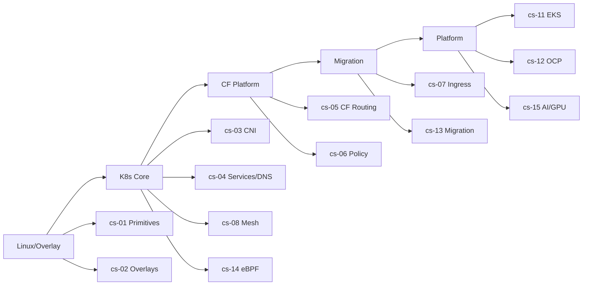

# Cheat Sheets Index

## Navigation

---

## Linux & Overlay

| # | File | One-line description |
|---|------|----------------------|
| 01 | [cs-01-linux-primitives.md](cs-01-linux-primitives.md) | Namespaces, veth pairs, bridges, iptables chains, `ip` commands |
| 02 | [cs-02-overlay-networks.md](cs-02-overlay-networks.md) | VXLAN / Geneve / Silk mechanics, encap headers, MTU impact |

## Kubernetes Core

| # | File | One-line description |
|---|------|----------------------|
| 03 | [cs-03-cni-overview.md](cs-03-cni-overview.md) | Flannel / Calico / Cilium / Silk feature matrix and plugin chain |
| 04 | [cs-04-k8s-services-dns.md](cs-04-k8s-services-dns.md) | ClusterIP / NodePort / LB, kube-proxy modes, CoreDNS config |
| 08 | [cs-08-service-mesh.md](cs-08-service-mesh.md) | Istio + Cilium Ambient: sidecar vs ambient, mTLS, traffic mgmt |
| 14 | [cs-14-ebpf-quick-ref.md](cs-14-ebpf-quick-ref.md) | eBPF program types, bpftool, bpftrace one-liners, XDP actions |

## Cloud Foundry Platform

| # | File | One-line description |
|---|------|----------------------|
| 05 | [cs-05-cf-routing.md](cs-05-cf-routing.md) | Gorouter, TCP Router, internal routes, route services |
| 06 | [cs-06-network-policy-compare.md](cs-06-network-policy-compare.md) | K8s NetworkPolicy vs CF network policies side-by-side |

## Migration & Cross-Platform

| # | File | One-line description |
|---|------|----------------------|
| 07 | [cs-07-ingress-compare.md](cs-07-ingress-compare.md) | NGINX Ingress vs Gateway API vs CF Gorouter feature comparison |
| 09 | [cs-09-observability.md](cs-09-observability.md) | Hubble / Prometheus / CF Loggregator metrics, queries, dashboards |
| 10 | [cs-10-security-hardening.md](cs-10-security-hardening.md) | K8s + CF hardening checklist: RBAC, PSA, mTLS, egress control |
| 13 | [cs-13-migration-cheatsheet.md](cs-13-migration-cheatsheet.md) | CF→K8s migration: manifest mapping, route translation, checklist |

## Platform Specialisations

| # | File | One-line description |
|---|------|----------------------|
| 11 | [cs-11-aws-eks.md](cs-11-aws-eks.md) | EKS VPC-CNI, ENI limits, ALB controller, security groups for pods |
| 12 | [cs-12-openshift.md](cs-12-openshift.md) | OVN-Kubernetes, OpenShift Routes, HAProxy, egress IP/firewall |
| 15 | [cs-15-ai-gpu-networking.md](cs-15-ai-gpu-networking.md) | RDMA, RoCEv2, InfiniBand, NCCL tuning, GPU node network layout |

---

## Quick Command Reference

| Goal | Command |
|------|---------|
| Inspect pod network namespace | `ip netns exec <ns> ip a` |
| Trace iptables for a service IP | `iptables -t nat -L -n -v \| grep <svc-ip>` |
| Dump VXLAN FDB entries | `bridge fdb show dev vxlan0` |
| Check CNI config on node | `cat /etc/cni/net.d/*.conf` |
| List K8s services + endpoints | `kubectl get svc,ep -A` |
| CF app network policy list | `cf network-policies` |
| Hubble observe flows | `hubble observe --pod <ns>/<pod>` |
| bpftool prog list | `bpftool prog list` |
| EKS ENI allocation | `kubectl describe node \| grep Allocatable -A5` |
| OVN logical flows | `ovn-sbctl lflow-list` |

---

## Thematic Groups

- **Linux/Overlay** — cs-01, cs-02: kernel primitives every CNI builds on
- **K8s Core** — cs-03, cs-04, cs-08, cs-14: CNI plugins, service routing, mesh, eBPF
- **CF** — cs-05, cs-06: routing tier and policy model unique to Cloud Foundry
- **Migration** — cs-07, cs-09, cs-10, cs-13: cross-platform comparison and migration tooling
- **Platform** — cs-11, cs-12, cs-15: EKS, OpenShift, AI/GPU cluster networking

---

→ Full lessons: [01-linux-networking-fundamentals.md](../lessons/01-linux-networking-fundamentals.md) · [05-vxlan-and-overlay-networks.md](../lessons/05-vxlan-and-overlay-networks.md) · [09-cni-specification.md](../lessons/09-cni-specification.md) · [13-kubernetes-services-kube-proxy.md](../lessons/13-kubernetes-services-kube-proxy.md) · [16-network-policies.md](../lessons/16-network-policies.md) · [21-service-mesh-istio.md](../lessons/21-service-mesh-istio.md) · [29-aws-eks-networking.md](../lessons/29-aws-eks-networking.md) · [34-ai-platform-networking.md](../lessons/34-ai-platform-networking.md)
