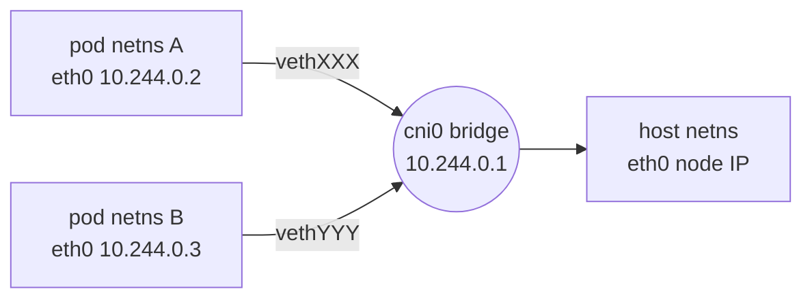

# Linux Networking Primitives

## Network Namespaces

- Isolated network stack: interfaces, routes, iptables rules, sockets
- Each pod gets its own netns; default netns: `/proc/1/ns/net`
- Pod netns path: `/proc/<pid>/ns/net`
- Pods connect to the host via **veth pairs** bridged to the node bridge

## ip netns Commands

| Task | Command |
|------|---------|
| List namespaces | `ip netns list` |
| Create namespace | `ip netns add <name>` |
| Delete namespace | `ip netns del <name>` |
| Run command in ns | `ip netns exec <name> <cmd>` |
| Open shell in ns | `ip netns exec <name> bash` |
| Show interfaces in ns | `ip netns exec <name> ip link` |
| Move interface into ns | `ip link set <iface> netns <name>` |

## veth Pairs

- Virtual Ethernet cable — always created as a pair
- Packet in one end exits the other end
- One end stays in host netns; other end moves into pod netns
- Deleting either end removes both: `ip link del veth0`
- If one end goes down, the other shows `NO-CARRIER`

| Task | Command |
|------|---------|
| Create pair | `ip link add veth0 type veth peer name veth1` |
| Move end to netns | `ip link set veth1 netns <name>` |
| Bring up | `ip link set veth0 up` |
| Assign address | `ip addr add 10.0.0.1/24 dev veth0` |
| Delete pair | `ip link del veth0` |

## Linux Bridge

- Layer-2 software switch — forwards by MAC address
- K8s node bridges: `cbr0` (kubenet), `cni0` (Flannel/Calico)
- veth host-ends attach as bridge ports
- Bridge gets pod-subnet gateway IP (e.g., `10.244.0.1/24`)

| Task | Command |
|------|---------|
| Create bridge | `ip link add br0 type bridge` |
| Bring up | `ip link set br0 up` |
| Attach port | `ip link set veth0 master br0` |
| Detach port | `ip link set veth0 nomaster` |
| Show ports | `bridge link show` |
| Show MAC table | `bridge fdb show` |
| Assign gateway IP | `ip addr add 10.244.0.1/24 dev br0` |

## ip link / ip addr / ip route

| Task | Command |
|------|---------|
| Show all interfaces | `ip link show` |
| Show addresses | `ip addr show` |
| Show routes | `ip route show` |
| Add static route | `ip route add 10.0.0.0/8 via 192.168.1.1` |
| Delete route | `ip route del 10.0.0.0/8` |
| Default gateway | `ip route show default` |
| Enable IP forwarding | `sysctl -w net.ipv4.ip_forward=1` |
| Persist IP forwarding | `echo 'net.ipv4.ip_forward=1' >> /etc/sysctl.d/99-k8s.conf` |

## iptables Basics

- Four built-in tables: `filter`, `nat`, `mangle`, `raw`
- K8s uses `nat` (Service ClusterIP DNAT) and `filter` (pod policy)
- Chain traversal order for incoming: PREROUTING → FORWARD → POSTROUTING

| Chain | Table | Kubernetes use |
|-------|-------|----------------|
| PREROUTING | nat | DNAT ClusterIP → PodIP |
| INPUT | filter | Host-local traffic policy |
| FORWARD | filter | Pod-to-pod routing |
| OUTPUT | nat | Localhost ClusterIP rewrite |
| POSTROUTING | nat | MASQUERADE for node egress |

| Task | Command |
|------|---------|
| List rules verbose | `iptables -t nat -nvL --line-numbers` |
| Append rule | `iptables -A FORWARD -i br0 -j ACCEPT` |
| Insert rule at top | `iptables -I FORWARD 1 -i br0 -j ACCEPT` |
| Delete rule by number | `iptables -D FORWARD 1` |
| Flush chain | `iptables -F FORWARD` |
| Add MASQUERADE | `iptables -t nat -A POSTROUTING -s 10.244.0.0/16 -j MASQUERADE` |
| Trace a packet | `iptables -t raw -A PREROUTING -p tcp --dport 80 -j TRACE` |

## Pod Network Setup Sequence (CNI)

1. Runtime calls CNI plugin with pod netns path
2. CNI creates veth pair (`vethXXXX` host-end, `eth0` pod-end)
3. CNI moves `eth0` into pod netns
4. CNI attaches `vethXXXX` to node bridge (`cni0`)
5. CNI assigns PodIP via IPAM, sets routes inside pod netns
6. Host IP forwarding already enabled by kubelet bootstrap

## Troubleshooting

| Symptom | Check |
|---------|-------|
| Pod has no IP | `ip netns exec <pod-ns> ip addr` |
| Pod can't reach gateway | `ip netns exec <pod-ns> ip route` |
| Cross-pod traffic drops | `iptables -t filter -nvL FORWARD` |
| ClusterIP not reachable | `iptables -t nat -nvL KUBE-SERVICES` |
| veth missing from bridge | `bridge link show` |
| IP forwarding disabled | `sysctl net.ipv4.ip_forward` |

→ Full lessons: [01 Linux Networking Fundamentals](../lessons/01-linux-networking-fundamentals.md) · [02 IP Routing and Forwarding](../lessons/02-ip-routing-and-forwarding.md) · [03 iptables and Netfilter](../lessons/03-iptables-and-netfilter.md) · [04 Network Namespaces Deep Dive](../lessons/04-network-namespaces-deep-dive.md)
