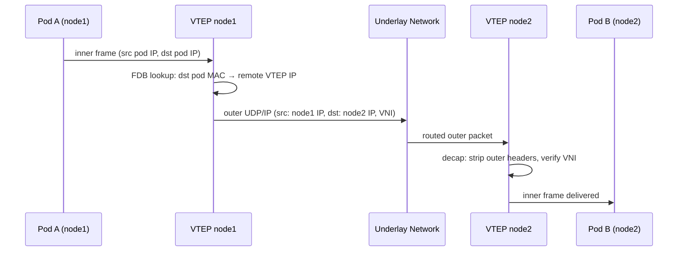

# Cheat Sheet 02 — VXLAN / Geneve / Silk Overlay Mechanics

## Encapsulation Header Formats

| Field | VXLAN | Geneve |
|---|---|---|
| **Outer transport** | UDP | UDP |
| **Default port** | 4789 (IANA); Flannel legacy: 8472 | 6081 |
| **Segment ID** | VNI — 24-bit (16M segments) | VNI — 24-bit |
| **Fixed overhead** | 50 bytes | 30 bytes minimum (variable TLV) |
| **Extensible options** | No | Yes — TLV options field |
| **L2 or L3 carry** | L2 Ethernet frame | L2 or L3 (protocol field) |
| **Used by** | Flannel, Calico VXLAN, Silk | OVN-Kubernetes, Geneve mode Cilium |

## VXLAN Packet Anatomy

| Layer | Header | Size |
|---|---|---|
| Outer Ethernet | src/dst node MAC | 14 bytes |
| Outer IP | src: node IP, dst: remote node IP | 20 bytes |
| Outer UDP | src: ephemeral, dst: 4789 | 8 bytes |
| VXLAN | flags + VNI (24-bit) | 8 bytes |
| **Total overhead** | | **50 bytes** |
| Inner Ethernet | pod src MAC → dst pod MAC | 14 bytes |
| Inner IP | pod src IP → pod dst IP | 20 bytes |
| Inner TCP/UDP payload | application data | variable |

## MTU Math

- **Rule:** pod MTU = underlay NIC MTU − VXLAN overhead
- VXLAN overhead = 50 bytes
- Geneve overhead = 30 bytes (no TLV options)

| Underlay MTU | VXLAN pod MTU | Geneve pod MTU | Jumbo (9000) VXLAN |
|---|---|---|---|
| 1500 | **1450** | **1470** | — |
| 9000 | 8950 | 8970 | **8950** |
| 1480 (some clouds) | 1430 | 1450 | — |

- **Silent fragmentation risk:** if pod MTU is too high, inner packets exceed outer MTU → drops, not errors
- Verify: `ip link show flannel.1` or `ip link show cilium_vxlan` and check MTU

## Silk VXLAN (CF) Key Numbers

| Parameter | Value |
|---|---|
| Overlay CIDR | `10.255.0.0/16` (default) |
| Subnet per Diego Cell | `/24` |
| Max containers per Cell | ~254 |
| Max Cells | 250 |
| VXLAN port | UDP 4789 |
| MTU penalty | 50 bytes (1500 → 1450) |
| Lease TTL | 24 h, renewed on boot |

## Encap / Decap Flow

## FDB (Forwarding Database) — VXLAN Control Plane

- **FDB** maps inner pod MAC → remote VTEP IP
- Populated by: CNI agent (Flannel, Calico node, Silk daemon) via kernel `bridge fdb` or netlink
- **Flannel:** writes FDB entries on `flannel.1`; uses etcd/k8s annotations for peer discovery
- **Calico VXLAN:** uses BGP to exchange VTEP/MAC info; FDB on `vxlan.calico`
- **Silk:** Silk Controller pushes cell VTEP IPs; FDB on `silk-vtep`

## Command Reference

| Task | Command |
|---|---|
| Show VTEP interface | `ip link show flannel.1` |
| Dump FDB entries | `bridge fdb show dev flannel.1` |
| Show VXLAN socket | `ss -unlp` (look for port 4789) |
| Check pod MTU | `ip link show eth0` (inside pod) |
| Capture VXLAN traffic | `tcpdump -i eth0 udp port 4789 -w cap.pcap` |
| Decode inner packet | `tcpdump -r cap.pcap -nn` |
| Silk: show VTEP on Diego Cell | `ip addr show silk-vtep` |
| Silk: show overlay routes | `ip route show table 1` |
| Calico VXLAN FDB | `bridge fdb show dev vxlan.calico` |

## CNI Overlay Comparison

| CNI | Encap | VTEP interface | FDB mechanism | MTU note |
|---|---|---|---|---|
| Flannel (VXLAN) | VXLAN | `flannel.1` | etcd annotations | set via `Network.MTU` |
| Calico (VXLAN) | VXLAN | `vxlan.calico` | BGP/Bird | auto-detect or `mtu` in config |
| Cilium (VXLAN) | VXLAN | `cilium_vxlan` | eBPF map | `tunnel-mtu` flag |
| Cilium (Geneve) | Geneve | `cilium_geneve` | eBPF map | 30-byte overhead |
| OVN-K8s | Geneve | `genev_sys_6081` | OVN southbound DB | 30-byte overhead |
| Silk (CF) | VXLAN | `silk-vtep` | Silk Controller API | always 1450 on 1500 |

## → Full lessons:

- K8s 05: [`lessons/05-vxlan-and-overlay-networks.md`](../lessons/05-vxlan-and-overlay-networks.md)
- CF-05: [`docs/cf/cf-05-silk-cni-vxlan.md`](../cf/cf-05-silk-cni-vxlan.md)
