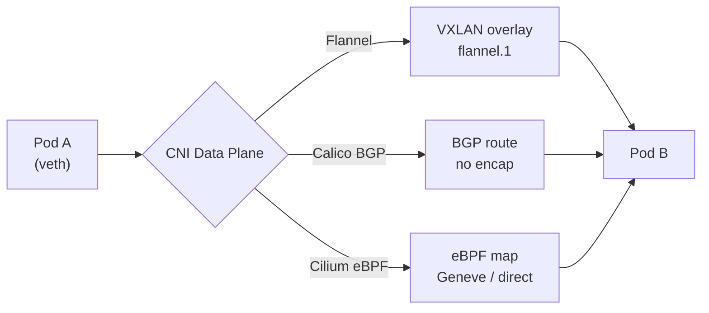

# CNI Plugins at a Glance

## Side-by-Side Feature Comparison

| Feature | Flannel | Calico | Cilium | Silk (CF) |
|---|---|---|---|---|
| **Data plane** | iptables / VXLAN | iptables or eBPF | eBPF native (TC hook) | iptables + VXLAN |
| **Network policy** | None | NetworkPolicy + GlobalNetworkPolicy | NetworkPolicy + CiliumNetworkPolicy | None (CF Security Groups) |
| **IPAM** | /24 per node | Block allocation (/26 default) | CRD-based or host-scope | /24 per Diego cell |
| **Overlay** | VXLAN or host-gw | VXLAN / IPIP / BGP | VXLAN / Geneve / native routing | VXLAN (always on) |
| **Encryption** | None | WireGuard / IPsec | WireGuard / IPsec | None |
| **kube-proxy replacement** | No | Yes (eBPF mode) | Yes (default) | N/A |
| **Observability** | Minimal | Felix stats | Hubble flow logs | None built-in |
| **Performance tier** | Low — O(n) iptables | Medium-High | Highest — eBPF bypass | Low-Medium |
| **Complexity** | Low | Medium | High | Low (CF-managed) |
| **Best fit** | Dev / learning | Production K8s | Large-scale / GPU clusters | CF / BTP only |

---

## Packet Path per Data Plane

| Plugin | Pod-to-pod path | iptables rules | eBPF programs |
|---|---|---|---|
| Flannel | pod → veth → cni0 → flannel.1 → VXLAN encap → remote node | O(n) FORWARD chain | 0 |
| Calico (iptables) | pod → veth → Felix iptables → routing table | O(n) per policy rule | 0 |
| Calico (eBPF) | pod → veth → eBPF hook → routing | Minimal (kube-proxy replaced) | Per-endpoint hooks |
| Cilium | pod → veth → eBPF TC hook → BPF map lookup → VXLAN/direct | None | Per-pod + service LB map |
| Silk | container → veth → silk-daemon → VTEP → VXLAN | Minimal | 0 |

---

## Architecture Flow

---

## IPAM Detail

| Plugin | Allocation unit | Backing store | Dual-stack | On-the-fly resize |
|---|---|---|---|---|
| Flannel | /24 per node (fixed) | etcd / flat file | No | No |
| Calico | IP blocks (/26 default) | Kubernetes CRDs | Yes | Yes (block expansion) |
| Cilium | Per-node pool or CRD | Kubernetes CRDs | Yes | Yes |
| Silk | /24 per Diego cell | Silk controller DB | No (IPv4 only) | No |

---

## Command Reference

| Task | Flannel | Calico | Cilium | Silk |
|---|---|---|---|---|
| Plugin health | `kubectl get ds -n kube-flannel` | `kubectl get ds calico-node -n kube-system` | `cilium status` | `bosh instances` |
| IPAM allocations | `cat /run/flannel/subnet.env` | `calicoctl ipam show` | `cilium ipam list` | `silk-controller list` |
| Network policy list | N/A | `calicoctl get networkpolicy` | `cilium policy get` | CF Security Groups API |
| Pod endpoint detail | N/A | `calicoctl get workloadendpoint` | `cilium endpoint list` | N/A |
| Connectivity test | `kubectl exec -- ping` | `calicoctl node status` | `cilium connectivity test` | `cf curl /networking/v1/...` |
| eBPF inspection | N/A | `bpftool prog list` (eBPF mode) | `cilium bpf list` | N/A |

---

## Quick-Select Decision Points

- **Dev / learning cluster** — Flannel: zero config, works immediately
- **Production K8s + rich policy** — Calico: mature, broad cloud support, BGP peering to ToR
- **High-throughput / observability required** — Cilium: eBPF data plane, Hubble for flow visibility
- **Cloud Foundry / SAP BTP** — Silk: built into CF, not portable to K8s
- **Service mesh without sidecars** — Cilium only (Envoy sidecar-free mode)
- **Air-gapped BGP fabric** — Calico with BGP peering to leaf switches

---

→ Full lessons: [09 — CNI Specification](../lessons/09-cni-specification.md) | [10 — eBPF and XDP](../lessons/10-ebpf-xdp.md) | [11 — Calico Deep Dive](../lessons/11-calico-cni-deep-dive.md) | [12 — Cilium and eBPF](../lessons/12-cilium-cni-ebpf.md) | [CF-05 — Silk CNI and VXLAN](../cf/cf-05-silk-cni-vxlan.md)
