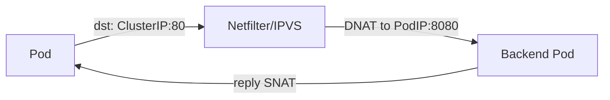

# K8s Services, kube-proxy, CoreDNS

## Service Types

| Type | Cluster Access | External Access | Use Case |
|------|---------------|-----------------|----------|
| `ClusterIP` | Yes (virtual IP) | No | Internal pod-to-pod |
| `NodePort` | Yes | Via `<NodeIP>:<NodePort>` | Dev / baremetal |
| `LoadBalancer` | Yes | Via cloud LB IP | Production cloud |
| `ExternalName` | CNAME only | No | Alias to external DNS |
| `Headless` (`clusterIP: None`) | Per-pod DNS | No | StatefulSets, direct pod routing |

---

## kube-proxy Modes

| Mode | Mechanism | Performance | Notes |
|------|-----------|-------------|-------|
| `iptables` | Netfilter rules per Service | Medium | Default; random load balancing |
| `ipvs` | Linux IPVS hash table | High | Requires `--proxy-mode=ipvs`; more LB algorithms |
| `nftables` | nft rules (alpha, k8s 1.29+) | High | Replaces iptables long-term |
| `kernelspace` | Windows HNS | Windows only | Windows nodes |

- kube-proxy watches the API server for Service/Endpoint changes
- Each rule maps `ClusterIP:Port` → real pod IPs (via NAT)
- IPVS preferred for large clusters (1000+ Services)

---

## Packet Flow: ClusterIP



---

## Service DNS Record Formats (CoreDNS)

| Record Type | Format | Resolves To |
|-------------|--------|-------------|
| A / AAAA | `<svc>.<ns>.svc.cluster.local` | ClusterIP |
| A / AAAA (Headless) | `<svc>.<ns>.svc.cluster.local` | All pod IPs |
| SRV | `_<port>._<proto>.<svc>.<ns>.svc.cluster.local` | Port + target hostname |
| Pod A | `<pod-ip-dashes>.<ns>.pod.cluster.local` | Pod IP |
| ExternalName CNAME | `<svc>.<ns>.svc.cluster.local` | External hostname |

---

## CoreDNS Config (Corefile Snippet)

```
.:53 {
    errors
    health
    kubernetes cluster.local in-addr.arpa ip6.arpa {
        pods insecure
        fallthrough in-addr.arpa ip6.arpa
    }
    forward . /etc/resolv.conf
    cache 30
    loop
    reload
    loadbalance
}
```

- `pods insecure` — enables `pod-ip.ns.pod.cluster.local` records
- `forward` — upstream resolver for non-cluster names
- `cache 30` — 30-second TTL for positive/negative answers

---

## DNS Search Path (Pod /etc/resolv.conf)

- `search <namespace>.svc.cluster.local svc.cluster.local cluster.local`
- Short names resolve in order: `<svc>` → `<svc>.<ns>` → `<svc>.svc.cluster.local`
- `ndots:5` — names with fewer than 5 dots try search path first

---

## Command Reference

| Command | Purpose |
|---------|---------|
| `kubectl get svc -A` | List all Services |
| `kubectl describe svc <name>` | Show Endpoints, selector, ports |
| `kubectl get endpoints <name>` | Show pod IPs behind Service |
| `kubectl exec -it <pod> -- nslookup <svc>` | DNS lookup from inside pod |
| `kubectl exec -it <pod> -- curl http://<svc>:<port>` | Connectivity test |
| `kubectl -n kube-system get cm coredns -o yaml` | View Corefile |
| `kubectl -n kube-system rollout restart deploy/coredns` | Reload CoreDNS config |
| `iptables -t nat -L KUBE-SERVICES -n` | List kube-proxy NAT rules |
| `ipvsadm -Ln` | List IPVS virtual servers |

---

## NodePort Range & Defaults

- Default range: `30000–32767` (set via `--service-node-port-range`)
- Every node listens on the NodePort, regardless of pod placement
- kube-proxy redirects NodePort traffic to any healthy pod

---

## Common Gotchas

- No Endpoints? Check: selector matches pod labels, pod is `Running`, readinessProbe passes
- DNS timeout? Check: `ndots:5` causing extra lookups; use FQDN to skip search path
- IPVS mode requires `ip_vs` kernel modules loaded before kube-proxy starts
- `ExternalName` does not proxy traffic — it only returns a CNAME; TLS SNI must match

---

→ Full lessons: [K8s Services & kube-proxy](../lessons/13-kubernetes-services-kube-proxy.md) · [CoreDNS & Service Discovery](../lessons/14-coredns-service-discovery.md)
