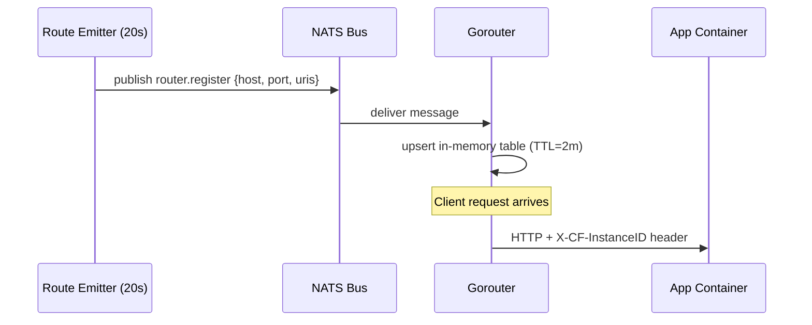

# CF Routing: Gorouter / TCP Router / Internal Routes

**CS-05** | Track CF-C — Ingress and Routing | Lessons: CF-09, CF-10, CF-11, CF-12

---

## Gorouter — Key Facts

- In-memory routing table: `hostname → [{ cell_ip:port, instance_id }, ...]`
- Populated via **NATS** `router.register` messages — no persistent store, no etcd
- **Route Emitter** (per Diego Cell) publishes every **20 s**; Gorouter TTL = **2 min**
- Routes expire silently if Route Emitter stops — traffic drops after 2 min
- Load balancing: round-robin across healthy instances
- Sticky sessions: `JSESSIONID` cookie (opt-in)
- WebSocket: `Upgrade: websocket` header triggers connection hijack
- TLS modes: edge termination (default), passthrough, full re-encrypt to container

---

## NATS Registration Sequence

---

## Gorouter vs TCP Router

| Attribute | Gorouter | TCP Router |
|---|---|---|
| Layer | L7 (HTTP/HTTPS/WS) | L4 (raw TCP) |
| Route registration | NATS heartbeat | Routing API DB (Postgres) |
| TTL / expiry | 2 min if emitter stops | Persisted in DB |
| Load balancing unit | Per HTTP request | Per TCP connection |
| Sticky sessions | Yes (`JSESSIONID`) | No |
| TLS termination | Yes (edge / passthrough) | Passthrough by default |
| Port model | Wildcard domain + path | One reserved port per route |
| Use cases | Web apps, REST, WebSocket | Databases, gRPC, MQTT, Redis |
| K8s equivalent | Ingress Controller | Service `type=LoadBalancer` (TCP) |

---

## TCP Router — Key Facts

- Port range set by operator: `reservable_ports` (e.g., `1024-1123`)
- One TCP route = one port on the TCP Router's public hostname
- Multiple instances behind one port = round-robin per connection
- No NATS — Routing API REST + Postgres persists TCP route mappings
- Diego Cell uses **iptables DNAT** to reach container IP (`10.255.x.y:8080`)
- No circuit breaker — if all backends unhealthy, connections are dropped
- `cf map-route` requires `--port <N>`; domain must have router group type `tcp`

---

## Route Types and DNS

| Route Type | Format | Resolved By | Traffic Path |
|---|---|---|---|
| HTTP shared domain | `app.cfapps.example.com` | Public DNS → LB | Client → LB → Gorouter → Cell |
| HTTP private domain | `app.my-org.com` | Custom DNS → LB | Same as above |
| TCP route | `tcp.example.com:1025` | Public DNS → TCP Router | Client → LB → TCP Router → Cell |
| Internal (C2C) | `app.apps.internal` | BOSH DNS (health-aware) | Direct VXLAN overlay, no SNAT |

---

## apps.internal — C2C Service Discovery

- Domain `apps.internal` served by **BOSH DNS**, not public DNS
- Resolves to container overlay IP (`10.255.x.y`) — Gorouter not involved
- Requires **both**: a Network Policy AND a mapped `apps.internal` route
- Health-aware: BOSH DNS removes unhealthy instances from responses
- No kube-proxy, no ClusterIP, no Endpoints — DNS + iptables only

---

## CF CLI — Route Command Reference

| Command | Purpose |
|---|---|
| `cf create-domain <org> <domain>` | Create a private domain |
| `cf create-shared-domain <domain>` | Create a shared domain (admin) |
| `cf create-route <space> <domain> --hostname <h>` | Create HTTP route |
| `cf create-route <space> <tcp-domain> --port <N>` | Create TCP route |
| `cf map-route <app> <domain> --hostname <h>` | Map HTTP route to app |
| `cf map-route <app> <tcp-domain> --port <N>` | Map TCP route to app |
| `cf unmap-route <app> <domain> --hostname <h>` | Unmap route (begin drain) |
| `cf delete-route <domain> --hostname <h>` | Delete route |
| `cf routes` | List all routes in targeted space |
| `cf router-groups` | List TCP router groups and port ranges |

---

## Gorouter Debug (BOSH SSH)

| Command | Purpose |
|---|---|
| `curl -s http://localhost:8082/routes \| python3 -m json.tool` | Dump live route table |
| `curl -s http://localhost:8082/varz` | Gorouter metrics snapshot |
| `cat /var/vcap/sys/log/gorouter/gorouter.stdout.log` | Gorouter application logs |
| `nats-sub 'router.*'` | Watch NATS route registration events |

---

## Common Failure Modes

| Symptom | Likely Cause | Fix |
|---|---|---|
| `404 Not Found` | Route unmapped or table stale | Wait 2 min or `cf push` again |
| `502 Bad Gateway` | App crashed, route still registered | Check `cf app <name>`, restart |
| Route conflict | Another org owns same hostname | Use private domain or new hostname |
| TCP connect refused | Port not reserved or all backends down | Check `cf router-groups`, verify range |
| `app.apps.internal` not resolving | No C2C policy or route not mapped | Add policy + `cf map-route apps.internal` |

---

## CF vs K8s Concept Map

| CF Concept | K8s Equivalent |
|---|---|
| Gorouter | Ingress Controller (nginx/Envoy/Contour) |
| NATS route registration | Ingress resource + controller reconcile |
| Route Emitter | Endpoints controller |
| `cf map-route` | `kubectl apply -f ingress.yaml` |
| TCP Router | Service `type=LoadBalancer` (protocol: TCP) |
| `reservable_ports` | `--service-node-port-range` |
| `apps.internal` DNS | CoreDNS + ClusterIP Service |
| BOSH DNS | CoreDNS / kube-dns |

→ Full lessons: [CF-09 Gorouter](../cf/cf-09-gorouter.md) | [CF-10 TCP Router](../cf/cf-10-tcp-router.md) | [CF-11 Routes & Domains](../cf/cf-11-routes-domains.md) | [CF-12 Service Discovery](../cf/cf-12-service-discovery.md)
