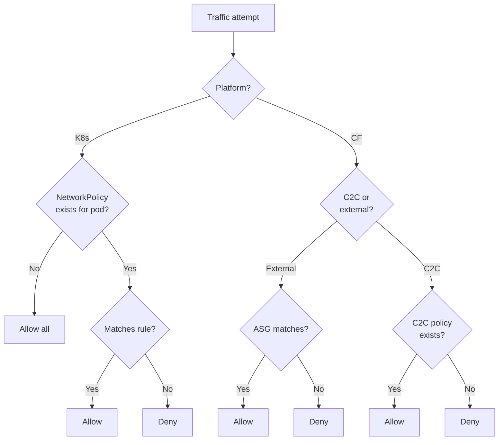

# Network Policy: K8s vs CF Side-by-Side

## Policy Model Comparison

| Dimension | K8s NetworkPolicy | CF ASGs | CF C2C Policies |
|-----------|------------------|---------|-----------------|
| Scope | Pod-to-pod, pod-to-external | App-to-external (egress) | App-to-app (internal) |
| Direction | Ingress + Egress | Egress only | Bidirectional (one rule) |
| Selector unit | Pod label | Space / App | Source app + dest app |
| Default (no policy) | Allow all | Deny all outbound | Deny all C2C |
| Default (policy exists) | Deny non-matched | Deny non-matched | Deny non-matched |
| Protocol support | TCP, UDP, SCTP | TCP, UDP, ICMP, all | TCP, UDP |
| Port ranges | Yes | Yes | Yes |
| IP-based rules | Yes (CIDR) | Yes (CIDR) | No — app identity only |
| Enforcement point | CNI plugin (Calico, Cilium) | Garden / iptables | Silk VXLAN + policy agent |
| Who creates | Cluster admin / namespace owner | Platform admin | Space developer |
| Dynamic update | Yes — no restart needed | Yes — no restart needed | Yes — no restart needed |

---

## Default Stance Comparison

| Scenario | K8s | CF |
|----------|-----|----|
| No policy at all | All traffic allowed | ASG: deny egress; C2C: deny internal |
| Policy applied to pod/app | Only matched traffic allowed | Only matched traffic allowed |
| Namespaced isolation | Requires explicit NetworkPolicy | Org/space isolation built-in |
| DNS traffic | Must allow port 53 explicitly | Included in default running ASG |
| Metadata endpoint | Must allow explicitly | Restricted by default ASG |
| Cross-namespace / cross-space | Requires namespaceSelector | Requires explicit C2C policy |

---

## Syntax Snippets

**K8s NetworkPolicy (ingress from labeled pods):**
```yaml
podSelector:
  matchLabels: {app: backend}
ingress:
- from:
  - podSelector:
      matchLabels: {app: frontend}
  ports:
  - protocol: TCP
    port: 8080
```

**CF ASG (egress to CIDR):**
```json
[{"protocol":"tcp","destination":"10.0.0.0/8","ports":"443"}]
```

**CF C2C policy:**
```bash
cf add-network-policy SOURCE_APP --destination-app DEST_APP --protocol tcp --port 8080
```

---

## Command Reference

| Task | K8s | CF |
|------|-----|----|
| List policies | `kubectl get networkpolicy -A` | `cf network-policies` |
| Describe policy | `kubectl describe netpol <name>` | `cf network-policies --source <app>` |
| Apply / add | `kubectl apply -f policy.yaml` | `cf add-network-policy ...` |
| Remove | `kubectl delete netpol <name>` | `cf remove-network-policy ...` |
| List ASGs | n/a | `cf security-groups` |
| Bind ASG to space | n/a | `cf bind-security-group <sg> <org> <space>` |
| Check egress | `kubectl exec -- curl <ip>` | `cf ssh <app> -- curl <ip>` |
| Audit effective rules | `iptables -L` (node) | `iptables -L` (Garden container) |

---

## Traffic Decision Flow



---

## Key Distinctions

- **K8s default is permissive** — traffic flows freely until a NetworkPolicy is applied
- **CF default is restrictive** — egress denied and C2C denied from day one
- **K8s uses label selectors**; CF C2C uses app names/GUIDs; CF ASGs use CIDRs
- **CF ASGs are egress-only**; K8s NetworkPolicy controls ingress and egress independently
- **CF C2C is symmetric** — one policy rule enables bidirectional communication
- **K8s policies are namespace-scoped** — podSelector cannot reach across namespaces without namespaceSelector
- **CF space = isolation boundary** — different-space apps cannot reach each other without C2C policy
- **K8s requires CNI enforcement** — without Calico/Cilium/etc., NetworkPolicy objects are ignored
- **CF enforces at hypervisor layer** (Garden) — apps cannot bypass ASGs from inside the container
- **Both platforms support dynamic updates** — no pod/app restart required when policies change

---

→ Full lessons: [K8s 16 — Network Policies](../lessons/16-network-policies.md) · [CF-07 — Application Security Groups](../cf/cf-07-application-security-groups.md) · [CF-13 — C2C Network Policies](../cf/cf-13-c2c-network-policies.md)
