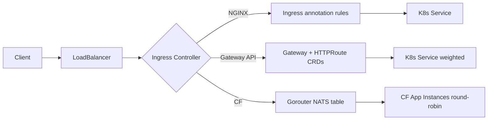

# Ingress Compared: NGINX / Gateway API / Gorouter

## Feature Matrix

| Feature | NGINX Ingress | Gateway API | Gorouter (CF) |
|---|---|---|---|
| API spec | `networking.k8s.io/v1` | `gateway.networking.k8s.io` | CF internal (not K8s CRD) |
| Config model | Annotations on Ingress | Typed CRDs (Gateway, Route) | `cf push` / CF CLI |
| TLS termination | Yes — K8s Secret ref | Yes — SecretObjectReference | Yes — CredHub / cert-manager |
| TLS passthrough | No | Yes — TLSRoute | No |
| Mutual TLS | Annotation | Policy attachment | CF route services |
| Weighted traffic split | Canary annotation | Native `weight` on backendRefs | Not supported |
| Header-based routing | Annotation | Native HTTPRoute `headers` | Via CF route services |
| Path-based routing | Yes | Yes | Yes — URI paths |
| TCP routing | Limited | Yes — TCPRoute | Separate TCP Router component |
| WebSocket | Yes | Yes | Yes |
| Sticky sessions | Annotation (`affinity`) | Implementation-dependent | No |
| Multi-namespace refs | Limited — IngressClass | Yes — ReferenceGrant | N/A — per org/space |
| Rate limiting | Annotation | Policy attachment | No |
| Auth integration | Annotation (oauth2-proxy) | Policy attachment | UAA — platform-level |

## TLS Modes

| Mode | NGINX Ingress | Gateway API | Gorouter |
|---|---|---|---|
| Edge termination | Yes (default) | Yes (default) | Yes (default) |
| Passthrough | No | Yes — TLSRoute | No |
| Re-encrypt | No | Yes — multi-step | No |
| Wildcard cert | Supported | Supported | Supported — CF domains |
| Cert store | K8s Secret (tls type) | K8s Secret (SecretObjectReference) | CredHub / cert-manager |
| Cert rotation | Re-apply Secret | Re-apply Secret | CredHub rotation |

## Weighted Traffic Split

| Implementation | Mechanism | Granularity |
|---|---|---|
| NGINX Ingress | `nginx.ingress.kubernetes.io/canary-weight: "20"` | % to canary Service |
| Gateway API | `weight: 80` / `weight: 20` on `backendRefs` | Native — no annotation |
| Gorouter | Not supported | Use separate apps + DNS |

## Command Reference

| Task | NGINX Ingress | Gateway API | CF / Gorouter |
|---|---|---|---|
| List routes | `kubectl get ingress -A` | `kubectl get httproute -A` | `cf routes` |
| Describe route | `kubectl describe ingress NAME` | `kubectl describe httproute NAME` | `cf app APP` |
| Check gateway | `kubectl get ingressclass` | `kubectl get gateway -A` | `cf domains` |
| Map route | Edit Ingress YAML | Edit HTTPRoute YAML | `cf map-route APP DOMAIN` |
| Unmap route | Edit Ingress YAML | Edit HTTPRoute YAML | `cf unmap-route APP DOMAIN` |
| TLS cert check | `kubectl get secret NAME -o yaml` | `kubectl get secret NAME -o yaml` | `cf env APP` / CredHub |
| View logs | `kubectl logs -n ingress-nginx deploy/controller` | `kubectl logs -n GATEWAY_NS` | `cf logs APP` |

## Traffic Flow

## Key Facts

- **NGINX Ingress** — annotations for everything; mature but config is non-portable
- **Gateway API** — role-split (infra / app); portable across implementations (Cilium, Istio, Contour)
- **Gorouter** — CF-native; routes auto-registered by Diego via NATS; no K8s CRDs
- Weighted splits — first-class only in Gateway API; NGINX uses canary hack; Gorouter lacks it
- Cross-namespace — Gateway API uses `ReferenceGrant`; NGINX requires same namespace or IngressClass trick
- Sticky sessions — NGINX: `nginx.ingress.kubernetes.io/affinity: cookie`; Gateway API: implementation-dependent
- WebSocket — all three support it; no special config needed in Gateway API or Gorouter

→ Full lessons: [K8s Lesson 17](../lessons/17-ingress-controllers.md) · [K8s Lesson 18](../lessons/18-gateway-api.md) · [CF Lesson 09](../cf/cf-09-gorouter.md)
