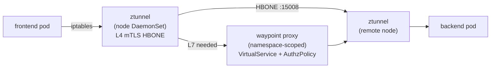

# Service Mesh Essentials: Istio + Cilium Ambient

## Sidecar vs Ambient — Quick Compare

| Dimension | Sidecar (classic Istio) | Ambient (Istio 1.18+) | Cilium Mesh |
|---|---|---|---|
| Data-plane | Envoy per pod | ztunnel (L4) + waypoint (L7) | eBPF + Envoy waypoint |
| Injection | `istio-injection: enabled` label | None — node DaemonSet | None — Cilium agent |
| Overhead | ~50 MB RAM / pod | ~1 MB / pod (ztunnel) | Near-zero (kernel) |
| L7 policy | Per-pod Envoy | Waypoint proxy (opt-in) | Envoy waypoint |
| mTLS | SPIFFE/X.509 auto-rotate | HBONE tunnel (HTTP/2) | WireGuard or mTLS |
| Upgrade blast radius | Per-pod rollout | Node daemon rollout | Node daemon rollout |

---

## mTLS Modes

| Mode | Behaviour | Use when |
|---|---|---|
| `DISABLE` | Plain text, no cert exchange | Dev/debug only |
| `PERMISSIVE` | Accepts mTLS and plain text | Migration phase |
| `STRICT` | mTLS only; plain text rejected | Production default |

- Peer authentication scope: mesh-wide → namespace → workload (most specific wins)
- SPIFFE identity format: `spiffe://cluster.local/ns/<ns>/sa/<serviceaccount>`

---

## Architecture — Ambient Mode

---

## Key CRDs

| CRD | Purpose | Scope |
|---|---|---|
| `PeerAuthentication` | mTLS mode per workload/ns/mesh | Inbound |
| `AuthorizationPolicy` | L4/L7 allow/deny rules (RBAC) | Inbound |
| `VirtualService` | Traffic routing: retries, timeouts, fault inject | Outbound |
| `DestinationRule` | Load balancing, circuit breaker, TLS origination | Outbound |
| `Gateway` | Ingress/egress entry point | Edge |
| `ServiceEntry` | Register external service in mesh registry | Registry |

---

## istioctl Command Reference

| Command | What it does |
|---|---|
| `istioctl install --set profile=ambient` | Install Istio in ambient mode |
| `istioctl analyze` | Lint mesh config; surface misconfigurations |
| `istioctl proxy-status` | Sync state of all Envoy proxies vs istiod |
| `istioctl proxy-config cluster <pod>` | Dump CDS (cluster) config for a pod |
| `istioctl proxy-config listener <pod>` | Dump LDS (listener) config |
| `istioctl proxy-config route <pod>` | Dump RDS (route) config |
| `istioctl experimental waypoint apply` | Deploy waypoint for a namespace (ambient) |
| `istioctl x precheck` | Pre-upgrade validation |

---

## Traffic Management Patterns

- **Canary:** `VirtualService` splits weight 90/10 between two `DestinationRule` subsets
- **Retries:** `retries.attempts: 3`, `retryOn: 5xx,reset,connect-failure`
- **Timeouts:** `.spec.http[].timeout: 5s` on VirtualService
- **Circuit breaker:** `DestinationRule.trafficPolicy.outlierDetection`
- **Fault inject:** `fault.delay.percentage` or `fault.abort.httpStatus` for chaos testing
- **Mirror:** `mirror` + `mirrorPercentage` for shadow traffic (zero-impact canary)

---

## Observability (Golden Signals)

| Signal | Istio source | Cilium source |
|---|---|---|
| Latency | Envoy `istio_request_duration_ms` | Hubble `flow.latency` |
| Traffic | `istio_requests_total` | Hubble HTTP flows |
| Errors | `istio_requests_total{response_code=~"5.."}` | Hubble drop reasons |
| Saturation | `envoy_cluster_upstream_cx_active` | `cilium_drop_count_total` |

- **Kiali:** topology graph, mTLS status, config validation
- **Jaeger/Zipkin:** distributed tracing via `x-b3-traceid` headers (propagate in app)
- **Prometheus scrape:** port `15020` (sidecar) or `15090` (Envoy admin)

---

## Cilium Mesh Specifics

- Enable: `helm upgrade cilium --set meshConfig.enabled=true`
- WireGuard encryption: `--set encryption.enabled=true --set encryption.type=wireguard`
- Mutual auth (mTLS): `--set authentication.mutual.spire.enabled=true`
- Hubble UI: `cilium hubble ui` — real-time L3–L7 flow graph
- `CiliumNetworkPolicy` can combine with `AuthorizationPolicy` (Cilium as CNI + mesh)

---

## Gotchas

- Ambient requires kernel >= 5.15 for eBPF-based ztunnel redirect
- `PERMISSIVE` mode leaks plaintext — set `STRICT` before going production
- Waypoint proxies are namespace-scoped; one per namespace using L7 policy
- `DestinationRule` host must match `ServiceEntry` host exactly (case-sensitive)
- Init container `istio-init` needs `NET_ADMIN` — blocked by some PSA `restricted` policies
- Sidecar injection requires pod restart; ambient does not

---

→ Full lessons: [Lesson 21 — Service Mesh with Istio](../lessons/21-service-mesh-istio.md) | [Lesson 12 — Cilium CNI + eBPF](../lessons/12-cilium-cni-ebpf.md) | [Lesson 16 — Network Policies](../lessons/16-network-policies.md) | [Lesson 13 — Kubernetes Services + kube-proxy](../lessons/13-kubernetes-services-kube-proxy.md)
