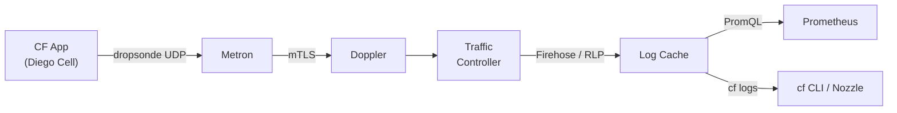

# Cheat Sheet 09 — Observability: Hubble / Prometheus / CF Loggregator

## Stack Comparison

| Layer | Kubernetes Tool | CF / BTP Equivalent |
|---|---|---|
| Flow visibility | Hubble (Cilium) | Loggregator / RLP Gateway |
| Metrics scraping | Prometheus | Log Cache / Metrics Forwarder |
| Visualization | Grafana | Stratos / Log Cache Nozzle |
| Alerting | Alertmanager | Healthwatch |
| Tracing | Jaeger / Tempo | Zipkin (via service mesh) |

---

## Key Prometheus / Cilium Metrics

| Metric | Description |
|---|---|
| `cilium_drop_count_total` | Packets dropped by policy or conntrack |
| `cilium_forward_count_total` | Packets forwarded |
| `cilium_policy_count` | Active network policies |
| `cilium_endpoint_state` | Endpoint health state counts |
| `cilium_bpf_map_ops_total` | eBPF map operation rate |
| `hubble_flows_processed_total` | Flows processed by Hubble Relay |
| `container_network_receive_bytes_total` | Pod inbound bytes |
| `container_network_transmit_bytes_total` | Pod outbound bytes |
| `coredns_dns_requests_total` | DNS query rate |
| `coredns_dns_responses_total{rcode="NXDOMAIN"}` | DNS failures |

---

## Hubble CLI Command Reference

| Command | Purpose |
|---|---|
| `hubble observe` | Stream live flows |
| `hubble observe --namespace <ns>` | Filter by namespace |
| `hubble observe --pod <pod>` | Filter by source/dest pod |
| `hubble observe --verdict DROPPED` | Show only dropped flows |
| `hubble observe --protocol dns` | Filter by protocol |
| `hubble observe --port 443` | Filter by port |
| `hubble observe -o json` | JSON output for scripting |
| `hubble observe --follow` | Tail live flow stream |
| `hubble status` | Relay connectivity and flow rate |

---

## CF Loggregator Architecture

### Loggregator Components
- **Metron** — sidecar agent on each Diego cell; collects app logs + metrics
- **Doppler** — aggregates streams from Metron over mTLS
- **Traffic Controller** — exposes Firehose WebSocket endpoint to consumers
- **Log Cache** — time-series store for recent logs and metrics (PromQL API)
- **RLP Gateway** — Reverse Log Proxy; feeds external nozzles (Prometheus, SIEM)

---

## CF Diagnostic Commands

| Command | Purpose |
|---|---|
| `cf logs <app>` | Tail app stdout/stderr live |
| `cf logs <app> --recent` | Last ~200 log lines |
| `cf app <app>` | Instances, memory, CPU, routes |
| `cf events <app>` | Deployment / crash events |
| `cf network-policies` | List active C2C policies |
| `cf curl /v2/info` | Platform version and endpoints |
| `log-cache tail <app-guid>` | Log Cache CLI plugin tail |
| `log-cache query --metric cpu` | Query metric by name |

---

## Diagnostic Workflows

**Flow drop investigation (K8s):**
- `hubble observe --verdict DROPPED --namespace <ns>` — identify dropped flows
- Check `cilium_drop_count_total{reason="Policy denied"}` in Prometheus
- `kubectl describe ciliumnetworkpolicy` — verify policy selectors

**DNS failure investigation (K8s):**
- `hubble observe --protocol dns --verdict DROPPED`
- Watch `coredns_dns_responses_total{rcode="NXDOMAIN"}` spike
- `kubectl exec <pod> -- nslookup <svc>` — confirm DNS resolution path

**CF app connectivity issue:**
- `cf logs <app> --recent` — look for connection refused / timeout
- `cf app <app>` — confirm instances in running state
- `cf network-policies` — verify C2C policy exists between source and target apps
- `cf curl /networking/v1/external/policies` — list all active C2C policies

---

→ Full lessons: [K8s Lesson 24 — Network Observability & Troubleshooting](../lessons/24-network-observability-troubleshooting.md) · [CF Lesson 16 — Observability & Troubleshooting](../cf/cf-16-observability-troubleshooting.md)
