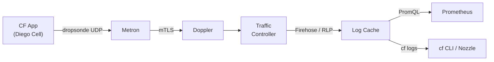

# Cheat Sheet 09 — Observability, SLOs, and RCA

## Stack Comparison (2025/2026)

| Layer | Kubernetes Tool | CF / BTP Equivalent | Notes |
|---|---|---|---|
| Flow visibility | Hubble (Cilium) | Loggregator / RLP Gateway | Cilium 1.15+ exports Hubble flows as OTLP traces |
| eBPF auto-instrumentation | Beyla / OTel eBPF Instrumentation (OBI) | — | Grafana donated Beyla to OTel project 2025 |
| Metrics scraping | Prometheus | Log Cache / Metrics Forwarder | OTel Collector can bridge both |
| Distributed traces | Grafana Tempo / Jaeger | Zipkin (via service mesh) | Cilium spans appear as network hops in Tempo |
| Logs | Grafana Loki | Loggregator + syslog drains | Tetragon events → structured JSON → Loki |
| Visualization | Grafana | Stratos / Log Cache Nozzle | Single Grafana can show K8s + CF signals |
| Alerting | Alertmanager | Healthwatch | Multiwindow multi-burnrate rules (see below) |

---

## Network SLO Reference

| SLO | SLI Metric | Target | Error Budget (30d) |
|---|---|---|---|
| Flow availability | `hubble_flows_processed_total{verdict="FORWARDED"} / total` | ≥ 99.95% | 21.6 min drop budget |
| DNS success rate | `1 - coredns_dns_responses_total{rcode=~"SERVFAIL\|NXDOMAIN"} / total` | ≥ 99.9% | 43.2 min |
| conntrack headroom | `node_nf_conntrack_entries / node_nf_conntrack_entries_limit` | < 80% | threshold alert |
| Policy convergence | `histogram_quantile(0.99, cilium_policy_regeneration_time_stats_seconds_bucket)` | < 5s p99 | threshold alert |
| DNS latency | CoreDNS histogram p99 | < 50ms | threshold alert |

**Error budget = `(1 - SLO_target) × window_seconds`**  
Example: 0.0005 × 2592000s = 1296s = 21.6 min

---

## Alerting — Burn Rate Rules

```yaml
# Fast burn (1h window, 14.4× burn rate → consuming 2% of monthly budget in 1 hour)
- alert: NetworkFlowDropBudgetBurn_Fast
  expr: (1 - slo:hubble_forward_ratio:rate5m) > (14.4 * 0.0005)
  for: 2m
  labels: { severity: page }

# Slow burn (6h window, 6× burn rate → consuming 5% in 6 hours)
- alert: NetworkFlowDropBudgetBurn_Slow
  expr: (1 - slo:hubble_forward_ratio:rate1h) > (6 * 0.0005)
  for: 15m
  labels: { severity: ticket }
```

**Multiwindow logic:** fast burn wakes you up; slow burn catches gradual erosion. Both are needed.

---

---

## Key Prometheus / Cilium Metrics

| Metric | Description |
|---|---|
| `cilium_drop_count_total` | Packets dropped by policy or conntrack |
| `cilium_forward_count_total` | Packets forwarded |
| `cilium_policy_count` | Active network policies |
| `cilium_endpoint_state` | Endpoint health state counts |
| `cilium_bpf_map_ops_total` | eBPF map operation rate |
| `hubble_flows_processed_total` | Flows processed by Hubble Relay |
| `container_network_receive_bytes_total` | Pod inbound bytes |
| `container_network_transmit_bytes_total` | Pod outbound bytes |
| `coredns_dns_requests_total` | DNS query rate |
| `coredns_dns_responses_total{rcode="NXDOMAIN"}` | DNS failures |

---

## Hubble CLI Command Reference

| Command | Purpose |
|---|---|
| `hubble observe` | Stream live flows |
| `hubble observe --namespace <ns>` | Filter by namespace |
| `hubble observe --pod <pod>` | Filter by source/dest pod |
| `hubble observe --verdict DROPPED` | Show only dropped flows |
| `hubble observe --protocol dns` | Filter by protocol |
| `hubble observe --port 443` | Filter by port |
| `hubble observe -o json` | JSON output for scripting |
| `hubble observe --follow` | Tail live flow stream |
| `hubble status` | Relay connectivity and flow rate |

---

## CF Loggregator Architecture



### Loggregator Components
- **Metron** — sidecar agent on each Diego cell; collects app logs + metrics
- **Doppler** — aggregates streams from Metron over mTLS
- **Traffic Controller** — exposes Firehose WebSocket endpoint to consumers
- **Log Cache** — time-series store for recent logs and metrics (PromQL API)
- **RLP Gateway** — Reverse Log Proxy; feeds external nozzles (Prometheus, SIEM)

---

## CF Diagnostic Commands

| Command | Purpose |
|---|---|
| `cf logs <app>` | Tail app stdout/stderr live |
| `cf logs <app> --recent` | Last ~200 log lines |
| `cf app <app>` | Instances, memory, CPU, routes |
| `cf events <app>` | Deployment / crash events |
| `cf network-policies` | List active C2C policies |
| `cf curl /v2/info` | Platform version and endpoints |
| `log-cache tail <app-guid>` | Log Cache CLI plugin tail |
| `log-cache query --metric cpu` | Query metric by name |

---

## Diagnostic Workflows

**Flow drop investigation (K8s):**
- `hubble observe --verdict DROPPED --namespace <ns>` — identify dropped flows
- Check `cilium_drop_count_total{reason="Policy denied"}` in Prometheus
- `kubectl describe ciliumnetworkpolicy` — verify policy selectors

**DNS failure investigation (K8s):**
- `hubble observe --protocol dns --verdict DROPPED`
- Watch `coredns_dns_responses_total{rcode="NXDOMAIN"}` spike
- `kubectl exec <pod> -- nslookup <svc>` — confirm DNS resolution path

**CF app connectivity issue:**
- `cf logs <app> --recent` — look for connection refused / timeout
- `cf app <app>` — confirm instances in running state
- `cf network-policies` — verify C2C policy exists between source and target apps
- `cf curl /networking/v1/external/policies` — list all active C2C policies

---

## Five-Layer RCA Decision Tree

```
Symptom: network fault
│
├─ L5 — Policy layer
│    hubble observe --verdict DROPPED
│    kubectl describe ciliumnetworkpolicy
│    → drops? → fix NetworkPolicy / CiliumNetworkPolicy
│
├─ L4 — K8s control plane
│    kubectl get endpoints <svc>
│    kubectl get endpointslice
│    → empty? → fix pod labels / service selector
│
├─ L3 — CNI / overlay
│    cilium status; bpftool prog list
│    → not OK? → restart cilium DaemonSet
│
├─ L2 — Node networking
│    sysctl net.ipv4.ip_forward
│    conntrack -S | grep max_entries
│    ip link show | grep mtu
│    → 0 or full or mismatch? → fix sysctl / MTU
│
└─ L1 — Infrastructure
     ip link show; ethtool -S eth0
     → cloud console: SG / VPC route / NIC errors
```

---

## Alerting Thresholds — Quick Reference

| Alert | Threshold | Action |
|---|---|---|
| Hubble DROPPED rate | > 0.05% for 2m | Page on-call |
| DNS NXDOMAIN + SERVFAIL rate | > 0.1% for 5m | Page on-call |
| conntrack fill | > 80% for 5m | Warning ticket |
| conntrack fill | > 95% for 1m | Page on-call |
| Policy convergence p99 | > 5s for 3m | Warning ticket |
| Cilium agent down | 0 for 1m | Page on-call |
| WireGuard interfaces | < 1 for 1m | Page on-call (HIPAA/PCI) |
| Tetragon events | 0 for 5m | Warning (IEC 62443) |
| Node network errors | > 0 for 5m | Warning ticket |

---

## OTel Network Observability (2025/2026)

| Component | Role |
|---|---|
| **Cilium Hubble OTLP export** | Hubble flows → OTLP traces (network hops as spans in Tempo) |
| **OTel eBPF Instrumentation (OBI)** | Beyla donated to OTel project 2025; eBPF auto-instrumentation without code changes |
| **OTel Collector** | Receives OTLP from Cilium + app SDKs; fans out to Prometheus/Tempo/Loki |
| **Tetragon → Loki** | Process/network security events as structured JSON logs with trace context |
| **Grafana Tempo** | Trace storage; correlate Cilium network-hop spans with app spans |

**Key OTel semantic conventions for network events:**  
`network.type` (ipv4/ipv6) · `network.transport` (tcp/udp) · `net.peer.ip` · `server.address` · `server.port`

---

## Postmortem Sections Checklist

- [ ] Title / Date / Severity / Duration
- [ ] Impact (services, users, error budget consumed)
- [ ] Timeline with UTC timestamps
- [ ] Five-layer RCA table (which layers were checked)
- [ ] 5-Why root cause chain
- [ ] What went well / what went wrong
- [ ] Action items with owner + due date
- [ ] Compliance evidence (flow logs, audit trail, ticket)

---

→ Full lessons: [K8s Lesson 24 — Network Observability & Troubleshooting](../lessons/24-network-observability-troubleshooting.md) · [K8s Lesson 39 — Network Incident Management, SLOs & RCA](../lessons/39-network-incident-management-slo-rca.md) · [CF Lesson 16 — Observability & Troubleshooting](../cf/cf-16-observability-troubleshooting.md)
