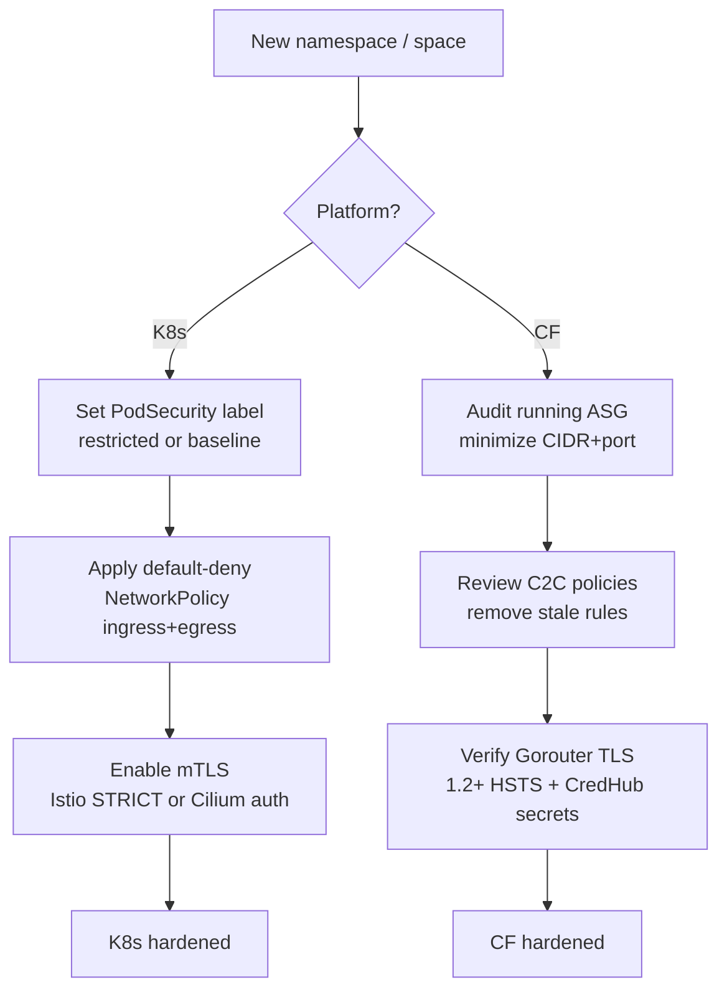

# Security Hardening Checklist: K8s + CF

## K8s PodSecurity Admission — Levels

| Level | Privileged | HostNetwork | RunAsRoot | seccompProfile | Use Case |
|-------|-----------|-------------|-----------|----------------|----------|
| `privileged` | Yes | Yes | Yes | None | Node agents, CNI plugins |
| `baseline` | No | No | Yes | RuntimeDefault optional | General workloads |
| `restricted` | No | No | No (must set `runAsNonRoot`) | RuntimeDefault required | Hardened prod apps |

- Apply at namespace level via label: `pod-security.kubernetes.io/enforce: restricted`
- Audit mode: `pod-security.kubernetes.io/audit: restricted` — logs violations without blocking
- Warn mode: `pod-security.kubernetes.io/warn: restricted` — returns admission warnings to kubectl

---

## K8s NetworkPolicy Hardening Checklist

| Control | YAML Snippet | Purpose |
|---------|-------------|---------|
| Default-deny ingress | `podSelector: {}` + `policyTypes: [Ingress]` (no rules) | Block all inbound per namespace |
| Default-deny egress | `podSelector: {}` + `policyTypes: [Egress]` (no rules) | Block all outbound per namespace |
| Allow DNS only | Egress to `kube-system` port 53 TCP+UDP | Permit name resolution |
| Block cloud metadata | Egress `ipBlock: cidr: 0.0.0.0/0` + `except: 169.254.169.254/32` | Prevent IMDS abuse |
| Namespace isolation | `namespaceSelector: matchLabels: kubernetes.io/metadata.name: <ns>` | Cross-ns traffic control |

---

## K8s mTLS (Istio / Cilium)

- **Istio PeerAuthentication** — set `mtls.mode: STRICT` per namespace or mesh-wide
- **Istio AuthorizationPolicy** — deny-all base + explicit `allow` rules per service
- **Cilium mTLS** — enabled via `CiliumNetworkPolicy` with `authentication.mode: required`
- Verify: `istioctl x authz check <pod>` or `cilium monitor --type drop`

---

## K8s RBAC Checklist

- Prefer `RoleBinding` over `ClusterRoleBinding` — scope to namespace
- Avoid `cluster-admin` for user accounts; use dedicated service accounts
- Audit with: `kubectl auth can-i --list --as=system:serviceaccount:<ns>:<sa>`
- Remove default service account token automount: `automountServiceAccountToken: false`

---

## CF Application Security Group (ASG) Defaults

| ASG Type | Bound To | Default Behavior |
|----------|----------|-----------------|
| Staging ASGs | Staging lifecycle | Allow outbound during app staging |
| Running ASGs | Running lifecycle | Allow outbound during app runtime |
| Space-scoped ASGs | Specific org/space | Override or extend platform defaults |
| No ASG | Any lifecycle | Deny all outbound (implicit) |

- Platform defaults set by admin: `cf bind-staging-security-group` / `cf bind-running-security-group`
- Restrict to minimal CIDRs + ports — avoid `0.0.0.0/0` with `all` protocol
- Audit effective ASGs: `cf security-groups` + `cf space-security-groups <org> <space>`

---

## CF TLS Configuration

- **Gorouter**: TLS 1.2+ minimum; disable RC4, 3DES; enforce HSTS headers
- **C2C (Silk)**: Mutual TLS between containers enabled by default via policy agent
- **Internal routes**: Use `apps.internal` domain + C2C policies instead of public routes
- **Service bindings**: Verify credentials use TLS endpoints (`jdbcUrl` / `uri` with `ssl=true`)
- **Custom domains**: Provide cert via `cf create-shared-domain` or `cf update-domain --router-group`

---

## CF CredHub — Secret Management

- **CredHub** stores service credentials, certs, and arbitrary secrets — not env vars in plaintext
- Service bindings via CredHub: credential value is a CredHub reference, not the secret itself
- Rotate secrets: `credhub set -n /cf/broker/<guid>/<key> -t value -v <new-value>`
- List credentials bound to app: `cf env <app>` — look for `credhub-ref` entries
- Never store secrets in `cf set-env` for production — use CredHub-backed service bindings

---

## CF Org / Space Isolation

| Boundary | What It Isolates | Breaks With |
|----------|-----------------|-------------|
| Org | Quota, billing, admin scope | Shared domains (cross-org reachable) |
| Space | App deployment, service bindings | Explicit C2C policies across spaces |
| Security group | Egress from apps | ASG bound to multiple spaces |
| Network segment | VXLAN overlay per cell | Misconfigured Silk subnet overlaps |

- Separate orgs for prod/non-prod — quota and isolation boundary
- Never bind broad running ASGs to prod spaces
- Audit C2C policies: `cf network-policies` — remove stale cross-space rules

---

## Command Reference

| Task | K8s Command | CF Command |
|------|------------|------------|
| Check pod security level | `kubectl get ns <ns> --show-labels` | n/a |
| List NetworkPolicies | `kubectl get netpol -A` | `cf network-policies` |
| Enforce default-deny | `kubectl apply -f default-deny.yaml` | Ensure no over-permissive ASG |
| Inspect mTLS status | `istioctl x authz check <pod>` | `cf ssh <app> -- openssl s_client ...` |
| List ASGs | n/a | `cf security-groups` |
| Bind ASG to space | n/a | `cf bind-security-group <sg> <org> <space>` |
| Remove C2C policy | n/a | `cf remove-network-policy <src> --destination-app <dst>` |
| Audit pod capabilities | `kubectl get pod -o json \| jq '.spec.containers[].securityContext'` | `cf ssh <app> -- cat /proc/1/status` |
| RBAC audit | `kubectl auth can-i --list --as=...` | `cf org-users <org>` |

---

## Hardening Decision Flow

---

→ Full lessons: [K8s 23 — Network Security Hardening](../lessons/23-network-security-hardening.md) · [CF-14 — TLS and Certificates](../cf/cf-14-tls-certificates.md) · [CF-15 — Org/Space Isolation](../cf/cf-15-org-space-isolation.md)
