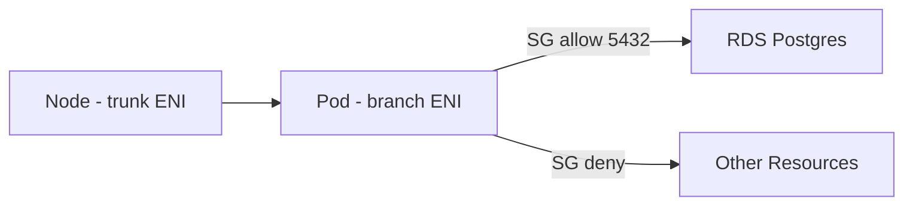

# AWS EKS Networking Essentials

## VPC CNI — ENI per Pod Model

- **aws-node** DaemonSet manages ENIs and IP assignments on every node
- Each pod gets a **real VPC IP** — no overlay; pods are first-class VPC citizens
- Node gets a primary ENI + secondary ENIs; each secondary ENI holds multiple IPs
- IP pool is pre-warmed via `WARM_IP_TARGET` / `MINIMUM_IP_TARGET` env vars
- Max pods per node = (ENIs × IPs-per-ENI) − 1; instance type determines limits
- Prefix delegation (`ENABLE_PREFIX_DELEGATION=true`) multiplies IP capacity on Nitro

| Instance Type | Max ENIs | IPs per ENI | Max Pods |
|---------------|----------|-------------|----------|
| t3.medium     | 3        | 6           | 17       |
| m5.large      | 3        | 10          | 29       |
| m5.xlarge     | 4        | 15          | 58       |
| c5.4xlarge    | 8        | 30          | 234      |

## Security Groups for Pods

- Requires VPC CNI ≥ 1.7.7 and **trunk ENI** support (Nitro instances only)
- Pod gets a dedicated **branch ENI** with its own SG — independent of the node SG
- Configured via `SecurityGroupPolicy` CRD (vpcresources.k8s.aws/v1beta1)



**SecurityGroupPolicy example:**

```yaml
apiVersion: vpcresources.k8s.aws/v1beta1
kind: SecurityGroupPolicy
metadata:
  name: allow-rds
spec:
  podSelector:
    matchLabels:
      app: backend
  securityGroups:
    groupIds:
      - sg-0abc123def456
```

## NLB vs ALB

| Feature             | NLB (L4)                        | ALB (L7)                        |
|---------------------|---------------------------------|---------------------------------|
| OSI Layer           | 4 (TCP/UDP)                     | 7 (HTTP/HTTPS)                  |
| K8s Resource        | Service type=LoadBalancer       | Ingress                         |
| Annotation prefix   | `service.beta.kubernetes.io`    | `alb.ingress.kubernetes.io`     |
| TLS termination     | Pass-through or at LB           | At LB                           |
| Path/host routing   | No                              | Yes                             |
| Cross-AZ            | Configurable                    | Default enabled                 |
| Target modes        | IP or Instance                  | IP or Instance                  |

### NLB Key Annotations

| Annotation (suffix)                                | Example Value    | Purpose              |
|----------------------------------------------------|------------------|----------------------|
| `aws-load-balancer-type`                           | `external`       | Use LBC (not in-tree)|
| `aws-load-balancer-nlb-target-type`                | `ip`             | Route to pod IPs     |
| `aws-load-balancer-scheme`                         | `internet-facing`| Public NLB           |
| `aws-load-balancer-cross-zone-load-balancing-enabled` | `true`        | Cross-AZ balancing   |

### ALB Key Annotations

| Annotation (suffix)       | Example Value           | Purpose                     |
|---------------------------|-------------------------|-----------------------------|
| `scheme`                  | `internet-facing`       | Public ALB                  |
| `target-type`             | `ip`                    | Route to pod IPs            |
| `certificate-arn`         | `arn:aws:acm:...`       | ACM TLS cert                |
| `listen-ports`            | `[{"HTTPS":443}]`       | HTTPS only                  |
| `group.name`              | `shared-alb`            | Share ALB across Ingresses  |

## CoreDNS on EKS

- Runs as a **Deployment** (not DaemonSet) in `kube-system`
- VPC DNS resolver (`169.254.169.253`) handles `.amazonaws.com` lookups
- **NodeLocal DNSCache** addon reduces CoreDNS load on large clusters

| Query Type                   | Resolution Path                              |
|------------------------------|----------------------------------------------|
| `svc.cluster.local`          | CoreDNS → kube-dns ClusterIP                 |
| `*.amazonaws.com`            | CoreDNS → VPC resolver (169.254.169.253)     |
| External hostname            | CoreDNS → VPC resolver → Route 53 / public  |
| DNS policy `ClusterFirst`    | Default; cluster DNS checked first           |
| DNS policy `None`            | Requires explicit `dnsConfig` in pod spec    |

## VPC Peering vs PrivateLink

| Dimension         | VPC Peering                          | AWS PrivateLink                        |
|-------------------|--------------------------------------|----------------------------------------|
| Traffic path      | Direct VPC-to-VPC                    | Via endpoint + NLB in service VPC      |
| CIDR overlap      | Not allowed                          | Allowed                                |
| Routing           | Route table entries required         | No route tables needed                 |
| Transitivity      | Non-transitive                       | Non-transitive                         |
| Use case          | Full VPC connectivity                | Expose a single service privately      |
| DNS               | Manual or Route 53 resolver rules    | Private DNS via endpoint               |

## Command Reference

| Task                        | Command                                                                 |
|-----------------------------|-------------------------------------------------------------------------|
| Check aws-node DaemonSet    | `kubectl -n kube-system get ds aws-node`                                |
| View CNI version            | `kubectl -n kube-system describe ds aws-node \| grep Image`             |
| Warm IP pool settings       | `kubectl -n kube-system describe ds aws-node \| grep -E 'WARM\|MINIMUM'`|
| List SecurityGroupPolicies  | `kubectl get sgp -A`                                                    |
| Check pod ENI / IP          | `kubectl get pod -o wide`                                               |
| View IPAMD logs             | `kubectl -n kube-system logs -l k8s-app=aws-node -c aws-node`           |
| Check LBC install           | `kubectl -n kube-system get deploy aws-load-balancer-controller`        |
| Describe ALB Ingress        | `kubectl describe ingress <name>`                                       |
| Check CoreDNS pods          | `kubectl -n kube-system get pods -l k8s-app=kube-dns`                  |
| Test DNS resolution         | `kubectl run dns-test --rm -it --image=busybox -- nslookup kubernetes`  |

## Gotchas

- `ip` target-type requires VPC CNI; `instance` target-type uses NodePort
- SG-for-pods requires Nitro instances — verify before enabling
- ALB Ingress requires `ingressClassName` field or IngressClass annotation
- CoreDNS ConfigMap controls forwarding: `kubectl -n kube-system edit cm coredns`
- Prefix delegation dramatically increases pod density on Nitro nodes

→ Full lessons: [29 — AWS EKS Networking](../lessons/29-aws-eks-networking.md) | [30 — AWS VPC Design](../lessons/30-aws-vpc-design.md) | [31 — AWS Load Balancer Controller](../lessons/31-aws-load-balancer-controller.md)
