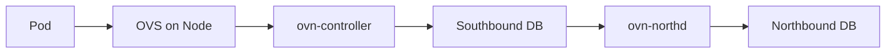

# OpenShift Networking at a Glance

## OVN-Kubernetes vs OpenShift SDN

| Aspect | OVN-Kubernetes (default) | OpenShift SDN (legacy) |
|--------|--------------------------|------------------------|
| Dataplane | OVS + OVN logical flows | OVS + iptables |
| NetworkPolicy enforcement | OVN ACLs | iptables rules |
| Multi-tenant isolation | AdminNetworkPolicy | Built-in multitenant plugin |
| IPv6 / dual-stack | Yes | Limited |
| EgressFirewall | Yes | EgressNetworkPolicy only |
| Status (OCP 4.14+) | Default | Deprecated |

## OVN-Kubernetes Component Roles

| Component | Role |
|-----------|------|
| `ovn-northd` | Translates logical intent to physical flows |
| `ovn-controller` | Programs OVS on each node per southbound DB |
| `OVS (Open vSwitch)` | Kernel dataplane — enforces flows |
| Northbound DB | Logical state: pods, policies, routers |
| Southbound DB | Physical bindings: chassis, port locations |

## Route vs Ingress

| Feature | OpenShift Route | Kubernetes Ingress |
|---------|-----------------|-------------------|
| Controller | HAProxy Router | Any (nginx, traefik, etc.) |
| TLS strategies | Edge / Passthrough / Re-encrypt | Edge only (standard) |
| Wildcard host | Native | Annotation-based |
| mTLS | Re-encrypt strategy | Controller-dependent |
| Weight-based split | `alternateBackends` | Annotation-based |
| Auto hostname | `<svc>.<ns>.<cluster-domain>` | Manual |

- Routes are OpenShift-native; Ingress is portable
- OpenShift Router also processes `networking.k8s.io/v1 Ingress` objects
- Use Routes when TLS re-encrypt or weight splitting is needed

## NetworkPolicy + EgressFirewall

| Resource | Scope | Purpose |
|----------|-------|---------|
| `NetworkPolicy` | Namespace | Ingress/egress pod-to-pod rules (upstream compatible) |
| `AdminNetworkPolicy` | Cluster | Admin-override; highest precedence |
| `BaselineAdminNetworkPolicy` | Cluster | Low-precedence baseline; namespace policies override |
| `EgressFirewall` | Namespace | Allow/deny egress by CIDR or DNS (OVN-K) |
| `EgressIP` | Namespace | Stable outbound SNAT IP bound to a node |
| `EgressRouter` | Pod | Dedicated NAT pod for fixed external IP |

- `EgressNetworkPolicy` is the SDN-era name; OVN-K uses `EgressFirewall`
- `AdminNetworkPolicy` requires OVN-K 1.0+ (OCP 4.14+)

## Service Mesh (OSSM / Istio)

- Operator: OpenShift Service Mesh (OSSM) — wraps Istio + Kiali + Jaeger + Prometheus
- Control plane CR: `ServiceMeshControlPlane` in a dedicated namespace
- Namespace opt-in: `ServiceMeshMemberRoll`
- mTLS modes: `STRICT` (reject plaintext) or `PERMISSIVE` (allow both)
- Traffic CRs: `VirtualService`, `DestinationRule`, `Gateway` — identical to upstream Istio
- Sidecar injection: enabled per namespace label or per-pod annotation

## Command Reference

| Task | Command |
|------|---------|
| List all routes | `oc get routes -A` |
| Expose service as HTTP route | `oc expose svc <name>` |
| Create edge TLS route | `oc create route edge --service=<svc> --cert=tls.crt --key=tls.key` |
| List OVN logical switches | `ovn-nbctl ls-list` |
| Dump OVS flows on node | `ovs-ofctl dump-flows br-int` |
| Check OVN pod port binding | `ovn-sbctl find Port_Binding logical_port=<pod>` |
| List egress IPs | `oc get egressip` |
| List EgressFirewall rules | `oc get egressfirewall -A` |
| Check OSSM member roll | `oc get servicemeshmemberroll -n istio-system` |
| Show Istio proxy config | `istioctl proxy-config cluster <pod> -n <ns>` |

---

→ Full lessons: [25 — OpenShift Networking Overview](../lessons/25-openshift-networking-overview.md) | [26 — OVN-Kubernetes](../lessons/26-ovn-kubernetes.md) | [27 — Routes & HAProxy](../lessons/27-openshift-routes-haproxy.md) | [28 — OpenShift Egress](../lessons/28-openshift-egress.md)
