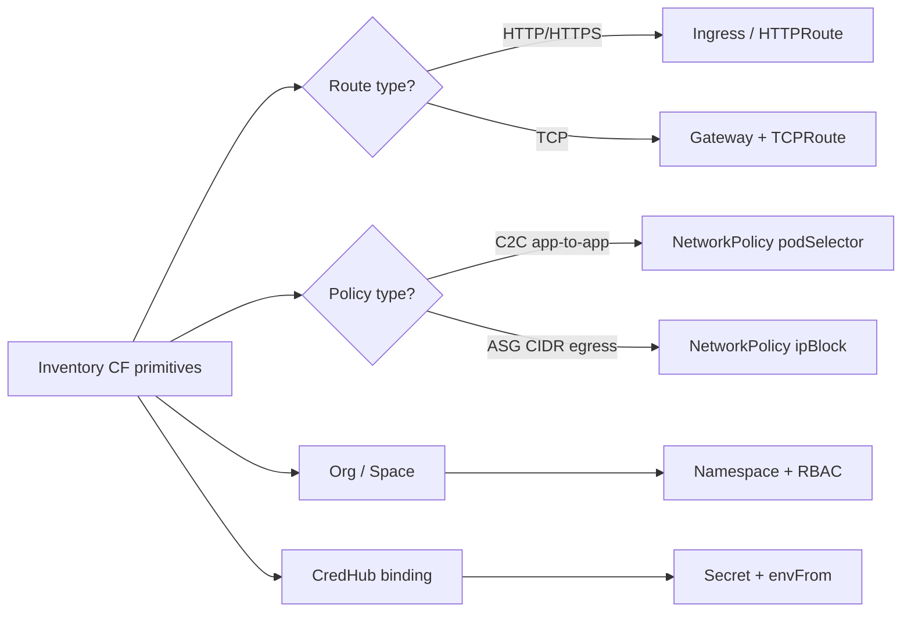

# CF→K8s Migration Cheat Sheet

## Primitive Mapping (CF → Kubernetes)

| CF Concept | CF Command / Config | K8s Resource | K8s Syntax |
|---|---|---|---|
| External HTTP route | `cf map-route app domain --hostname h` | `Ingress` | `spec.rules[].host: h.domain` |
| External HTTPS (auto TLS) | Gorouter wildcard cert | `cert-manager` Certificate + Ingress | `cert-manager.io/cluster-issuer: letsencrypt-prod` |
| Internal route | `cf map-route app apps.internal --hostname svc` | `Service` (ClusterIP) | `spec.type: ClusterIP` |
| C2C allow policy | `cf add-network-policy src --destination-app dst --port 8080` | `NetworkPolicy` ingress | `spec.ingress[].from[].podSelector.matchLabels` |
| C2C default deny | No policy added = deny-by-default | NetworkPolicy default-deny | `spec.podSelector: {}` with no ingress rules |
| ASG egress CIDR allow | `"destination":"10.0.0.0/8","ports":"443"` | `NetworkPolicy` egress | `spec.egress[].to[].ipBlock.cidr: 10.0.0.0/8` |
| ASG DNS allow | Implicit for all running apps | NetworkPolicy egress port 53 | Explicit rule to `kube-dns` ns, UDP+TCP 53 |
| Route weight (blue-green) | `cf map-route v2 example.com --hostname app --weight 20` | `HTTPRoute` backendRefs | `backendRefs[].weight: 20` |
| TCP route | `cf create-route tcp.example.com --port 1234` | `Gateway` + `TCPRoute` | `Gateway.spec.listeners[].port: 1234` |
| Org / Space boundary | CF Org + Space hierarchy | `Namespace` | `metadata.namespace: acme-production` |
| Isolation segment | Dedicated Diego Cell pool | NodeSelector + Taint + Toleration | `spec.nodeSelector`, `spec.tolerations` |
| apps.internal DNS | `svc.apps.internal` via BOSH-DNS | `svc.ns.svc.cluster.local` via CoreDNS | Auto-registered; short form `svc` within same ns |
| Instance-level DNS | `0.svc.apps.internal` | `pod-0.svc.ns.svc.cluster.local` | Headless Service (`clusterIP: None`) + StatefulSet |
| CredHub secret binding | `cf bind-service app svc` | `Secret` + `envFrom.secretRef` | External Secrets Operator for bridge mode |
| Route service (inline proxy) | `cf bind-route-service` via broker | Istio `EnvoyFilter` / `HTTPRoute` filter | CRD-based; no broker required |
| Gorouter health check | TCP/HTTP check on port 8080 | `readinessProbe` | `httpGet.path: /health`, `periodSeconds: 10` |
| Canary deployment | Manual weight bumps on route | Argo Rollouts canary steps | `spec.strategy.canary.steps[].setWeight` |
| Blue-green full swap | Map v2, unmap v1 | Update `HTTPRoute` to 100% new backend | Or Argo Rollouts `BlueGreen` strategy |
| UAA Org/Space roles | `cf set-space-role USER ORG SPACE ROLE` | K8s RBAC `RoleBinding` | `roleRef.name: edit` (dev) / `view` (auditor) |
| Shared domain | `cf create-shared-domain` | `IngressClass` or Gateway `className` | Shared by namespace convention |
| Private domain | `cf create-private-domain` | Namespace-scoped `Gateway` | `spec.listeners[].allowedRoutes.namespaces` |

---

## Migration Decision Checklist

- [ ] **Routes** — run `cf routes`; map each entry to `Ingress` (HTTP) or `Gateway`+`TCPRoute` (TCP)
- [ ] **C2C policies** — export with `cf network-policies`; replace app GUIDs with pod label selectors
- [ ] **ASGs** — list with `cf security-groups`; translate each CIDR/port to `NetworkPolicy` egress ipBlock
- [ ] **DNS** — replace all `*.apps.internal` references with `svc.namespace.svc.cluster.local`
- [ ] **Service bindings** — replace CredHub bindings with `Secret`+`envFrom` or External Secrets Operator
- [ ] **Org/Space RBAC** — map CF roles to `ClusterRole`/`Role` + `RoleBinding` per Namespace
- [ ] **Isolation segments** — label nodes; add `nodeSelector` + `tolerations` to workload manifests
- [ ] **TLS** — install cert-manager; replace Gorouter wildcard with per-domain `Certificate` CRs
- [ ] **Health checks** — add `readinessProbe` + `livenessProbe` to every container spec
- [ ] **Canary / blue-green** — adopt `HTTPRoute` weights or Argo Rollouts before final cutover
- [ ] **Coexistence** — add bidirectional `NetworkPolicy` rules: CF cell overlay CIDR ↔ K8s pod CIDR
- [ ] **DNS egress rule** — add explicit port-53 egress rule to every namespace using default-deny

---

## Migration Flow

---

## Command Reference

| Task | CF Command | K8s Command |
|---|---|---|
| List all routes | `cf routes` | `kubectl get ingress,httproute -A` |
| Map HTTP route | `cf map-route APP DOMAIN --hostname H` | `kubectl apply -f httproute.yaml` |
| Unmap / remove route | `cf unmap-route APP DOMAIN --hostname H` | `kubectl delete httproute NAME` |
| List C2C policies | `cf network-policies` | `kubectl get networkpolicy -A` |
| Add C2C allow | `cf add-network-policy SRC --destination-app DST --port P` | `kubectl apply -f netpol.yaml` |
| List security groups | `cf security-groups` | `kubectl get networkpolicy -A -o yaml` |
| Bind service / secret | `cf bind-service APP SVC` | `kubectl create secret generic NAME --from-literal=…` |
| View DNS / routes | `cf app APP` (routes field) | `kubectl get svc,ep -n NS` |
| Scale replicas | `cf scale APP -i 3` | `kubectl scale deploy APP --replicas=3` |
| Rolling update | `cf push APP --strategy rolling` | `kubectl rollout status deploy/APP` |
| SSH / exec into app | `cf ssh APP` | `kubectl exec -it POD -n NS -- sh` |
| Test internal DNS | `cf ssh APP` → `curl svc.apps.internal:PORT` | `kubectl exec POD -- curl svc.ns.svc.cluster.local:PORT` |
| Set traffic weight | `cf map-route V2 DOMAIN --hostname H --weight 20` | `kubectl patch httproute NAME --type=json -p '[…]'` |
| View isolation segment | `cf isolation-segments` | `kubectl get nodes -l segment=NAME` |
| Set space role | `cf set-space-role USER ORG SPACE SpaceDeveloper` | `kubectl create rolebinding NAME --clusterrole=edit --user=EMAIL -n NS` |

---

## Mental Model — Five Equivalences

- **Gorouter** = Ingress controller (nginx/envoy) or Gateway API HTTPRoute
- **C2C overlay network** = Pod CIDR + `NetworkPolicy` podSelector rules
- **Application Security Groups** = `NetworkPolicy` egress `ipBlock` rules
- **BOSH-DNS / apps.internal** = CoreDNS `svc.cluster.local`
- **UAA + Org/Space** = K8s RBAC on Namespaces (OIDC replaces UAA)

---

→ Full lessons: [`mig-02-translation-cookbook.md`](../migration/mig-02-translation-cookbook.md) | [`mig-01-strategy.md`](../migration/mig-01-strategy.md) | [`mig-03-coexistence-cutover.md`](../migration/mig-03-coexistence-cutover.md)
