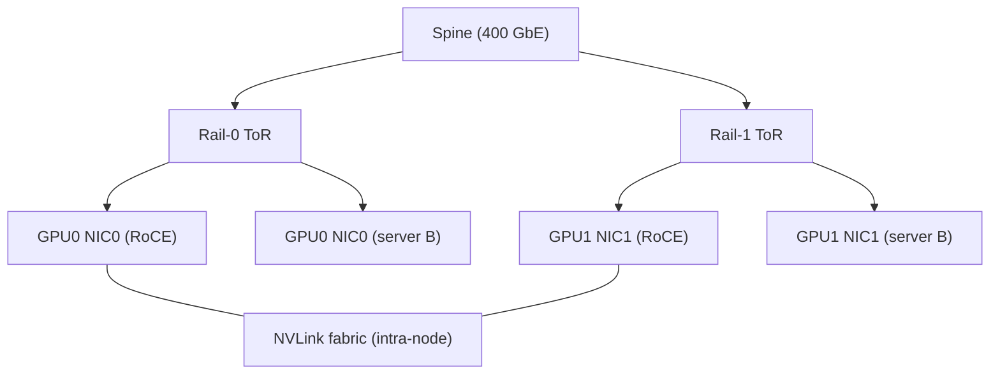

# AI/GPU Cluster Networking Quick-Ref

## Transport Technologies at a Glance

| Technology | Medium | Bandwidth | Latency | Use Case |
|---|---|---|---|---|
| RoCE v2 | Ethernet (UDP 4791) | 100–400 Gbps | ~1–2 µs | Inter-node RDMA over lossless Ethernet |
| InfiniBand HDR | IB fabric | 200 Gbps/port | ~0.6 µs | HPC clusters, requires dedicated switches |
| InfiniBand NDR | IB fabric | 400 Gbps/port | ~0.5 µs | Latest-gen HPC/AI clusters |
| NVLink 4 (H100) | On-board / NVSwitch | 900 GB/s node | ~ns | Intra-node GPU-to-GPU |
| GPUDirect RDMA | PCIe + RDMA NIC | NIC line rate | ~1 µs | GPU memory → remote GPU, zero CPU copies |
| GPUDirect Storage | NVMe + RDMA | Storage BW | ~µs | GPU ↔ NVMe bypassing CPU |
| Standard TCP/IP | Ethernet | NIC line rate | ~10–100 µs | Control plane, non-latency-sensitive paths |

## RoCE Lossless Fabric Requirements

| Config Item | Setting | Why |
|---|---|---|
| PFC (Priority Flow Control) | Enable on priority 3 | Pause frames prevent buffer overflow / drops |
| ECN (Explicit Congestion Notification) | Enable on ToR and NICs | Early signal before drops, smoother backpressure |
| MTU | 9000 (jumbo frames) | Reduce per-packet overhead for large transfers |
| DCQCN | Enable on ConnectX NICs | RDMA-specific congestion control algorithm |
| Buffer reservation | ~20% headroom per port | Absorb PFC pause bursts without tail drop |
| QoS DSCP marking | DSCP=26 (CS3) for RDMA | Separate queues for RDMA vs. control traffic |

## NCCL Collective Operations

| Operation | Pattern | Typical Size | NCCL Algo |
|---|---|---|---|
| AllReduce | All → All (sum/max/min) | Model gradients | Ring, Tree, or NVLS |
| AllGather | Scatter → replicate | Activation shards | Ring |
| ReduceScatter | Partial reduce + scatter | Tensor parallel | Ring |
| Broadcast | 1 → All | Model weights init | Tree |
| P2P Send/Recv | Pair | Pipeline parallel | Direct or proxy |

## Key Environment Variables — NCCL

| Variable | Recommended Value | Effect |
|---|---|---|
| `NCCL_IB_DISABLE` | `0` | Use InfiniBand / RoCE RDMA |
| `NCCL_IB_GID_INDEX` | `3` (RoCEv2) | GID table index for RoCEv2 |
| `NCCL_NET_GDR_LEVEL` | `5` | Enable GPUDirect RDMA |
| `NCCL_SOCKET_IFNAME` | `eth0` | NIC for NCCL bootstrap (TCP) |
| `NCCL_DEBUG` | `INFO` or `TRACE` | Verbose logging |
| `NCCL_ALGO` | `Ring` / `Tree` | Force collective algorithm |
| `NCCL_MIN_NCHANNELS` | `4` | Parallelism within a NIC |

## Rail-Optimized Topology (small diagram)

- Each GPU has its own dedicated NIC on its own ToR (rail)
- All-reduce between servers = one NIC per GPU, no bandwidth sharing
- Intra-node GPU comms stay on NVSwitch fabric, never hit Ethernet

## Kubernetes: Multus + SR-IOV for RDMA

- **Multus CNI** attaches multiple network interfaces to a pod
- **SR-IOV Device Plugin** exposes VFs (Virtual Functions) as K8s resources
- **RDMA resource** (`rdma/rdma_shared_device_a`) allocated per pod via resource limits
- NetworkAttachmentDefinition selects VF pool bound to RDMA-capable NIC
- Pod requests: `nvidia.com/gpu: 1` + `rdma/rdma_shared_device_a: 1`

## Diagnostic Command Reference

| Command | What It Shows |
|---|---|
| `ibstat` | IB/RoCE port state, GID, link speed |
| `ibv_devinfo` | RDMA device attributes |
| `perftest` / `ib_send_bw` | RDMA bandwidth test between two nodes |
| `rdma link` | Linux RDMA subsystem link state |
| `ethtool -S <nic> \| grep pause` | PFC pause frame counters |
| `mlnx_qos -i <nic>` | Show QoS / PFC / ETS config on Mellanox NIC |
| `nccl-tests allreduce` | End-to-end NCCL bandwidth / latency |
| `nvidia-smi nvlink -s` | NVLink bandwidth and error counters |
| `kubectl exec -it <pod> -- nvidia-smi topo -m` | GPU-NIC topology matrix |
| `nsenter -t <pid> -n ip addr` | Inspect pod network namespace |

## Common Failure Modes

- **Packet drop on RoCE** — missing PFC or ECN config; check `ethtool -S` pause counters
- **NCCL timeout / hang** — NCCL bootstrap TCP fails; check `NCCL_SOCKET_IFNAME` and firewall
- **GPUDirect disabled** — `NCCL_NET_GDR_LEVEL` not set; kernel module `nv_peer_mem` missing
- **NVLink errors** — hardware fault; check `nvidia-smi nvlink -e`
- **SR-IOV VF not assigned** — device plugin not running or VF pool exhausted
- **MTU mismatch** — jumbo frames not enabled end-to-end; causes fragmentation/drops
- **DCQCN not active** — NICs or switches not configured; causes head-of-line blocking

## Bandwidth Reference

| Path | Bandwidth |
|---|---|
| H100 NVLink (intra-node) | 900 GB/s bidirectional |
| ConnectX-7 (inter-node, single NIC) | 400 Gbps |
| DGX H100 (8 NICs, inter-node) | 3.2 Tbps aggregate |
| IB NDR single port | 400 Gbps |
| PCIe Gen5 x16 (CPU-GPU) | ~128 GB/s |

→ Full lessons: [34 — AI Platform Networking](../lessons/34-ai-platform-networking.md) · [09 — CNI Specification](../lessons/09-cni-specification.md) · [07 — Bare Metal Network Infrastructure](../lessons/07-bare-metal-network-infrastructure.md) · [10 — eBPF and XDP](../lessons/10-ebpf-xdp.md)
