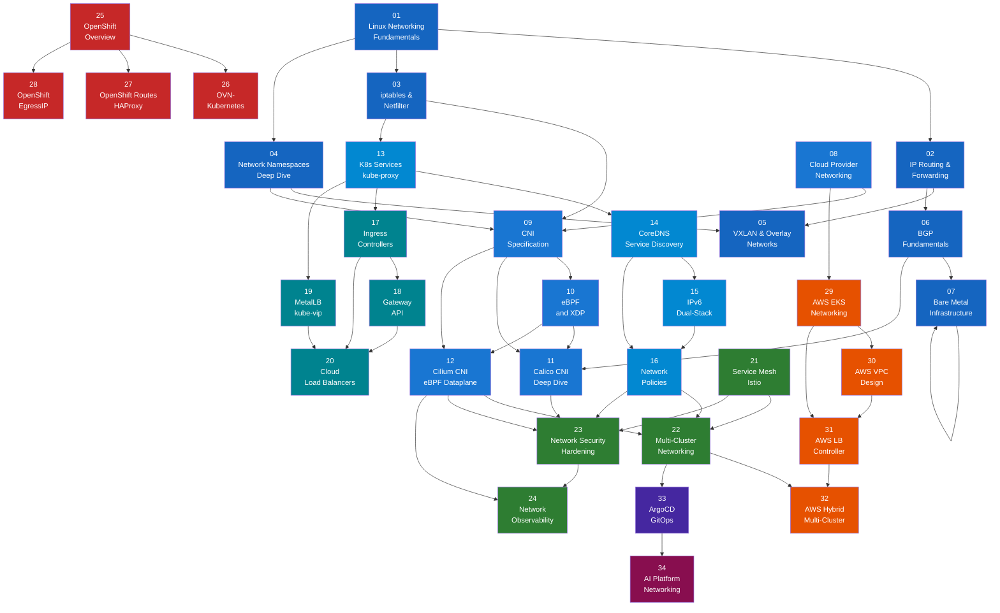

# Course Map

Visual dependency graph of all 34 lessons. Follow the arrows to understand prerequisites.

---

## Lesson Dependency Graph

---

## Track Overview

| Track | Lessons | Focus |
|-------|---------|-------|
| A — Linux Foundations | 01–07 | Kernel primitives every Kubernetes network is built on |
| B — CNI Plugins & eBPF | 08–12 | How pods get network interfaces and IPs |
| C — Kubernetes Networking | 13–16 | Services, DNS, dual-stack, network policy |
| D — Ingress & Load Balancing | 17–20 | External traffic into the cluster |
| E — Advanced Topics | 21–24 | Istio, multi-cluster, security hardening, observability |
| F — OpenShift | 25–28 | OVN-Kubernetes, Routes, EgressIP |
| G — AWS | 29–32 | EKS-specific networking and hybrid connectivity |
| H — GitOps | 33 | ArgoCD sync waves for network config delivery |
| I — AI Platform | 34 | RDMA, SR-IOV, rail topology, GPU cluster networking |

---

## Minimum Learning Paths

### CKA Exam Focus (Lessons 01–24)
`01 → 02 → 03 → 04 → 09 → 13 → 14 → 16 → 17 → 21 → 23 → 24`

### OpenShift Engineer
`01 → 03 → 09 → 13 → 16 → 25 → 26 → 27 → 28`

### AWS/EKS Specialist
`01 → 03 → 08 → 09 → 13 → 16 → 20 → 29 → 30 → 31 → 32`

### AI/HPC Platform Engineer
`01 → 05 → 07 → 09 → 10 → 12 → 34`
