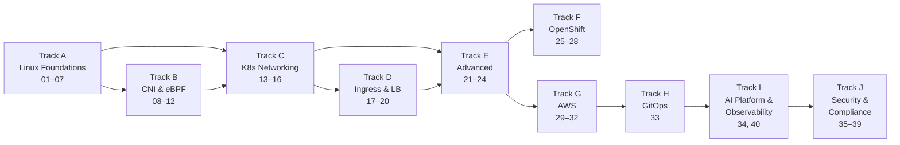

# Platform Network Engineering

> Three books in one — Kubernetes Networking · Cloud Foundry Networking · Migration Guide

---

## Books

<div class="grid cards" markdown>

- :fontawesome-brands-kubernetes: **Kubernetes Networking**  
  41 lessons (00–40) from Linux foundations through CNI, service meshes, OpenShift, AWS, GitOps, AI GPU clusters, compliance (HIPAA/PCI-DSS/IEC 62443/GDPR), network incident management with SLOs and RCA, and OpenTelemetry.  
  [Start Track A →](lessons/01-linux-networking-fundamentals.md)

- :fontawesome-solid-cloud: **Cloud Foundry Networking**  
  23 lessons covering Diego, Silk CNI, GoRouter, CF-to-CF mTLS, BTP Private Link, compliance, and hybrid connectivity.  
  [Start CF Book →](cf/cf-00-overview.md)

- :fontawesome-solid-arrows-left-right: **K8s ↔ CF Migration Guide**  
  Side-by-side networking concepts, migration patterns, and decision frameworks for teams moving workloads.  
  [Open Migration Guide →](migration/mig-00-guide.md)

- :fontawesome-solid-table-list: **Cheat Sheets**  
  Quick-reference cards for kubectl, calicoctl, cilium, cf CLI networking commands, and iptables.  
  [Browse Cheat Sheets →](cheatsheets/cs-00-index.md)

</div>

---

## Kubernetes Networking — 10 Tracks

<div class="grid cards" markdown>

- :fontawesome-solid-network-wired: **[Track A — Linux Foundations](lessons/01-linux-networking-fundamentals.md)**  
  veth pairs · bridges · iptables · namespaces · VXLAN · BGP · bare metal

- :fontawesome-solid-plug: **[Track B — CNI Plugins & eBPF](lessons/09-cni-specification.md)**  
  CNI spec · eBPF/XDP · Calico · Cilium

- :fontawesome-brands-kubernetes: **[Track C — Kubernetes Networking](lessons/13-kubernetes-services-kube-proxy.md)**  
  Services · CoreDNS · IPv6 · NetworkPolicy

- :fontawesome-solid-route: **[Track D — Ingress & Load Balancing](lessons/17-ingress-controllers.md)**  
  Ingress · Gateway API · MetalLB · Cloud LBs

- :fontawesome-solid-layer-group: **[Track E — Advanced Topics](lessons/21-service-mesh-istio.md)**  
  Istio · Multi-cluster · Security · Observability

- :fontawesome-brands-redhat: **[Track F — OpenShift](lessons/25-openshift-networking-overview.md)**  
  OVN-Kubernetes · Routes · EgressIP

- :fontawesome-brands-aws: **[Track G — AWS](lessons/29-aws-eks-networking.md)**  
  EKS · VPC design · ALB/NLB controller · Hybrid

- :fontawesome-solid-code-branch: **[Track H — GitOps](lessons/33-argocd-gitops.md)**  
  ArgoCD · sync waves · multi-cluster delivery

- :fontawesome-solid-microchip: **[Track I — AI Platform & Observability](lessons/34-ai-platform-networking.md)**  
  RDMA · SR-IOV · Multus · RoCE · EFA · GPU Operator · OBI · OTel Operator · Hubble OTLP

- :fontawesome-solid-shield-halved: **[Track J — Security & Compliance](lessons/35-tetragon-ebpf-runtime-security.md)**  
  Tetragon · KubeEdge / industrial edge · HIPAA/PCI-DSS/IEC 62443/GDPR · Multus CNI · Incident Management & RCA

</div>

---

## Cert Prep

<div class="grid cards" markdown>

- :fontawesome-solid-certificate: **[CKNE + CCA Exam Prep](ckne-prep.md)**  
  5 CKNE domains + 8 CCA domains mapped to lessons · study paths · exam traps

- :fontawesome-solid-certificate: **[CKA + CKS Exam Prep](cka-cks-prep.md)**  
  CKA Services & Networking + all 6 CKS domains mapped to lessons

- :fontawesome-solid-map: **[Compliance Learning Paths](compliance-paths.md)**  
  Sector paths for medtech · banking · manufacturing · big tech — CH / DE / USA

</div>

---

## Practice Environment

Every lesson uses two terminals:

```bash
# Terminal 1 — Linux node (kernel commands)
minikube ssh

# Terminal 2 — Mac / local machine (kubectl)
kubectl get pods -A
```

Linux-only commands (`ip netns`, `iptables`, `bpftool`) run inside `minikube ssh`.  
Cluster commands (`kubectl`, `calicoctl`, `cilium`) run from your local terminal.

---

## Learning Path



---

## Course Stats

| Metric | Value |
|--------|-------|
| Lessons | 41 (K8s) + 23 (CF) |
| Tracks | 10 (K8s) + 8 (CF) |
| Mermaid diagrams | 110+ |
| Troubleshooting entries | 260+ |
| Practice commands | 450+ |
| Free resources mapped | 25+ |

---

## Downloads

| Book | EPUB | PDF |
|------|------|-----|
| Kubernetes Networking (41 lessons) | [EPUB](https://github.com/MykolaLebid/Kubernetes_networking_engineering/raw/main/kubernetes-network-engineering.epub) | [PDF](https://github.com/MykolaLebid/Kubernetes_networking_engineering/raw/main/kubernetes-network-engineering.pdf) |
| Cloud Foundry Networking (23 lessons) | [EPUB](https://github.com/MykolaLebid/Kubernetes_networking_engineering/raw/main/cf-networking.epub) | [PDF](https://github.com/MykolaLebid/Kubernetes_networking_engineering/raw/main/cf-networking.pdf) |

EPUB files reflow on reMarkable and e-readers. PDF files are print-ready with page breaks.

---

## Free Resources

See [RESOURCES.md](RESOURCES.md) for a curated list of free interactive labs, playgrounds, and courses mapped to every lesson.
