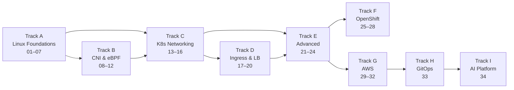

# Kubernetes Network Engineering

> A 34-lesson course covering Linux networking foundations through Kubernetes CNI, service meshes, OpenShift, AWS, GitOps, and AI GPU cluster networking.

---

## Start Learning

<div class="grid cards" markdown>

- :fontawesome-solid-network-wired: **[Track A — Linux Foundations](lessons/01-linux-networking-fundamentals.md)**  
  veth pairs · bridges · iptables · namespaces · VXLAN · BGP · bare metal

- :fontawesome-solid-plug: **[Track B — CNI Plugins & eBPF](lessons/09-cni-specification.md)**  
  CNI spec · eBPF/XDP · Calico · Cilium

- :fontawesome-brands-kubernetes: **[Track C — Kubernetes Networking](lessons/13-kubernetes-services-kube-proxy.md)**  
  Services · CoreDNS · IPv6 · NetworkPolicy

- :fontawesome-solid-route: **[Track D — Ingress & Load Balancing](lessons/17-ingress-controllers.md)**  
  Ingress · Gateway API · MetalLB · Cloud LBs

- :fontawesome-solid-layer-group: **[Track E — Advanced Topics](lessons/21-service-mesh-istio.md)**  
  Istio · Multi-cluster · Security · Observability

- :fontawesome-brands-redhat: **[Track F — OpenShift](lessons/25-openshift-networking-overview.md)**  
  OVN-Kubernetes · Routes · EgressIP

- :fontawesome-brands-aws: **[Track G — AWS](lessons/29-aws-eks-networking.md)**  
  EKS · VPC design · ALB/NLB controller · Hybrid

- :fontawesome-solid-code-branch: **[Track H — GitOps](lessons/33-argocd-gitops.md)**  
  ArgoCD · sync waves · multi-cluster delivery

- :fontawesome-solid-microchip: **[Track I — AI Platform](lessons/34-ai-platform-networking.md)**  
  RDMA · SR-IOV · Multus · RoCE · EFA · GPU Operator

</div>

---

## Practice Environment

Every lesson uses two terminals:

```bash
# Terminal 1 — Linux node (kernel commands)
minikube ssh

# Terminal 2 — Mac / local machine (kubectl)
kubectl get pods -A
```

Linux-only commands (`ip netns`, `iptables`, `bpftool`) run inside `minikube ssh`.  
Cluster commands (`kubectl`, `calicoctl`, `cilium`) run from your local terminal.

---

## Learning Path



---

## Course Stats

| Metric | Value |
|--------|-------|
| Lessons | 34 |
| Tracks | 9 |
| Mermaid diagrams | 90+ |
| Troubleshooting entries | 230+ |
| Practice commands | 400+ |
| Free resources mapped | 25+ |

---

## Downloads

- [Complete course PDF](https://github.com/MykolaLebid/Kubernetes_networking_engineering/raw/main/kubernetes-network-engineering.pdf) — 34 lessons with rendered diagrams
- [Complete course EPUB](https://github.com/MykolaLebid/Kubernetes_networking_engineering/raw/main/kubernetes-network-engineering.epub) — 4.1 MB, reflows on reMarkable and e-readers

---

## Free Resources

See [RESOURCES.md](RESOURCES.md) for a curated list of free interactive labs, playgrounds, and courses mapped to every lesson.
