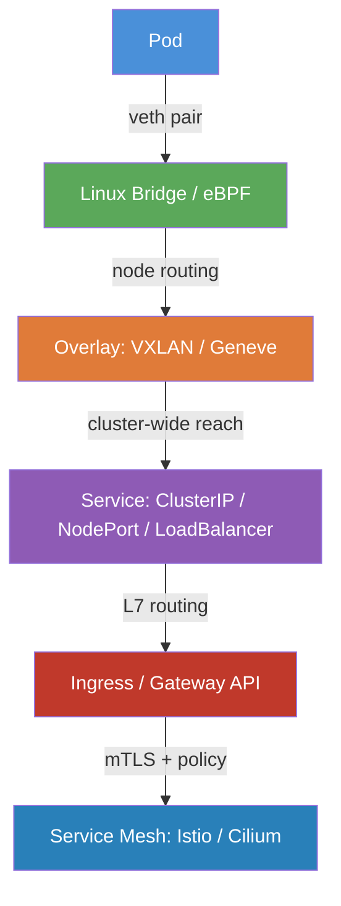
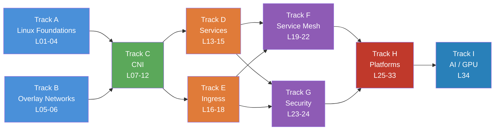

# Kubernetes Network Engineering

Kubernetes networking is not a single monolithic system — it is a set of composable layers, each
built on Linux primitives that have existed for decades. At the lowest level, network namespaces
and virtual Ethernet pairs give every Pod its own isolated network stack. A bridge or eBPF program
connects those pairs to the node. An overlay protocol such as VXLAN or Geneve tunnels Pod traffic
across nodes without requiring the underlay to know anything about Pod CIDRs. The CNI plugin wires
all of this together at container startup. Above the node, kube-proxy or eBPF-based load balancing
implements the Service abstraction; Ingress controllers and Gateway API resources expose traffic to
the outside world; and service meshes inject sidecar proxies to give every Pod mTLS, retries, and
fine-grained traffic policy — all without changing application code. This book walks each layer from
first principles to production-grade configuration, using Minikube as the sandbox and real-world
CNI, mesh, and cloud-provider examples throughout.

## Kubernetes Networking Stack



The diagram reads bottom-up: every higher abstraction depends on the layer below it, so debugging
always starts at the Pod/veth level and works upward.

---

## Track Listing

| Track | Topic | Lessons |
|-------|-------|---------|
| **A — Linux Foundations** | Namespaces, iptables, tc, eBPF/XDP | [01 Linux Networking Fundamentals](lessons/01-linux-networking-fundamentals.md) · [02 IP Routing and Forwarding](lessons/02-ip-routing-and-forwarding.md) · [03 iptables and Netfilter](lessons/03-iptables-and-netfilter.md) · [04 Network Namespaces Deep Dive](lessons/04-network-namespaces-deep-dive.md) |
| **B — Overlay Networks** | VXLAN, BGP, cloud provider | [05 VXLAN and Overlay Networks](lessons/05-vxlan-and-overlay-networks.md) · [06 BGP Fundamentals](lessons/06-bgp-fundamentals.md) · [07 Bare Metal Network Infrastructure](lessons/07-bare-metal-network-infrastructure.md) · [08 Cloud Provider Networking](lessons/08-cloud-provider-networking.md) |
| **C — CNI** | Spec, Calico, Cilium | [09 CNI Specification](lessons/09-cni-specification.md) · [10 eBPF and XDP](lessons/10-ebpf-xdp.md) · [11 Calico CNI Deep Dive](lessons/11-calico-cni-deep-dive.md) · [12 Cilium CNI and eBPF](lessons/12-cilium-cni-ebpf.md) |
| **D — Services** | kube-proxy, CoreDNS, IPv6 | [13 Kubernetes Services and kube-proxy](lessons/13-kubernetes-services-kube-proxy.md) · [14 CoreDNS and Service Discovery](lessons/14-coredns-service-discovery.md) · [15 IPv6 and Dual-Stack](lessons/15-ipv6-dual-stack.md) |
| **E — Ingress** | NetworkPolicy, nginx, Gateway API | [16 Network Policies](lessons/16-network-policies.md) · [17 Ingress Controllers](lessons/17-ingress-controllers.md) · [18 Gateway API](lessons/18-gateway-api.md) · [19 MetalLB and kube-vip](lessons/19-metallb-kube-vip.md) · [20 Cloud Load Balancers](lessons/20-cloud-load-balancers.md) |
| **F — Service Mesh** | Istio, multi-cluster | [21 Service Mesh with Istio](lessons/21-service-mesh-istio.md) · [22 Multi-Cluster Networking](lessons/22-multi-cluster-networking.md) |
| **G — Security** | Hardening, observability | [23 Network Security Hardening](lessons/23-network-security-hardening.md) · [24 Network Observability and Troubleshooting](lessons/24-network-observability-troubleshooting.md) |
| **H — Platforms** | OpenShift, EKS, ArgoCD | [25 OpenShift Networking Overview](lessons/25-openshift-networking-overview.md) · [26 OVN-Kubernetes](lessons/26-ovn-kubernetes.md) · [27 OpenShift Routes and HAProxy](lessons/27-openshift-routes-haproxy.md) · [28 OpenShift EgressIP and EgressFirewall](lessons/28-openshift-egress.md) · [29 AWS EKS Networking](lessons/29-aws-eks-networking.md) · [30 AWS VPC Design](lessons/30-aws-vpc-design.md) · [31 AWS Load Balancer Controller](lessons/31-aws-load-balancer-controller.md) · [32 AWS Hybrid and Multi-Cluster](lessons/32-aws-hybrid-multicluster.md) · [33 ArgoCD and GitOps](lessons/33-argocd-gitops.md) |
| **I — AI / GPU** | RDMA, RoCE, GPUDirect | [34 AI Platform Networking](lessons/34-ai-platform-networking.md) |

---

## How to Use This Book

### Two-Terminal Model

Every lesson in this book is designed for two simultaneous terminals:

| Terminal | Purpose | Setup |
|----------|---------|-------|
| **Terminal 1** | Linux kernel — run `ip`, `tc`, `iptables`, `bpftool` inside the node | `minikube ssh` |
| **Terminal 2** | Kubernetes control plane — run `kubectl`, `calicoctl`, `cilium`, `istioctl` | Your Mac / local shell |

The separation is intentional. It trains the habit of distinguishing "what the kernel sees" from
"what Kubernetes thinks is happening" — a distinction that matters every time you debug a
connectivity issue in production.

### Recommended Workflow Per Lesson

1. Read the concept section (usually 10 minutes).
2. Apply the manifests from `manifests/<lesson-slug>/` with `kubectl apply -f`.
3. Open Terminal 1 (`minikube ssh`) and run the kernel-side commands shown in the lesson.
4. Run the lab validation script: `bash labs/<lesson-slug>-lab.sh`.
5. Tear down: `kubectl delete -f manifests/<lesson-slug>/`.

### Lab Environment

```bash
# Install Minikube (macOS)
brew install minikube

# Start a cluster with enough resources
minikube start --cpus 4 --memory 8192 --disk-size 40g \
  --network-plugin=cni --cni=false

# Verify
kubectl get nodes
minikube ssh -- uname -r
```

---

## Prerequisites

Before starting Track A, you should be comfortable with:

- **Linux command line** — file system navigation, pipes, `grep`, `ss`, `ip addr`
- **Basic networking** — IP addressing (CIDR), TCP/UDP, DNS resolution, the OSI model
- **Docker or container basics** — running containers, understanding images and layers
- **kubectl fundamentals** — `get`, `describe`, `logs`, `exec`, `apply`, `delete`

You do not need prior Kubernetes networking experience. The course builds knowledge from scratch,
starting with the Linux primitives that underpin every CNI plugin and service mesh in production.

Recommended background reading (not required):

- Brendan Gregg, *Systems Performance* — chapters on networking
- The Linux `ip(8)` and `tc(8)` man pages
- The CNI specification: <https://github.com/containernetworking/cni/blob/main/SPEC.md>

---

## Quick-Start Path for CF / BTP Engineers

If you are coming from Cloud Foundry (CF) or SAP BTP and want to understand how Kubernetes
networking differs from the CF networking model (Garden containers, Silk CNI, CF route emitter,
Gorouter), use this accelerated five-lesson path:

| Step | Lesson | Why It Matters for CF Engineers |
|------|--------|---------------------------------|
| 1 | [01 Linux Networking Fundamentals](lessons/01-linux-networking-fundamentals.md) | CF containers also use Linux network namespaces; this lesson names the primitives CF abstracts away |
| 2 | [05 VXLAN and Overlay Networks](lessons/05-vxlan-and-overlay-networks.md) | CF Silk CNI uses VXLAN internally; seeing the raw encapsulation demystifies Diego cell-to-cell traffic |
| 3 | [11 Calico CNI Deep Dive](lessons/11-calico-cni-deep-dive.md) | Calico is the dominant CNI in SAP BTP Kyma clusters; its BGP-based routing contrasts sharply with Silk |
| 4 | [13 Kubernetes Services and kube-proxy](lessons/13-kubernetes-services-kube-proxy.md) | The Service abstraction replaces the CF route emitter + Gorouter for east-west traffic |
| 5 | [16 Network Policies](lessons/16-network-policies.md) | K8s NetworkPolicy maps to CF ASGs (Application Security Groups) but operates at the Pod level |

After this path you will have a working mental model that maps CF concepts to K8s equivalents.
Continue with Track E (Ingress) and Track F (Service Mesh) to cover the north-south routing that
Gorouter handles in CF.

---

## Book Structure at a Glance



Each track builds on the ones to its left. Tracks A and B are prerequisites for all CNI work in
Track C. Tracks D and E feed into the service mesh material in Track F. Platform-specific content
in Track H assumes fluency with all prior tracks.

---

*Last updated: November 2026. Course version 1.0.*
