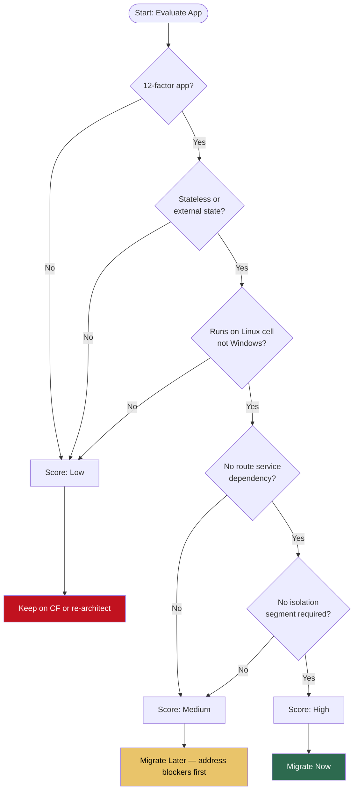

# Migration Decision Guide

## Should I Migrate This App Now?

---

## Migration Readiness Checklist

- [ ] App follows 12-factor principles (config via env vars, no local state)
- [ ] App is stateless or stores state in an external service (DB, cache)
- [ ] App runs on a Linux Diego cell (not Windows)
- [ ] App does not depend on a route service (inline proxy broker)
- [ ] App does not require an isolation segment; or NodeSelector/Taint equivalent is planned
- [ ] All CF service bindings (CredHub) have a K8s `Secret` + `envFrom.secretRef` equivalent mapped
- [ ] C2C network policies are translated to K8s `NetworkPolicy` podSelector ingress/egress rules
- [ ] ASG egress rules are translated to `NetworkPolicy` egress `ipBlock.cidr` entries
- [ ] CF routes are translated to Ingress or Gateway API `HTTPRoute`/`TCPRoute` resources
- [ ] Internal routes (`apps.internal`) are translated to `ClusterIP` Service + `svc.cluster.local` DNS
- [ ] Blue-green or canary strategy is defined (Gateway API `HTTPRoute` `backendRefs[].weight`)
- [ ] Coexistence period is planned: CF callable from K8s via external route; K8s callable from CF via ASG egress + DNS

---

## Quick Scoring Table

| Criterion | Points |
|---|---|
| App is 12-factor | 20 |
| Stateless or external state store | 20 |
| Runs on Linux cell | 15 |
| No route service dependency | 15 |
| No isolation segment required | 10 |
| All service bindings mapped to K8s Secrets | 10 |
| C2C policies translated to NetworkPolicy | 5 |
| ASG rules translated to NetworkPolicy egress | 5 |
| **Total possible** | **100** |

| Score | Recommendation |
|---|---|
| 80 – 100 | **Migrate Now** — all prerequisites met |
| 50 – 79 | **Migrate Later** — resolve blockers (route service, Windows cell, isolation segment) |
| 0 – 49 | **Keep on CF** — re-architect required before migration is viable |

---

## CF to Kubernetes Concept Map (Quick Reference)

| CF Concept | Kubernetes Equivalent |
|---|---|
| `cf map-route app domain --hostname h` | Ingress / `HTTPRoute` with `hostnames:` |
| `cf map-route app apps.internal --hostname svc` | `ClusterIP` Service |
| `cf add-network-policy src --destination-app dst` | `NetworkPolicy` podSelector ingress/egress |
| ASG egress CIDR/port | `NetworkPolicy` egress `ipBlock.cidr` |
| Route weight blue-green `--weight 20` | `HTTPRoute` `backendRefs[].weight` |
| `cf create-route tcp.domain --port 1234` | Gateway API `TCPRoute` + port |
| CF Org + Space | Namespace |
| Isolation segment (dedicated Diego Cells) | NodeSelector + Taint |
| `apps.internal` BOSH DNS | `svc.cluster.local` CoreDNS |
| `0.svc.apps.internal` (instance address) | `pod-0.svc.ns.svc.cluster.local` (StatefulSet) |
| `cf bind-service` / CredHub secret | `envFrom.secretRef` |
| Route service (inline proxy broker) | Istio `EnvoyFilter` / `HTTPRoute` filter |
| Blue-green: `cf map-route` both + weight | Argo Rollouts / `HTTPRoute` weights |
| Gorouter health check | `readinessProbe` |
| SAP BTP CF environment | Kyma environment (XSUAA token validation compatible) |
| Coexistence: CF calls K8s | K8s external route; CF ASG permits egress to K8s node CIDRs |
| Coexistence: K8s calls CF | ASG egress + DNS; Istio `ServiceEntry` pointing at CF Gorouter hostname |
| K8s NetworkPolicy permits CF traffic | Ingress rule allows CF cell overlay CIDR |
| Canary rollout | Gateway API `HTTPRoute` weight starting at 5% K8s; increment after monitoring |
| Rollback | Re-map CF route to 100%; remove K8s `HTTPRoute` weight |
| Strangler Fig | Route traffic split at edge; migrate service by service |

---

## Lessons in This Migration Track

- [mig-01 — Migration Strategy: Strangler Fig Pattern](mig-01-strategy.md)
- [mig-02 — Translation Cookbook: CF Constructs to K8s](mig-02-translation-cookbook.md)
- [mig-03 — Coexistence and Cutover](mig-03-coexistence-cutover.md)
