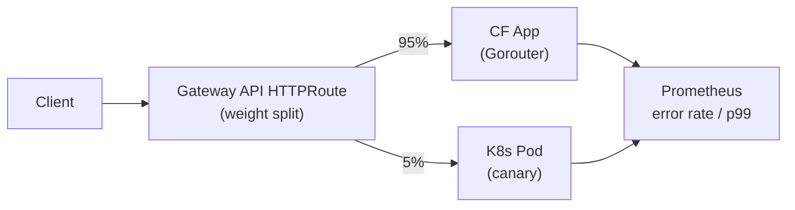
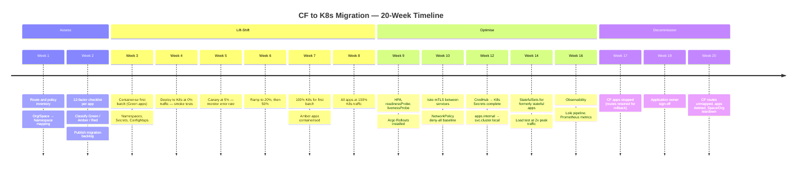

# Migration Strategy: Strangler Fig Pattern for CF→K8s

## Quick Read

**Goal:** Move workloads from Cloud Foundry to Kubernetes incrementally, one service at a time, using weighted traffic splitting rather than a big-bang cutover.

**Core idea — Strangler Fig:**
- A routing facade sits in front of both CF and K8s backends simultaneously
- Traffic weight shifts from CF (100%) toward K8s (100%) per service
- CF handles traffic until each function is proven stable in K8s
- Rollback at any point = patch the weight back to 100% CF

**Key mapping at a glance:**

| CF construct | K8s equivalent |
|---|---|
| `cf map-route app domain --hostname h` | Ingress / HTTPRoute `hostnames:` |
| `cf map-route app apps.internal` | ClusterIP Service |
| `cf add-network-policy src --destination-app dst` | NetworkPolicy `podSelector` |
| ASG CIDR/port allow | NetworkPolicy egress `ipBlock.cidr` |
| `cf map-route v2 --weight 20` | HTTPRoute `backendRefs[].weight` |
| `cf create-route tcp.domain --port 1234` | Gateway API `TCPRoute` |
| Org / Space | Namespace |
| Isolation segment | NodeSelector + Taint |
| `apps.internal` DNS | `svc.cluster.local` |
| `0.svc.apps.internal` | `pod-0.svc.ns.svc.cluster.local` (StatefulSet) |
| CredHub secret | K8s Secret + `envFrom.secretRef` |
| Route service | Istio EnvoyFilter / HTTPRoute filter |
| CF blue-green (`cf map-route` + weight) | Argo Rollouts / HTTPRoute weights |
| Gorouter health check | `readinessProbe` |
| CF environment (BTP) | Kyma environment (BTP) — same XSUAA |

**Canary traffic schedule:**
- Day 0: 5% K8s — monitor for 10 min, check error rate and p99 latency
- Day 1: 20% K8s — if healthy
- Day 2: 50% K8s — if healthy
- Day 3: 100% K8s — if healthy; CF app stopped (not deleted) for 30-day rollback window

**Rule:** Never delete the CF app or unmap its route until the rollback window expires.



---

## Practice Setup

**Terminal 1 — minikube (Linux kernel commands):**
```bash
minikube start --driver=docker --cpus=4 --memory=8192 \
  --kubernetes-version=v1.30.0
minikube ssh
```

**Terminal 2 — Mac / local (kubectl, cf CLI, gateway API):**
```bash
# Install Gateway API CRDs
kubectl apply -f \
  https://github.com/kubernetes-sigs/gateway-api/releases/download/v1.1.0/standard-install.yaml

# Install Istio with Gateway API support
istioctl install --set profile=demo -y
kubectl label namespace default istio-injection=enabled

# CF CLI — point at SAP BTP CF environment
cf api https://api.cf.<region>.hana.ondemand.com
cf login --sso

# Verify both platforms are reachable
cf apps
kubectl get nodes
```

**Namespaces used in this lesson:**
```bash
kubectl create namespace migration-demo
kubectl create namespace orders
kubectl create namespace inventory
```

**Simulate CF-side and K8s-side backends for local practice:**
```bash
# Simulate legacy CF workload (served locally to represent Gorouter backend)
kubectl create namespace cf-side
kubectl create deployment cf-app --image=hashicorp/http-echo:latest \
  --namespace=cf-side -- /http-echo -listen=:5678 -text="hello from CF-side"
kubectl expose deployment cf-app --port=5678 --namespace=cf-side

# Deploy K8s migration target
kubectl create namespace k8s-side
kubectl create deployment k8s-app --image=hashicorp/http-echo:latest \
  --namespace=k8s-side -- /http-echo -listen=:5678 -text="hello from K8s-side"
kubectl expose deployment k8s-app --port=5678 --namespace=k8s-side
```

---

## 1. Strangler Fig Pattern

The Strangler Fig pattern (Martin Fowler, 2004) replaces a legacy system incrementally. A thin routing facade sits in front of both old and new backends. Traffic shifts gradually from the legacy system to the new one — service by service — until the legacy handles zero requests and can be decommissioned.

Applied to CF→K8s:
- **Facade** = Gateway API HTTPRoute (or Istio VirtualService)
- **Legacy** = CF application behind Gorouter
- **New system** = K8s Deployment behind Istio Gateway

The CF Gorouter is modelled as an `ExternalName` Service in K8s so both backends appear as backend refs in the same HTTPRoute.

```mermaid
sequenceDiagram
    autonumber
    participant Client
    participant GW as Gateway API HTTPRoute
    participant CF as CF Gorouter → CF App
    participant K8s as K8s Service → Pod
    participant Prom as Prometheus

    Client->>GW: HTTPS GET /orders (day 0)
    Note over GW: weight CF=100, K8s=0
    GW->>CF: 100% of traffic
    CF-->>Client: 200 OK

    Note over GW: Migration starts — canary at 5%

    Client->>GW: HTTPS GET /orders (day 1)
    Note over GW: weight CF=95, K8s=5
    GW->>CF: 95% of traffic
    GW->>K8s: 5% of traffic
    CF-->>Client: 200 OK (95% requests)
    K8s-->>Client: 200 OK (5% requests)
    GW-->>Prom: expose per-backend error rate

    Prom-->>GW: K8s error rate < 0.5% — healthy

    Note over GW: Increment to 20% K8s

    Client->>GW: HTTPS GET /orders (day 2)
    Note over GW: weight CF=80, K8s=20

    Note over GW: Full cutover — 100% K8s

    Client->>GW: HTTPS GET /orders (day 3+)
    Note over GW: weight CF=0, K8s=100
    GW->>K8s: 100% of traffic
    K8s-->>Client: 200 OK

    Note over CF: cf stop orders — CF app idle; route retained for rollback
```

### HTTPRoute implementing the weighted split

```yaml
apiVersion: gateway.networking.k8s.io/v1
kind: HTTPRoute
metadata:
  name: orders-route
  namespace: istio-system
spec:
  parentRefs:
    - name: main-gateway
  hostnames:
    - "orders.example.com"
  rules:
    - matches:
        - path:
            type: PathPrefix
            value: /orders
      backendRefs:
        - name: orders-cf-external   # ExternalName → CF Gorouter
          namespace: cf-side
          port: 443
          weight: 95
        - name: orders-k8s-svc       # K8s Service in orders namespace
          namespace: orders
          port: 8080
          weight: 5
```

### CF Gorouter modelled as ExternalName Service

```yaml
apiVersion: v1
kind: Service
metadata:
  name: orders-cf-external
  namespace: cf-side
spec:
  type: ExternalName
  externalName: orders.cfapps.example.com   # CF public route hostname
  ports:
    - port: 443
```

### Incrementing the canary weight without full replacement

```bash
# Bump K8s to 20%, CF to 80%
kubectl patch httproute orders-route -n istio-system \
  --type=json \
  -p='[
    {"op":"replace","path":"/spec/rules/0/backendRefs/0/weight","value":80},
    {"op":"replace","path":"/spec/rules/0/backendRefs/1/weight","value":20}
  ]'

# Full cutover — 100% K8s
kubectl patch httproute orders-route -n istio-system \
  --type=json \
  -p='[
    {"op":"replace","path":"/spec/rules/0/backendRefs/0/weight","value":0},
    {"op":"replace","path":"/spec/rules/0/backendRefs/1/weight","value":100}
  ]'
```

### Coexistence networking

During the migration window both platforms handle live traffic. Cross-platform calls must work in both directions.

```
CF Cell overlay CIDR:  10.255.0.0/16  (Diego/Silk)
K8s Pod CIDR:          10.244.0.0/16  (minikube/Flannel)
K8s Node CIDR:         192.168.49.0/24
```

**K8s → CF:** Create an Istio `ServiceEntry` so K8s pods can resolve and call the CF Gorouter hostname:

```yaml
apiVersion: networking.istio.io/v1beta1
kind: ServiceEntry
metadata:
  name: cf-gorouter
  namespace: istio-system
spec:
  hosts:
    - "*.cfapps.example.com"
  location: MESH_EXTERNAL
  ports:
    - number: 443
      name: https
      protocol: HTTPS
  resolution: DNS
```

**CF → K8s:** CF ASGs must permit egress to K8s node CIDRs:

```json
[{
  "protocol": "tcp",
  "destination": "192.168.49.0/24",
  "ports": "443",
  "description": "K8s cluster ingress"
}]
```

```bash
cf update-security-group k8s-egress asg-k8s.json
cf bind-running-security-group k8s-egress
```

**K8s NetworkPolicy — allow ingress from CF cell overlay:**

```yaml
apiVersion: networking.k8s.io/v1
kind: NetworkPolicy
metadata:
  name: allow-cf-cell-ingress
  namespace: orders
spec:
  podSelector:
    matchLabels:
      app: orders
  ingress:
    - from:
        - ipBlock:
            cidr: 10.255.0.0/16   # CF Silk/Diego cell overlay
      ports:
        - port: 8080
```

---

## 2. Assessment Phase

Run the full checklist for every CF application before scheduling its migration slot. Classify each app as: **Green** (migrate as-is), **Amber** (requires refactor), or **Red** (block — deep dependency or unsupported feature).

### 12-Factor App Checklist

| Factor | CF behavior | K8s migration action | Status |
|---|---|---|---|
| I. Codebase | Single repo per app | Same — no change | auto-pass |
| II. Dependencies | buildpack-managed | Dockerfile / CNB image | verify |
| III. Config | `cf set-env` / `VCAP_APPLICATION` | `ConfigMap` / `Secret` envFrom | migrate |
| IV. Backing services | `cf bind-service` / `VCAP_SERVICES` | `ServiceBinding` CRD or Secret | migrate |
| V. Build/release/run | `cf push` pipeline | CI → OCI image → Helm | migrate |
| VI. Processes | Stateless Diego instances | Pod replicas, no local state | assess |
| VII. Port binding | `PORT` env var, 8080 default | `containerPort` + ClusterIP Service | migrate |
| VIII. Concurrency | `cf scale -i` | `kubectl scale` / HPA | migrate |
| IX. Disposability | Fast start / graceful stop | `preStop` hook + `terminationGracePeriodSeconds` | assess |
| X. Dev/prod parity | CF Spaces map to environments | Namespaces per environment | migrate |
| XI. Logs | stdout → Loggregator firehose | stdout → Fluentd / Loki | migrate |
| XII. Admin processes | `cf run-task` one-off | `kubectl create job` / CronJob | migrate |

### Stateless Check

A CF app that writes to local disk or uses session affinity cannot run with `replicas > 1` in K8s without refactoring.

```bash
# Check CF manifest for disk dependencies
grep -E 'disk_quota|services' manifest.yml

# Check whether the CF route has session affinity (sticky sessions)
cf curl "/v3/apps/$(cf app myapp --guid)/routes" | jq '.[].options.session_affinity'
# true → app stores session locally → not K8s-ready without Redis/HANA Cloud

# Check for local filesystem writes in CF app source
grep -rE 'File\.open|open\(.*w\)|fs\.writeFile|ioutil\.WriteFile' src/ | head -20
```

If stateful: externalise state to Redis or HANA Cloud, then use a K8s StatefulSet with PVC for any truly persistent processes.

### Linux-Only Check

CF Diego cells run Linux only. Confirm no Windows artefacts in source:

```bash
grep -rE '\\\\|\.exe|\.dll|CRLF|windows' src/ && echo "FAIL: Windows artefacts found" \
  || echo "PASS: no Windows artefacts"
```

### No Route Services Check

CF route services inject an inline HTTP proxy before the app receives the request. There is no native K8s equivalent — the nearest mapping is an Istio `EnvoyFilter` or an `HTTPRoute` request filter.

```bash
# Identify apps with route service bindings
cf curl /v3/service_route_bindings | \
  jq '.resources[] | {app: .relationships.app.data.guid, route: .relationships.route.data.guid}'
```

If route services are present, design an Istio `EnvoyFilter` or external auth/rate-limit sidecar before migration. Classify app as **Amber**.

### No TCP Router Check

CF TCP Router exposes arbitrary TCP ports via route mapping. K8s uses Gateway API `TCPRoute` or a `LoadBalancer` Service with a static NodePort.

```bash
# List TCP routes in CF org
cf curl "/v2/shared_domains" | jq '.resources[] | select(.entity.router_group_type=="tcp") | .entity.name'

# List apps using TCP routes
cf routes | grep tcp
```

If TCP routes exist: verify the target gateway controller (Istio, Contour, Cilium) supports `TCPRoute` before migration. Classify app as **Amber** unless gateway support is confirmed.

TCP route translation:
```yaml
# cf create-route tcp.example.com --port 1234
# →
apiVersion: gateway.networking.k8s.io/v1alpha2
kind: TCPRoute
metadata:
  name: legacy-tcp-1234
  namespace: orders
spec:
  parentRefs:
    - name: main-gateway
      sectionName: tcp-1234
  rules:
    - backendRefs:
        - name: legacy-tcp-svc
          port: 1234
```

---

## 3. SAP BTP — CF Environment → Kyma

SAP BTP offers both a Cloud Foundry environment and a Kyma environment under the same global account and subaccount. XSUAA (SAP Authorization and Trust Management Service) is the shared identity layer — JWT tokens issued by XSUAA are valid in both environments.

### Environment comparison

| Concept | SAP BTP CF Environment | SAP BTP Kyma Environment |
|---|---|---|
| Runtime | Diego cells (Garden containers) | Kubernetes (Gardener-managed) |
| Auth | XSUAA — `VCAP_SERVICES.xsuaa` | XSUAA — K8s Secret via BTP Operator |
| Service binding | `cf bind-service` → `VCAP_SERVICES` JSON | `ServiceBinding` CRD → K8s Secret |
| Networking | Gorouter + C2C overlay | Istio + NetworkPolicy |
| DNS | `*.cfapps.<region>.hana.ondemand.com` | Kyma cluster domain |
| Org / Space | Org / Space model | Namespace model |

### XSUAA token validation — identical in both environments

In CF the app reads credentials from `VCAP_SERVICES`:
```bash
# CF: inspect XSUAA binding
echo $VCAP_SERVICES | jq '.xsuaa[0].credentials | {url, clientid, verificationkey}'
```

The app validates: `token.iss == credentials.url` and `token.aud` contains the app's `xsappname`. This logic does not change in Kyma — only the credential source changes.

### Kyma XSUAA binding via BTP Operator

```yaml
# ServiceInstance — provision the XSUAA service
apiVersion: services.cloud.sap.com/v1
kind: ServiceInstance
metadata:
  name: orders-xsuaa-instance
  namespace: orders
spec:
  serviceOfferingName: xsuaa
  servicePlanName: application
  parameters:
    xsappname: orders-app
    tenant-mode: dedicated
---
# ServiceBinding — creates a K8s Secret with the same credentials as VCAP_SERVICES
apiVersion: services.cloud.sap.com/v1
kind: ServiceBinding
metadata:
  name: orders-xsuaa-binding
  namespace: orders
spec:
  serviceInstanceName: orders-xsuaa-instance
  secretName: orders-xsuaa-secret
---
# Deployment reads from the secret instead of VCAP_SERVICES
apiVersion: apps/v1
kind: Deployment
metadata:
  name: orders
  namespace: orders
spec:
  template:
    spec:
      containers:
        - name: orders
          image: registry.example.com/orders:v2
          envFrom:
            - secretRef:
                name: orders-xsuaa-secret
          # App reads: clientid, clientsecret, url, xsappname
          # Token validation logic is unchanged from CF version
```

Verify the binding reconciled:
```bash
kubectl get servicebinding orders-xsuaa-binding -n orders
# STATUS: Ready
kubectl get secret orders-xsuaa-secret -n orders -o jsonpath='{.data}' | \
  jq 'keys'   # clientid, clientsecret, url, xsappname, ...
```

### BTP service migration reference

| BTP Service | CF binding | Kyma binding |
|---|---|---|
| XSUAA | `cf bind-service app xsuaa-inst` | `ServiceBinding` → `xsuaa-secret` |
| HANA Cloud | `cf bind-service app hana-inst` | `ServiceBinding` → `hana-secret` |
| Destination Service | `cf bind-service app dest-inst` | `ServiceBinding` → `destination-secret` |
| Object Store | `cf bind-service app os-inst` | `ServiceBinding` → `objectstore-secret` |

During coexistence, the same XSUAA service instance can be bound in both environments simultaneously. JWT tokens issued by UAA are valid in both CF and Kyma — clients do not need to re-authenticate during the migration window.

### CredHub → K8s Secret

```bash
# CF: retrieve a CredHub secret value (requires cf CLI + credhub CLI)
credhub get -n /cf/$(cf org myorg --guid)/$(cf space myspace --guid)/$(cf app myapp --guid)/DB_PASSWORD

# K8s: store in a Secret
kubectl create secret generic myapp-credentials \
  --from-literal=DB_PASSWORD="<value-from-credhub>" \
  --from-literal=API_KEY="<value-from-credhub>" \
  -n migration-demo

# Reference in Deployment
# envFrom:
#   - secretRef:
#       name: myapp-credentials
```

---

## 4. Migration Phases

### Overview



### Phase 1 — Assess (weeks 1–2)

- Export all CF routes, network policies, service bindings, and CredHub references.
- Map each CF Org/Space to a K8s Namespace.
- Map each isolation segment to a NodeSelector + Taint pair.
- Run the 12-factor checklist and route services / TCP router checks.
- Classify every app: Green / Amber / Red.

```bash
# Export CF routes for an org
cf curl "/v3/routes?organization_guids=$(cf org myorg --guid)" | \
  jq '.resources[] | {host: .host, path: .path, app: .destinations[].app.guid}'

# Export CF network policies
cf network-policies --output json

# Export ASGs bound to a space
cf security-groups | grep myspace
```

Deliverable: migration inventory spreadsheet; prioritised backlog.

### Phase 2 — Lift-and-Shift (weeks 3–8)

Migrate apps with minimal code changes. Goal is functional parity, not optimisation.

Steps per service:
1. Containerise using Cloud Native Buildpacks (`pack build`).
2. Push image to registry accessible from the K8s cluster.
3. Create namespace mirroring the CF Space.
4. Translate `cf set-env` variables to ConfigMap and Secret.
5. Translate `cf bind-service` to ServiceBinding CRD (BTP) or manual Secret.
6. Translate `cf add-network-policy` to NetworkPolicy (see below).
7. Translate `cf map-route` to HTTPRoute or Ingress.
8. Deploy with HTTPRoute weight 0% K8s — run smoke tests directly against the K8s Service.
9. Ramp traffic: 5% → 20% → 50% → 100%.

```bash
# Step 1: containerise
pack build orders-image \
  --builder paketobuildpacks/builder-jammy-base \
  --path ./orders-src
docker push registry.example.com/orders-image:v1

# Step 3: create namespace
kubectl create namespace orders
kubectl label namespace orders env=production istio-injection=enabled

# Step 6: translate C2C policy to NetworkPolicy
# cf add-network-policy orders --destination-app inventory --protocol tcp --port 8080
kubectl apply -f - <<EOF
apiVersion: networking.k8s.io/v1
kind: NetworkPolicy
metadata:
  name: orders-to-inventory
  namespace: inventory
spec:
  podSelector:
    matchLabels:
      app: inventory
  policyTypes:
    - Ingress
  ingress:
    - from:
        - namespaceSelector:
            matchLabels:
              kubernetes.io/metadata.name: orders
          podSelector:
            matchLabels:
              app: orders
      ports:
        - protocol: TCP
          port: 8080
EOF
```

ASG egress translation (CIDR/port allow → NetworkPolicy egress ipBlock):
```yaml
# CF ASG: { "protocol":"tcp","destination":"10.10.0.5/32","ports":"5432" }
# →
apiVersion: networking.k8s.io/v1
kind: NetworkPolicy
metadata:
  name: orders-egress-db
  namespace: orders
spec:
  podSelector:
    matchLabels:
      app: orders
  policyTypes:
    - Egress
  egress:
    - to:
        - ipBlock:
            cidr: 10.10.0.5/32
      ports:
        - protocol: TCP
          port: 5432
```

Internal DNS translation:
- `orders.apps.internal` → `orders.orders.svc.cluster.local`
- `0.orders.apps.internal` (first CF instance) → `orders-0.orders.orders.svc.cluster.local` (StatefulSet pod)

### Phase 3 — Optimise (weeks 9–16)

After functional parity, improve K8s-native characteristics:

```yaml
# HPA — replaces cf scale -i
apiVersion: autoscaling/v2
kind: HorizontalPodAutoscaler
metadata:
  name: orders-hpa
  namespace: orders
spec:
  scaleTargetRef:
    apiVersion: apps/v1
    kind: Deployment
    name: orders
  minReplicas: 2
  maxReplicas: 20
  metrics:
    - type: Resource
      resource:
        name: cpu
        target:
          type: Utilization
          averageUtilization: 70
```

```yaml
# readinessProbe — replaces Gorouter health check
readinessProbe:
  httpGet:
    path: /health
    port: 8080
  initialDelaySeconds: 5
  periodSeconds: 10
  failureThreshold: 3
# livenessProbe for crash detection
livenessProbe:
  httpGet:
    path: /health
    port: 8080
  initialDelaySeconds: 15
  periodSeconds: 20
  failureThreshold: 3
```

Argo Rollouts blue-green — replaces `cf map-route v2 --weight 20`:

```yaml
apiVersion: argoproj.io/v1alpha1
kind: Rollout
metadata:
  name: orders
  namespace: orders
spec:
  strategy:
    canary:
      canaryService: orders-canary
      stableService: orders-stable
      trafficRouting:
        plugins:
          argoproj-labs/gatewayAPI:
            httpRoute: orders-httproute
            namespace: orders
      steps:
        - setWeight: 5
        - pause: {duration: 10m}
        - setWeight: 20
        - pause: {duration: 10m}
        - setWeight: 50
        - pause: {duration: 10m}
        - setWeight: 100
      analysis:
        templates:
          - templateName: success-rate
        startingStep: 1
```

### Phase 4 — Decommission (weeks 17–20)

Only after all services in a CF Space have been:
- Running in K8s at 100% traffic for at least 2 weeks with zero P1/P2 incidents
- Validated under peak-equivalent load tests
- Signed off by the application owner

```bash
# Stop CF apps; keep routes mapped for rollback window
cf stop orders
cf stop inventory

# After 30-day rollback window with no incidents:
cf unmap-route orders cfapps.example.com --hostname orders
cf delete orders -f
cf delete inventory -f
cf delete-space production -f -o myorg
```

---

## 5. Rollback Strategy

The rollback strategy has three tiers depending on how far decommissioning has progressed. The cheapest rollback is always a weight patch.

### Tier 1 — Canary phase (weight < 100% K8s)

Rollback is instantaneous while CF still handles any share of traffic:

```bash
# Revert immediately to 100% CF
kubectl patch httproute orders-route -n istio-system \
  --type=json \
  -p='[
    {"op":"replace","path":"/spec/rules/0/backendRefs/0/weight","value":100},
    {"op":"replace","path":"/spec/rules/0/backendRefs/1/weight","value":0}
  ]'

# Confirm CF app is still alive
cf app orders   # expected state: started
curl -s https://orders.cfapps.example.com/health | jq .status
```

### Tier 2 — Full cutover (100% K8s, CF app stopped, route still mapped)

```bash
# Restart CF app
cf start orders

# Wait for running state
cf app orders

# Traffic still flows to K8s via HTTPRoute; switch weight back to CF
kubectl patch httproute orders-route -n istio-system \
  --type=json \
  -p='[
    {"op":"replace","path":"/spec/rules/0/backendRefs/0/weight","value":100},
    {"op":"replace","path":"/spec/rules/0/backendRefs/1/weight","value":0}
  ]'
```

### Tier 3 — Post-delete rollback (CF app deleted — slow path)

If the CF app has been deleted, rollback requires a full re-push from source:

```bash
cf push orders -f manifest.yml
cf bind-service orders orders-db
cf bind-service orders orders-xsuaa
cf restage orders
```

This is the highest-risk scenario and should require an explicit approval gate. Never reach this tier during active business hours.

### Automated rollback triggers

Define alert thresholds in your CI/CD pipeline. If any trigger fires during a canary increment, auto-revert to the previous weight step:

| Metric | Threshold | Action |
|---|---|---|
| HTTP 5xx error rate | > 1% over 5 min | Revert weight to previous step |
| p99 latency | > 2× CF baseline over 5 min | Revert weight to previous step |
| Pod CrashLoopBackOff | > 2 restarts | Revert weight to 0% K8s |
| Readiness probe failures | > 30% pods not ready | Revert weight to 0% K8s |

Argo Rollouts built-in abort:
```bash
# Abort and revert to stable
kubectl argo rollouts abort orders -n orders
kubectl argo rollouts undo orders -n orders
```

### Rollback window policy

| Phase | Rollback window | Gate to shorten |
|---|---|---|
| 100% K8s, CF app stopped (not deleted) | 30 days | Zero P1/P2 in 14 consecutive days |
| 30-day window elapsed | CF app deleted | Application owner sign-off |
| CF Space decommissioned | Permanent (K8s only) | — |

---

## Production Checklist

Complete every item before shifting the first production traffic to K8s.

### Container image

- [ ] Image built from pinned base image — no `latest` tag in `FROM`
- [ ] Image pushed to private registry with pull secret configured in the namespace
- [ ] Image scan (Trivy / Grype) passes with no critical or high CVEs
- [ ] Container runs as non-root (`USER 1000` in Dockerfile)
- [ ] No secrets baked into the image layer

### Deployment

- [ ] `readinessProbe` and `livenessProbe` configured and passing for all pods
- [ ] `resources.requests` and `resources.limits` set (CPU + memory)
- [ ] `terminationGracePeriodSeconds` >= app shutdown time + drain buffer
- [ ] `PodDisruptionBudget` created (`minAvailable: 1` minimum)
- [ ] At least 2 replicas spread across 2 nodes (`topologySpreadConstraints`)
- [ ] `preStop` hook delays pod termination to drain in-flight requests

### Networking

- [ ] HTTPRoute hostname matches the CF public route hostname exactly
- [ ] TLS certificate covers the hostname (cert-manager or pre-existing Secret)
- [ ] NetworkPolicy: deny-all default (`policyTypes: [Ingress, Egress]`) applied to namespace
- [ ] NetworkPolicy: explicit ingress from gateway pods
- [ ] NetworkPolicy: explicit egress to each backing service (by ipBlock or podSelector)
- [ ] CF ASGs updated to allow egress to K8s node CIDRs (coexistence period)
- [ ] K8s NetworkPolicy allows ingress from CF cell overlay CIDR (coexistence period)
- [ ] Istio ServiceEntry created for each CF Gorouter hostname callable from K8s
- [ ] TCP routes translated to Gateway API `TCPRoute` with matching port (if applicable)
- [ ] Route services translated to Istio EnvoyFilter (if applicable)

### Secrets and config

- [ ] All `cf set-env` variables migrated to ConfigMap or Secret
- [ ] All `cf bind-service` bindings migrated to ServiceBinding CRD (BTP) or manual Secret
- [ ] CredHub references migrated to K8s Secrets with `envFrom.secretRef`
- [ ] XSUAA binding verified — app starts, reads credentials, validates a JWT end-to-end
- [ ] `apps.internal` DNS references updated to `svc.cluster.local`
- [ ] `0.svc.apps.internal` references updated to `pod-0.svc.ns.svc.cluster.local` (StatefulSet)

### SAP BTP specific

- [ ] `ServiceBinding` for XSUAA reconciles cleanly (`kubectl get servicebinding`)
- [ ] Kyma cluster domain registered in XSUAA redirect URIs if the app serves OAuth flows
- [ ] CF environment still active in BTP subaccount during the entire coexistence period
- [ ] BTP Operator version is compatible with the Kyma cluster version

### Observability

- [ ] Structured logs flowing to centralised store (Loki / Splunk)
- [ ] Prometheus scrape configured on all pods (annotation or ServiceMonitor)
- [ ] Grafana dashboard: request rate, p50/p99 latency, 5xx rate, pod restarts
- [ ] Alert rules active: error rate > 1% → PagerDuty / Slack
- [ ] Distributed tracing spans correlated between CF and K8s during coexistence

### Canary gate criteria

- [ ] 5% traffic: error rate < 0.5% for 10 minutes
- [ ] 20% traffic: p99 latency within 10% of CF baseline for 10 minutes
- [ ] 50% traffic: no crash loops, readiness > 99% for 10 minutes
- [ ] 100% traffic: stable for 2 hours before stopping CF app

### Sign-off

- [ ] Application owner approved production traffic switch
- [ ] Security review completed (NetworkPolicy least-privilege verified)
- [ ] Rollback runbook tested in staging with a simulated failure
- [ ] On-call engineer briefed; rollback commands pre-written and tested

---

## See Also / Online Resources

### Strangler Fig and Migration Patterns

- [Martin Fowler — Strangler Fig Application](https://martinfowler.com/bliki/StranglerFigApplication.html)
- [Microsoft Azure Architecture — Strangler Fig Pattern](https://learn.microsoft.com/en-us/azure/architecture/patterns/strangler-fig)
- [Twelve-Factor App](https://12factor.net)

### Gateway API

- [Kubernetes Gateway API — HTTPRoute](https://gateway-api.sigs.k8s.io/api-types/httproute/)
- [Gateway API — TCPRoute](https://gateway-api.sigs.k8s.io/api-types/tcproute/)
- [Gateway API — Traffic Splitting Guide](https://gateway-api.sigs.k8s.io/guides/traffic-splitting/)

### Progressive Delivery

- [Argo Rollouts — Canary deployments](https://argo-rollouts.readthedocs.io/en/stable/concepts/#canary)
- [Argo Rollouts — Gateway API integration](https://argo-rollouts.readthedocs.io/en/stable/features/traffic-management/gateway-api/)
- [Argo Rollouts — Analysis Templates (automated rollback)](https://argo-rollouts.readthedocs.io/en/stable/features/analysis/)

### Cloud Foundry and Buildpacks

- [Cloud Native Buildpacks — `pack` CLI](https://buildpacks.io/docs/tools/pack/)
- [cf-for-k8s — CF API on top of K8s](https://github.com/cloudfoundry/cf-for-k8s)

### SAP BTP

- [SAP BTP Kyma Environment](https://help.sap.com/docs/btp/sap-business-technology-platform/kyma-environment)
- [SAP BTP Operator — ServiceBinding CRD](https://github.com/SAP/sap-btp-service-operator)
- [XSUAA — Token Validation](https://help.sap.com/docs/CP_AUTHORIZ_TRUST_MNG)
- [Migrating from CF to Kyma — SAP Community](https://community.sap.com/topics/kyma)

### Istio

- [Istio ServiceEntry](https://istio.io/latest/docs/reference/config/networking/service-entry/)
- [Istio EnvoyFilter](https://istio.io/latest/docs/reference/config/networking/envoy-filter/)
- [Istio — External service access](https://istio.io/latest/docs/tasks/traffic-management/egress/egress-control/)

### Related lessons in this course

- `docs/migration/mig-00-guide.md` — Migration overview and decision tree
- `docs/migration/mig-02-translation-cookbook.md` — Full CF→K8s object mapping reference
- `docs/migration/mig-03-coexistence-cutover.md` — Coexistence networking and cutover runbook
- `lessons/track-05-network-policy/` — NetworkPolicy deny-all baseline, ipBlock egress
- `lessons/track-06-gateway-api/` — HTTPRoute, TCPRoute, weight-based routing
- `lessons/track-07-service-mesh/` — Istio EnvoyFilter, ServiceEntry, mTLS
