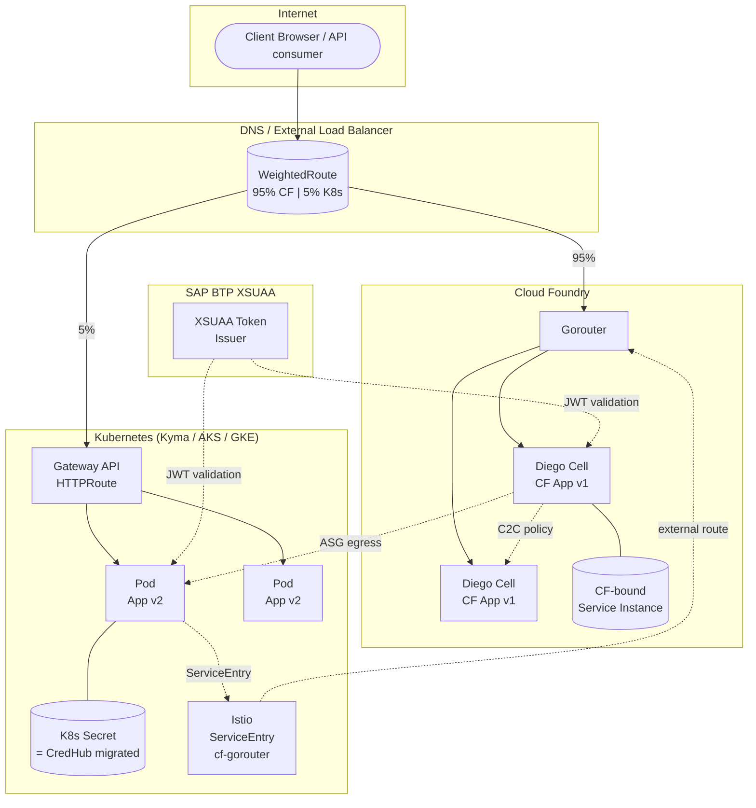

# Coexistence and Cutover: Running CF and K8s in Parallel

## Quick Read

During a migration from Cloud Foundry to Kubernetes you will almost always run both platforms in parallel for weeks or months. This lesson covers the networking plumbing that makes that safe.

**Core idea.** CF Gorouter and a Kubernetes Gateway (or Ingress) can share the same external hostname simultaneously using traffic weights. You shift load incrementally: 5 % to K8s, observe error rates, then advance to 50 % and 100 %. If anything breaks, a single `cf map-route` call or an `HTTPRoute` weight edit returns all traffic to CF in under a minute.

**What you must wire up for coexistence:**

| Direction | CF side | K8s side |
|---|---|---|
| CF app → K8s service | ASG egress rule (CIDR + port) | NetworkPolicy ingress from CF cell overlay CIDR |
| K8s pod → CF app | (none needed) | External DNS resolves CF route; mTLS via Istio ServiceEntry |
| Shared auth | XSUAA JWT issued by same tenant | Same XSUAA JWT; validation code identical |

**Cutover sequence (canary):**

1. Deploy K8s workload; keep CF app running at 100 %.
2. Create Gateway API `HTTPRoute` with `backendRefs` weight 95 (CF) / 5 (K8s).
3. Monitor error rate and latency for 30 minutes.
4. Advance weights: 50/50, then 0/100.
5. Keep CF app staged (not deleted) for 48 hours as a rollback target.
6. Rollback: edit `HTTPRoute` weight back to 100 % CF, or run `cf map-route`.

**Key mapping reminders:**

- `apps.internal` DNS → `svc.cluster.local`
- CF C2C policy → `NetworkPolicy` `podSelector`
- CF ASG → `NetworkPolicy` egress `ipBlock`
- CF org/space → Kubernetes namespace
- CredHub secret → `Secret` + `envFrom.secretRef`

---

## Practice Setup

You need a working `minikube` cluster and a CF environment (SAP BTP CF trial, or a local `cf-for-k8s` / `korifi` install). The examples assume:

- CF API endpoint: `https://api.cf.example.com`
- CF app route: `myapp.cf.example.com`
- Kubernetes cluster ingress IP: `10.100.0.50`
- CF cell overlay CIDR: `10.255.0.0/16`
- K8s pod CIDR: `10.244.0.0/16`
- K8s node CIDR: `10.0.0.0/24`

**Terminal 1 — minikube:**

```bash
minikube start --cni=cilium --kubernetes-version=v1.30.0
minikube addons enable ingress
# Install Gateway API CRDs
kubectl apply -f https://github.com/kubernetes-sigs/gateway-api/releases/download/v1.1.0/standard-install.yaml
```

**Terminal 2 — local Mac:**

```bash
cf login -a https://api.cf.example.com
cf target -o my-org -s my-space
# Confirm the app is running
cf app myapp
cf routes | grep myapp
```

---

## 1. Coexistence Architecture

The diagram below shows traffic flowing through both platforms simultaneously during a canary cutover. An external load balancer (or DNS-based routing) distributes requests between the CF Gorouter and the Kubernetes Gateway.



**Reading the diagram:**

- Both platforms receive real traffic during coexistence.
- Istio `ServiceEntry` lets K8s pods call CF apps through the Gorouter's external hostname without breaking out of the mesh.
- ASG egress rules allow CF cells to reach K8s node IPs; a `NetworkPolicy` on the K8s side permits that traffic inbound.
- XSUAA issues JWTs that are valid on both sides — no token migration required.

---

## 2. CF Apps Callable from K8s

A K8s pod can call a CF app through the app's external route. No special CF configuration is needed; the Gorouter is reachable from anywhere that has internet (or VPN) access to the CF domain.

**Networking requirements:**

1. The CF app must have a public (or VPN-accessible) route: `myapp.cf.example.com`.
2. DNS from inside the cluster must resolve that hostname. Verify:

```bash
# From a debug pod in the cluster
kubectl run dns-test --image=busybox --rm -it --restart=Never -- \
  nslookup myapp.cf.example.com
```

3. If the cluster uses an egress firewall, open port 443 toward the CF Gorouter VIP.
4. For mTLS between the mesh and the Gorouter, use an Istio `ServiceEntry` (see section 4).

**Simple curl call from a pod:**

```bash
kubectl run curl-test --image=curlimages/curl --rm -it --restart=Never -- \
  curl -H "Authorization: Bearer $TOKEN" \
  https://myapp.cf.example.com/api/health
```

**Service DNS alias (optional).** Create a Kubernetes `ExternalName` Service so pods use cluster-internal DNS instead of the raw CF hostname.

```yaml
apiVersion: v1
kind: Service
metadata:
  name: cf-myapp
  namespace: migration
spec:
  type: ExternalName
  externalName: myapp.cf.example.com
  ports:
    - port: 443
      targetPort: 443
```

Pods can now call `https://cf-myapp.migration.svc.cluster.local/api/health`.

---

## 3. K8s Services Callable from CF

CF apps run inside Diego Cells. By default, outbound traffic is restricted by Application Security Groups (ASGs). To reach a K8s service from a CF app you need:

1. An ASG that permits egress to the K8s node CIDR (or pod CIDR if using NodePort/LoadBalancer).
2. A DNS name the CF app can resolve — either the external hostname of a LoadBalancer Service, or an internal DNS entry injected via CF environment variable.

### ASG JSON example

Create a file `k8s-egress-asg.json`:

```json
[
  {
    "protocol": "tcp",
    "destination": "10.0.0.0/24",
    "ports": "30000-32767",
    "description": "K8s NodePort range on node CIDR 10.0.0.0/24"
  },
  {
    "protocol": "tcp",
    "destination": "10.100.0.50/32",
    "ports": "443",
    "description": "K8s LoadBalancer VIP for myapp service"
  },
  {
    "protocol": "tcp",
    "destination": "10.244.0.0/16",
    "ports": "8080,8443",
    "description": "Direct pod CIDR access (requires routable pod IPs)"
  }
]
```

Apply and bind to the space:

```bash
cf create-security-group k8s-egress ./k8s-egress-asg.json
cf bind-security-group k8s-egress my-org my-space --lifecycle running
# Restart apps to pick up the new ASG
cf restart myapp
```

Verify from inside the CF app container:

```bash
cf ssh myapp
# Inside the container:
curl http://10.100.0.50:443/healthz
```

### DNS resolution from CF to K8s

CF containers use the BOSH-deployed DNS. There is no automatic registration of `svc.cluster.local` names. Options:

- Use the LoadBalancer Service's external IP directly (no DNS needed).
- Register a custom DNS entry in your corporate DNS pointing `myservice.k8s.example.com` to the LoadBalancer IP, then set `CF_K8S_SVC_URL=https://myservice.k8s.example.com` as a CF environment variable.
- Use CF User-Provided Service to inject the URL as a bound credential.

---

## 4. Istio ServiceEntry → CF Gorouter

When the K8s workload runs inside an Istio service mesh, outbound traffic to external hosts must be declared in a `ServiceEntry` for Istio to allow and optionally apply mTLS or traffic policies.

```yaml
apiVersion: networking.istio.io/v1beta1
kind: ServiceEntry
metadata:
  name: cf-gorouter-myapp
  namespace: migration
spec:
  hosts:
    - myapp.cf.example.com
  ports:
    - number: 443
      name: https
      protocol: HTTPS
    - number: 80
      name: http
      protocol: HTTP
  location: MESH_EXTERNAL
  resolution: DNS
---
apiVersion: networking.istio.io/v1beta1
kind: DestinationRule
metadata:
  name: cf-gorouter-myapp-tls
  namespace: migration
spec:
  host: myapp.cf.example.com
  trafficPolicy:
    tls:
      mode: SIMPLE          # TLS origination; Gorouter presents a public cert
      sni: myapp.cf.example.com
```

With `MESH_EXTERNAL` and `resolution: DNS`, Istio's Envoy sidecar resolves the hostname at request time and routes to the Gorouter's public IP. The `DestinationRule` enables TLS origination so traffic leaves the sidecar encrypted even if the app code calls `http://`.

**Testing:**

```bash
kubectl exec -n migration deployment/myapp-v2 -- \
  curl -sv http://myapp.cf.example.com/api/ping
# Expect: Istio sidecar upgrades to HTTPS; Gorouter responds 200
```

---

## 5. SAP XSUAA — Token Validation in CF and Kyma

SAP XSUAA issues OAuth2 JWT tokens. The same XSUAA service instance and the same `xs-security.json` scopes work in both CF and Kyma. No token migration is required during coexistence.

**CF binding (auto-injected via VCAP_SERVICES):**

```bash
cf create-service xsuaa application myapp-xsuaa -c xs-security.json
cf bind-service myapp myapp-xsuaa
cf restage myapp
```

The app reads credentials from `VCAP_SERVICES["xsuaa"][0].credentials`.

**K8s binding (Kyma Service Binding):**

```yaml
apiVersion: services.cloud.sap.com/v1
kind: ServiceInstance
metadata:
  name: myapp-xsuaa
  namespace: migration
spec:
  serviceOfferingName: xsuaa
  servicePlanName: application
  parameters:
    xsappname: myapp
    tenant-mode: dedicated
---
apiVersion: services.cloud.sap.com/v1
kind: ServiceBinding
metadata:
  name: myapp-xsuaa-binding
  namespace: migration
spec:
  serviceInstanceName: myapp-xsuaa
  secretName: myapp-xsuaa-secret
```

Mount the secret in the pod:

```yaml
envFrom:
  - secretRef:
      name: myapp-xsuaa-secret
```

The app reads `XSUAA_URL`, `CLIENTID`, `CLIENTSECRET`, and `VERIFICATIONKEY` from env vars — structurally identical to `VCAP_SERVICES` credentials, just delivered via Kubernetes Secret instead of CF binding.

**Validation is identical.** Both the CF and K8s versions of the app call the XSUAA `/token_keys` endpoint (or use the embedded public key) to verify the JWT signature and check scopes. The token issuer URL does not change.

---

## 6. K8s NetworkPolicy — Permit Ingress from CF Cell Overlay CIDR

CF Diego Cells use an overlay network (default `10.255.0.0/16` on OSS CF; SAP BTP CF uses a different range — check your landscape). When a CF app calls a K8s service, the source IP seen by the K8s pod is the Diego Cell's overlay IP.

Apply a `NetworkPolicy` that permits this inbound traffic:

```yaml
apiVersion: networking.k8s.io/v1
kind: NetworkPolicy
metadata:
  name: allow-cf-cell-ingress
  namespace: migration
spec:
  podSelector:
    matchLabels:
      app: myapp-v2        # Only pods receiving CF to K8s calls need this rule
  policyTypes:
    - Ingress
  ingress:
    - from:
        - ipBlock:
            cidr: 10.255.0.0/16    # CF cell overlay CIDR
            except:
              - 10.255.254.0/24    # Exclude CF internal management subnet if present
      ports:
        - protocol: TCP
          port: 8080
        - protocol: TCP
          port: 8443
---
# Also allow inbound from K8s pods in the same namespace (normal pod-to-pod)
apiVersion: networking.k8s.io/v1
kind: NetworkPolicy
metadata:
  name: allow-same-namespace-ingress
  namespace: migration
spec:
  podSelector:
    matchLabels:
      app: myapp-v2
  policyTypes:
    - Ingress
  ingress:
    - from:
        - podSelector: {}
```

**Verify the policy is applied:**

```bash
kubectl get networkpolicy -n migration
kubectl describe networkpolicy allow-cf-cell-ingress -n migration
```

**Test from a CF app:**

```bash
cf ssh myapp
# Inside the container:
curl http://<K8s-LoadBalancer-IP>:8080/healthz
# Should return 200; without the NetworkPolicy it would time out
```

**Finding your CF cell overlay CIDR:**

```bash
# On OSS CF with BOSH
bosh -d cf instances -d cf | grep diego
# On SAP BTP, check the CF landscape documentation or contact your operator
# Common ranges: 10.255.0.0/16 (OSS), 192.168.0.0/16 (some vendors)
```

---

## 7. Canary Cutover

The canary pattern shifts traffic from CF to K8s in small increments so you can catch regressions before they affect all users.

### Sequence diagram

```mermaid
sequenceDiagram
    actor Ops
    participant DNS as External DNS / LB
    participant CF as CF Gorouter (v1)
    participant K8S as K8s Gateway (v2)
    participant Mon as Monitoring

    Note over CF,K8S: Both platforms running; CF at 100%

    Ops->>DNS: Create HTTPRoute weight 95 (CF) / 5 (K8s)
    DNS-->>CF: 95% of requests
    DNS-->>K8S: 5% of requests
    K8S->>Mon: Emit metrics (latency, error rate)
    Mon-->>Ops: 5% slice looks healthy (30 min)

    Ops->>DNS: Update weights to 50 (CF) / 50 (K8s)
    DNS-->>CF: 50% of requests
    DNS-->>K8S: 50% of requests
    Mon-->>Ops: 50% slice healthy (60 min)

    Ops->>DNS: Update weights to 0 (CF) / 100 (K8s)
    DNS-->>K8S: 100% of requests
    Note over CF: CF app still staged (not deleted)

    alt Error rate spikes
        Mon-->>Ops: Alert: p99 latency above threshold
        Ops->>DNS: Rollback: 100 (CF) / 0 (K8s)
        DNS-->>CF: 100% of requests
    else Stable for 48 h
        Ops->>CF: cf delete myapp -f
    end
```

### Gateway API HTTPRoute weight example

This `HTTPRoute` splits traffic between a CF-backed `ExternalName` Service (acting as a backend) and the new K8s `Deployment`.

```yaml
apiVersion: gateway.networking.k8s.io/v1
kind: HTTPRoute
metadata:
  name: myapp-canary
  namespace: migration
spec:
  parentRefs:
    - name: prod-gateway
      namespace: gateway-system
  hostnames:
    - "myapp.example.com"
  rules:
    - backendRefs:
        - name: cf-myapp           # ExternalName Service pointing at CF Gorouter
          port: 443
          weight: 95
        - name: myapp-v2-svc       # ClusterIP Service for K8s Deployment
          port: 8080
          weight: 5
      matches:
        - path:
            type: PathPrefix
            value: /
```

Advance the canary by editing weights. Using `kubectl patch`:

```bash
# Move to 50/50
kubectl patch httproute myapp-canary -n migration --type=json \
  -p='[
    {"op":"replace","path":"/spec/rules/0/backendRefs/0/weight","value":50},
    {"op":"replace","path":"/spec/rules/0/backendRefs/1/weight","value":50}
  ]'

# Move to 100% K8s
kubectl patch httproute myapp-canary -n migration --type=json \
  -p='[
    {"op":"replace","path":"/spec/rules/0/backendRefs/0/weight","value":0},
    {"op":"replace","path":"/spec/rules/0/backendRefs/1/weight","value":100}
  ]'
```

**Monitoring during canary.** Watch these signals in Prometheus / Grafana:

```bash
# Error rate on the K8s backend (Istio metric)
rate(istio_requests_total{destination_service="myapp-v2-svc",response_code=~"5.."}[5m])
  / rate(istio_requests_total{destination_service="myapp-v2-svc"}[5m])

# p99 latency
histogram_quantile(0.99,
  rate(istio_request_duration_milliseconds_bucket{destination_service="myapp-v2-svc"}[5m]))
```

Gate each weight increase on: error rate < 0.1 %, p99 latency within 20 % of CF baseline.

---

## 8. Rollback

If a problem is detected at any weight stage, rollback restores 100 % CF traffic immediately.

### Option A — Edit HTTPRoute (sub-second propagation via Gateway API)

```bash
kubectl patch httproute myapp-canary -n migration --type=json \
  -p='[
    {"op":"replace","path":"/spec/rules/0/backendRefs/0/weight","value":100},
    {"op":"replace","path":"/spec/rules/0/backendRefs/1/weight","value":0}
  ]'
```

The Gateway controller reconciles and updates Envoy listeners within seconds.

### Option B — Map CF route back to 100 % (CF-native)

If the external DNS points directly at the CF Gorouter (no Gateway API in front):

```bash
# Ensure the CF app is still mapped
cf map-route myapp example.com --hostname myapp

# If you had used cf map-route with --weight, reset it
cf map-route myapp example.com --hostname myapp --weight 100
# Remove the K8s route share
cf unmap-route myapp-k8s-proxy example.com --hostname myapp
```

### Option C — DNS failover

If using an external DNS provider with health checks (AWS Route53, Cloudflare):

```bash
# Disable K8s target health check so DNS stops routing to it automatically
# Or manually set CF record weight to 100 and K8s record weight to 0 via your DNS
# provider's CLI
```

### Keeping CF as a cold standby

After full cutover to K8s, do not immediately delete the CF app. Keep it staged for 48-72 hours:

```bash
cf stop myapp          # Frees container quota; route still mapped
# NOT: cf delete myapp  (wait until satisfied)
```

If a production issue surfaces within the standby window:

```bash
cf start myapp
cf map-route myapp example.com --hostname myapp
# Then roll HTTPRoute back to CF as above
```

---

## Production Checklist

Before advancing each canary stage and before final CF decommission:

### Pre-cutover (before first 5 % shift)

- [ ] K8s `Deployment` passes all readiness probes for 10 consecutive minutes
- [ ] `NetworkPolicy` `allow-cf-cell-ingress` applied and tested
- [ ] ASG `k8s-egress` bound to CF space and CF apps restarted
- [ ] Istio `ServiceEntry` created for every CF hostname that K8s pods call
- [ ] XSUAA `ServiceBinding` secret mounted in K8s pods; token validation tested end-to-end
- [ ] CredHub secrets migrated to K8s `Secret` objects; no hardcoded credentials
- [ ] `HTTPRoute` with 95/5 weights created and confirmed by `kubectl describe httproute`
- [ ] Monitoring dashboards active; alert thresholds set

### During canary (at each weight stage)

- [ ] Error rate < 0.1 % for 30+ minutes on K8s backend
- [ ] p99 latency within 20 % of CF baseline
- [ ] No increase in CF app crash/restart rate (CF side still healthy)
- [ ] Logs from K8s pods show no authentication errors (XSUAA)
- [ ] Database connections from K8s pods stable (no connection pool exhaustion)

### At 100 % K8s

- [ ] CF app stopped (not deleted) — rollback target active
- [ ] CF route still mapped (do not `cf delete-route` yet)
- [ ] Confirm zero traffic to CF Gorouter for the hostname via access logs
- [ ] 48-hour observation window started

### Final decommission (48 h after 100 % K8s)

- [ ] No rollback events in the 48-hour window
- [ ] Stakeholder sign-off obtained
- [ ] `cf delete myapp -f` executed
- [ ] `cf delete-route example.com --hostname myapp` executed
- [ ] CF service instances unbound and deleted
- [ ] `ExternalName` Service for CF Gorouter removed from K8s
- [ ] Istio `ServiceEntry` for CF Gorouter removed (if no longer needed)
- [ ] ASG `k8s-egress` retained or adjusted for remaining CF apps

---

## See Also / Online Resources

| Resource | URL |
|---|---|
| Gateway API HTTPRoute specification | https://gateway-api.sigs.k8s.io/api-types/httproute/ |
| Gateway API Traffic Splitting guide | https://gateway-api.sigs.k8s.io/guides/traffic-splitting/ |
| Kubernetes NetworkPolicy reference | https://kubernetes.io/docs/concepts/services-networking/network-policies/ |
| Istio ServiceEntry reference | https://istio.io/latest/docs/reference/config/networking/service-entry/ |
| CF Application Security Groups | https://docs.cloudfoundry.org/concepts/asg.html |
| CF route weights (blue-green) | https://docs.cloudfoundry.org/devguide/deploy-apps/routes-domains.html#weighted-routing |
| SAP BTP Kyma Service Binding | https://help.sap.com/docs/btp/sap-business-technology-platform/using-sap-btp-services-in-kyma-environment |
| SAP XSUAA on Kyma | https://help.sap.com/docs/btp/sap-business-technology-platform/using-sap-xsuaa-connectivity-in-kyma |
| Argo Rollouts canary (alternative) | https://argoproj.github.io/argo-rollouts/features/canary/ |
| CF-to-K8s migration patterns (Korifi) | https://www.cloudfoundry.org/blog/korifi-runs-cf-workloads-natively-on-kubernetes/ |
