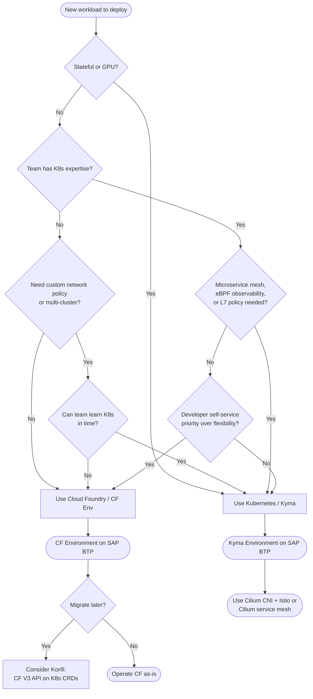

# Cloud Foundry vs Kubernetes: Networking Reference

> Reference document — not a lesson. Intended for platform engineers evaluating or migrating between CF and Kubernetes environments.

---

## Executive Summary

Cloud Foundry (CF) and Kubernetes are both container orchestration platforms, but they occupy different positions on the abstraction spectrum. CF delivers a tightly integrated, opinionated application runtime: developers `cf push` source code and receive a routable URL with zero manifest overhead. The platform enforces network boundaries through App Security Groups and container-to-container (C2C) policies keyed on stable App GUIDs, which remain valid across restarts and re-pushes. This model suits organizations that prioritize developer velocity, auditability via GUID-stable policy references, and predictable egress control without burdening application teams with infrastructure concepts.

Kubernetes offers a lower-level, composable substrate. Teams assemble their own ingress controllers, CNI plugins, service mesh layers, and policy engines. This flexibility enables capabilities CF cannot match — eBPF-based observability, L7-aware network policies, multi-cluster federation, and GPU workload scheduling — but it requires dedicated platform engineering effort. The right choice depends on the operational maturity of the platform team, the diversity of workload types, and whether developer simplicity or infrastructure flexibility is the primary constraint. In practice, SAP BTP provides both: the CF Environment for lift-and-shift and developer-first workloads, and the Kyma Environment (Kubernetes) for microservice architectures that need fine-grained control.

---

## Full Concept Mapping Table

| Networking Dimension | Cloud Foundry | Kubernetes |
|---|---|---|
| **Overlay network** | VXLAN via Silk CNI; default CIDR 10.255.0.0/16 | CNI-plugin dependent (Flannel VXLAN, Calico, Cilium eBPF, Weave) |
| **IP assignment model** | Each Diego Cell gets a /24 subnet; ~254 container IPs per cell; max 250 cells | Each Node gets a pod CIDR from the cluster range; size configurable per node |
| **Container networking** | Silk CNI assigns overlay IP; underlay NIC on host; veth pair into container namespace | CNI plugin assigns podIP from node CIDR; veth pair into pod netns |
| **DNS for apps** | BOSH DNS; `apps.internal` domain for C2C; no ndots:5 search chain | CoreDNS; `<svc>.<ns>.svc.cluster.local`; ndots:5 search chain by default |
| **DNS health awareness** | BOSH DNS performs health checks; client-side load balancing baked in | CoreDNS is dumb forwarder; health-aware LB requires ExternalDNS or service mesh |
| **Service discovery** | Gorouter in-memory routing table; NATS-based registration; Route Emitter refreshes every 20 s; TTL 2 min | kube-proxy programs iptables/IPVS rules for ClusterIP; relies on Endpoints/EndpointSlice |
| **Ingress / edge routing** | Gorouter (L7 HTTP/WebSocket); HAProxy or custom for TCP; SNI-based TLS termination | Ingress controller (nginx, Contour, Istio Gateway, Envoy, Traefik); IngressClass selects controller |
| **Ingress routing model** | Route-based (`app.sys.example.com`); routes registered per App GUID | Host/path/header rules in Ingress or HTTPRoute (Gateway API) resources |
| **Route registration** | Route Emitter on Diego Cell reads CC API → publishes NATS route-register messages | Service object + Ingress/HTTPRoute; no active registration daemon needed |
| **TLS termination** | Gorouter terminates TLS; cert managed by platform operator (CredHub) | Ingress controller terminates TLS; cert managed by cert-manager or cloud LB |
| **mTLS between workloads** | Optional C2C with mutual TLS via envoy sidecar (Istio integration); not on by default | Istio or Linkerd sidecar injection; Cilium SPIFFE identity; not on by default |
| **Network policy model** | App Security Groups (ASGs) for egress; C2C policies for internal east-west | NetworkPolicy (L3/L4); Cilium/Calico extend to L7; AdminNetworkPolicy (KEP-2091) |
| **Policy identity** | Stable App GUID (survives restarts); Space-scoped | Pod label selector; namespace selector; not stable across recreate |
| **Default posture (east-west)** | C2C default-deny; explicit allow per GUID pair | NetworkPolicy default-allow unless a policy selects the pod; then default-deny |
| **Default posture (egress)** | ASG default-deny unless a Running ASG allows the CIDR/port | No default egress restriction; requires explicit egress NetworkPolicy |
| **Policy enforcement plane** | VXLAN Policy Agent on each Cell polls Policy Server → iptables ACCEPT/DROP rules | kube-proxy (iptables/IPVS) for Services; CNI plugin for NetworkPolicy |
| **Egress control granularity** | ASG: protocol, CIDR range, port, description; Staging vs Running lifecycle | NetworkPolicy egress: pod/namespace selector + CIDR + port; no lifecycle distinction |
| **Multi-tenancy isolation** | Orgs and Spaces; ASGs scoped to Space or global; C2C scoped to Space | Namespaces; NetworkPolicy per namespace; no built-in Org abstraction |
| **Load balancing (internal)** | Gorouter round-robin across app instances; sticky sessions supported | kube-proxy round-robin or IPVS (rr/lc/sh); service mesh adds weighted/subset routing |
| **Load balancing (external)** | Cloud-provider load balancer fronts Gorouter HA pair | LoadBalancer Service type or Ingress; MetalLB for bare-metal |
| **Health check integration** | Diego health check gates route registration; unhealthy instances removed from Gorouter | Readiness probe gates Endpoints inclusion; liveness probe triggers restart |
| **Observability — connection level** | Gorouter access logs (X-Forwarded-For, response time, status); no per-flow kernel metrics | Pod-level flow logs via Cilium Hubble, Calico flow logs, or eBPF-based metrics |
| **Observability — distributed tracing** | Requires app-level instrumentation; no sidecar injection by default | Istio/Linkerd auto-inject Envoy; Jaeger/Tempo integration out of box |
| **Overlay protocol** | VXLAN (UDP 4789) via Silk | CNI-dependent: VXLAN, Geneve, WireGuard, or no overlay (BGP native routing) |
| **CNI plugin** | Silk (CF-proprietary); no third-party CNI swap supported in production CF | Any conformant CNI: Calico, Cilium, Flannel, AWS VPC CNI, Azure CNI, etc. |
| **IPv6 support** | Not supported in Silk/CF networking stack | Dual-stack supported since K8s 1.21 (IPv4/IPv6 simultaneously) |
| **Network namespace lifecycle** | Created per container instance by Garden/runC; destroyed on instance stop | Created per pod by container runtime (containerd/CRI-O); destroyed on pod termination |
| **Sidecar injection** | Manual opt-in via app manifest or platform-level Envoy injection (Tanzu) | Admission webhook auto-injection (Istio, Linkerd, Dapr) per namespace label |
| **Service mesh integration** | Tanzu Service Mesh wraps Gorouter; limited native mesh support | First-class: Istio, Linkerd, Consul Connect, Cilium service mesh |
| **Multi-cluster networking** | Not natively supported; relies on shared Gorouter domains | Istio multi-cluster, Cilium Cluster Mesh, Submariner, Liqo |
| **GPU / accelerator networking** | Not supported | NVIDIA device plugin; RDMA over InfiniBand/RoCE; GPUDirect networking |
| **Config API** | CC API (REST); CLI `cf` commands; no manifest-based network config | Declarative YAML manifests; kubectl; CRD-based extensions |
| **Korifi (2026 state)** | CF V3 API translated to K8s CRDs: CFApp, CFRoute, CFBuild, CFSpace; Contour replaces Gorouter | Native K8s underneath Korifi; HTTPRoute for routing; CNI unchanged |

---

## Capability Gap Matrix

### What Kubernetes Has That CF Does Not

| Capability | K8s Mechanism | Why It Matters |
|---|---|---|
| **eBPF-based data plane** | Cilium eBPF programs loaded into kernel; replaces iptables entirely | Sub-microsecond policy enforcement; kernel-bypass for observability; no conntrack overhead |
| **L7-aware network policy** | Cilium CiliumNetworkPolicy `toFQDNs`, HTTP method/path rules; Istio AuthorizationPolicy | Block specific HTTP verbs or paths between services; not possible with iptables-only CNI |
| **Multi-cluster federation** | Cilium Cluster Mesh, Istio multi-primary, Submariner, Liqo | Active-active workloads across cloud regions; DR without DNS TTL games |
| **GPU and accelerator workloads** | NVIDIA device plugin, RDMA CNI, GPUDirect RDMA, NVLink topology awareness | AI/ML training jobs; CF has no device plugin model |
| **Arbitrary CRD extensions** | Any controller can extend the API; Operator pattern | Databases, message queues, certificates — all as first-class K8s objects |
| **Stateful workloads** | StatefulSet with stable network identity (`pod-0.svc.ns`); PVC per pod | CF is stateless-only; no stable per-instance hostname |
| **DaemonSet networking agents** | Node-level agents for CNI, logging, monitoring deployed as DaemonSets | Fine-grained node-level control; CF Cell agents are BOSH-managed, not operator-extensible |
| **Gateway API (HTTPRoute)** | Traffic splitting, header-based routing, A/B, canary — all in-cluster | Gorouter supports header-based routing only via plugins; no native traffic splitting |
| **AdminNetworkPolicy** | Cluster-scoped policy overrides namespace policies; guaranteed baseline | CF uses global ASGs but no equivalent cluster-scoped L4 policy that namespaces cannot override |
| **WireGuard node-to-node encryption** | Cilium/Calico WireGuard mode; zero app changes | CF relies on IPsec or no encryption at the overlay layer |

### What CF Has That Kubernetes Does Not (Without Add-ons)

| Capability | CF Mechanism | Kubernetes Gap |
|---|---|---|
| **Developer-first push UX** | `cf push`: buildpack detection, staging, route registration — single command | K8s requires Dockerfile/image, Deployment YAML, Service YAML, Ingress YAML; steep learning curve |
| **GUID-stable policies** | ASGs and C2C policies reference App GUID, not ephemeral IPs or labels | K8s NetworkPolicy uses label selectors; labels can be changed; no identity anchored to workload lifecycle |
| **App Security Groups (ASGs)** | Named, reusable egress allow-lists; Staging vs Running lifecycle distinction; global or space-scoped | K8s egress NetworkPolicy has no Staging/Running lifecycle; no reusable named groups without CRDs |
| **Gorouter NATS registration** | Route Emitter auto-registers routes; no operator YAML required; routes survive Cell restarts | K8s Ingress requires explicit host/path entries; no auto-registration from workload |
| **BOSH DNS with health awareness** | Client-side LB with health checks in DNS; unhealthy instances excluded before TCP connect | CoreDNS returns all A records; health-awareness requires Envoy sidecar or external tooling |
| **Buildpack-based image construction** | Heroku-style buildpack detects language, compiles, layers; no Dockerfile needed | K8s accepts OCI images only; buildpacks available via Cloud Native Buildpacks (CNB) but separate step |
| **Built-in multi-tenancy (Orgs/Spaces)** | Orgs and Spaces with RBAC and network isolation without namespace sprawl | K8s namespaces are single-level; Org/Space hierarchy requires Hierarchical Namespaces (HNC) add-on |
| **Automatic route de-registration on failure** | Diego detects instance failure → Route Emitter withdraws NATS message → Gorouter removes route | K8s readiness probe removes from Endpoints, but probe interval adds latency to traffic shift |
| **CredHub integration for TLS** | Gorouter certs managed by CredHub; automatic rotation; no cert-manager setup | cert-manager is excellent but requires separate installation and CRD management |

---

## Decision Flowchart



---

## SAP BTP Context: CF Environment vs Kyma Environment

| Dimension | BTP CF Environment | BTP Kyma Environment |
|---|---|---|
| **Underlying platform** | Cloud Foundry (Diego + Silk + Gorouter) | Kubernetes (managed, SAP-operated) |
| **Developer interface** | `cf push` / CF CLI / CF manifest | `kubectl` / Helm / Kyma Console |
| **Networking model** | Silk VXLAN overlay; Gorouter HTTP routing; ASGs for egress | CNI-based pod networking; Istio service mesh; API Rules for routing |
| **Ingress** | Gorouter with SAP-managed wildcard TLS cert (*.cfapps.region.hana.ondemand.com) | Istio Ingress Gateway with API Rule CRD; custom domain support |
| **Service discovery** | BOSH DNS; apps.internal; CF service binding injects VCAP_SERVICES | K8s DNS (CoreDNS); BTP service binding injects credentials via Secret/Volume |
| **Network isolation** | Space-level isolation via ASGs and C2C policy | Namespace-level isolation via NetworkPolicy; Istio AuthorizationPolicy |
| **Egress control** | Running ASGs per Space; operator-defined global ASGs | Egress NetworkPolicy or Istio ServiceEntry; no built-in lifecycle concept |
| **BTP service connectivity** | CF service broker binds services; connectivity via CF environment variables | SAP BTP Operator; Kubernetes Secret injection; transparent proxy for on-premise |
| **On-premise connectivity** | Cloud Connector → Connectivity Service → CF app (via env proxy) | Cloud Connector → Connectivity Service → Transparent Proxy sidecar in pod |
| **Multi-tenancy** | BTP Sub-account = CF Org; Space = team boundary | BTP Sub-account = Kyma cluster (or namespace per tenant) |
| **Observability** | Loggregator (Doppler); CF metrics; limited network flow visibility | Prometheus + Grafana stack; Istio telemetry; Hubble (if Cilium); Jaeger tracing |
| **Scaling** | `cf scale -i N` horizontal; buildpack vertical via memory/disk quotas | HPA / KEDA autoscaling; VPA for vertical; custom metrics supported |
| **Deployment model** | Source push → buildpack → droplet → Diego Cell scheduling | OCI image → Helm chart → K8s scheduler → Node |
| **TLS between services** | Optional mTLS via Istio integration; not default | Istio auto-mTLS between services in mesh; PeerAuthentication per namespace |
| **Pricing / cost model** | Per GB memory per hour (CF application container quota) | Per node compute; SAP manages control plane |
| **Target workloads** | 12-factor apps, enterprise Java, Node.js, Python, Ruby lift-and-shift | Microservices, event-driven, AI/ML, stateful, custom operators |
| **Extension / customization** | Limited; CF buildpacks and service brokers only | Full CRD + Operator model; any K8s-native toolchain |
| **CAP / CAPM app fit** | Native; most CAP documentation targets CF deployment | Supported via CAP Helm chart; more setup required |
| **Long-term roadmap** | SAP continuing CF investments; Korifi bridge under evaluation | SAP strategic platform; active investment; feature velocity higher |

---

## Migration Readiness Checklist

Use this checklist when evaluating migration of a CF workload to Kubernetes (Kyma or self-managed).

### Application Architecture

- [ ] Application is stateless (no local disk state between requests)
- [ ] All configuration is externalized (environment variables, Secrets, ConfigMaps — not baked into the droplet)
- [ ] Application starts and stops cleanly on SIGTERM within 30 seconds
- [ ] Application exposes a health check endpoint (HTTP 200 on `/health` or equivalent)
- [ ] No dependency on CF-specific environment variables (`VCAP_SERVICES`, `VCAP_APPLICATION`) without an adapter layer
- [ ] Logging goes to stdout/stderr (not to files inside the container)
- [ ] Application is 12-factor compliant

### Networking and Routing

- [ ] All routes are HTTP/HTTPS (TCP routes require additional Ingress config in K8s)
- [ ] Application does not rely on Gorouter sticky-session cookies without equivalent Ingress annotation
- [ ] C2C policies documented as a source/destination GUID map (will become NetworkPolicy or ServiceEntry)
- [ ] All ASG rules catalogued: destination CIDRs, ports, protocols
- [ ] On-premise connectivity via Cloud Connector identified; Transparent Proxy configured in Kyma target
- [ ] Custom domains identified; cert-manager or wildcard cert available on K8s cluster
- [ ] WebSocket routes identified; Ingress controller must support WebSocket upgrade

### Service Dependencies

- [ ] All CF service bindings inventoried (databases, message queues, identity services)
- [ ] BTP service instances available via SAP BTP Operator on Kyma target
- [ ] VCAP_SERVICES parsing replaced with K8s Secret/Volume mounting or BTP Operator binding
- [ ] Service broker-provisioned credentials have equivalent in K8s (ExternalSecret, sealed-secret, etc.)

### Identity and Security

- [ ] App identity (CF App GUID-based) translated to K8s ServiceAccount for mTLS SPIFFE identity
- [ ] ASG egress rules translated to K8s egress NetworkPolicy rules (or Cilium FQDN policies)
- [ ] C2C allow-list translated to K8s NetworkPolicy ingress rules per destination workload
- [ ] Staging-phase network access requirements reviewed (init containers in K8s do not have separate ASG lifecycle)
- [ ] Platform-level mTLS (Istio PeerAuthentication) policy defined for new namespace

### Observability and Operations

- [ ] Log aggregation pipeline updated to scrape K8s pod logs (Fluent Bit, Loki, etc.)
- [ ] Metrics instrumentation compatible with Prometheus exposition format
- [ ] Distributed tracing headers (B3 / W3C TraceContext) propagated by application code
- [ ] Alerting rules migrated from CF Healthwatch to Prometheus AlertManager equivalents
- [ ] Runbooks updated to reference `kubectl` commands instead of `cf` commands

### Build and Deploy Pipeline

- [ ] CF buildpack replaced with Cloud Native Buildpack (CNB / `pack build`) or Dockerfile
- [ ] OCI image stored in a container registry accessible from K8s cluster
- [ ] CI/CD pipeline updated: `cf push` → `helm upgrade --install` or `kubectl apply`
- [ ] Blue/green or canary deployment strategy defined (Argo Rollouts, Flagger, or manual)
- [ ] Image vulnerability scanning added to pipeline

### Operational Readiness

- [ ] Platform team trained on `kubectl`, Helm, and cluster operations
- [ ] Namespace naming convention and RBAC roles defined
- [ ] Resource quotas and LimitRanges set per namespace
- [ ] Network policy default-deny baseline applied to target namespace
- [ ] HPA or KEDA autoscaling policy defined to match CF `cf scale -i` behavior
- [ ] Cluster upgrade runbook available; application disruption budget assessed

### Korifi-Specific (If Using CF API on K8s)

- [ ] CF V3 API compatibility verified for all `cf` CLI commands in use
- [ ] CFApp, CFRoute, CFBuild, CFSpace CRDs deployed in target cluster
- [ ] Contour Ingress controller installed (replaces Gorouter in Korifi)
- [ ] kpack or CNB builder configured for buildpack-based staging
- [ ] CF service broker compatibility with Korifi service binding CRDs verified

---

## Key CF Networking Parameters (Quick Reference)

| Parameter | Value | Notes |
|---|---|---|
| Silk VXLAN CIDR | 10.255.0.0/16 | Default; operator-configurable at deploy time |
| Per-Cell subnet size | /24 | 254 usable container IPs per Diego Cell |
| Max Diego Cells | 250 | At default /24 per cell within /16 |
| Gorouter refresh interval | 20 seconds | Route Emitter → NATS publish cycle |
| Route TTL | 2 minutes | Gorouter drops route if no refresh within TTL |
| VXLAN Policy Agent poll interval | Configurable; default ~5 s | Polls Policy Server for C2C allow-list → updates iptables |
| BOSH DNS domain for C2C | apps.internal | App DNS names: `<app-name>.apps.internal` |
| ASG lifecycle phases | Staging, Running | Separate allow-lists for build vs runtime egress |
| CF CC API port | 443 (HTTPS) | Cloud Controller API; used by Route Emitter and CF CLI |
| Gorouter HTTP port | 80, 443 | External; HAProxy fronts in HA deployments |

---

## Further Reading

- [CF Networking docs — container-to-container networking](https://docs.cloudfoundry.org/concepts/understand-cf-networking.html)
- [Silk CNI GitHub](https://github.com/cloudfoundry/silk)
- [Korifi project](https://github.com/cloudfoundry/korifi)
- [Kubernetes NetworkPolicy reference](https://kubernetes.io/docs/concepts/services-networking/network-policies/)
- [Cilium eBPF CNI](https://cilium.io/learn/technology/)
- [SAP BTP Kyma Environment networking](https://help.sap.com/docs/btp/sap-business-technology-platform/kyma-environment)
- [SAP BTP CF Environment networking](https://help.sap.com/docs/btp/sap-business-technology-platform/cloud-foundry-environment)
- [Gateway API (SIG-Network)](https://gateway-api.sigs.k8s.io/)

---

## CF Networking Internals Deep-Dive

### Silk CNI Data Path

When a CF application container starts, the following steps occur in order:

1. Diego Cell's Garden creates a network namespace for the container.
2. Silk CNI plugin is called by Garden; it assigns an IP from the Cell's /24 slice of 10.255.0.0/16.
3. A veth pair is created: one end in the container namespace (`eth0`), the other in the host namespace.
4. VXLAN encapsulation: host kernel wraps inter-cell traffic in UDP/4789 frames with VXLAN Network Identifier (VNI) derived from the overlay.
5. The host's vtep device (`silk-vtep`) handles encap/decap using kernel VXLAN offload when available.
6. The Cell's flannel-like routing table maps remote container IPs to the remote Cell's underlay IP.

Intra-cell traffic (container to container on same Cell) never hits VXLAN — it traverses the bridge directly.

### Gorouter Request Flow

```
Client
  → DNS resolves *.cfapps.region.hana.ondemand.com → Load Balancer VIP
  → Load Balancer → Gorouter (active/standby pair)
  → Gorouter looks up route in in-memory table (route = hostname + path → app GUID + instance IPs)
  → Gorouter selects instance (round-robin or sticky)
  → HTTP request forwarded to Diego Cell IP:port
  → Container receives on mapped port → app process on 8080 (or $PORT)
```

The in-memory routing table is populated by Route Emitter. Route Emitter runs on every Diego Cell, watches the BBS (Bulletin Board System) for running LRPs, and publishes NATS messages of the form:

```json
{
  "host": "10.255.14.3",
  "port": 61002,
  "uris": ["my-app.cfapps.example.com"],
  "app": "deadbeef-1234-...",
  "private_instance_id": "...",
  "ttl": 120
}
```

If a Cell loses NATS connectivity, routes age out after 2 minutes (TTL). Gorouter returns 502 for routes with no healthy backends.

### C2C Policy Enforcement Path

```
App A (10.255.14.5) → App B (10.255.21.8)

1. VXLAN Policy Agent on Cell A periodically polls Policy Server REST API
   GET /networking/v1/internal/policies?id=<app-a-guid>
   Response: [{source: app-a-guid, destination: app-b-guid, port: 8080, protocol: tcp}]

2. Agent translates policy to iptables rules in the container's network namespace:
   -A netout--<container-id> -d 10.255.21.8/32 -p tcp --dport 8080 -j ACCEPT

3. If no policy exists:
   -A netout--<container-id> -j REJECT  (default-deny for C2C traffic)

4. VXLAN encapsulates packet; remote Cell's iptables run the same check in reverse
   (ingress policy enforced on destination Cell).
```

The VXLAN header carries the source App GUID encoded in the VNI field (high bits) so that remote Cells can apply ingress policy without maintaining state.

### ASG Enforcement Path

ASGs are enforced by iptables rules injected into the container's network namespace for traffic leaving the overlay toward the underlay:

```
Container egress → veth → host bridge → iptables FORWARD chain
  → Chain: netout--<container-id>
    → ACCEPT rules per ASG entry (CIDR + port + protocol)
    → Default REJECT at chain end
```

Staging ASGs apply only during the `cf push` staging phase (Diego Task). Running ASGs apply to Diego LRP instances. Global ASGs apply to all Spaces; Space-scoped ASGs apply only to that Space's containers.

---

## Troubleshooting Quick Reference

### CF Networking Diagnostics

| Symptom | First Command | What to Check |
|---|---|---|
| App unreachable externally | `cf app <name>` | Routes listed? State RUNNING? |
| 502 from Gorouter | `cf logs <name> --recent` | App crashing? Port mismatch ($PORT)? |
| C2C connection refused | `cf network-policies` | Policy for source→dest GUID exists? Port matches? |
| C2C connection timeout | `cf ssh <app>` → `netstat -an` | Firewall on Cell underlay (security group at IaaS level)? |
| ASG egress blocked | `cf security-groups` | Running ASG allows CIDR/port? Global vs Space-scoped? |
| DNS not resolving apps.internal | `cf network-policies` + nslookup inside container | C2C policy required even for DNS; check BOSH DNS health |
| Route not registering | `cf map-route` / Route Emitter logs | NATS connectivity from Cell? CC API accessible from Cell? |

### Kubernetes Networking Diagnostics

| Symptom | First Command | What to Check |
|---|---|---|
| Pod cannot reach Service | `kubectl get endpoints <svc>` | Endpoints populated? Pod readiness probe passing? |
| Service unreachable by name | `kubectl exec <pod> -- nslookup <svc>` | CoreDNS running? ndots:5 search chain? |
| NetworkPolicy blocking | `kubectl get networkpolicy -n <ns>` | Ingress/egress rules cover the pod's labels? |
| Ingress 404 | `kubectl describe ingress <name>` | Host matches? Path regex correct? IngressClass set? |
| Ingress 502/503 | `kubectl get endpoints <svc>` | Backend pods healthy? Port name matches? |
| Pod-to-pod blocked (Cilium) | `hubble observe --pod <src>` | CiliumNetworkPolicy verdict DROP? FQDN policy miss? |
| mTLS SPIFFE error (Istio) | `istioctl x check-inject -n <ns>` | Sidecar injected? PeerAuthentication mode STRICT? |
| NodePort not reachable | `kubectl get svc` + firewall rules | Node security group allows NodePort range 30000-32767? |
