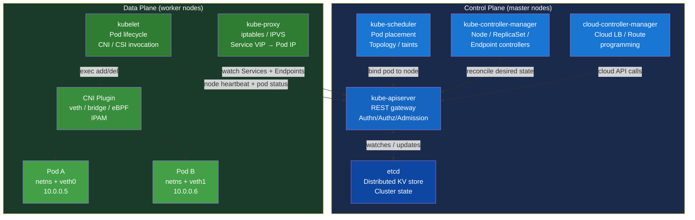
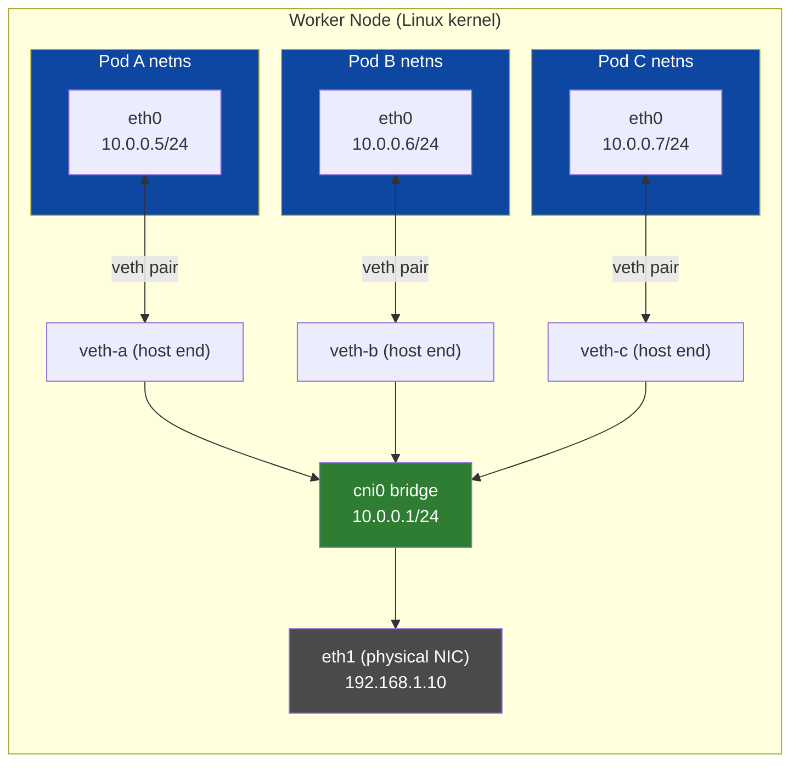
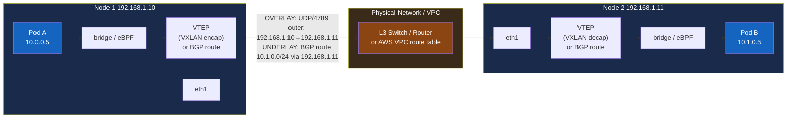
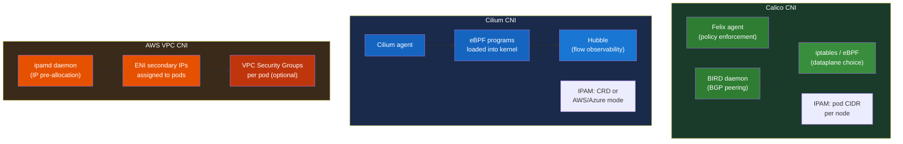
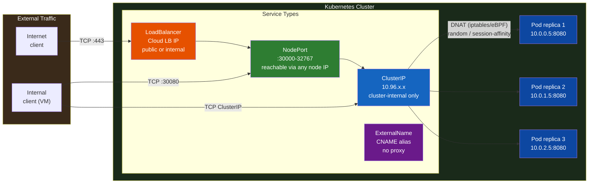
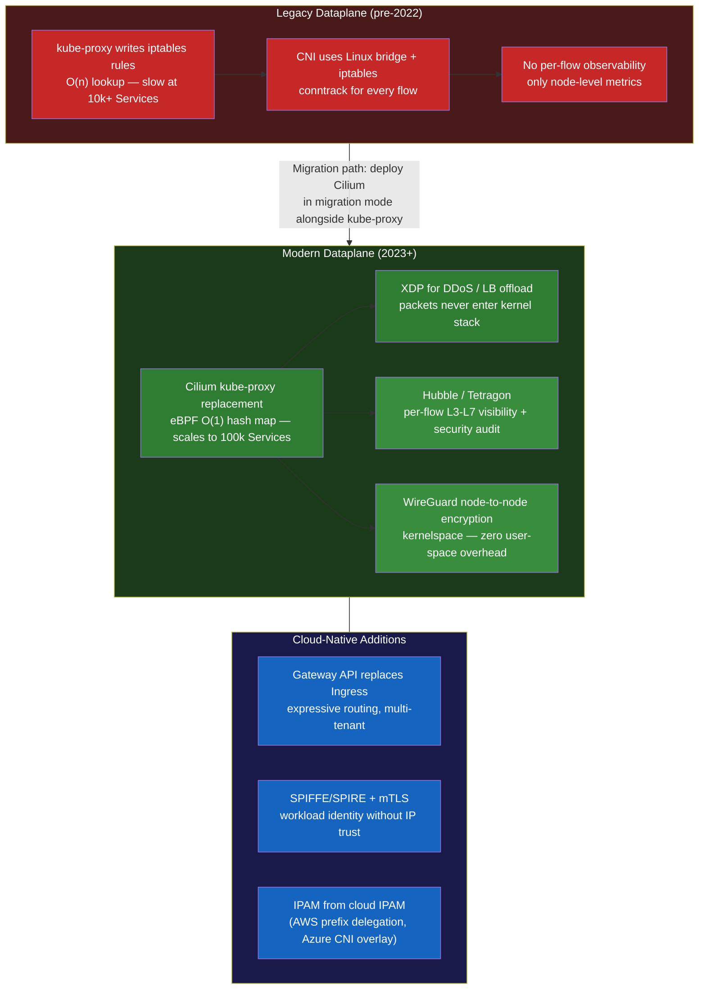

# Lesson 00 — Kubernetes Networking: Visual Overview

> **Track:** Orientation · **Prerequisites:** None · **Duration:** ~30 minutes (read-only)

> **Goal:** Build a complete mental picture of Kubernetes networking before touching a single command. Every diagram in this lesson maps directly to a later lesson — use it as a reference you return to throughout the course.

---

## How to Use This Lesson

Read this top-to-bottom once before starting Track A. The six diagrams progress from the inside out:

1. Kubernetes control/data plane split
2. Pod networking on a single node
3. Pod-to-pod traffic across nodes
4. CNI plugin comparison (Calico vs Cilium vs VPC CNI)
5. Service types and traffic paths
6. State-of-the-art 2026 dataplane (eBPF vs iptables)

Each diagram is self-contained. On a reMarkable or e-reader, zoom in on each one individually.

---

## 1. Kubernetes Architecture — Control Plane and Data Plane

Every Kubernetes cluster splits into two planes. The **control plane** decides what should happen; the **data plane** makes it happen.

> **Key insight:** The control plane never touches packet forwarding. kubelet and kube-proxy on each worker node do all the dataplane work, driven by watch streams from the API server.

---

## 2. Pod Networking — Single Node

Every pod gets its own Linux network namespace connected to the node via a **veth pair**. The node side of each veth attaches to a bridge (or eBPF program), which forwards between pods and to the node's physical NIC.

> **What CNI does:** At pod start, kubelet calls the CNI plugin binary with `ADD`. CNI creates the veth pair, moves one end into the pod's netns, assigns an IP via IPAM, and programs a route on the bridge. At pod deletion it calls `DEL` to clean up.

---

## 3. Pod-to-Pod Traffic — Across Nodes

When Pod A on Node 1 sends a packet to Pod B on Node 2, the packet must cross the underlay network. CNI plugins solve this in two fundamentally different ways: **overlay** (encapsulate) or **underlay routing** (BGP).

| Approach | CNI Example | Encapsulation | Requires |
|----------|------------|---------------|----------|
| Overlay (VXLAN) | Flannel, Calico VXLAN mode | UDP 4789 wrapper | No underlay changes |
| Underlay (BGP) | Calico BGP, Cilium native | None — real IPs | Router peering |
| Cloud native | AWS VPC CNI, GKE | None — VPC routes | Cloud IAM |

---

## 4. CNI Plugin Comparison

The three dominant CNI families use fundamentally different dataplanes.

| Feature | Calico | Cilium | AWS VPC CNI |
|---------|--------|--------|------------|
| Dataplane | iptables or eBPF | eBPF only | VPC routes |
| BGP peering | Yes (BIRD) | Optional | No |
| NetworkPolicy | Yes | Yes + extended | Yes (via SG) |
| Observability | Limited | Hubble (rich) | VPC Flow Logs |
| Pod density limit | None | None | ENI slots |

---

## 5. Kubernetes Service Types — Traffic Paths

A Service is a stable virtual IP (ClusterIP) backed by an Endpoints list. kube-proxy (or eBPF) translates the VIP to a real pod IP at the kernel level using DNAT.

> **How kube-proxy works:** It watches the API server for Service/Endpoints changes and writes iptables DNAT rules (or IPVS entries, or loads eBPF programs in Cilium kube-proxy replacement mode). The kernel intercepts packets destined for the ClusterIP and rewrites the destination before routing.

---

## 6. State of the Art — 2026 Kubernetes Dataplane

Modern production clusters are moving from iptables to eBPF. Here is the full picture of where the industry stands.

| Era | kube-proxy | CNI dataplane | Observability | Encryption |
|-----|-----------|---------------|---------------|------------|
| 2018–2021 | iptables | bridge + conntrack | node metrics only | manual mTLS |
| 2022–2023 | IPVS option | Calico eBPF (beta) | Hubble (alpha) | WireGuard |
| 2024–2026 | Cilium replacement | eBPF XDP | Hubble + Tetragon | WireGuard default |

---

## What Comes Next

Each diagram above is covered in depth in later lessons:

| Diagram | Deep-dive lesson |
|---------|-----------------|
| Control / data plane split | [Lesson 01 — Linux Networking Fundamentals](01-linux-networking-fundamentals.md) |
| Pod networking on a node | [Lesson 04 — Network Namespaces Deep Dive](04-network-namespaces-deep-dive.md) |
| Cross-node traffic | [Lesson 05 — VXLAN and Overlay Networks](05-vxlan-and-overlay-networks.md) |
| CNI comparison | [Lesson 11 — Calico CNI](11-calico-cni-deep-dive.md) · [Lesson 12 — Cilium CNI](12-cilium-cni-ebpf.md) |
| Service types | [Lesson 13 — Kubernetes Services and kube-proxy](13-kubernetes-services-kube-proxy.md) |
| eBPF dataplane | [Lesson 10 — eBPF and XDP](10-ebpf-xdp.md) · [Lesson 12 — Cilium CNI](12-cilium-cni-ebpf.md) |
