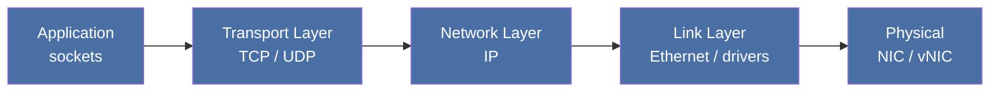
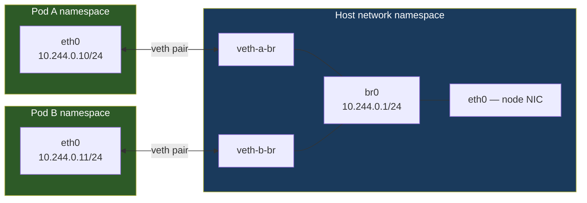
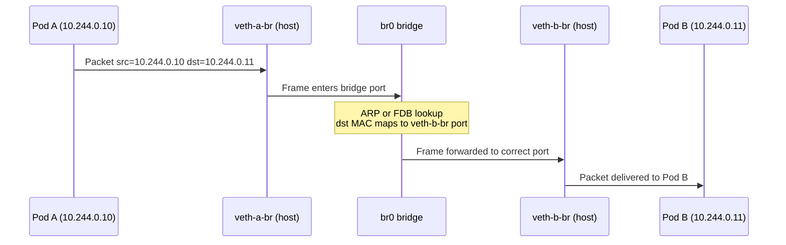

# Lesson 01 — Linux Networking Fundamentals

> **Track:** Network Foundation — Bare Metal & Cloud · **Prereqs:** Basic Linux command line familiarity · **Time:** ~2 hours

> **Goal:** Wire two virtual pods together on a single Linux host using veth pairs, a bridge, and ip_forward — replicating exactly what every CNI plugin does on node startup.

---

## Practice Setup

All commands in this lesson run on **Linux**. Use two terminals side by side:

```bash
# Terminal 1 — minikube Linux node
minikube ssh

# Terminal 2 — your Mac (observe differences)
ip addr   # uses iproute2mac wrapper
```

Inside `minikube ssh` you have full Linux networking: `ip netns`, `ip link add veth`, `bridge`, `iptables`, etc.

---

## 1. The Linux Network Stack



Kubernetes adds virtual layers (veth pairs, bridges, tunnels) **between** the Link and Network layers. The kernel enforces namespace isolation at the network layer — each pod gets its own complete stack. CNI plugins operate at this virtual layer, never touching the physical NIC directly.

---

## 2. Network Namespaces

A **network namespace** gives a process its own isolated network stack: interfaces, routing table, iptables rules, and sockets.

```bash
# Create a namespace
ip netns add ns-blue

# List namespaces
ip netns list

# Run a command inside the namespace
ip netns exec ns-blue ip link list

# Delete
ip netns del ns-blue
```

Each Kubernetes **pod** runs in its own network namespace. The pause (infra) container holds the namespace; app containers join it via `--network=container:<id>`.

> **See also:** [Lesson 04 — Network Namespaces Deep Dive](04-network-namespaces-deep-dive.md) covers the full pod namespace lifecycle, CNI invocation sequence, and how to debug pod namespaces from the host using `nsenter`.

---

## 3. Virtual Ethernet Pairs (veth)

A **veth pair** is a bidirectional virtual wire connecting two network namespaces. Packets written into one end emerge from the other — zero buffering, kernel-internal path.

```bash
# Create a veth pair
ip link add veth0 type veth peer name veth1

# Move veth1 into ns-blue
ip link set veth1 netns ns-blue

# Configure veth0 on the host
ip addr add 10.0.0.1/24 dev veth0
ip link set veth0 up

# Configure veth1 inside the namespace
ip netns exec ns-blue ip addr add 10.0.0.2/24 dev veth1
ip netns exec ns-blue ip link set veth1 up
ip netns exec ns-blue ip link set lo up

# Test connectivity
ping -c3 10.0.0.2
ip netns exec ns-blue ping -c3 10.0.0.1
```

This is exactly what a CNI plugin does when it creates a pod: one veth end goes into the pod namespace (named `eth0` by convention), the other stays on the host (named `cali<hash>`, `veth<hash>`, or similar).

---

## 4. Linux Bridge

A **bridge** (layer 2 switch in software) connects multiple veth endpoints so pods on the same node can communicate without routing.

```bash
# Create a bridge
ip link add br0 type bridge
ip link set br0 up
ip addr add 10.244.0.1/24 dev br0

# Attach veth0 (host side of pod veth pair) to the bridge
ip link set veth0 master br0
```

Flannel's `cbr0`, Docker's `docker0`, and Calico's `cali*`-to-bridge wiring all follow this pattern.

### Architecture: Two-Pod Node



### Flow: Pod A to Pod B (same node)



---

## 5. Routing Table

Linux uses routing rules to decide where to send packets.

```bash
# Show main routing table
ip route show

# Add a route: reach 10.244.1.0/24 via 192.168.1.10
ip route add 10.244.1.0/24 via 192.168.1.10 dev eth0

# Add a host route for a pod IP (Calico-style)
ip route add 10.244.0.5/32 dev veth_pod0

# Policy routing — multiple tables
ip rule list
ip route show table local
```

For cross-node pod routing, CNI plugins either:
- **Add static routes** per remote pod CIDR (Calico BGP, Flannel host-gw)
- **Encapsulate** packets in a tunnel and route the outer header (VXLAN, Geneve)

> **See also:** [Lesson 02 — IP Routing and Forwarding](02-ip-routing-and-forwarding.md) for longest-prefix match, ECMP, policy routing, and cloud provider differences.

---

## 6. ARP and Neighbor Table

ARP resolves IP addresses to MAC addresses within a L2 segment. The kernel caches results in the neighbor table.

```bash
# Show ARP cache
ip neigh show

# Flush ARP for an interface
ip neigh flush dev eth0

# Static ARP entry (useful for VXLAN FDB population)
ip neigh add 10.244.0.5 lladdr aa:bb:cc:dd:ee:ff dev eth0
```

Calico uses `proxy_arp` on each veth so pods can reach any IP without an ARP for the gateway:

```bash
cat /proc/sys/net/ipv4/conf/cali1234abcd/proxy_arp
# → 1
```

---

## 7. Key Kernel Parameters for Kubernetes

```bash
# IP forwarding — required so the node can route between pod and external traffic
sysctl net.ipv4.ip_forward=1
sysctl net.ipv6.conf.all.forwarding=1

# Allow iptables to see bridged traffic (needed by kube-proxy and many CNIs)
sysctl net.bridge.bridge-nf-call-iptables=1
sysctl net.bridge.bridge-nf-call-ip6tables=1

# Avoid conntrack table exhaustion
sysctl net.netfilter.nf_conntrack_max=1000000
```

These are set in `/etc/sysctl.d/99-kubernetes.conf` by kubeadm.

### Sysctl Configuration Reference

| Parameter | Default | Effect | When to change |
|-----------|---------|--------|----------------|
| `net.ipv4.ip_forward` | `0` | Enables packet forwarding between interfaces | Must be `1` on every Kubernetes node |
| `net.bridge.bridge-nf-call-iptables` | `0` | Routes bridge traffic through iptables hooks | Required for kube-proxy and most CNIs |
| `net.bridge.bridge-nf-call-ip6tables` | `0` | Same for IPv6 bridged traffic | Required for dual-stack clusters |
| `net.netfilter.nf_conntrack_max` | `65536` | Maximum concurrent tracked connections | Raise to `524288`+ on nodes with many pods |
| `net.ipv4.conf.all.rp_filter` | `1` | Strict reverse path filtering | Set to `0` or `2` for Calico asymmetric routing |
| `net.ipv4.neigh.default.gc_thresh3` | `1024` | ARP table hard limit | Raise to `16384`+ on nodes with 100+ pods |
| `net.core.somaxconn` | `128` | Maximum socket listen backlog | Raise to `32768` for high-connection workloads |

---

## 8. Hands-On Lab: Simulate a Two-Pod Node

Reproduce what a CNI plugin does on a single Linux machine.

```bash
# 1. Create two "pod" namespaces
ip netns add pod-a
ip netns add pod-b

# 2. Create a bridge to act as the node bridge
ip link add br0 type bridge
ip link set br0 up
ip addr add 10.244.0.1/24 dev br0

# 3. Create veth pairs and wire them up
ip link add veth-a type veth peer name veth-a-br
ip link add veth-b type veth peer name veth-b-br

ip link set veth-a netns pod-a
ip link set veth-b netns pod-b
ip link set veth-a-br master br0
ip link set veth-b-br master br0
ip link set veth-a-br up
ip link set veth-b-br up

# 4. Configure IPs inside pods
ip netns exec pod-a ip addr add 10.244.0.10/24 dev veth-a
ip netns exec pod-a ip link set veth-a up
ip netns exec pod-a ip link set lo up
ip netns exec pod-a ip route add default via 10.244.0.1

ip netns exec pod-b ip addr add 10.244.0.11/24 dev veth-b
ip netns exec pod-b ip link set veth-b up
ip netns exec pod-b ip link set lo up
ip netns exec pod-b ip route add default via 10.244.0.1
```

### Step-by-step Observation

```bash
# Observe bridge MAC learning — run after first ping
ip netns exec pod-a ping -c1 10.244.0.11
bridge fdb show dev veth-a-br
# → aa:bb:cc:00:01:01 dev veth-a-br master br0 (pod-a's MAC learned)

# Watch ARP resolution inside pod-a
ip netns exec pod-a ip neigh show
# → 10.244.0.1  dev veth-a lladdr 02:42:0a:f4:00:01 REACHABLE
# → 10.244.0.11 dev veth-a lladdr aa:bb:cc:00:01:02 REACHABLE

# See packets crossing the bridge in real time
tcpdump -i br0 -n &
ip netns exec pod-a ping -c3 10.244.0.11
# → ARP request/reply, then ICMP echo/reply visible on br0

# Confirm routing table inside pod-a
ip netns exec pod-a ip route show
# → default via 10.244.0.1 dev veth-a
# → 10.244.0.0/24 dev veth-a proto kernel scope link src 10.244.0.10

# 5. Test pod-a → pod-b
ip netns exec pod-a ping -c3 10.244.0.11
# → PING 10.244.0.11: 3 packets transmitted, 3 received, 0% packet loss
```

### Verification

```bash
# Confirm environment is correct before testing
ip netns list        # → pod-a  pod-b
ip link show br0     # → br0: ... state UP
ip route show        # → 10.244.0.0/24 dev br0 proto kernel scope link src 10.244.0.1
sysctl net.ipv4.ip_forward  # → net.ipv4.ip_forward = 1

# 6. Cleanup
ip netns del pod-a
ip netns del pod-b
ip link del br0
```

---

## Troubleshooting

| Symptom | Likely Cause | Diagnostic Command | Fix |
|---------|-------------|-------------------|-----|
| Ping between pods fails 100% | `ip_forward` disabled on host | `sysctl net.ipv4.ip_forward` | `sysctl -w net.ipv4.ip_forward=1` |
| Ping fails but ARP resolves | iptables FORWARD chain DROP; `bridge-nf-call-iptables=0` | `iptables -L FORWARD -v -n` | Add ACCEPT rule or set sysctl `bridge-nf-call-iptables=1` |
| Pod gets IP but cannot reach bridge gateway | Missing default route inside namespace | `ip netns exec <ns> ip route` | `ip netns exec <ns> ip route add default via <gw>` |
| Interface stays DOWN after `ip link add` | Missing `ip link set <iface> up` | `ip link show <iface>` | `ip link set <iface> up` |
| Stale ARP causes intermittent drops after pod restart | Old MAC address cached for reused IP | `ip neigh show dev <iface>` | `ip neigh flush dev <iface>` |
| `ip link add veth` returns `RTNETLINK operation not permitted` | Not running as root | `whoami` | Re-run with `sudo` or in `minikube ssh` |
| Bridge traffic not reaching iptables | `br_netfilter` kernel module not loaded | `lsmod \| grep br_netfilter` | `modprobe br_netfilter` then set sysctl |

---

## Production Checklist

- [ ] `net.ipv4.ip_forward=1` persisted in `/etc/sysctl.d/99-kubernetes.conf` and applied at boot via `sysctl --system`
- [ ] `net.bridge.bridge-nf-call-iptables=1` and `br_netfilter` module loaded before kubelet starts (verify with `lsmod | grep br_netfilter`)
- [ ] `nf_conntrack_max` sized to at least `2 × max_pods_per_node × avg_connections_per_pod`
- [ ] `rp_filter` set to `0` or `2` on node interfaces used by CNI when asymmetric routing is in use (required for Calico)
- [ ] ARP neighbor table limits (`gc_thresh1`, `gc_thresh2`, `gc_thresh3`) raised for nodes running 100+ pods
- [ ] Veth pair naming convention verified with `ip link show` after every CNI upgrade to catch interface naming regressions
- [ ] Kernel version ≥ 4.19 confirmed for stable veth/bridge behavior with eBPF-based CNIs

---

## Common Anti-Patterns

| What people do | Why it breaks | Correct approach |
|----------------|--------------|-----------------|
| Set `ip_forward=1` at runtime only, skip persisting | Reverts on reboot; cross-node pod routing fails silently after node restart | Persist in `/etc/sysctl.d/99-kubernetes.conf`; run `sysctl --system` after writing the file |
| Assign the same `/24` to both the pod namespace and the bridge's gateway address | Overlapping subnet causes routing conflicts; ARP floods the bridge | Assign a `/32` host route for each pod IP on the bridge side, or use a `/24` subnet for the bridge and `/32` for pod IPs |
| Leave veth host-side unattached to any bridge | Pod is isolated; no traffic can leave the namespace | Always run `ip link set veth-X master br0` before bringing the interface up |
| Forget `ip link set lo up` inside the namespace | Loopback is `DOWN`; processes using `localhost` or `127.0.0.1` fail | Include `ip link set lo up` in every namespace setup script |
| Use identical bridge names across multiple nodes expecting them to sync | Linux bridges are purely local; identical names have no network relationship | Bridges are node-local; cross-node reachability requires routes or overlays (Lessons 02 and 05) |

---

## Quick Reference

| Use Case | Command |
|----------|---------|
| Create network namespace | `ip netns add <name>` |
| Run command in namespace | `ip netns exec <name> <cmd>` |
| List all namespaces | `ip netns list` |
| Create veth pair | `ip link add veth0 type veth peer name veth1` |
| Move veth into namespace | `ip link set veth1 netns <name>` |
| Create bridge and attach veth | `ip link add br0 type bridge && ip link set veth0 master br0` |
| Enable IP forwarding (temporary) | `sysctl -w net.ipv4.ip_forward=1` |
| Check interface state | `ip link show <iface>` |
| Show ARP / neighbor table | `ip neigh show` |
| Flush stale ARP for interface | `ip neigh flush dev <iface>` |
| Show bridge MAC table | `bridge fdb show dev <bridge>` |
| Trace packets crossing bridge | `tcpdump -i br0 -n` |

---

## Summary

| Primitive | Kubernetes Mapping |
|-----------|-------------------|
| Network namespace | Pod isolation boundary |
| veth pair | Pod ↔ node connection |
| Linux bridge | Intra-node pod switching (L2) |
| Routing table | Cross-node pod reachability (L3) |
| `ip_forward` sysctl | Node acts as a router |
| `bridge-nf-call-iptables` | kube-proxy sees bridged pod traffic |
| `proxy_arp` on veth | Calico's gateway-less pod routing model |

---

## Check Your Understanding

1. **[Concept question]** A veth pair is described as a "bidirectional virtual wire." What happens to a veth pair's peer interface when the namespace it lives in is deleted, and why does this matter for CNI cleanup?

   <details><summary>Answer</summary>

   When a network namespace is deleted, all interfaces inside it are destroyed. Because a veth pair's two ends are linked, destroying the pod-side end (`eth0` inside the namespace) automatically removes the host-side end (e.g., `cali<hash>`) as well. This means CNI plugins do not need a separate step to delete the host-side veth — running `ip netns del <ns>` or `ip link del <host-side-veth>` cleans up both ends atomically.

   </details>

2. **[Scenario question]** You manually wire up a pod namespace with a veth pair and bridge, but pings from the pod to the bridge gateway IP (`10.244.0.1`) fail with 100% packet loss. The bridge is up, the veth pair is up, and the IP addresses are correct inside the namespace. What is the most likely remaining cause, and what command confirms it?

   <details><summary>Answer</summary>

   The most likely cause is that IP forwarding is disabled on the host (`net.ipv4.ip_forward = 0`), so the kernel silently drops packets that need to be forwarded between the pod namespace and the rest of the network. Run `sysctl net.ipv4.ip_forward` to confirm — if it returns `0`, enable it with `sysctl -w net.ipv4.ip_forward=1`. A secondary cause could be that `net.bridge.bridge-nf-call-iptables=0` or the `br_netfilter` module is not loaded, preventing iptables FORWARD rules from seeing bridged traffic.

   </details>

3. **[Practical question]** What command would you run to verify that IP forwarding is currently enabled on a Kubernetes node?

   <details><summary>Answer</summary>

   ```bash
   sysctl net.ipv4.ip_forward
   ```
   The output should show `net.ipv4.ip_forward = 1`. A value of `0` means the node cannot forward packets between pod namespaces and external destinations, breaking cross-node pod communication.

   </details>

---

## Online Resources

| Resource | Type | What you practice |
|----------|------|-------------------|
| [iximiuz: Container Networking from Scratch](https://labs.iximiuz.com/tutorials/container-networking-from-scratch) | Free interactive lab | Build veth pairs, bridges, namespaces by hand in a real Linux environment — mirrors this lesson's lab exactly |
| [Killercoda Playground](https://killercoda.com/) | Free playground | Instant browser-based Linux node; run every `ip` command from this lesson without minikube |
| [iximiuz: Networking Challenges](https://labs.iximiuz.com/challenges) | Free challenges | Practical Linux networking problems with automated verification |

---

**Next:** [Lesson 02 — IP Routing and Forwarding in Linux](02-ip-routing-and-forwarding.md)
