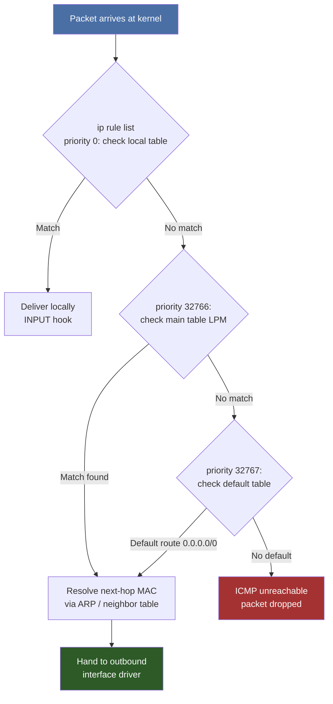
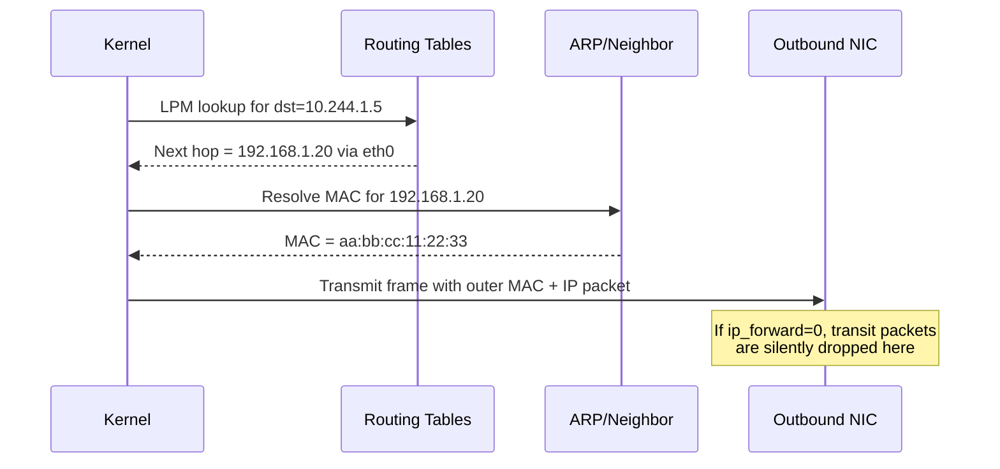

# Lesson 02 — IP Routing and Forwarding in Linux

> **Track:** Network Foundation — Bare Metal & Cloud · **Prereqs:** [Lesson 01 — Linux Networking Fundamentals](01-linux-networking-fundamentals.md) · **Time:** ~2 hours

> **Goal:** Trace a packet's exact path through the Linux routing subsystem and explain why CNI plugins choose between static routes, BGP, and VXLAN based on the underlying network topology.

---

## Practice Setup

```bash
# Run all commands inside minikube
minikube ssh

# View live pod routes — these are real Calico-programmed routes
ip route show
```

---

## 1. How Linux Routes a Packet

When a process sends a packet, the kernel performs a **longest-prefix match (LPM)** lookup across policy rule tables:



```bash
# Trace which route would be chosen for a destination
ip route get 10.244.1.5
# → 10.244.1.5 via 192.168.1.20 dev eth0 src 192.168.1.10
```

### Packet Routing Decision — Step by Step



---

## 2. Routing Tables and Rules

Linux supports **multiple routing tables** selected by policy rules evaluated in priority order.

```bash
# List policy rules (evaluated top-to-bottom)
ip rule list
# 0:      from all lookup local       ← loopback, broadcast
# 32766:  from all lookup main        ← normal routes
# 32767:  from all lookup default     ← fallback

# Show a specific table
ip route show table main
ip route show table local

# Add a rule: traffic from pod CIDR uses table 100
ip rule add from 10.244.0.0/16 lookup 100 priority 100
ip route add default via 192.168.1.1 table 100
```

Calico uses policy routing to steer pod traffic to the correct veth without IP masquerading.

> **See also:** [Lesson 03 — iptables and Netfilter](03-iptables-and-netfilter.md) for how `conntrack` interacts with routing decisions and why DNAT at PREROUTING must happen before the routing lookup.

---

## 3. Static Routes

```bash
# Host route — single destination IP (pod-specific routes in Calico/Cilium)
ip route add 10.244.1.5/32 via 192.168.1.20

# Network route — entire remote pod CIDR (Flannel host-gw mode)
ip route add 10.244.1.0/24 via 192.168.1.20 dev eth0

# ECMP — equal-cost multi-path (multiple next-hops for HA)
ip route add 10.244.1.0/24 nexthop via 192.168.1.20 nexthop via 192.168.1.21

# Delete a route
ip route del 10.244.1.0/24 via 192.168.1.20

# Blackhole route (drop traffic to unreachable pod CIDR)
ip route add blackhole 10.244.99.0/24
```

---

## 4. IP Forwarding

A Linux node acts as a router only when `ip_forward` is enabled.

```bash
# Check
cat /proc/sys/net/ipv4/ip_forward

# Enable temporarily
sysctl -w net.ipv4.ip_forward=1

# Persist across reboots
echo 'net.ipv4.ip_forward = 1' > /etc/sysctl.d/99-ip-forward.conf
sysctl --system
```

Without this, pods on node A cannot reach pods on node B even if routes exist — the node will silently drop transit packets.

### Routing Kernel Parameter Reference

| Parameter | Default | Effect | When to change |
|-----------|---------|--------|----------------|
| `net.ipv4.ip_forward` | `0` | Enables IP packet forwarding between interfaces | Must be `1` on every K8s node |
| `net.ipv6.conf.all.forwarding` | `0` | Same for IPv6 | Required for IPv6 or dual-stack clusters |
| `net.ipv4.fib_multipath_hash_policy` | `0` (L3) | ECMP hash uses L3 header only (src/dst IP) | Set to `1` (L4) for per-flow load-balancing in K8s |
| `net.ipv4.conf.all.rp_filter` | `1` (strict) | Drops packets with unexpected source interface | Set to `2` (loose) or `0` for Calico/asymmetric routes |
| `net.ipv4.conf.all.accept_redirects` | `1` | Accepts ICMP redirects that could change routing | Set to `0` on Kubernetes nodes to prevent redirect attacks |
| `net.ipv4.ip_local_port_range` | `32768 60999` | Ephemeral source port range for outbound connections | Widen to `1024 65535` on high-throughput nodes |
| `net.ipv4.tcp_fin_timeout` | `60` | Time sockets linger in FIN_WAIT_2 state | Reduce to `15` on nodes with many short-lived connections |

---

## 5. Routing in Different CNI Modes

### Flannel host-gw (pure L3, no overlay)
```
Node A (192.168.1.10) has pod CIDR 10.244.0.0/24
Node B (192.168.1.20) has pod CIDR 10.244.1.0/24

On Node A:
  ip route add 10.244.1.0/24 via 192.168.1.20   ← added by Flannel

On Node B:
  ip route add 10.244.0.0/24 via 192.168.1.10   ← added by Flannel
```
Requires all nodes to be on the same L2 segment (same VLAN/subnet). Fails across separate L3 networks.

### Calico with BGP

Calico runs `bird` (BGP daemon) on each node. Nodes peer with each other (or a Route Reflector) and exchange `/32` host routes for each pod.

```bash
# View BGP peers
calicoctl node status

# View routes propagated by Calico
ip route show | grep bird
```

### Cilium native routing

Cilium programs the kernel routing table directly using BPF hooks. No separate routing daemon needed.

```bash
cilium status
cilium bpf tunnel list   # empty in native routing mode
```

> **See also:** [Lesson 05 — VXLAN and Overlay Networks](05-vxlan-and-overlay-networks.md) for the alternative when nodes are not L2-adjacent and overlay encapsulation is used instead of static routes.

---

## 6. ECMP and Hashing

For high-availability setups, multiple paths to the same destination can be load-balanced.

```bash
# ECMP with weighted next-hops (Linux 3.6+)
ip route add 10.244.0.0/16 \
  nexthop via 192.168.1.10 weight 1 \
  nexthop via 192.168.1.11 weight 1

# Hash is per-flow by default (src IP, dst IP, protocol, ports)
# Check hash policy
cat /proc/sys/net/ipv4/fib_multipath_hash_policy
# 0 = L3 only (src/dst IP), 1 = L4 (recommended for Kubernetes)
sysctl -w net.ipv4.fib_multipath_hash_policy=1
```

---

## 7. Troubleshooting Routing

```bash
# Is ip_forward on?
sysctl net.ipv4.ip_forward

# Which route will be used?
ip route get 10.244.3.7

# Is there a blackhole route blocking traffic?
ip route show | grep blackhole

# Watch routing table changes in real time
ip monitor route

# Is the packet leaving the right interface?
tcpdump -i eth0 -n 'host 10.244.3.7'
tcpdump -i cali1234abcd -n 'host 10.244.3.7'

# Check if kernel is dropping forwarded packets
watch -n1 'cat /proc/net/stat/rt_cache'
netstat -s | grep -i "forwarded\|route"
```

---

## 8. Cloud Provider Routing Differences

### AWS VPC
- Each EC2 instance has a VPC route table entry pointing to its ENI.
- **Pod routing options:**
  - AWS VPC CNI: pods get real VPC IPs via secondary ENI IPs — no overlay needed, routes are in the VPC route table.
  - Overlay CNI (Flannel/Calico): pods use a secondary CIDR; traffic is encapsulated before leaving the node.
- Requires disabling the **Source/Destination Check** on the EC2 instance when using non-VPC pod IPs.

### GCP VPC
- GCP uses a software-defined distributed router. Route tables are per-VPC and global.
- Kubernetes on GKE injects per-node pod CIDR routes automatically.
- Google's VPC supports custom-mode subnets with alias IP ranges for pods (similar to AWS VPC CNI).

### Azure VNet
- Azure CNI gives pods Azure VNet IPs from the subnet address space.
- Kubenet (the basic option) uses a UDR (User Defined Route) for pod CIDRs — similar to Flannel host-gw.

---

## 9. Hands-On Lab: Cross-Namespace Routing

Simulate two nodes routing pods to each other (no overlay, pure L3).

```bash
# Two "nodes" = two namespaces with veth links to the host
ip netns add node1
ip netns add node2

# node1 veth
ip link add veth-n1 type veth peer name veth-n1-host
ip link set veth-n1 netns node1
ip link set veth-n1-host up
ip addr add 192.168.1.1/24 dev veth-n1-host
ip netns exec node1 ip addr add 192.168.1.10/24 dev veth-n1
ip netns exec node1 ip link set veth-n1 up
ip netns exec node1 ip link set lo up
ip netns exec node1 ip route add default via 192.168.1.1

# node2 veth
ip link add veth-n2 type veth peer name veth-n2-host
ip link set veth-n2 netns node2
ip link set veth-n2-host up
ip addr add 192.168.1.2/24 dev veth-n2-host
ip netns exec node2 ip addr add 192.168.1.20/24 dev veth-n2
ip netns exec node2 ip link set veth-n2 up
ip netns exec node2 ip link set lo up
ip netns exec node2 ip route add default via 192.168.1.2

# "CNI" static routes — each node knows remote pod CIDR
ip netns exec node1 ip route add 10.244.1.0/24 via 192.168.1.20
ip netns exec node2 ip route add 10.244.0.0/24 via 192.168.1.10

# Enable forwarding on host
sysctl -w net.ipv4.ip_forward=1
```

### Step-by-step Observation

```bash
# Verify routing tables in each "node"
ip netns exec node1 ip route show
# → default via 192.168.1.1 dev veth-n1
# → 192.168.1.0/24 dev veth-n1 proto kernel scope link src 192.168.1.10
# → 10.244.1.0/24 via 192.168.1.20 dev veth-n1       ← CNI-added route

ip netns exec node2 ip route show
# → 10.244.0.0/24 via 192.168.1.10 dev veth-n2       ← CNI-added route

# Test which route the kernel selects
ip netns exec node1 ip route get 10.244.1.1
# → 10.244.1.1 via 192.168.1.20 dev veth-n1 src 192.168.1.10

# Monitor routing decisions live while pinging
ip monitor route &
ip netns exec node1 ping -c3 -I 10.244.0.1 10.244.1.1

# Watch forwarding counters increment
watch -n1 "netstat -s | grep 'forwarded\|dropped'"
# → 3 outgoing packets forwarded
```

### Verification

```bash
# Confirm routes are present and ip_forward is on
ip netns exec node1 ip route | grep 10.244.1
# → 10.244.1.0/24 via 192.168.1.20 dev veth-n1
sysctl net.ipv4.ip_forward
# → net.ipv4.ip_forward = 1

# Clean up
ip netns del node1
ip netns del node2
```

---

## Troubleshooting

| Symptom | Likely Cause | Diagnostic Command | Fix |
|---------|-------------|-------------------|-----|
| Pod-to-pod cross-node traffic 100% loss | `ip_forward=0` on transit node | `sysctl net.ipv4.ip_forward` | `sysctl -w net.ipv4.ip_forward=1`; persist in sysctl.d |
| `ip route get <pod-ip>` returns blackhole | CNI added blackhole route for unreachable CIDR | `ip route show | grep blackhole` | Remove stale blackhole: `ip route del blackhole <cidr>` |
| Intermittent packet loss on ECMP path | L3-only hash causes all flows to pick same path | `sysctl net.ipv4.fib_multipath_hash_policy` | Set to `1` for L4 hashing |
| Route exists but packets drop | `rp_filter=1` dropping asymmetrically routed packets | `sysctl net.ipv4.conf.all.rp_filter` | Set to `2` (loose) for Calico or multi-path setups |
| AWS cross-node routing fails with VPC routes | Source/Destination Check enabled on EC2 instance | `aws ec2 describe-instances` | Disable Source/Destination Check on the ENI |
| `ip route add` returns `RTNETLINK file exists` | A conflicting route already covers the prefix | `ip route show match <prefix>` | Delete the conflicting route first, then add |
| Routing works but no ARP reply from next-hop | ARP cache stale or proxy_arp not set | `ip neigh show` | `ip neigh flush dev <iface>` |

---

## Production Checklist

- [ ] `net.ipv4.ip_forward=1` persisted in sysctl.d and verified with `sysctl -a | grep ip_forward` after node boot
- [ ] `net.ipv4.fib_multipath_hash_policy=1` set when ECMP is used to ensure per-flow (not per-destination) load distribution
- [ ] `rp_filter` set appropriately per interface when CNI uses asymmetric routing (Calico with BGP requires `rp_filter=0` or `2`)
- [ ] No stale blackhole routes from failed CNI initialization — verify with `ip route show | grep blackhole` after cluster upgrades
- [ ] Cloud provider-specific requirements met: AWS Source/Destination Check disabled; GCP alias IP ranges configured; Azure UDRs in place
- [ ] `ip monitor route` output reviewed after each CNI update to confirm expected routes are added
- [ ] ECMP next-hop weights balanced when nodes have differing pod densities

---

## Common Anti-Patterns

| What people do | Why it breaks | Correct approach |
|----------------|--------------|-----------------|
| Rely on default route for pod CIDR traffic | Traffic exits via default gateway (internet); routers don't know pod IPs | Add explicit host or network routes for each pod CIDR via the correct next-hop |
| Use L3-only ECMP hash (`policy=0`) in Kubernetes | All connections from one source IP always pick the same path; uneven load, broken failover | Set `fib_multipath_hash_policy=1` for L4 hashing so each flow is independently distributed |
| Add pod routes with `scope link` without a reachable next-hop | Packets go nowhere; kernel assumes direct delivery but no ARP succeeds | Specify `via <next-hop-ip>` explicitly unless the pod is truly on the same L2 segment |
| Forget to disable `accept_redirects` | A rogue router can inject ICMP redirects and silently reroute pod traffic | Set `net.ipv4.conf.all.accept_redirects=0` and `net.ipv6.conf.all.accept_redirects=0` on all nodes |
| Program pod routes inside pod namespace instead of host | Only traffic from that pod benefits; other pods on the node remain unreachable to it | Pod CIDR routes belong in the host network namespace, not inside the pod |

---

## Quick Reference

| Use Case | Command |
|----------|---------|
| Show main routing table | `ip route show` |
| Show specific routing table | `ip route show table <N>` |
| Simulate routing decision for IP | `ip route get <dst-ip>` |
| Add static route | `ip route add <prefix> via <gw> dev <iface>` |
| Add host route (pod-specific) | `ip route add <pod-ip>/32 dev <veth>` |
| Add ECMP route | `ip route add <prefix> nexthop via <gw1> nexthop via <gw2>` |
| Delete route | `ip route del <prefix> via <gw>` |
| List policy routing rules | `ip rule list` |
| Add policy rule | `ip rule add from <src-cidr> lookup <table>` |
| Enable IP forwarding | `sysctl -w net.ipv4.ip_forward=1` |
| Monitor routing table changes live | `ip monitor route` |
| Set L4 ECMP hash | `sysctl -w net.ipv4.fib_multipath_hash_policy=1` |

---

## Summary

| Concept | Command |
|---------|---------|
| Show routing table | `ip route show` |
| Test routing decision | `ip route get <dst>` |
| Add static route | `ip route add <prefix> via <gw>` |
| Enable forwarding | `sysctl net.ipv4.ip_forward=1` |
| Monitor route changes | `ip monitor route` |
| Multi-path hash policy | `net.ipv4.fib_multipath_hash_policy=1` |

---

## Online Resources

| Resource | Type | What you practice |
|----------|------|-------------------|
| [iximiuz: Container Networking from Scratch](https://labs.iximiuz.com/tutorials/container-networking-from-scratch) | Free interactive lab | Routing table manipulation between namespaces — same commands as this lesson |
| [Killercoda Playground](https://killercoda.com/) | Free playground | Run `ip route`, policy routing, and ECMP commands live |

---

**Next:** [Lesson 03 — iptables and Netfilter Architecture](03-iptables-and-netfilter.md)
