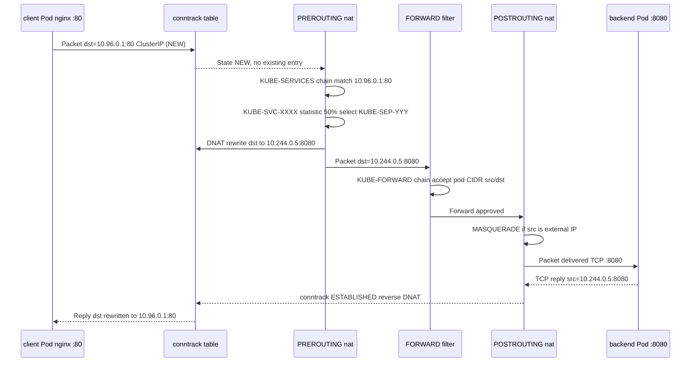

# Lesson 03 — iptables and Netfilter Architecture

> **Track:** Network Foundation — Bare Metal & Cloud · **Prereqs:** [Lesson 02 — IP Routing and Forwarding](02-ip-routing-and-forwarding.md) · **Time:** ~2.5 hours

> **Goal:** Explain how kube-proxy translates a Kubernetes Service into iptables DNAT rules and trace a packet end-to-end from ClusterIP through conntrack to a backend pod.


**Jump to:** [Theory](#theory) · [Practice](#practice) · [Troubleshooting](#troubleshooting) · [Production Checklist](#production-checklist) · [Quick Reference](#quick-reference) · [Check Your Understanding](#check-your-understanding)

---

## Theory

## 1. Netfilter Hook Points

The Linux kernel's **netfilter framework** intercepts packets at five hook points in the network stack:

```mermaid
flowchart LR
    NIC_IN["NIC Ingress (eth0)"] --> PRE["PREROUTING raw/mangle/nat"]
    PRE --> RD{"Routing Decision"}
    RD -->|"For local process"| INP["INPUT mangle/filter/security"]
    RD -->|"Transit packet"| FWD["FORWARD mangle/filter/security"]
    INP --> LOC["Local Process (kube-proxy/kubelet)"]
    LOC --> OUT["OUTPUT raw/mangle/nat/filter"]
    FWD --> POST["POSTROUTING mangle/nat"]
    OUT --> POST
    POST --> NIC_OUT["NIC Egress (eth0)"]
    PRE --> CT["conntrack state table"]
    CT --> RD

    style NIC_IN fill:#1a3a5c,color:#fff
    style NIC_OUT fill:#1a3a5c,color:#fff
    style PRE fill:#4a6fa5,color:#fff
    style RD fill:#6a4fa5,color:#fff
    style INP fill:#4a6fa5,color:#fff
    style FWD fill:#4a6fa5,color:#fff
    style OUT fill:#4a6fa5,color:#fff
    style POST fill:#4a6fa5,color:#fff
    style CT fill:#2d5a27,color:#fff
```



### kube-proxy Packet Flow: ClusterIP → Pod



---

## 2. Tables and Chains

iptables organizes rules into **tables** (purpose) and **chains** (hook points).

| Table | Purpose | Built-in Chains |
|-------|---------|-----------------|
| `raw` | Skip conntrack; earliest hook | PREROUTING, OUTPUT |
| `mangle` | Modify headers (TTL, TOS, marks) | All 5 hooks |
| `nat` | SNAT / DNAT address translation | PREROUTING, OUTPUT, POSTROUTING |
| `filter` | Allow / Drop / Reject | INPUT, FORWARD, OUTPUT |
| `security` | SELinux MAC policy | INPUT, FORWARD, OUTPUT |

Processing order at PREROUTING: `raw → mangle → nat → filter`

---

## 3. kube-proxy iptables Rules

When you create a Service of type ClusterIP, kube-proxy writes rules like this:

```
ClusterIP: 10.96.0.1  Port: 80
Backend Pods: 10.244.0.5:8080, 10.244.1.3:8080
```

```bash
# Inspect kube-proxy chains
iptables -t nat -L KUBE-SERVICES -n --line-numbers
iptables -t nat -L KUBE-SVC-XXXX -n       # per-Service chain
iptables -t nat -L KUBE-SEP-XXXX -n       # per-Endpoint chain
```

Packet flow for a ClusterIP request:
```
Pod sends to 10.96.0.1:80
  → PREROUTING → nat/KUBE-SERVICES
    → matches KUBE-SVC-XXXX (the service chain)
      → statistic match (round-robin) → KUBE-SEP-YYY (endpoint 1)
        → DNAT to 10.244.0.5:8080
  → routing decision: forward to 10.244.0.5
  → POSTROUTING: MASQUERADE if leaving the node
```

---

## 4. Common iptables Commands

```bash
# List rules with line numbers and no DNS resolution
iptables -t nat -L -n --line-numbers -v

# Save and restore rules
iptables-save > /etc/iptables/rules.v4
iptables-restore < /etc/iptables/rules.v4

# Append a rule to FORWARD chain (allow pod traffic)
iptables -A FORWARD -s 10.244.0.0/16 -j ACCEPT
iptables -A FORWARD -d 10.244.0.0/16 -j ACCEPT

# Insert a logging rule at position 1 (before DROP)
iptables -I INPUT 1 -p tcp --dport 80 -j LOG --log-prefix "HTTP-IN: "

# Count packets matching a rule
iptables -t filter -L FORWARD -v -n

# Flush all rules (DANGEROUS — locks you out if no default ACCEPT)
# iptables -F

# Delete a specific chain
iptables -t nat -F KUBE-SVC-XXXX
iptables -t nat -X KUBE-SVC-XXXX
```

---

## 5. NAT in Kubernetes

### DNAT — ClusterIP to Pod IP

Translates a virtual service IP to a real pod IP. Done in PREROUTING (for traffic arriving at the node) and OUTPUT (for traffic from local pods).

### SNAT / MASQUERADE — Pod to External

When a pod sends traffic to the internet, the pod IP must be replaced with the node's IP (since pod IPs are not routable externally).

```bash
# kube-proxy adds this for pod → external traffic
iptables -t nat -A POSTROUTING -s 10.244.0.0/16 ! -d 10.244.0.0/16 -j MASQUERADE

# Check MASQUERADE rules
iptables -t nat -L POSTROUTING -n -v | grep -i masq
```

### Hairpin NAT

When a pod accesses its own service IP, the reply must loop back. kube-proxy handles this with MASQUERADE in POSTROUTING when src and dst are both pods.

---

## 6. Conntrack — Connection Tracking

Netfilter tracks connection state so reply packets can be automatically associated with their forward request.

```bash
# View conntrack table
conntrack -L
conntrack -L --proto tcp --state ESTABLISHED

# Monitor new connections
conntrack -E --event-mask NEW

# Table size (critical to tune for high-throughput clusters)
cat /proc/sys/net/netfilter/nf_conntrack_max
sysctl -w net.netfilter.nf_conntrack_max=1000000

# Current usage
cat /proc/sys/net/netfilter/nf_conntrack_count

# Bucket count (hash table size)
cat /proc/sys/net/netfilter/nf_conntrack_buckets
```

Conntrack exhaustion causes **silent packet drops** — one of the most common and hardest-to-diagnose issues in production Kubernetes clusters.

```bash
# Check for conntrack drops
dmesg | grep -i "nf_conntrack: table full"
cat /proc/net/stat/nf_conntrack | awk '{print $1, $2, $3}'
```

**Conntrack state machine:**

| State | Meaning | Example |
|-------|---------|---------|
| `NEW` | First packet of a new flow | SYN packet |
| `ESTABLISHED` | Bidirectional traffic seen | ACK after SYN-ACK |
| `RELATED` | Associated flow (FTP data, ICMP error) | ICMP unreachable for TCP connection |
| `INVALID` | Does not match any known state | Out-of-window RST |
| `UNTRACKED` | Marked with `NOTRACK` in raw table | Intentionally bypassed traffic |

---

## 7. ipset

kube-proxy uses `ipset` for efficient lookups when there are many endpoints. Instead of thousands of individual iptables rules, one rule matches against an ipset.

```bash
# List all ipsets
ipset list

# kube-proxy creates sets like KUBE-CLUSTER-IP, KUBE-NODE-PORT-TCP
ipset list KUBE-CLUSTER-IP

# Manual ipset
ipset create my-pods hash:ip
ipset add my-pods 10.244.0.5
ipset add my-pods 10.244.1.3

iptables -A INPUT -m set --match-set my-pods src -j ACCEPT
```

---

## 8. IPVS Mode (kube-proxy alternative)

IPVS (IP Virtual Server) is a kernel-level L4 load balancer — faster than iptables for large numbers of services.

```bash
# Check if kube-proxy is using IPVS
kubectl get cm -n kube-system kube-proxy -o yaml | grep mode
# mode: ipvs

# Inspect IPVS rules
ipvsadm -L -n
ipvsadm -L -n --stats

# Example output:
# TCP  10.96.0.1:80 rr
#   -> 10.244.0.5:8080           Masq    1      0          0
#   -> 10.244.1.3:8080           Masq    1      0          0
```

IPVS advantages over iptables:
- O(1) lookup (hash table) vs O(n) iptables chain traversal
- Native load-balancing algorithms: rr, lc, dh, sh, lblc, lblcr
- Lower CPU for large clusters (1000+ services)

---

## 9. eBPF and the Post-iptables Era

Cilium replaces kube-proxy's iptables rules with eBPF programs attached directly to network interfaces:

```bash
# Check kube-proxy replacement mode in Cilium
cilium status | grep KubeProxy

# View eBPF-based service entries
cilium service list

# View NAT table in BPF
cilium bpf nat list
```

Benefits: no conntrack for pod-to-pod, no SNAT for intra-cluster traffic, lower latency.

> **See also:** [Lesson 04 — Network Namespaces Deep Dive](04-network-namespaces-deep-dive.md) for where iptables and eBPF programs get applied — they operate on the veth endpoints inside the pod namespace boundary.


---

### Industry Applications

| Company / Project | Context | Technology from this lesson | Outcome |
|---|---|---|---|
| AWS | EC2 hypervisor Security Groups are implemented via iptables rules on the hypervisor layer for each instance | iptables filter chains + conntrack | Millions of Security Group rules enforced at line rate without custom ASIC hardware |
| Datadog | Replaced kube-proxy iptables rules with Cilium eBPF at their Kubernetes platform for 10x rule-load performance | iptables KUBE-SERVICES chains → eBPF XDP | Reduced CPU usage from iptables rule traversal by 90% at 100k+ services scale |
| Kubernetes kube-proxy | At scale, every Service creates O(n) KUBE-SEP rules; clusters with 10k services have 100k+ iptables rules | KUBE-SERVICES + KUBE-SVC-* + KUBE-SEP-* chain hierarchy | Deterministic ClusterIP DNAT for every pod-to-service packet across all nodes |
| Calico CNI | Felix daemon manages per-pod iptables FORWARD rules so only valid pod-to-pod traffic is allowed | filter/FORWARD chain with pod CIDR src/dst ACCEPT rules | Network policy enforcement without an overlay or SDN controller |
| Hospital PACS (medtech) | Bulk DICOM image transfers exhausted the conntrack table on radiology cluster nodes, silently dropping TCP connections with no application-level error | conntrack `nf_conntrack_max` tuning + kube-proxy IPVS mode | Raising `nf_conntrack_max` and switching kube-proxy to IPVS eliminated silent drops and stabilised image retrieval under peak radiology load |

---

## Practice

### Environment Setup

```bash
# Run all commands inside minikube
minikube ssh

# See kube-proxy iptables rules live
sudo iptables -t nat -L KUBE-SERVICES -n --line-numbers | head -20
```

### Hands-On Lab

Trace a packet through Netfilter hooks and inspect kube-proxy rules.

Run the commands from Section 4 above inside `minikube ssh` to observe each chain.

#### Packet Tracing

```bash
# Trace a packet through the netfilter hooks (requires kernel module)
modprobe nf_log_ipv4
iptables -t raw -A PREROUTING -s 10.244.0.5 -j TRACE
iptables -t raw -A OUTPUT -d 10.244.0.5 -j TRACE
# Then watch kernel logs
dmesg -wH | grep TRACE

# Count drops per chain
iptables -t filter -L FORWARD -v -n
# Pkts in and out columns show traffic; zero out means matching but passing

# Watch iptables rule hit counts live
watch -n1 'iptables -t nat -L KUBE-SERVICES -v -n | head -30'
```

#### Conntrack Exhaustion Check

```bash
# Check for conntrack drops
dmesg | grep -i "nf_conntrack: table full"
cat /proc/net/stat/nf_conntrack | awk '{print $1, $2, $3}'
```

### Configuration Reference

| Parameter | Default | Effect | When to change |
|-----------|---------|--------|----------------|
| `net.netfilter.nf_conntrack_max` | `65536` | Maximum tracked connections | Raise to `524288`+ for clusters with 100+ nodes |
| `net.netfilter.nf_conntrack_buckets` | `16384` | Hash table size for conntrack | Set to `nf_conntrack_max / 4` |
| `net.netfilter.nf_conntrack_tcp_timeout_established` | `432000` (5 days) | TCP established session timeout | Reduce to `86400` (1 day) for large busy clusters |
| `net.netfilter.nf_conntrack_tcp_timeout_time_wait` | `120` | TIME_WAIT connection hold | Reduce to `30` for high-connection-rate services |
| `net.ipv4.netfilter.ip_conntrack_tcp_timeout_close_wait` | `60` | CLOSE_WAIT timeout | Reduce if stale connections fill conntrack table |
| `net.bridge.bridge-nf-call-iptables` | `0` | Bridge traffic traverses iptables | Must be `1` for kube-proxy to intercept pod traffic |

---

## Troubleshooting

| Symptom | Likely Cause | Diagnostic Command | Fix |
|---------|-------------|-------------------|-----|
| Service ClusterIP unreachable from pods | kube-proxy iptables rules missing or stale | `iptables -t nat -L KUBE-SERVICES -n | grep <cluster-ip>` | Restart kube-proxy pod; check `--iptables-sync-period` |
| Intermittent connection drops under load | conntrack table exhaustion | `dmesg | grep "nf_conntrack: table full"` | Raise `nf_conntrack_max`; check `nf_conntrack_count` |
| Pod can reach internet but external traffic can't reach pod | MASQUERADE rule missing in POSTROUTING | `iptables -t nat -L POSTROUTING -v -n | grep MASQ` | Re-run kube-proxy or add MASQUERADE rule manually |
| Pod-to-pod FORWARD drops | Default FORWARD policy is DROP and no ACCEPT rule exists | `iptables -L FORWARD -v -n` | Add `iptables -A FORWARD -s 10.244.0.0/16 -j ACCEPT` |
| iptables rules disappear after node reboot | Rules not persisted | `ls /etc/iptables/` | Use `iptables-save` / `iptables-restore` or switch to nftables with persistence |
| kube-proxy IPVS mode — sessions not load balanced | IPVS scheduler not set to `rr` or connection persistence active | `ipvsadm -L -n --stats` | Adjust scheduler in kube-proxy ConfigMap; check timeout with `ipvsadm -L --timeout` |
| TRACE target shows packet entering PREROUTING but not exiting | Packet dropped in nat or mangle rule before forwarding | `iptables -t nat -L PREROUTING -v -n` | Identify the rule with the highest packet count matching the src/dst |

---

## Production Checklist

- [ ] `nf_conntrack_max` sized to `max_pods_per_node × max_services × connections_per_service`; set `nf_conntrack_buckets` to `max / 4`
- [ ] `nf_conntrack_tcp_timeout_established` reduced from default 5 days if the cluster handles high-churn short-lived connections
- [ ] kube-proxy mode confirmed (`iptables` vs `ipvs`) and appropriate tuning applied — IPVS preferred for clusters with 500+ services
- [ ] `iptables-save` output reviewed after every kube-proxy restart to confirm expected KUBE-SERVICES and KUBE-SEP rules are present
- [ ] `bridge-nf-call-iptables=1` and `br_netfilter` module loaded before kube-proxy starts
- [ ] TRACE rules removed after debugging — they generate one kernel log line per packet and can flood the system log
- [ ] iptables rules persisted via `iptables-restore` at boot if kube-proxy is not running as a DaemonSet

---

## Common Anti-Patterns

| What people do | Why it breaks | Correct approach |
|----------------|--------------|-----------------|
| Flush all iptables rules (`iptables -F`) on a live node | Drops all KUBE-SERVICES and FORWARD rules; all service traffic fails instantly | Never flush on a live node; use `iptables-save` to inspect and delete specific rules |
| Leave default `nf_conntrack_max=65536` on nodes with 200+ pods | Conntrack exhaustion causes silent packet drops with no obvious error messages | Size conntrack table at node provisioning time; alert on `nf_conntrack_count / nf_conntrack_max > 80%` |
| Use iptables `TRACE` target in production | One log line per packet per hook; can generate millions of kernel log entries per second | Use TRACE only on development clusters; limit scope with specific src/dst filters |
| Manually add kube-proxy iptables rules | kube-proxy overwrites them on the next sync cycle (default 30s) | Configure services via Kubernetes API; let kube-proxy manage rules |
| Mix iptables and nftables rules on the same node | Rule evaluation order is undefined; some packets bypass one or the other | Choose one framework; migrating clusters use `iptables-nft` shim which routes iptables commands to nftables backend |

---

## Quick Reference

| Use Case | Command |
|----------|---------|
| List nat table rules (no DNS lookup) | `iptables -t nat -L -n --line-numbers -v` |
| Inspect kube-proxy service chains | `iptables -t nat -L KUBE-SERVICES -n` |
| Watch rule hit counts live | `watch -n1 'iptables -t nat -L KUBE-SERVICES -v -n'` |
| Save rules to file | `iptables-save > /etc/iptables/rules.v4` |
| Restore rules from file | `iptables-restore < /etc/iptables/rules.v4` |
| Check conntrack table usage | `cat /proc/sys/net/netfilter/nf_conntrack_count` |
| View conntrack entries for TCP | `conntrack -L --proto tcp` |
| Monitor new connections | `conntrack -E --event-mask NEW` |
| Check for conntrack table full | `dmesg \| grep nf_conntrack` |
| Trace packet through hooks | `iptables -t raw -A PREROUTING -s <ip> -j TRACE` |
| List IPVS rules | `ipvsadm -L -n` |
| Check kube-proxy mode | `kubectl get cm -n kube-system kube-proxy -o yaml \| grep mode` |

---

## Summary

| Component | Role in Kubernetes |
|-----------|--------------------|
| nat/PREROUTING | DNAT service IP → pod IP |
| nat/POSTROUTING | SNAT pod IP → node IP (MASQUERADE) |
| filter/FORWARD | Allow/deny routed pod traffic |
| conntrack | Session state for NAT reverse translation |
| ipset | Efficient IP group matching for endpoints |
| IPVS | Fast kernel load balancing (kube-proxy IPVS mode) |
| eBPF (Cilium) | Bypass iptables entirely at the socket/TC layer |

---

## Check Your Understanding

1. **[Concept question]** At which Netfilter hook does kube-proxy install its DNAT rules for ClusterIP services, and why must DNAT happen at that specific hook rather than at the FORWARD hook?

   <details><summary>Answer</summary>

   kube-proxy installs DNAT rules in the `nat` table at both the `PREROUTING` hook (for traffic arriving from outside the node) and the `OUTPUT` hook (for traffic originating from local pods). DNAT must happen before the routing decision — if the kernel looked up a route for the original ClusterIP (e.g., `10.96.42.10`), it would find no route for a virtual IP. By rewriting the destination to a real pod IP at PREROUTING, the subsequent routing lookup correctly finds a path to `10.244.x.x`.

   </details>

2. **[Scenario question]** A pod can reach the internet but cannot communicate with a ClusterIP service at `10.96.42.10`. The service has two healthy endpoints and `kubectl get endpoints` shows their IPs. `iptables -t nat -L KUBE-SERVICES` shows no entry for `10.96.42.10`. What is the most likely cause?

   <details><summary>Answer</summary>

   The kube-proxy rules are missing, most likely because kube-proxy is not running on that node or its iptables sync period has not fired since the service was created. Check `kubectl get pods -n kube-system -l k8s-app=kube-proxy` to verify the pod is running. If kube-proxy is running but rules are absent, check for `bridge-nf-call-iptables=0` or the `br_netfilter` module not being loaded — without these, kube-proxy rules cannot intercept bridged pod traffic.

   </details>

3. **[Practical question]** What command would you run to inspect the per-service iptables load-balancing chain for a ClusterIP service and see the DNAT rules for each backend endpoint?

   <details><summary>Answer</summary>

   ```bash
   iptables -t nat -L KUBE-SERVICES -n | grep 10.96.42.10
   ```
   This shows the `KUBE-SVC-XXXX` chain name for the service. Then run `iptables -t nat -L KUBE-SVC-XXXX -n` to see the probabilistic load-balancing rules, and `iptables -t nat -L KUBE-SEP-YYYY -n` to see the DNAT rule for each individual endpoint.

   </details>

---

## Online Resources

| Resource | Type | What you practice |
|----------|------|-------------------|
| [Killercoda Playground](https://killercoda.com/) | Free playground | Full `iptables`/`nftables` access on a real Linux node; inspect kube-proxy chains |
| [KodeKloud: Kubernetes Networking Deep Dive](https://www.kodekloud.com/learning-path/kubernetes) | Paid course (free trial) | 4h 31m structured labs covering iptables, conntrack, and kube-proxy rule generation |

---

**← Previous:** [Lesson 02 — IP Routing and Forwarding in Linux](02-ip-routing-and-forwarding.md)   |   **Next:** [Lesson 04 — Network Namespaces Deep Dive](04-network-namespaces-deep-dive.md)
