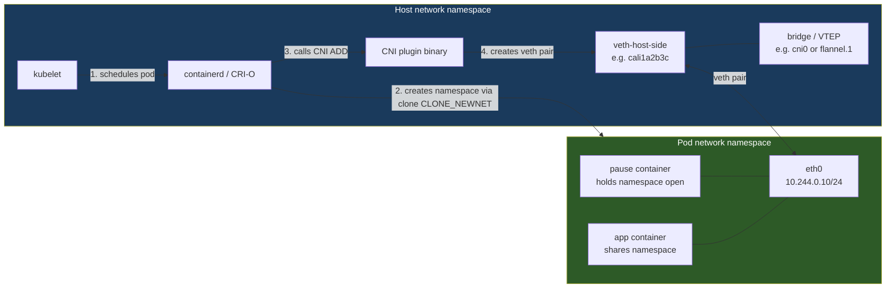
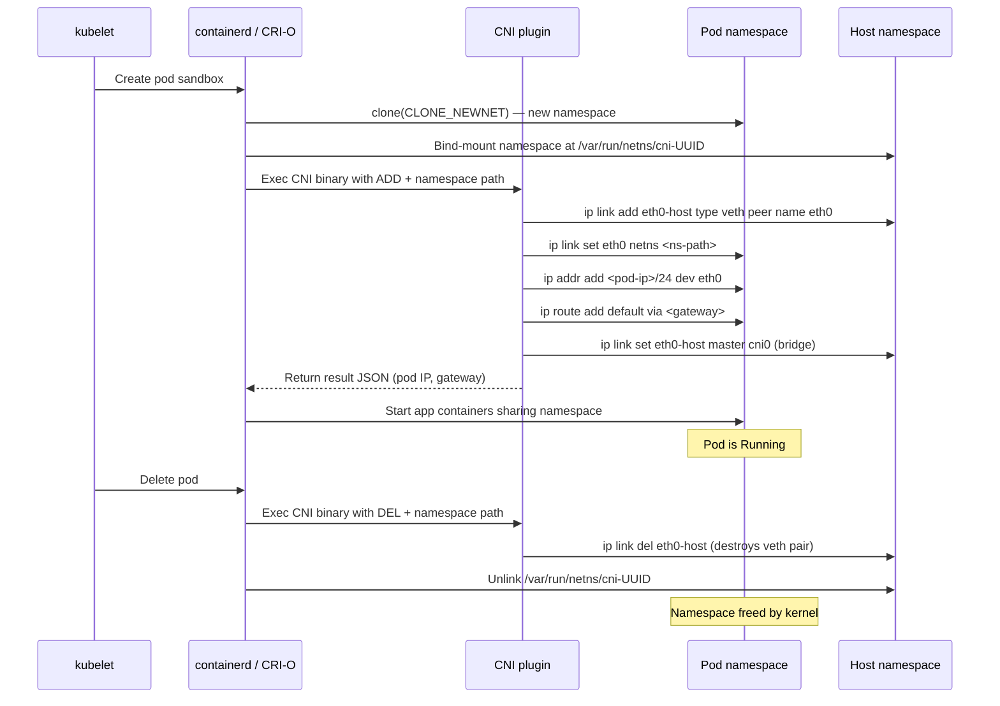

# Lesson 04 — Network Namespaces Deep Dive

> **Track:** Network Foundation — Bare Metal & Cloud · **Prereqs:** [Lesson 01 — Linux Networking Fundamentals](01-linux-networking-fundamentals.md) · **Time:** ~2 hours

> **Goal:** Reproduce the complete pod network namespace lifecycle — from `clone(CLONE_NEWNET)` through CNI wiring — and debug a running pod's network state from the host using `nsenter`.

---

## Practice Setup

```bash
# Run all commands inside minikube
minikube ssh

# See real pod namespaces
ip netns list

# Inspect a pod's namespace (find the pause PID first)
sudo crictl ps | head -5
```

---

## 1. What a Network Namespace Contains

A network namespace is a **complete, isolated copy** of the network stack:

| Resource | Isolated per namespace |
|----------|----------------------|
| Network interfaces | Yes (lo, eth0, etc.) |
| IP addresses | Yes |
| Routing tables | Yes |
| iptables/nftables rules | Yes |
| Conntrack table | Yes |
| Sockets | Yes (cannot be shared across namespaces) |
| BPF programs attached to interfaces | Yes |

What is **not** isolated: the physical hardware, kernel sysctl `net.*` globals (partially), and network namespaces themselves (managed from the host).

---

## 2. Creating and Managing Network Namespaces

```bash
# Create a named namespace (creates /var/run/netns/<name>)
ip netns add red
ip netns add blue

# List all named namespaces
ip netns list
ip netns list -details     # show if namespace file is a bind mount

# Execute a command in a namespace
ip netns exec red ip link list
ip netns exec red bash     # interactive shell in the namespace

# Delete
ip netns del red

# Show which namespace a process is in
ls -la /proc/<pid>/ns/net

# List all namespaces known to the kernel
lsns -t net
```

### Architecture: Namespace / Pause / CNI Wiring



---

## 3. How Kubernetes Uses Network Namespaces

The kubelet/container runtime creates a pod namespace using the **pause container**:

```bash
# Find the pause container for a pod
crictl ps | grep pause
# or:
docker ps | grep pause

# Get the pause container's PID
PAUSE_PID=$(crictl inspect <container-id> | jq '.info.pid')

# Access its network namespace
nsenter --target $PAUSE_PID --net -- ip addr
nsenter --target $PAUSE_PID --net -- ip route
nsenter --target $PAUSE_PID --net -- ss -tlnp

# Alternative: find the namespace path from the pod UID
ls /var/run/netns/   # on containerd-based nodes, the path may differ
# containerd: /proc/<pause_pid>/ns/net (accessed via nsenter or /proc)
```

All containers in the same pod share this namespace, which is why they can communicate via `localhost` and share port space.

---

## 4. Inspecting Pod Network Namespaces from the Host

```bash
# Method 1: nsenter (most reliable)
POD_NS=$(kubectl get pod <pod-name> -o jsonpath='{.metadata.uid}')
PAUSE_PID=$(crictl inspect $(crictl ps | grep $POD_NS | head -1 | awk '{print $1}') | jq -r '.info.pid')

nsenter -t $PAUSE_PID -n ip addr
nsenter -t $PAUSE_PID -n ip route
nsenter -t $PAUSE_PID -n ss -s

# Method 2: netshoot (run a debug pod in the same namespace)
kubectl debug -it <pod-name> --image=nicolaka/netshoot --target=<container-name>

# Method 3: kubectl exec with network tools
kubectl exec -it <pod-name> -- sh
# Then: ip addr, ip route, ss, nslookup, curl
```

### Namespace / Runtime Configuration Reference

| Item | Location / Command | Notes |
|------|-------------------|-------|
| Named namespace bind-mount | `/var/run/netns/<name>` | Created by `ip netns add`; CNI uses this path |
| Pod namespace (containerd) | `/proc/<pause_pid>/ns/net` | Accessed via `nsenter -t <pid> -n` |
| List namespaces (kernel) | `lsns -t net` | Shows PID, NSID, and process name |
| Namespace inode ID | `stat /proc/<pid>/ns/net` | Same inode = same namespace |
| Pause container image | `registry.k8s.io/pause:3.x` | Configured in kubelet `--pod-infra-container-image` |
| CNI binary directory | `/opt/cni/bin/` | CNI plugins must be executable here |
| CNI config directory | `/etc/cni/net.d/` | JSON config files; first sorted file is used |

### Kernel Namespace Limit Parameters

| Parameter | Default | Effect | When to change |
|-----------|---------|--------|----------------|
| `user.max_net_namespaces` | `unlimited` (varies by distro) | Maximum network namespaces the user namespace can create | Set a cap on shared nodes to prevent namespace exhaustion attacks |
| `user.max_user_namespaces` | `7182` (distro-dependent) | Caps nested user namespaces (affects rootless containers) | Raise if rootless container runtimes are used (Podman, rootless containerd) |
| `net.core.default_qdisc` | `pfifo_fast` | Default queueing discipline applied to new veth interfaces | Set to `fq_codel` or `noqueue` on Kubernetes nodes for lower pod latency |
| `net.ipv4.conf.default.rp_filter` | `1` | rp_filter value applied to newly created interfaces | Set to `0` before CNI creates veths if CNI uses asymmetric routing |
| `net.ipv4.conf.default.forwarding` | `0` | IP forwarding default for new interfaces | Set to `1` so veth pairs created by CNI forward without per-interface config |

---

## 5. Network Namespace Lifecycle with CNI

When a pod is scheduled, this sequence occurs:



---

## 6. Namespace Sharing Edge Cases

### hostNetwork pods

Some system pods (kube-proxy, CNI agents) run in the **host network namespace**:

```yaml
spec:
  hostNetwork: true
```

```bash
# These pods appear in host routing/iptables
kubectl get pod -n kube-system -o wide | grep -E "kube-proxy|calico-node"
# Their IPs are node IPs, not pod CIDR IPs
```

Risks: a compromised `hostNetwork` pod can see and modify all host network state.

### Shared network between pods (non-standard)

Pods can share a namespace using `shareProcessNamespace` + init container tricks, but the standard model is one namespace per pod.

> **See also:** [Lesson 03 — iptables and Netfilter](03-iptables-and-netfilter.md) for how iptables rules are namespace-scoped — each pod namespace has its own iptables state independent of the host, though kube-proxy rules only exist in the host namespace.

---

## 7. Namespace File Descriptors and Pinning

A namespace exists as long as either:
- A process is running inside it, **or**
- A file descriptor referencing it is open (bind-mount counts)

```bash
# Bind-mount a namespace so it persists without a process
touch /tmp/netns-persist
mount --bind /proc/$$/ns/net /tmp/netns-persist

# Open a namespace from its bind-mount path
ip netns exec $(readlink /tmp/netns-persist) ip addr

# This is exactly how CNI keeps the pod namespace alive
# when the pause container hasn't started yet
ls -la /var/run/netns/
```

---

## 8. Debugging Namespace Leaks

After a node has been running a long time, stale namespace files can accumulate if cleanup fails.

```bash
# Count active namespaces
ls /var/run/netns/ | wc -l

# Check for orphaned namespaces (no pause container for them)
for ns in /var/run/netns/cni-*; do
  ns_id=$(basename $ns)
  pid=$(lsns -t net -o PID,NETNSID | grep $ns_id | awk '{print $1}')
  if [ -z "$pid" ]; then
    echo "ORPHAN: $ns"
  fi
done

# View all network namespaces the kernel knows about
lsns -t net

# Identify which pods use each namespace
crictl pods --no-trunc -o json | jq -r '.items[] | .metadata.name + " " + .status.linux.namespaces[] | select(.type=="network") | .path'
```

---

## 9. Hands-On Lab: Full Pod Namespace Simulation

Reproduce the entire pod network namespace lifecycle manually.

```bash
# Step 1: Create the namespace (simulating CRI)
ip netns add cni-pod-sim

# Step 2: Create veth pair (simulating CNI ADD)
ip link add eth0-host type veth peer name eth0
ip link set eth0 netns cni-pod-sim

# Step 3: Set up bridge on host
ip link add cni0 type bridge
ip link set cni0 up
ip addr add 10.244.0.1/24 dev cni0
ip link set eth0-host master cni0
ip link set eth0-host up

# Step 4: Configure pod namespace
ip netns exec cni-pod-sim ip link set lo up
ip netns exec cni-pod-sim ip link set eth0 up
ip netns exec cni-pod-sim ip addr add 10.244.0.100/24 dev eth0
ip netns exec cni-pod-sim ip route add default via 10.244.0.1
```

### Step-by-step Observation

```bash
# Verify the namespace was created
ip netns list
# → cni-pod-sim (id: N)

# Confirm the veth pair spans both namespaces
ip link show eth0-host
# → eth0-host@if<N>: <BROADCAST,MULTICAST,UP,LOWER_UP> ...

ip netns exec cni-pod-sim ip link show eth0
# → eth0@if<M>: <BROADCAST,MULTICAST,UP,LOWER_UP> ...

# Step 5: Verify pod-side networking
ip netns exec cni-pod-sim ip addr
# → 2: eth0 ... inet 10.244.0.100/24 brd 10.244.0.255 scope global eth0

ip netns exec cni-pod-sim ip route
# → default via 10.244.0.1 dev eth0
# → 10.244.0.0/24 dev eth0 proto kernel scope link src 10.244.0.100

ip netns exec cni-pod-sim ping -c3 10.244.0.1
# → PING 10.244.0.1: 3 packets transmitted, 3 received, 0% packet loss

# Confirm namespace inode to verify isolation
readlink /proc/$$/ns/net
# → net:[<host-ns-inode>]
readlink /proc/$(ip netns exec cni-pod-sim sh -c 'echo $$')/ns/net
# → net:[<different-inode>]  ← proves separate namespace
```

### Verification

```bash
# Confirm full setup
lsns -t net
# → host namespace + cni-pod-sim listed

# Step 6: Simulate CNI DEL (pod deletion)
ip link del eth0-host     # destroys veth pair; eth0 inside ns also gone
ip link del cni0
ip netns del cni-pod-sim

# Confirm cleanup
ip netns list   # → (empty or no cni-pod-sim)
lsns -t net     # → only host namespace remains
```

---

## Troubleshooting

| Symptom | Likely Cause | Diagnostic Command | Fix |
|---------|-------------|-------------------|-----|
| `ip netns list` shows nothing but pods are running | containerd uses `/proc/<pid>/ns/net` paths, not `/var/run/netns/` | `lsns -t net` | Use `nsenter -t <pause_pid> -n <cmd>` to access namespace directly |
| Pod networking works but `kubectl exec` times out | Pod's loopback is DOWN | `nsenter -t <pause_pid> -n ip link show lo` | `nsenter -t <pause_pid> -n ip link set lo up` |
| Orphan namespaces accumulate on node | CNI DEL failed during pod deletion; namespace not cleaned up | `ls /var/run/netns/ | wc -l` vs `crictl pods | wc -l` | Manually delete orphan files from `/var/run/netns/`; fix CNI plugin logs |
| `nsenter` returns `ENOENT` or permission denied | PID not found or running without root | `ps aux | grep pause` | Run with `sudo`; verify pause container is still running |
| Two pods can communicate via localhost | They share a network namespace (same pod) | `kubectl get pod <name> -o jsonpath='{.spec.containers[*].name}'` | Expected behavior for sidecar containers in the same pod |
| Pod IP missing after CNI failure | CNI ADD failed partway through; namespace exists but veth not wired | `nsenter -t <pid> -n ip addr` shows no eth0 | Delete and re-create pod; check CNI plugin logs via `journalctl -u containerd` |
| hostNetwork pod sees all node traffic | Pod running with `hostNetwork: true` by design or misconfiguration | `kubectl get pod -o yaml | grep hostNetwork` | Remove `hostNetwork: true` unless required; apply PodSecurityPolicy or OPA to restrict |

---

## Production Checklist

- [ ] Namespace count (`ls /var/run/netns/ | wc -l`) monitored and alerted when it diverges from running pod count by more than 10%
- [ ] CNI plugin version pinned in node image; update tested in staging before rolling to production
- [ ] `hostNetwork: true` restricted via PodSecurity admission or OPA/Gatekeeper policy — only approved system workloads allowed
- [ ] Node-level debugging tooling (`nsenter`, `crictl`, `lsns`) pre-installed on all nodes; do not rely on cluster access alone for debugging
- [ ] CNI binary directory `/opt/cni/bin/` permissions verified (executable, owned by root) after every node image rebuild
- [ ] Pause container image pinned to a specific digest in `--pod-infra-container-image` to prevent silent upgrades during node reboot
- [ ] Namespace leak detection script run weekly; orphaned namespaces cleaned before they affect kernel namespace limit

---

## Common Anti-Patterns

| What people do | Why it breaks | Correct approach |
|----------------|--------------|-----------------|
| Run `ip netns exec` to debug pods directly | On containerd nodes, pod namespaces are not registered in `/var/run/netns/`; command fails silently | Use `nsenter -t <pause_pid> -n <cmd>` or `kubectl debug` with a netshoot sidecar |
| Delete the pause container to "restart" networking | Destroying the pause container destroys the namespace and all app container sockets; kubelet then terminates the entire pod | Delete the pod via Kubernetes API and let the scheduler reschedule it |
| Use `hostNetwork: true` for performance | Bypasses all namespace isolation; a bug in the app can affect host routing/firewall state | Use high-performance CNIs (Cilium with XDP, Multus + DPDK) that keep namespace isolation |
| Assume CNI failure leaves no residue | A partial CNI ADD can leave orphan veth interfaces and stale IPs in the IPAM store | Always check CNI plugin exit codes in kubelet logs; implement CNI plugin liveness probes |
| Hard-code pause container PID for scripting | PID changes every time the pod is recreated; scripts break silently | Use `crictl inspect` or `/proc/<pid>/ns/net` paths dynamically |

---

## Quick Reference

| Use Case | Command |
|----------|---------|
| Create named namespace | `ip netns add <name>` |
| List named namespaces | `ip netns list` |
| Execute command in namespace | `ip netns exec <name> <cmd>` |
| List all kernel namespaces | `lsns -t net` |
| Find pause PID for pod | `crictl inspect <pause-container-id> \| jq '.info.pid'` |
| Enter pod namespace (nsenter) | `nsenter -t <pause_pid> -n ip addr` |
| Check namespace inode | `readlink /proc/<pid>/ns/net` |
| List CNI configs | `ls /etc/cni/net.d/` |
| Check CNI binaries | `ls /opt/cni/bin/` |
| Count namespaces on node | `ls /var/run/netns/ \| wc -l` |
| Debug pod with netshoot | `kubectl debug -it <pod> --image=nicolaka/netshoot` |
| View pod namespace file | `ls -la /var/run/netns/cni-*` |

---

## Summary

| Concept | Key Detail |
|---------|-----------|
| Namespace creation | `clone(CLONE_NEWNET)` or `ip netns add` |
| Persistence mechanism | Bind-mount at `/var/run/netns/<name>` |
| Pod namespace holder | pause (infra) container |
| Inspect from host | `nsenter -t <pause_pid> -n <cmd>` |
| CNI role | Wires veth pair into namespace, assigns IP/routes |
| hostNetwork pods | Share host namespace — elevated privilege |
| Namespace leak | Orphaned `/var/run/netns/cni-*` files after failed cleanup |

---

## Check Your Understanding

1. **[Concept question]** Why does the pause (infra) container serve as the holder of a pod's network namespace, rather than the first application container that starts?

   <details><summary>Answer</summary>

   The pause container is started first and holds the network namespace open for the entire lifetime of the pod. If the application container held the namespace and then crashed and restarted, the namespace (along with its IP address, routes, and sockets) would be destroyed and recreated, breaking network state. The pause container does nothing except hold the namespace file descriptor open via a bind-mount at `/var/run/netns/cni-<UUID>`, ensuring the namespace survives application container restarts.

   </details>

2. **[Scenario question]** You run `ip netns list` on a node running containerd and it shows no namespaces, but `kubectl get pods` shows many running pods. Where are the pod network namespaces, and how do you access one to inspect its routing table?

   <details><summary>Answer</summary>

   On containerd-based nodes, pod namespaces are not registered in `/var/run/netns/` — they are referenced by the pause container's PID via `/proc/<pause_pid>/ns/net`. Find the pause container ID with `crictl ps | grep pause`, get its PID with `crictl inspect <id> | jq '.info.pid'`, then run `nsenter -t <pause_pid> -n ip route` to enter the namespace and inspect its routing table. The command `lsns -t net` lists all kernel-known network namespaces with their PIDs.

   </details>

3. **[Practical question]** What command would you run to inspect the IP addresses and routes of a running pod from the host node, given the pause container's PID?

   <details><summary>Answer</summary>

   ```bash
   nsenter -t <pause_pid> -n ip addr
   ```
   This enters the pod's network namespace and runs `ip addr` within it, showing the pod's `eth0` interface with its assigned IP. Follow with `nsenter -t <pause_pid> -n ip route` to see the pod's routing table, which should show a default route via the bridge gateway (e.g., `10.244.0.1`).

   </details>

---

## Online Resources

| Resource | Type | What you practice |
|----------|------|-------------------|
| [iximiuz: Container Networking from Scratch](https://labs.iximiuz.com/tutorials/container-networking-from-scratch) | Free interactive lab | The best free resource for this lesson — builds and inspects namespaces from scratch with the exact `ip netns` commands covered here |
| [Killercoda Playground](https://killercoda.com/) | Free playground | Real Linux environment to run `nsenter`, `lsns`, `crictl` commands |

---

**Next:** [Lesson 05 — VXLAN and Overlay Networks](05-vxlan-and-overlay-networks.md)
